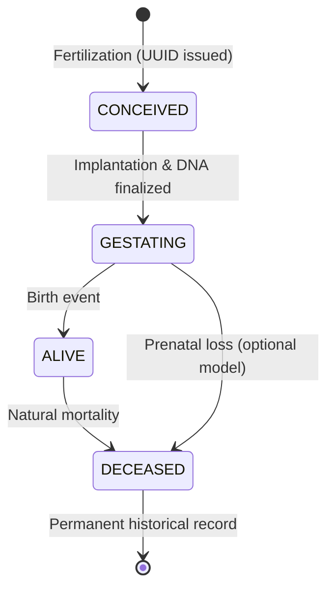

# PrincessPink — Technical Concept

## 1. Executive Summary & Vision

### 1.1 Core Idea
**PrincessPink** is a scientific, population-level simulation of human reproduction presented through a pen-and-paper role-playing game (RPG) interface inspired by classic tabletop systems (such as AD&D). Rather than focusing on combat or adventure, PrincessPink gamifies human biology, genetics, and generational lineage. Players interact with structured character sheets featuring comic-style face portraits that help them visualize the individuals they guide across generations.

### 1.2 Goals of the Simulation
- **Scientific Modeling:** Model the biological stages of human reproduction—hormonal cycles, gamete production, fertilization, genetic recombination, gestation, aging, and natural mortality—using parameterized, reproducible scientific logic.
- **Accessible Gamification:** Translate complex biological and genetic states into a familiar pen-and-paper character sheet experience so players and game masters can explore inheritance, family trees, and population dynamics intuitively.
- **Modular & Scalable Engineering:** Decompose the platform into focused Go microservices deployed on Kubernetes (Microsoft Azure AKS), enabling independent development, scaling, and scientific refinement of each biological process and character attribute.

### 1.3 Non-Negotiable Content & Safety Principles
PrincessPink strictly enforces a **zero-violence, zero-nudity** policy:
- **No Violence or Gore:** Unlike adventure or combat RPGs (e.g., AD&D combat modules, World of Warcraft, GTA6), PrincessPink contains no combat mechanics, weapons, injury graphics, or violent narratives. Death occurs strictly through natural biological lifecycles.
- **No Nudity or Explicit Content:** Biological reproduction is represented purely as abstract, scientific data, state transitions, and tabletop-style attributes/events—never through explicit text, imagery, or adult themes.
- **Safe-by-Design Visuals:** Visual character representation is strictly limited to **comic-style face portraits** generated deterministically from genetic and age-related traits. Free-form user image uploads are avoided (or restricted/moderated if ever introduced) so inappropriate content cannot enter the platform.

---

## 2. Domain Model & Core Concepts

### 2.1 Core Entities & Relationships

```mermaid
erDiagram
    USER ||--o{ GROUP_MEMBERSHIP : "belongs to"
    GROUP ||--o{ GROUP_MEMBERSHIP : "contains"
    GROUP_MEMBERSHIP }o--o| CHARACTER : "selects 1 active PC at start"
    GROUP ||--o{ CHARACTER : "origin / hosts as NPC"
    USER |o--o{ CHARACTER : "owns (0..N roster; null while unowned NPC)"
    CHARACTER ||--o| OWNERSHIP_AGREEMENT : "child custody agreement"
    USER ||--o{ CHAT_MESSAGE : "sends"
    USER }o--o| WORLD_CHAT_SERVER : "selects preferred"
    WORLD_CHAT_SERVER ||--o{ CHAT_CHANNEL : "hosts world chat"
    GROUP ||--o| CHAT_CHANNEL : "has group chat"
    CHAT_CHANNEL ||--o{ CHAT_MESSAGE : "contains"
    CHARACTER ||--o| GENOME : "has immutable diploid"
    CHARACTER ||--o{ CHARACTER_PARENT : "child of (mother & father)"
    CHARACTER ||--o{ MENSTRUATION_CYCLE : "female records"
    CHARACTER ||--o| EGG_RESERVE_DB : "female carries SQLite DB from birth"
    EGG_RESERVE_DB ||--|{ EGG_CELL : "stores haploid oocytes"
    CHARACTER ||--o{ EJACULATION_DB : "male generates SQLite DB"
    EJACULATION_DB ||--|{ SPERM_CELL : "contains haploid"
    CHARACTER ||--o{ LIFECYCLE_EVENT : "records"
    CHARACTER ||--o{ WEIGHT_ADJUSTMENT : "records GM role-play changes"

    USER {
        uuid id PK
        string email UK
        string display_name
        string role "PLAYER | GAME_MASTER"
        timestamp created_at
    }

    GROUP {
        uuid id PK
        string name
        uuid game_master_id FK
        jsonb simulation_config
        timestamp created_at
    }

    GROUP_MEMBERSHIP {
        uuid id PK
        uuid group_id FK "unique with user_id"
        uuid user_id FK "unique with group_id"
        uuid selected_character_id FK "1 owned character selected at group start; origin_group_id != group_id"
        timestamp joined_at
    }

    OWNERSHIP_AGREEMENT {
        uuid id PK
        uuid character_id FK "conceived/born child"
        uuid mother_player_id FK
        uuid father_player_id FK
        uuid proposed_owner_user_id FK "mother_player_id or father_player_id"
        string status "PENDING | AGREED | REJECTED"
        timestamp agreed_at "nullable"
    }

    WORLD_CHAT_SERVER {
        uuid id PK
        string slug UK
        string display_name
        string region
        string language
        string category "GENERAL | ROLEPLAY | SCIENCE | NEWCOMER"
        string status "ONLINE | HIGH_LOAD | FULL | MAINTENANCE | DRAINING"
        int max_capacity
        timestamp created_at
    }

    CHAT_CHANNEL {
        uuid id PK
        string channel_type "GLOBAL | GROUP | DIRECT"
        uuid world_server_id FK "nullable, set for GLOBAL (World Chat)"
        uuid group_id FK "nullable, set for GROUP"
        string name
        timestamp created_at
    }

    CHAT_MESSAGE {
        uuid id PK
        uuid channel_id FK
        uuid sender_user_id FK
        uuid recipient_user_id FK "nullable, set for DIRECT"
        text body
        timestamp sent_at
    }

    CHARACTER {
        uuid id PK
        uuid owner_user_id FK "nullable while unowned NPC"
        uuid origin_group_id FK "nullable; group where conceived/born (always NPC here)"
        string name "nullable before birth"
        string gender "FEMALE | MALE"
        string lifecycle_state "CONCEIVED | GESTATING | ALIVE | DECEASED"
        timestamp conceived_at_sim
        date date_of_birth "nullable before birth"
        date date_of_death "nullable while alive"
        date date_of_first_menstruation "female-only, nullable"
        float height_cm "nullable before birth; height in cm"
        float weight_kg "nullable before birth; weight in kg, GM-adjustable within params"
    }

    WEIGHT_ADJUSTMENT {
        uuid id PK
        uuid character_id FK
        uuid group_id FK
        uuid adjusted_by_gm_id FK
        float previous_weight_kg
        float new_weight_kg
        string reason "role-play rationale"
        timestamp adjusted_at_sim
    }

    MENSTRUATION_CYCLE {
        uuid id PK
        uuid character_id FK
        date start_date
        date end_date
        date ovulation_date
    }

    EGG_RESERVE_DB {
        uuid id PK
        uuid character_uuid UK
        int initial_egg_count
        int remaining_egg_count
        string sqlite_artifact_uri
        timestamp created_at_sim
    }

    EGG_CELL {
        bigint cell_id PK
        blob haploid_dna "22 autosomes + X"
        blob surface_profile "zona pellucida & oolemma receptors"
        float quality_score
        timestamp ovulated_at_sim "nullable"
        string status "DORMANT | SELECTED | VIABLE | FERTILIZED | EXPIRED | ATRESIA"
    }

    EJACULATION_DB {
        uuid id PK
        uuid father_id FK
        timestamp occurred_at_sim
        int sperm_count
        string sqlite_artifact_uri
    }

    SPERM_CELL {
        bigint cell_id PK
        string sex_chromosome "X | Y"
        blob haploid_dna "22 autosomes + X/Y"
        blob surface_profile "acrosome & membrane ligands"
        float motility
        float viability
        float morphology
    }
```



### 2.2 Roles, Character Ownership & Group Participation Rules
- **Player (User):** Authenticated user identified by a unique `UUID`. A Player may own **multiple Characters** in their personal roster, has read/interaction access to the character sheets of their owned characters, and can communicate via **Global / World Chat**, their assigned **Group Chat(s)**, and private **1-to-1 Direct Messages** with other Players.
- **Game Master (GM):** Authenticated user who manages one or more **Groups** (simulation worlds/campaigns). A Game Master has visibility into all active player characters and NPC children living within their group(s), controls group-level simulation settings (e.g., simulation clock speed, starting population parameters, and role-play weight adjustment bounds), may adjust a character's `weight_kg` within configured biological/role-play parameters for storytelling (with full audit logging), and participates in and moderates the **Group Chat** for his/her Group(s) alongside Global / World Chat and Direct Messages.
- **One Character per Player per Group:** Although a Player may own multiple Characters across their account, **within any single Group a Player plays only one Character**. At the **start of the Group**, each Player selects that single active Character from the Characters they already own (`GROUP_MEMBERSHIP.selected_character_id`).
- **Children as NPCs & Parental Ownership Agreement:** Every child **conceived or born during a simulation** enters the simulation as an **NPC (Non-Player Character)** with no Player owner (`owner_user_id = null`). The child remains an unowned NPC until the **Players of the mother and the father reach a mutual agreement** (`OWNERSHIP_AGREEMENT`) deciding which of them takes ownership of the child. Once both parents' Players agree, `owner_user_id` is assigned and the child is added to that Player's personal character roster.
- **Future-Group-Only Playability for Children:** Even after parental ownership is agreed and assigned to a Player, **a child can never be played as a Player Character in the Group where the mother and father live** (`origin_group_id`). Within that origin Group, the child continues to live strictly as an NPC; the owning Player may only select and play that child in a **future Group** at the start of that new Group.

### 2.3 Agent / Character Lifecycle
Every Agent in the simulation is a **Character** assigned a globally unique, immutable **UUID** at the moment of conception. That UUID remains the canonical identifier for the character across all phases of existence:



- **Before Birth (`CONCEIVED`, `GESTATING`):** The character already exists in the system with a UUID, immutable diploid DNA, determined biological `gender` (`FEMALE` or `MALE`), `origin_group_id`, and mother/father references. `date_of_birth` and `date_of_death` are `null`. Newly conceived children start as **NPCs** (`owner_user_id = null`) until the mother's and father's Players reach an ownership agreement. Players may optionally assign or reserve a name prior to or at birth.
- **During Life (`ALIVE`):** Upon birth, `date_of_birth` is recorded permanently. The character participates in the simulation, ages with simulation time, exposes full core and gender-specific character sheet attributes, and can reproduce according to biological rules. Children born in a Group live in that Group strictly as **NPCs** (even after parental ownership is agreed) and can only be selected as a playable character by their owning Player in a **future Group**.
- **After Death (`DECEASED`):** Upon natural mortality, `date_of_death` is recorded permanently. The character record and UUID remain permanently queryable for genealogy, family trees, and genetic heritage analysis.

### 2.4 Core & Gender-Specific Character Attributes
Every character carries both universal lifecycle attributes and biologically grounded **gender-specific attributes**:
- **Universal Core Attributes:**
  - `uuid`: Globally unique, permanent identifier from conception onward.
  - `name`: Player-assigned name (optional prior to birth).
  - `gender`: Biological sex (`FEMALE` or `MALE`), determined at conception by the sex chromosome pair (`XX` → `FEMALE`, `XY` → `MALE`).
  - `date_of_birth`: Simulated calendar date of birth (populated upon transition to `ALIVE`).
  - `date_of_death`: Simulated calendar date of natural death (nullable until transition to `DECEASED`).
  - `mother_uuid` / `father_uuid`: Immutable lineage references to both biological parents (null only for initial founder population).
- **Visible Appearance Attributes (Shown on All Character Sheets):**
  - `eye_color`: Current expressed iris pigmentation (e.g., blue, gray, hazel, green, amber, brown).
  - `hair_color`: Current expressed hair pigmentation (e.g., blonde, red, light/dark brown, black, silver/gray, white).
  - `skin_color`: Current expressed skin pigmentation tone.
  - **Dynamic Changes After Birth & During Life:** While each character's pigmentation baseline is anchored in their immutable diploid DNA, `eye_color`, `hair_color`, and `skin_color` are **not static**—they may change after birth and throughout life based on developmental stage, aging, hormonal shifts, and environmental/biological factors (for example, newborn eye color darkening during infancy, childhood hair darkening or graying/whitening with age, and gradual age- or environment-driven skin tone shifts).
- **Physical Measurements & Medical Body Composition Attributes (Shown on All Character Sheets):**
  Every living character carries anthropometric measurements together with derived clinical values equivalent to those calculated by a medical body-composition scale, recalculated dynamically as age, growth, gestation, or role-play weight changes occur:
  - **Core Measurements:**
    - `height_cm`: Current height in **centimeters (`cm`)**, anchored in polygenic DNA and evolving naturally across developmental stages (birth length, infancy/childhood growth, pubertal growth spurt, adult plateau, and subtle late-life decline).
    - `weight_kg`: Current body mass in **kilograms (`kg`)**, evolving naturally with age, growth, and pregnancy (`sim-gestation`).
    - **Game Master Role-Play Weight Adjustment:** For tabletop role-play storytelling (e.g., lifestyle, nutrition, or narrative arcs), a **Game Master** may adjust `weight_kg` for any character (PC or NPC) within their managed Group(s), strictly constrained by **bounded parameters** configured in `GROUP.simulation_config` and enforced by `character-registry`:
      - Age- and height-scaled **minimum and maximum physiological weight bounds** (e.g., safe BMI/pediatric percentile limits so impossible or harmful extremes cannot be entered, preserving the zero-violence/natural-lifecycle policy).
      - Configurable **maximum change per adjustment (`max_delta_kg` / `max_delta_pct`)** and optional cooldown period to keep weight transitions realistic for role-play.
      - Mandatory **role-play reason** and immutable audit recording (`WEIGHT_ADJUSTMENT`), emitting `character.weight.updated` so all derived medical body-composition metrics recalculate automatically.
  - **Derived Medical Body-Composition Values (Calculated from `height_cm`, `weight_kg`, `gender`, Age & Lifecycle State):**
    - `bmi`: **Body Mass Index (`kg/m²`)** (`weight_kg / (height_cm / 100)²`) with WHO adult classification band or age/sex-adjusted pediatric percentile band.
    - `body_fat_percentage` & `body_fat_index`: **Body Fat Percentage (`%`) & Body Fat Index** (sex- and age-adjusted anthropometric estimate modulated by genotype and hormonal state, plus Fat Mass Index `fat_mass_kg / (height_cm / 100)²`).
    - `lean_body_mass_kg`: **Lean Body Mass / Fat-Free Mass (`kg`)** (non-adipose body mass derived from height, weight, sex, and body fat percentage).
    - `muscle_mass_kg` & `muscle_mass_pct`: **Skeletal Muscle Mass (`kg` & `%`)** (estimated lean skeletal muscle share adjusted for sex and age stage).
    - `total_body_water_pct` & `total_body_water_l`: **Total Body Water (`%` & `L`)** (hydration volume and percentage estimated via sex-, age-, height-, and weight-adjusted clinical formulas such as Watson).
    - `bone_mass_kg`: **Estimated Bone Mass (`kg`)** (skeletal mineral mass reflecting pubertal bone accrual and age-related density shifts).
    - `visceral_fat_rating`: **Visceral Fat Rating (index)** (clinical scale indicator of abdominal/visceral adipose level).
    - `bmr_kcal`: **Basal Metabolic Rate (`kcal/day`)** (resting daily energy expenditure via Mifflin-St Jeor using `weight_kg`, `height_cm`, age, and `gender`).
    - `bsa_m2`: **Body Surface Area (`m²`)** (clinical body surface area via Mosteller/Du Bois formula from `height_cm` and `weight_kg`).
    - `ideal_weight_range_kg`: **Ideal / Healthy Weight Range (`kg`)** (reference weight band for the character's current `height_cm`, `gender`, and age stage).
- **Core Reproduction Attributes (AD&D-Style RPG Stats, Shown on All Character Sheets):**
  Inspired by classic AD&D ability scores (e.g., Strength, Constitution), every character sheet displays **6 tabletop-style numeric attributes** (such as a `3–18` scale with derived positive/negative modifiers) specifically tailored to human reproduction. Derived from genotype, age, health, and lifecycle state, **these attributes directly modify the probability and mechanics of every reproduction try**:
  1. **Fertility (`FER`):** Baseline gamete production capacity and reproductive reserve (follicular/ovarian quality in females; spermatogenesis output in males). Modifies gamete availability and base conception chance on each attempt.
  2. **Constitution (`CON`):** Overall physiological resilience and bodily health. Modifies gamete viability, implantation stability, and gestation resilience during and after a reproduction try.
  3. **Vitality (`VIT`):** Cellular energy and metabolic vigor. Modifies sperm motility/endurance during the race to the egg and oocyte vigor during the fertile window.
  4. **Hormonal Balance (`HOR`):** Endocrine regularity and cycle synchronization. Modifies ovulation regularity, fertile-window clarity, cervical mucus permeability, and reproductive readiness on each try.
  5. **Receptivity (`REC`):** Biological readiness and synchronization of the reproductive environment (e.g., optimal fertile-window alignment, capacitation support, and implantation receptivity). Applies timing and environment modifiers to each reproduction attempt.
  6. **Compatibility (`COM`):** Molecular and surface-receptor affinity between gametes (zona pellucida / oolemma receptor and sperm ligand alignment). Modifies the gamete surface-fit check and fertilization fusion chance on each reproduction try.
- **Female-Specific Attributes (`gender == FEMALE`):**
  - `date_of_first_menstruation`: Simulated calendar date of menarche (onset of the first menstrual cycle during puberty), calculated for a young female character by `sim-menarche`.
  - `egg_reserve_db`: Reference to the dedicated ovarian **Egg-Cell SQLite database** linked to the female character's `UUID`, generated at birth by `sim-egg-reserve` and queried each cycle by `sim-egg-selection` to choose the next ovulated egg cell.
  - `menstruation_dates`: Historical and current record of menstruation dates (cycle start/end dates, cycle length, and ovulation dates).
  - `ovarian_cycle_state`: Current phase (pre-menarche, menstrual, follicular, ovulation, luteal, pregnant, post-menopausal) and reference to any currently viable **egg cell (oocyte)** selected from her Egg-Cell SQLite database and its haploid DNA.
- **Male-Specific Attributes (`gender == MALE`):**
  - `spermatogenesis_state`: Pubertal onset, sperm production baseline, motility/morphology distributions, and reproductive readiness.
  - `ejaculation_history`: References to recent ejaculation events and their generated sperm-cell SQLite databases.

### 2.5 Genetics, Gamete DNA & Phenotype Model
- **Diploid Character Genotype (Immutable):** Stored as a structured representation of 23 chromosome pairs (22 autosomal pairs + 1 sex chromosome pair, `XX` or `XY`), carrying allele definitions for modeled Mendelian and polygenic traits (e.g., facial geometry, eye/hair/skin pigmentation, blood type, baseline biological predispositions).
- **Egg Cell (Oocyte) Haploid DNA, Surface Profile & Ovarian Egg-Reserve SQLite Database:** Mirroring human biology, a female character carries her lifetime supply of egg cells from birth. When a girl is born (`gender == FEMALE`), `sim-egg-reserve` generates all egg cells she carries with her and stores them in a **dedicated SQLite database explicitly linked to the girl's `character_uuid`**. Each stored egg cell carries its own **haploid DNA** (22 single autosomes + 1 `X` chromosome, calculated via simulated meiosis with homologous crossover/recombination, independent assortment, and rare point mutations from her diploid DNA), an egg **surface profile** (zona pellucida and oolemma binding receptors), and baseline viability/quality traits. During each menstrual cycle after menarche, `sim-egg-selection` queries the girl's linked Egg-Cell SQLite database to determine **which specific egg cell drops (ovulates) during her next cycle**.
- **Sperm Cell Haploid DNA, Surface Profile & Ejaculation SQLite Database:** Each ejaculation event by a male character builds a **dedicated SQLite database** containing all simulated sperm cells included in that ejaculation. Every sperm cell record is individually calculated from the father's diploid DNA via simulated meiosis—yielding its own unique **haploid DNA** (22 single autosomes + either an `X` or `Y` sex chromosome) alongside cell-level physical traits (motility, morphology, viability) and a **surface profile** (acrosome/membrane binding ligands).
- **Offspring DNA Calculation from Mother and Father:** Fertilization requires not only that a sperm cell reaches the egg, but also that its surface profile **fits the egg cell's surface**—just as in biology, the fastest sperm cell does not always win. When a surface-compatible winning sperm cell fertilizes a specific egg cell, the new character's immutable diploid DNA (23 chromosome pairs) is calculated directly by pairing the **egg cell's haploid DNA** (from the mother) with the **winning sperm cell's haploid DNA** (from the father's ejaculation SQLite database). This guarantees true gamete-level Mendelian and polygenic inheritance and naturally determines the offspring's `gender` (`XX` or `XY`).
- **Phenotype (Derived):** Computed dynamically by Character Sheet Attribute Microservices from the character's immutable genotype combined with current simulation state (age derived from `date_of_birth` / `date_of_death`, gender, `height_cm`, `weight_kg`, hormonal phase, health state). This includes `eye_color`, `hair_color`, and `skin_color`, which can evolve after birth and across life stages, derived medical body-composition metrics (`BMI`, Body Fat Index, Lean Body Mass, Muscle Mass, Total Body Water, Bone Mass, Visceral Fat, BMR, BSA, Ideal Weight Range), as well as the character's 6 AD&D-style reproduction attributes.
- **Comic Face Portrait:** Derived deterministically from facial phenotype traits (including current `eye_color`, `hair_color`, and `skin_color`), gender, and current age stage, producing a stylized comic-art portrait (head/shoulders only) displayed on the character sheet.

---

## 3. System Architecture Overview

### 3.1 Architectural Style
PrincessPink follows a **distributed microservices architecture** written in **Go** and deployed on **Kubernetes** via **Microsoft Azure Kubernetes Service (AKS)**. Services are organized into five primary functional domains:
1. **Frontend Microservices (Go + Gin)** — UI rendering, BFF aggregation, auth/session handling, real-time chat UI/WebSocket edge, and user experience.
2. **User Administration Service** — Identity, authentication, RBAC/group authorization, backed by central **PostgreSQL**.
3. **Character Sheet & Attribute Microservices** — Composable character sheet aggregation with one dedicated microservice per calculated attribute/value.
4. **Scientific Simulation Microservices** — Discrete biological process services coordinated via synchronous RPCs and asynchronous domain events, using **local SQLite** databases where appropriate.
5. **Real-Time Chat & Communication Microservices** — Global Chat (World of Warcraft-style), Group Chat (Game Master and Group members), and 1-to-1 Direct Messaging between Players.

### 3.2 High-Level Architecture Diagram

```mermaid
flowchart TB
    Client[Web Browser / Player & GM] --> Ingress[Azure Front Door / AKS Ingress + TLS]

    subgraph AKS["Azure Kubernetes Service (AKS)"]
        subgraph FrontendNS["Namespace: frontend (Go + Gin)"]
            AuthGW[Auth / Session Gateway]
            SheetUI[Character Sheet Web Service]
            GMUI[Game Master Dashboard Service]
            PortraitUI[Comic Portrait Service]
            ChatUI[Chat UI / WebSocket Gateway]
        end

        subgraph AuthNS["Namespace: user-admin"]
            UserAdmin[User & Group Admin Service]
        end

        subgraph ChatNS["Namespace: chat"]
            ChatSvc[Chat Service\nWorld / Group / 1-to-1 DM]
            ChatWorldReg[World Chat Server Registry]
        end

        subgraph SheetNS["Namespace: character-sheet"]
            SheetAgg[Character Sheet Aggregator]
            CharReg[Character Registry Service]
            AttrAge[Attr: Biological Age]
            AttrFert[Attr: Fertility Index]
            AttrGen[Attr: Genetic Traits]
            AttrHorm[Attr: Hormonal State]
            AttrLineage[Attr: Lineage & Pedigree]
            AttrN[Attr: ... N Attribute Services]
        end

        subgraph SimNS["Namespace: simulation"]
            SimClock[Simulation Clock Service]
            EggReserve[Egg-Cell Reserve Service]
            EggSelect[Egg-Cell Selection Service]
            Menarche[First Menstruation Service]
            Menstruation[Menstruation Cycle Service]
            Ejaculation[Ejaculation Service]
            SpermRace[Race-to-the-Egg Service]
            GameteSurface[Gamete Surface Compatibility Service]
            Conception[Conception Service]
            DNACalc[DNA Calculation Service]
            BirthDate[Birth Date Calculation Service]
            Gestation[Gestation Service]
            Mortality[Date of Death Service]
            Lifecycle[Lifecycle Service]
        end

        EventBus[(Event Bus / Message Broker\nNATS JetStream or Azure Service Bus)]
    end

    PG[(Central PostgreSQL\nAzure Database for PostgreSQL)]

    Ingress --> AuthGW
    AuthGW --> SheetUI
    AuthGW --> GMUI
    AuthGW --> PortraitUI
    AuthGW --> ChatUI

    AuthGW --> UserAdmin
    ChatUI --> ChatSvc
    ChatUI --> ChatWorldReg
    ChatSvc --> ChatWorldReg
    ChatSvc --> UserAdmin
    ChatSvc --> PG
    ChatWorldReg --> PG
    EventBus <--> ChatSvc
    EventBus <--> ChatWorldReg
    UserAdmin --> PG
    CharReg --> PG

    SheetUI --> SheetAgg
    SheetAgg --> CharReg
    SheetAgg --> AttrAge
    SheetAgg --> AttrFert
    SheetAgg --> AttrGen
    SheetAgg --> AttrHorm
    SheetAgg --> AttrLineage
    SheetAgg --> AttrN

    SimClock --> EventBus
    EventBus <--> EggReserve
    EventBus <--> EggSelect
    EventBus <--> Menarche
    EventBus <--> Menstruation
    EventBus <--> Ejaculation
    EventBus <--> SpermRace
    EventBus <--> GameteSurface
    EventBus <--> Conception
    EventBus <--> DNACalc
    EventBus <--> BirthDate
    EventBus <--> Gestation
    EventBus <--> Mortality
    EventBus <--> Lifecycle
    EventBus <--> CharReg
```



### 3.3 Repository & Go Workspace Layout
The repository is structured as a Go multi-module workspace (`go.work`) to keep shared contracts and service implementations cleanly separated:

```text
princesspink/
├── go.work                  # Go workspace coordinating shared libs and services
├── Makefile                 # Common build, test, lint, and container targets
├── pkg/                     # Shared Go libraries (proto/gRPC contracts, auth middleware,
│                            #   UUID helpers, telemetry, common errors, config)
├── services/                # Independently deployable Go microservices
│   ├── frontend-gateway/
│   ├── frontend-sheets/
│   ├── frontend-gm/
│   ├── frontend-chat/       # In-app chat UI, World Server selector & WebSocket edge gateway
│   ├── chat-service/        # World, Group (GM + Players), and 1-to-1 DM chat service
│   ├── chat-world-registry/ # World Chat Server directory, live occupancy & server selection
│   ├── user-admin/
│   ├── character-registry/
│   ├── sheet-aggregator/
│   ├── attr-*/              # Dedicated attribute calculation microservices
│   ├── portrait-renderer/
│   ├── sim-clock/
│   ├── sim-egg-reserve/     # Generates & stores newborn girl's egg cells in UUID-linked SQLite DB
│   ├── sim-egg-selection/   # Determines which egg cell drops during the girl's next cycle
│   ├── sim-menarche/        # Calculates date of first menstruation for a young girl
│   ├── sim-menstruation/
│   ├── sim-ejaculation/
│   ├── sim-sperm-race/
│   ├── sim-gamete-surface/
│   ├── sim-conception/
│   ├── sim-dna/
│   ├── sim-birth-date/      # Calculates date of birth from mother's last menstruation or conception date
│   ├── sim-gestation/
│   ├── sim-mortality/       # Calculates natural date of death for each character
│   └── sim-lifecycle/
├── docs/
│   ├── Concept.md           # This technical concept
│   ├── api/                 # OpenAPI & Protobuf API specifications
│   ├── architecture/        # ADRs, sequence diagrams, infrastructure specs
│   └── runbooks/            # Operational & incident response runbooks
└── .github/workflows/       # CI/CD pipelines (lint, test, build, deploy)
```

### 3.4 Inter-Service Communication Patterns
- **External / Frontend HTTP & WebSockets:** REST/HTML over HTTPS using the **Gin** framework, plus authenticated **WebSockets** over TLS (`wss://`) in `frontend-chat` for real-time bi-directional Global, Group, and 1-to-1 Direct Message chat delivery.
- **Internal Synchronous RPC:** **gRPC with Protocol Buffers** (`pkg/proto`, see [ADR-0005](architecture/ADR-0005-shared-grpc-protobuf-contracts.md)) for low-latency, strongly typed internal calls (especially the high fan-out from `sheet-aggregator` to individual `attr-*` services, authorization/group-membership checks against `user-admin`, and direct calculation queries to `sim-birth-date`, `sim-egg-selection`, `sim-menarche`, and `sim-mortality`).
- **Internal Asynchronous Events:** An event broker (**NATS JetStream** inside AKS or **Azure Service Bus**) for decoupled, reliable propagation of simulation ticks, chat pub/sub fan-out across pods, and biological/character lifecycle events (e.g., `sim.tick.advanced`, `sim.egg_reserve.created`, `sim.menarche.calculated`, `sim.egg.selected`, `sim.ovulation.triggered`, `sim.conception.occurred`, `sim.dna.calculated`, `sim.birthdate.calculated`, `sim.character.born`, `character.weight.updated`, `sim.deathdate.calculated`, `sim.character.deceased`).
- **Correlation & Idempotency:** Every request and event carries a `correlation_id`, `group_id`, and `character_uuid` (standardized on RFC 9562 UUIDv7 via `pkg/uuid`, see [ADR-0007](architecture/ADR-0007-shared-uuid-utilities.md)). Event consumers must be idempotent to safely handle at-least-once delivery.

### 3.5 Independent Microservice Versioning
Every microservice in PrincessPink has **its own independent version number** (following **Semantic Versioning**, `MAJOR.MINOR.PATCH`, e.g., `1.3.0`) rather than sharing a single monolithic platform release version:
- **Per-Service Ownership & Release Cadence:** Each service directory under `services/<service-name>/` maintains its own version metadata (e.g., a `VERSION` file and scoped Git release tags such as `sim-gamete-surface/v1.2.0` or `attr-eye-color/v0.4.1`). This lets scientific models, attribute calculators, and frontend services evolve, test, and deploy independently.
- **Runtime Introspection & Contracts:** Each service embeds its version at build time (`-ldflags`) and exposes it via `/healthz` / `/version` endpoints, gRPC response payloads/metadata (e.g., `service_version`), OpenTelemetry `service.version` resource attributes, and structured log entries.
- **Scientific Reproducibility & Deployment Traceability:** Container images pushed to Azure Container Registry (ACR) and deployed to AKS are tagged with each microservice's own version number. Simulation events and character sheet calculations record the producing microservice version so historical outcomes remain fully auditable even as individual biological models are refined.

---

## 4. Subsystem Specifications

### 4.1 Frontend Microservices (Go + Gin)
The frontend is composed of multiple Go microservices built with the **Gin** HTTP framework, following a Backend-for-Frontend (BFF) / micro-frontend architecture:

| Service | Responsibilities |
| :--- | :--- |
| `frontend-gateway` | Edge routing, authentication/session management (interacting with `user-admin`), CSRF protection, rate limiting, and authorization context injection. |
| `frontend-sheets` | Renders the pen-and-paper character sheet UI, displays the Player's multi-character roster, handles single-character selection at Group start, character naming, parental child-ownership agreements, and allowed player actions. |
| `frontend-gm` | Game Master portal for managing groups, inviting/assigning players, verifying group-start character selections, inspecting all group player characters and NPC children, applying bounded role-play `weight_kg` adjustments, and configuring simulation clock and group parameters. |
| `frontend-chat` | Renders the in-app chat interface (Global / World Chat with World Chat Server selector, Group Chat, and 1-to-1 Direct Messages) and manages authenticated WebSocket connections to `chat-service` and `chat-world-registry`. |
| `portrait-renderer` | Generates and serves comic-style face portraits (SVG or rasterized PNG/WebP) from a character's phenotypic facial traits and age stage. |

**UI/UX Design Principles:**
- **Pen-and-Paper Character Sheet Aesthetic:** Structured layout inspired by classic tabletop RPG sheets—Header (Player-assigned Name, Character UUID, Lifecycle Status, Comic Face Portrait), Visible Appearance (`eye_color`, `hair_color`, `skin_color` reflecting current life-stage pigmentation), Physical & Medical Body Composition (`height_cm`, `weight_kg`, `BMI`, Body Fat Index/Percentage, Lean Body Mass, Skeletal Muscle Mass, Total Body Water, Bone Mass, Visceral Fat Rating, BMR, BSA, Ideal Weight Range), Core AD&D-Style Reproduction Attributes (`FER`, `CON`, `VIT`, `HOR`, `REC`, `COM` with scores and modifiers), Core Biological Stats, Genetic & Hereditary Summary, Reproductive Cycle/Status Indicators, and Lineage/Event History.
- **Rendering Strategy:** Server-rendered HTML templates (Go `html/template` or `templ`) enhanced with lightweight progressive interactivity (e.g., HTMX) or a clean JSON API served by Gin—keeping the entire frontend stack Go-native and fast.

---

### 4.2 User Administration & Security Service
The `user-admin` microservice is the authoritative source of identity, group membership, and access control, backed by a **central PostgreSQL database**.

#### Core Responsibilities
- User registration, login, logout, password reset, and profile management.
- Issuing and validating authentication credentials (UUID-keyed user identities).
- Managing Groups (campaigns), Game Master / Player memberships, and enforcing the **one-character-per-player-per-group** selection rule at Group start.
- Answering authorization queries (e.g., *"Can User `U` view/act on Character `C`?"*, *"Can User `U` select Character `C` for Group `G`?"*).

#### State-of-the-Art Security Measures
- **Password Hashing:** `Argon2id` with per-user cryptographically random salts and tuned memory/iteration parameters.
- **Authentication & Sessions:** OAuth 2.0 / OpenID Connect (OIDC) compatible token flow or secure, `HttpOnly`, `Secure`, `SameSite=Strict` session cookies paired with short-lived signed JWTs (Ed25519 / RS256) and rotating refresh tokens with reuse detection.
- **Multi-Factor Authentication (MFA):** Support for TOTP (RFC 6238) and optional WebAuthn/Passkeys, strongly recommended for Game Masters.
- **Authorization Model (RBAC + Ownership/Group Scoping):**
  - `PLAYER`: Read/roster access to all characters where `character.owner_user_id == current_user.id`; within any Group `G`, active play access is restricted to the single Character selected by the Player at the start of Group `G` (`GROUP_MEMBERSHIP.selected_character_id`), which must be already owned by the Player and **must not** have been conceived/born in Group `G` (`character.origin_group_id != G`). Players of a child's biological mother and father may also initiate and confirm the child's `OWNERSHIP_AGREEMENT` while the child is an unowned NPC (`owner_user_id == null`).
  - `GAME_MASTER`: Read/supervisory access to all active player characters and NPC children living in `managed_groups(current_user.id)`, plus permission to adjust character `weight_kg` within the Group's configured biological/role-play parameters (`GROUP.simulation_config`).
  - Enforcement occurs at both `frontend-gateway` (coarse-grained) and backend services such as `sheet-aggregator` / `character-registry` (fine-grained defense in depth).
- **Transport & Service Security:** TLS 1.3 externally; mTLS internally between Kubernetes pods.
- **Audit Logging:** Immutable audit trail in PostgreSQL recording authentication events, role/group changes, GM access to player character sheets, and GM role-play `weight_kg` adjustments (capturing old/new values and rationale).

---

### 4.3 Character Sheet & Attribute Microservices
To maximize modularity, independent scaling, and scientific maintainability, **each attribute or derived value displayed on a character sheet is computed by a dedicated Go microservice**.

#### Components
1. **Character Registry (`character-registry`):** Owns the canonical character record (`UUID`, nullable `owner_user_id`, `origin_group_id`, player-assigned `name`, `gender`, `lifecycle_state`, `date_of_birth`, `date_of_death`, `height_cm`, `weight_kg`, `mother_uuid`, `father_uuid`, and immutable diploid genome reference), parental child-ownership agreements (`OWNERSHIP_AGREEMENT`), and GM role-play weight adjustment history (`WEIGHT_ADJUSTMENT`) in PostgreSQL. Enforces that conceived/born children start as unowned NPCs, transitions ownership only upon mutual agreement between the mother's and father's Players, prevents a child from being selected as a playable character in its `origin_group_id`, and validates any GM `weight_kg` adjustment against the Group's configured biological/role-play parameter bounds before persisting and publishing `character.weight.updated`.
2. **Character Sheet Aggregator (`sheet-aggregator`):**
   - Receives a sheet request for `character_uuid` (after verifying Player/GM authorization).
   - Fetches canonical metadata (including `gender`, `date_of_birth`, `date_of_death`, `lifecycle_state`, `height_cm`, `weight_kg`) from `character-registry` and executes a **concurrent parallel fan-out** (via Go `errgroup` + gRPC with strict per-call deadlines) to all applicable universal and **gender-specific** Attribute Microservices.
   - Aggregates results into a unified `CharacterSheet` response.
   - Supports **graceful degradation**: if a non-critical attribute service is temporarily unavailable, the sheet still renders with a clearly marked `"unavailable"` field rather than failing the entire page.
   - Caches short-lived attribute results keyed by `(character_uuid, sim_tick)` (invalidated immediately upon `character.weight.updated` events) to avoid redundant recomputation when simulation time has not advanced.
3. **Standardized Attribute Microservice Contract:**
   Every `attr-*` microservice implements a shared gRPC interface defined in `pkg/proto/attribute/v1`:
   ```protobuf
   service AttributeCalculator {
     rpc Calculate(CalculateRequest) returns (CalculateResponse);
   }
   ```
   - `CalculateRequest`: `character_uuid`, `sim_tick`, optional context snapshot (`gender`, `date_of_birth`, `date_of_death`, `height_cm`, `weight_kg`, genome digest, lifecycle state).
   - `CalculateResponse`: `attribute_key`, `display_name`, `value`, `unit`, `confidence_or_range`, `computed_at_tick`, `schema_version`, `service_version`.
   - Examples of Attribute Microservices:
     - `attr-biological-age` (chronological & developmental stage derived from `date_of_birth` and `date_of_death` / current `sim_tick`)
     - `attr-height` (current `height_cm` derived from polygenic genotype, age, and developmental growth trajectory)
     - `attr-weight` (current `weight_kg` reflecting developmental/gestational trajectory and any bounded GM role-play weight adjustments)
     - `attr-bmi` (**Body Mass Index (`kg/m²`)** and WHO/age-adjusted classification band derived from `height_cm`, `weight_kg`, `gender`, and age)
     - `attr-body-fat-index` (**Body Fat Percentage (`%`) & Body Fat Index** estimated from `height_cm`, `weight_kg`, `gender`, age, and genotype/hormonal modifiers)
     - `attr-lean-body-mass` (**Lean Body Mass / Fat-Free Mass (`kg`)** derived from `height_cm`, `weight_kg`, `gender`, and body fat composition)
     - `attr-muscle-mass` (**Skeletal Muscle Mass (`kg` & `%`)** estimated for the character's sex, age, and body composition)
     - `attr-body-water` (**Total Body Water (`%` & `L`)** estimated hydration share and volume)
     - `attr-bone-mass` (**Estimated Bone Mass (`kg`)** reflecting skeletal mineral mass across growth and aging)
     - `attr-visceral-fat` (**Visceral Fat Rating (index)** estimating abdominal adipose level)
     - `attr-bmr` (**Basal Metabolic Rate (`kcal/day`)** resting daily energy expenditure via Mifflin-St Jeor)
     - `attr-body-surface-area` (**Body Surface Area (`m²`)** clinical BSA via Mosteller/Du Bois)
     - `attr-ideal-weight` (**Ideal / Healthy Weight Range (`kg`)** reference band for current height, sex, and age)
     - `attr-eye-color` (current expressed eye color derived from genotype and age/developmental stage, accounting for post-birth and lifetime color changes)
     - `attr-hair-color` (current expressed hair color derived from genotype, age, and lifecycle state, accounting for post-birth darkening and age-related graying/whitening)
     - `attr-skin-color` (current expressed skin color derived from genotype, age, hormonal state, and environmental/seasonal modifiers)
     - `attr-repro-fertility` (AD&D-style **Fertility (`FER`)** score & modifier applied to reproduction tries)
     - `attr-repro-constitution` (AD&D-style **Constitution (`CON`)** score & modifier applied to reproduction tries and gestation stability)
     - `attr-repro-vitality` (AD&D-style **Vitality (`VIT`)** score & modifier influencing gamete vigor and endurance)
     - `attr-repro-hormonal-balance` (AD&D-style **Hormonal Balance (`HOR`)** score & modifier influencing cycle regularity and readiness)
     - `attr-repro-receptivity` (AD&D-style **Receptivity (`REC`)** score & modifier influencing fertile-window and implantation mechanics)
     - `attr-repro-compatibility` (AD&D-style **Compatibility (`COM`)** score & modifier influencing gamete surface-fit and fusion rolls)
     - `attr-menstruation-history` *(female-specific)* (`date_of_first_menstruation` / menarche, historical `menstruation_dates`, current cycle phase & next predicted cycle)
     - `attr-spermatogenesis-profile` *(male-specific)* (pubertal onset, baseline sperm count/motility/viability parameters)
     - `attr-fertility-index` (gender-, age-, and cycle-adjusted reproductive readiness)
     - `attr-hormonal-profile` (gender-specific abstracted endocrine indicators)
     - `attr-genetic-traits` (expressed Mendelian/polygenic phenotypic traits)
     - `attr-health-vitality` (overall biological vitality score)
     - `attr-lineage-depth` (generation number, mother/father, ancestors, descendants)
     - `attr-portrait-traits` (structured facial feature vector—including current eye, hair, and skin colors—consumed by `portrait-renderer`)

---

### 4.4 Scientific Simulation Engine Microservices
The simulation engine decomposes human reproduction and life cycles into independent Go microservices. Each service encapsulates a specific biological subsystem and its scientific parameters.

#### Simulation Microservices Catalog

| Microservice | Biological Scope & Responsibilities | Storage |
| :--- | :--- | :--- |
| `sim-clock` | Manages per-group simulation time (discrete ticks / calendar dates), publishes `sim.tick.advanced` events, and allows GMs to pause/step/adjust speed. | PostgreSQL / State store |
| `sim-egg-reserve` | Triggered at the birth of every female character (`gender == FEMALE`). Generates all **egg cells (oocytes)** the girl carries with her at birth—each with its unique haploid DNA (22 autosomes + `X` via simulated meiosis from her diploid DNA), surface receptor profile, and baseline quality/viability traits—and stores them in a **dedicated SQLite database explicitly linked to the girl's `character_uuid`**. | Local SQLite (meiosis & receptor reference tables) + **Per-Female-Character Egg-Reserve SQLite DB** (linked to `character_uuid`) |
| `sim-egg-selection` | Opens the **Egg-Cell SQLite database linked to a post-menarche female character's `character_uuid`** and determines **which specific egg cell drops (ovulates) during her next cycle** (modeling follicular recruitment, atresia, and dominant follicle selection modulated by age, `FER`, `HOR`, and `REC`). Marks the chosen egg cell as selected/ovulated and supplies its haploid DNA and surface profile to `sim-menstruation`, `sim-gamete-surface`, and `sim-conception`. | Local SQLite (follicular selection & atresia curves) + reads/updates **Per-Female-Character Egg-Reserve SQLite DB** |
| `sim-menarche` | Calculates for a young female character (**Girl**) when her **first menstruation (menarche)** will occur (`date_of_first_menstruation`), based on her `date_of_birth`, genotype, developmental trajectory, and hormonal/health attributes (`HOR`, `CON`, `VIT`). Publishes `sim.menarche.calculated` to `character-registry` and `sim-menstruation`. | Local SQLite (pubertal onset & menarche statistical distributions) |
| `sim-menstruation` | Tracks female-specific reproductive milestones (`date_of_first_menstruation` from `sim-menarche`, `menstruation_dates`), simulates ovarian/menstrual cycles (menstrual, follicular, ovulation, luteal phases) modulated by the mother's reproduction attributes (`FER`, `HOR`, `REC`), and coordinates with `sim-egg-selection` each cycle to retrieve the selected ovulated **egg cell (oocyte)**, its **haploid DNA**, and its **surface receptor profile**. | Local SQLite (cycle state & hormone lookup tables) + consumes `sim-egg-selection` |
| `sim-ejaculation` | Models male spermatogenesis and ejaculation events modulated by the father's reproduction attributes (`FER`, `CON`, `VIT`, `HOR`). For each ejaculation, reads the male character's diploid DNA, performs meiosis for the simulated sperm cohort, and **builds a dedicated per-ejaculation SQLite database** containing all simulated **sperm cells** (each with its unique haploid DNA, sex chromosome `X`/`Y`, **surface ligand profile**, motility, morphology, and viability). | Local SQLite (reference distributions) + **Per-Ejaculation SQLite DB artifact** |
| `sim-sperm-race` | Opens/reads the per-ejaculation SQLite database of sperm cells, simulates sperm transport ("race to the egg"): cervical mucus permeability (coupled to cycle phase and parental `HOR`/`REC`/`VIT` modifiers), capacitation, attrition curves, and chemotaxis, and produces an **arrival-ordered shortlist of viable candidate sperm cells** reaching the egg (since the fastest cell does not automatically win if its surface does not fit). | Local SQLite (reference physics/biology curves) + reads Ejaculation SQLite DB |
| `sim-gamete-surface` | Evaluates molecular **surface compatibility between each arriving sperm cell and the viable egg cell** (modeling zona pellucida glycoprotein and oolemma receptor–ligand binding, modulated by parental `COM` and `REC` attributes). Iterates through arriving candidates from `sim-sperm-race`: if the fastest sperm cell's surface does not fit the egg cell, it is rejected and subsequent arriving candidates are tested until a surface-compatible sperm cell binds—or no candidate fits, resulting in non-fertilization. | Local SQLite (receptor–ligand compatibility matrices) + reads Ejaculation SQLite DB & selected Egg surface profile |
| `sim-conception` | Pairs the surface-compatible winning sperm cell (confirmed by `sim-gamete-surface`) with the viable egg cell (selected by `sim-egg-selection` / tracked by `sim-menstruation`), evaluates oocyte availability window, membrane fusion, polyspermy block, and parental `CON`/`REC` implantation modifiers. Allocates a new **Character UUID** upon successful fertilization and emits `sim.conception.occurred` with mother UUID, father UUID, egg-cell DNA, and winning sperm-cell DNA. | Local SQLite / Event-driven |
| `sim-dna` | Provides meiosis/gamete-DNA synthesis utilities (for egg cells and sperm cells) and performs fertilization DNA combination: merges the **egg cell's haploid DNA** (mother) and the **winning sperm cell's haploid DNA** (father) into the new character's immutable 23-pair diploid **DNA** and determines biological `gender` (`XX` → `FEMALE`, `XY` → `MALE`). | Local SQLite (gene loci & allele reference DB) + immutable genome store |
| `sim-birth-date` | Calculates a character's **date of birth (`date_of_birth`)** from **either the mother's last menstruation date (LMP — Naegele's rule / gestational age model) or the exact date of conception** (gestation duration modulated by maternal `CON` and biological variance). Exposes synchronous gRPC calculation and emits `sim.birthdate.calculated` for `sim-gestation` and `character-registry`. | Local SQLite (gestational duration & LMP-to-delivery reference curves) |
| `sim-gestation` | Tracks prenatal milestones from implantation through trimesters to birth, queries `sim-birth-date` to determine the scheduled `date_of_birth`, updates prenatal attributes, and emits `sim.character.born` upon delivery (triggering `sim-egg-reserve` and `sim-menarche` for newborn girls, and `sim-mortality` for all characters). | Local SQLite / Event-driven |
| `sim-mortality` | Calculates the natural **date of death (`date_of_death`)** for each Character based on `date_of_birth`, gender, genetic predispositions, actuarial life tables, and biological health/vitality modifiers (`CON`, `VIT`)—strictly natural mortality in compliance with the zero-violence policy. Emits `sim.deathdate.calculated` for `sim-lifecycle`. | Local SQLite (actuarial & biological mortality life tables) |
| `sim-lifecycle` | Advances character age (from `date_of_birth`), updates natural developmental `height_cm` and baseline `weight_kg` trajectories (while respecting bounded GM role-play weight adjustments), coordinates developmental milestones (such as puberty and menarche scheduled by `sim-menarche`), tracks health trajectories, and transitions characters to `DECEASED` upon reaching the `date_of_death` calculated by `sim-mortality`, emitting `sim.character.deceased`. | Local SQLite (developmental, growth & aging reference tables) |

#### End-to-End Reproduction, Birth & Lifecycle Initialization Flow

```mermaid
sequenceDiagram
    participant Clock as sim-clock
    participant EggSel as sim-egg-selection
    participant EggDB as Egg-Reserve SQLite DB
    participant Mens as sim-menstruation
    participant Ejac as sim-ejaculation
    participant EjacDB as Ejaculation SQLite DB
    participant Race as sim-sperm-race
    participant Surf as sim-gamete-surface
    participant Conc as sim-conception
    participant DNA as sim-dna
    participant BDate as sim-birth-date
    participant Reg as character-registry
    participant Gest as sim-gestation
    participant EggRes as sim-egg-reserve
    participant Menar as sim-menarche
    participant Mort as sim-mortality

    Clock->>Mens: sim.tick.advanced (calendar date)
    Mens->>EggSel: Select egg cell for mother's next cycle (mother_uuid)
    EggSel->>EggDB: Query UUID-linked Egg-Reserve SQLite DB & mark selected egg cell
    EggSel-->>Mens: Selected egg cell (cell_id, haploid DNA, surface profile)
    Mens-->>Race: Fertile window, mucus state & maternal repro attribute modifiers
    Note over Ejac,Surf: Reproductive try initiated (modulated by 6 AD&D-style reproduction attributes)
    Ejac->>Reg: Fetch father diploid DNA & repro attributes (father_uuid)
    Ejac->>EjacDB: Build per-ejaculation SQLite DB of sperm cells (haploid DNA + surface profile + motility/viability)
    Ejac->>Race: Ejaculation event + SQLite DB reference
    Race->>EjacDB: Query & simulate sperm cell cohort race
    Race->>Surf: Arrival-ordered candidate sperm cells (fastest first)
    Surf->>Mens: Fetch selected viable egg cell surface profile
    Surf->>EjacDB: Read candidate sperm surface profiles
    Surf-->>Surf: Check surface fit in arrival order (fastest may fail fit then next fitting candidate wins)
    Surf->>Conc: Surface-compatible winning sperm cell (cell_id + haploid DNA) or no-fit outcome
    Conc->>Mens: Verify viable egg cell & retrieve egg haploid DNA
    alt Fertilization Succeeds
        Conc->>DNA: Combine egg haploid DNA (mother) + sperm haploid DNA (father)
        DNA-->>DNA: Compute diploid 23-pair DNA & gender (XX/XY)
        Conc->>Reg: Allocate Character UUID (state = CONCEIVED, gender, mother_uuid, father_uuid, owner = NULL [NPC], origin_group_id)
        DNA-->>Reg: Persist immutable diploid DNA & update state = GESTATING
        DNA->>Gest: sim.dna.calculated (start gestation tracking)
        Gest->>BDate: Calculate date_of_birth (from mother's last menstruation OR conception date)
        BDate-->>Gest: Scheduled date_of_birth (sim.birthdate.calculated)
        Gest->>Reg: sim.character.born (state = ALIVE, set date_of_birth)
        Gest->>Mort: Calculate natural date_of_death for newborn Character
        Mort-->>Reg: Record scheduled natural mortality (sim.deathdate.calculated)
        opt Newborn is FEMALE (Girl)
            Gest->>EggRes: Generate all birth egg cells for girl (character_uuid, diploid DNA)
            EggRes->>EggDB: Create & link Egg-Reserve SQLite DB to girl's character_uuid
            EggRes-->>Reg: Persist Egg-Reserve DB link for character_uuid
            Gest->>Menar: Calculate date_of_first_menstruation for young girl
            Menar-->>Reg: Persist date_of_first_menstruation (sim.menarche.calculated)
        end
    else Fertilization Does Not Occur
        Conc-->>Clock: Log non-conception outcome
    end
```



#### Scientific Modeling Standards
- **Reproducible Stochasticity:** All probabilistic biological processes use seeded pseudorandom number generators (`math/rand/v2` with explicit seeds derived from `group_id + sim_tick + event_id`) so simulation runs are auditable and reproducible in tests.
- **Versioned Scientific Parameters & Service Versions:** Biological constants (e.g., mean luteal phase length, mutation rates, crossover probabilities, receptor-binding thresholds) are versioned configuration data rather than hardcoded magic numbers, and every simulation event records the emitting microservice's own version number.

---

### 4.5 Real-Time Chat & Communication Microservices
PrincessPink provides an integrated, real-time **Chat** system (`frontend-chat` + `chat-service` + `chat-world-registry`) designed for tabletop RPG coordination and community interaction across the simulation.

#### Supported Chat Channels
1. **Global / World Chat (World of Warcraft-Style with Player-Selectable Servers):**
   - Realized through **logical World Chat Servers** managed by `chat-world-registry` (see [ADR-0002](architecture/ADR-0002-world-chat-microservices-and-server-selection.md)), modeled on the classic World of Warcraft realm/world chat experience (familiar channel tabs, slash-command routing such as `/world`, `/global`, `/1`, `/servers`, `/world join <slug>`, timestamps, and user display names).
   - Players and Game Masters browse available World Chat Servers filtered by **language**, **region**, **category** (`GENERAL`, `ROLEPLAY`, `SCIENCE`, `NEWCOMER`), **status**, and live **population band** (`LOW`, `MEDIUM`, `HIGH`, `FULL`), and select or switch their preferred World Chat Server at any time without disconnecting their WebSocket session or interrupting Group Chat and Direct Messages.
   - Enables players across different groups to discuss simulation mechanics, genetics, lineage milestones, and community topics without turning global chat into an unpartitioned firehose.
2. **Group Chat (Game Master & Group Members):**
   - A private channel scoped strictly to a single **Group**, connecting the **Game Master** and all **Players** belonging to his/her Group (e.g., `/group` or `/g`).
   - Supports in-campaign coordination, GM announcements, simulation-clock notifications, and collaborative tabletop storytelling. Membership is enforced on every connection and message via `user-admin`.
3. **Direct Message Chat (1-to-1 Player Messaging):**
   - Private **1-to-1 messaging** between any two Players (e.g., `/whisper <player>` or `/w <player>`), allowing bilateral negotiation (such as agreeing on ownership of a conceived or born child), lineage planning, or private conversation without exposing messages to Global / World or Group channels.
   - Strict participant-only read/write authorization ensures only the sender and recipient can view direct message threads.

#### Chat Architecture, Delivery & Safety
- **Transport, Server Discovery & Fan-Out:** `frontend-chat` terminates a single authenticated WebSocket (`wss://`) connection per client (validated via `frontend-gateway` / `user-admin`), queries `chat-world-registry` for live World Chat Server discovery/occupancy, and streams messages and `SwitchWorldServer` requests to `chat-service` over gRPC. `chat-service` publishes incoming messages to partitioned NATS JetStream subjects (`chat.world.<world_server_id>`, `chat.group.<group_id>`, `chat.dm.<pair_id>`) so horizontally scaled pods deliver messages in real time and live World Chat Server switches occur atomically without dropping the WebSocket or disrupting Group/DM streams.
- **Persistence:** World Chat Server definitions (`chat.world_servers`), per-user selected server preferences (`chat.user_world_preferences`), channel definitions, `uuidv7()`-keyed message history, read markers, and user mute/block lists are stored in central PostgreSQL 18+ under the `chat.*` schema with cursor-based pagination.
- **Content Policy & Moderation:** In strict alignment with PrincessPink's **zero-violence, zero-nudity** policy, `chat-service` enforces automated content filtering, per-user message and server-switch rate limiting (anti-spam / anti-hopping), globally enforced player mute/block/report actions across all World Chat Servers, and Game Master moderation capabilities within their own Group Chat.

---

## 5. Data Architecture & Persistence Strategy

PrincessPink uses a **polyglot persistence strategy** aligned with service ownership:

### 5.1 Central PostgreSQL (Authoritative Transactional Data)
Hosted on **Azure Database for PostgreSQL (Flexible Server)** running **PostgreSQL 18+** (minimum supported version; see [ADR-0001](architecture/ADR-0001-minimum-postgresql-version.md)) with automated backups, point-in-time recovery (PITR), and high availability.
- **Minimum Version Rationale (`PostgreSQL 18+`):** Generally Available across all Azure public regions with upstream security support through November 2030, providing native `uuidv7()` for PrincessPink's UUID-everywhere primary keys and cursor-paginated chat/audit/outbox tables, `RETURNING OLD/NEW` for atomic audit trails, SQL/JSON functions for `jsonb` (`simulation_config`), B-tree skip scans, Asynchronous I/O (`worker` mode on Azure), and hardened security (`SCRAM-SHA-256`, TLS 1.3, OAuth 2.0 / Microsoft Entra ID).
- **Owned Domains:**
  - `user-admin`: Users, credentials (Argon2id hashes), MFA secrets, sessions/refresh tokens, groups, memberships (including each Player's single `selected_character_id` chosen at Group start), RBAC policies, and audit logs.
  - `character-registry`: Character UUIDs, nullable player ownership (`owner_user_id`), `origin_group_id`, parental child-ownership agreements (`OWNERSHIP_AGREEMENT`), player-given names, `gender`, `date_of_birth`, `date_of_death`, `height_cm`, `weight_kg`, GM role-play weight adjustment history (`WEIGHT_ADJUSTMENT`), `lifecycle_state`, gender-specific milestone history (such as `date_of_first_menstruation` and `menstruation_dates`), ovarian Egg-Reserve SQLite DB links (mapped to female `character_uuid`), mother/father lineage links, and immutable diploid genome records (or references).
  - `chat-service` & `chat-world-registry`: World Chat Server catalog, per-user server preferences, chat channels (`GLOBAL`, `GROUP`, `DIRECT`), message history, participant metadata, mute/block lists, and moderation audit logs (see [ADR-0002](architecture/ADR-0002-world-chat-microservices-and-server-selection.md)).
- **Schema Isolation:** Logical separation via dedicated PostgreSQL schemas (e.g., `user_admin.*`, `character_registry.*`, `chat.*`) with per-service database credentials and least-privilege grants.

### 5.2 Local SQLite in Simulation Microservices
Selected simulation microservices use embedded **SQLite** databases for low-latency, zero-network-hop data access. Because SQLite is file-based and single-writer, PrincessPink distinguishes four explicit deployment patterns on Kubernetes:

1. **Read-Only Reference SQLite Databases (Preferred for Stateless Scaling):**
   - Used for scientific lookup tables (e.g., human gene loci, allele frequencies, trait dominance maps, hormone reference curves, gestational duration curves, menarche distributions, actuarial mortality tables).
   - Built as immutable `.sqlite` artifacts baked into the container image or mounted as read-only volumes (`mode=ro&immutable=1`).
   - Allows unlimited horizontal pod autoscaling (`Deployment` + HPA) with zero lock contention.

2. **Writable Local SQLite Databases (Stateful Services):**
   - Used only where a simulation service maintains local ephemeral state, intermediate cycle tracking, or local calculation caches.
   - Deployed as a Kubernetes **`StatefulSet`** backed by an **Azure Managed Disk PVC** (one writer pod per shard/partition, WAL mode enabled: `PRAGMA journal_mode=WAL; PRAGMA busy_timeout=5000;`).
   - Canonical outcomes (new Character UUIDs, finalized DNA, `date_of_birth`, `date_of_death`, `date_of_first_menstruation`, `menstruation_dates`) are always published as events and durably persisted to PostgreSQL/Event Store so local SQLite state can be rebuilt or backed up cleanly.

3. **Per-Female-Character Egg-Reserve SQLite Databases (Lifetime Gamete Store Linked to `character_uuid`):**
   - When a female character (**Girl**) is born (`sim.character.born` with `gender == FEMALE`), `sim-egg-reserve` generates all egg cells she carries with her at birth and persists them in a **dedicated SQLite database explicitly linked to her `character_uuid`** (e.g., `egg_reserve_<character_uuid>.sqlite`), registering the `character_uuid` → SQLite DB link in `character-registry`.
   - **Logical Schema:**
     - `egg_reserve_meta` (`character_uuid` PK, `group_id`, `born_at_sim`, `prng_seed`, `initial_egg_count`, `remaining_egg_count`, `service_version`, `created_at`)
     - `egg_cells` (`cell_id` PK, `haploid_dna` [compact binary 22 autosomes + `X`], `surface_profile` [compact binary zona pellucida & oolemma receptor signature], `quality_score`, `atresia_risk`, `status` [`DORMANT` | `SELECTED` | `VIABLE` | `FERTILIZED` | `EXPIRED` | `ATRESIA`], `selected_cycle_id`, `ovulated_at_sim`)
   - **Lifecycle & Access in Kubernetes:** Built in a single batched transaction at birth and stored on durable shared/partitioned storage (e.g., **Azure Managed Disk PVC** per shard or **Azure Blob Storage** with per-`character_uuid` lease locking). On every menstrual cycle after menarche, `sim-egg-selection` opens the girl's UUID-linked SQLite database to determine which egg cell drops during her next cycle and updates its `status` (`DORMANT` → `SELECTED` → `VIABLE` → `FERTILIZED`/`EXPIRED`). The database is retained across the character's reproductive lifespan and archived or garbage-collected after menopause or death according to the group's retention policy.

4. **Per-Ejaculation SQLite Databases (Event-Scoped Gamete Artifacts):**
   - Each ejaculation event triggers `sim-ejaculation` to construct a self-contained SQLite database file (e.g., `ejaculation_<event_uuid>.sqlite`) populated with the individual simulated **sperm cells** calculated via meiosis from the male character's diploid DNA.
   - **Logical Schema:**
     - `ejaculation_meta` (`ejaculation_id`, `father_uuid`, `group_id`, `sim_tick`, `prng_seed`, `cell_count`, `created_at`)
     - `sperm_cells` (`cell_id`, `sex_chromosome` [`X` | `Y`], `haploid_dna` [compact binary chromosome encoding], `surface_profile` [compact binary receptor/ligand signature], `motility_score`, `morphology_score`, `viability_score`, `status`)
   - **Build & Lifecycle in Kubernetes:** Written in a single batched transaction on local ephemeral NVMe/tmpfs storage (with `PRAGMA journal_mode=OFF; PRAGMA synchronous=OFF;` during creation), then sealed read-only and published to shared artifact storage (e.g., **Azure Blob Storage** or a shared ReadWriteMany volume) for consumption by `sim-sperm-race`, `sim-gamete-surface`, and `sim-conception`. Once the race, surface-compatibility check, and conception evaluation complete, the winning sperm cell's DNA is preserved in the child's conception record and the temporary SQLite artifact is garbage-collected or archived according to the group's retention policy.

### 5.3 Data Consistency
- **Transactional Outbox Pattern:** Services writing to PostgreSQL and publishing domain events use an outbox table to guarantee atomicity between database commits and event publication.
- **Eventual Consistency for Derived Views:** Character sheet attributes and lineage projections converge asynchronously on simulation events, tagged with `sim_tick` so clients always know the simulation timestamp of displayed values.

---

## 6. Cloud Infrastructure & Deployment (Microsoft Azure AKS)

### 6.1 Kubernetes Cluster Topology
PrincessPink runs on **Azure Kubernetes Service (AKS)** with workload isolation via Kubernetes Namespaces:
- `ingress` — Ingress controller (e.g., NGINX or Azure Application Gateway for Containers) and TLS termination (cert-manager / Azure Key Vault).
- `frontend` — Gin web microservices (`frontend-gateway`, `frontend-sheets`, `frontend-gm`, `frontend-chat`, `portrait-renderer`).
- `user-admin` — Authentication, user, and group administration services.
- `chat` — Real-time messaging services (`chat-service` and `chat-world-registry`) handling player-selectable World Chat Servers, Group Chat, and 1-to-1 Direct Messages (see [ADR-0002](architecture/ADR-0002-world-chat-microservices-and-server-selection.md)).
- `character-sheet` — `character-registry`, `sheet-aggregator`, and all `attr-*` microservices.
- `simulation` — Biological simulation microservices (`sim-clock`, `sim-egg-reserve`, `sim-egg-selection`, `sim-menarche`, `sim-menstruation`, `sim-ejaculation`, `sim-sperm-race`, `sim-gamete-surface`, `sim-conception`, `sim-dna`, `sim-birth-date`, `sim-gestation`, `sim-mortality`, `sim-lifecycle`).
- `messaging` — Event broker (if running NATS JetStream in-cluster).
- `observability` — OpenTelemetry Collector, Prometheus, Grafana/Azure Monitor agents.

### 6.2 Azure Managed Services Integration
- **Azure Kubernetes Service (AKS):** Managed control plane, separate system and user node pools, cluster autoscaler.
- **Azure Container Registry (ACR):** Private registry for signed Go distroless/scratch container images.
- **Azure Database for PostgreSQL Flexible Server (PostgreSQL 18+):** Managed central relational database (minimum version PostgreSQL 18 per [ADR-0001](architecture/ADR-0001-minimum-postgresql-version.md)) with private VNet integration and Microsoft Entra ID authentication.
- **Azure Key Vault + Secrets Store CSI Driver:** Centralized storage and automatic rotation of database credentials, JWT signing keys, and TLS certificates.
- **Azure Monitor & Log Analytics:** Unified metrics, logs, and alerting.

### 6.3 Networking, Security & Resilience
- **Zero-Trust Pod Networking:** Default-deny Kubernetes `NetworkPolicy` per namespace, explicitly allowing only required service-to-service paths (e.g., `sheet-aggregator` → `attr-*`; `user-admin` → PostgreSQL).
- **Container Hardening:** Multi-stage Go builds producing minimal non-root images (`distroless/static`), read-only root filesystems (except mounted SQLite PVC paths where required), dropped Linux capabilities.
- **Resilience & Scaling:**
  - Horizontal Pod Autoscaler (HPA) on CPU/RPS for stateless frontend, attribute, and read-only simulation services.
  - `PodDisruptionBudgets` (PDB), readiness/liveness/startup probes (`/healthz`, `/readyz`), gRPC deadlines, circuit breakers, and bounded retries.

---

## 7. Observability, Testing & Operations

### 7.1 Observability (OpenTelemetry)
- **Distributed Tracing:** End-to-end OpenTelemetry traces (`pkg/telemetry`, see [ADR-0004](architecture/ADR-0004-shared-opentelemetry-observability.md)) across Gin HTTP handlers, gRPC fan-out (`sheet-aggregator` → `attr-*`), and async simulation event chains.
- **Structured Logging:** Go standard `log/slog` (`pkg/logging`, see [ADR-0003](architecture/ADR-0003-shared-logging-library.md)) outputting JSON logs enriched with `service_version`, `trace_id`, `user_uuid` (non-PII), `group_id`, and `character_uuid`.
- **Metrics:** Prometheus-compatible metrics ([ADR-0004](architecture/ADR-0004-shared-opentelemetry-observability.md)) tracking request latency (p50/p95/p99), attribute fan-out error rates, simulation tick duration, active characters, and conception/birth rates.

### 7.2 Testing Strategy
- **Unit Tests:** Pure Go tests for biological formulas, genetic crossover/recombination math, hormonal curves, and RBAC rules.
- **Deterministic Simulation Tests:** Fixed-seed end-to-end reproduction scenarios verifying statistical invariants (e.g., Mendelian ratios, expected sex-chromosome distribution ~50/50 over large cohorts, cycle duration bounds).
- **Contract Tests:** Protobuf schema compatibility checks (`buf breaking`) and OpenAPI validation stored under `docs/api/`.
- **Integration Tests:** Containerized tests (e.g., Testcontainers with PostgreSQL 18+ and NATS) verifying authentication flows, authorization boundaries (Player vs. GM), and event pipelines.
- **Load & Resilience Tests:** Verifying `sheet-aggregator` fan-out latency and graceful degradation when individual `attr-*` services experience latency or failure.

### 7.3 CI/CD & Developer Experience
- **Local Development:** `Makefile` targets (see [ADR-0008](architecture/ADR-0008-multi-module-makefile-build-automation.md)), typed 12-Factor environment/file-secret configuration (`pkg/config`, see [ADR-0006](architecture/ADR-0006-shared-configuration-library.md)), and local Kubernetes (`kind` / `k3d`) or Docker Compose stack for running core services locally without Azure dependencies.
- **CI/CD (`.github/workflows/`):** Automated `golangci-lint`, unit/integration tests, vulnerability scanning (`govulncheck`, Trivy), independent per-service versioned multi-arch container builds to ACR (tagged with each microservice's own semantic version), and GitOps/Helm deployments to AKS (dev → staging → prod) (see [ADR-0009](architecture/ADR-0009-github-actions-ci-cd.md)).
- **Operational Documentation:** API contracts in `docs/api/`, Architecture Decision Records (ADRs) in `docs/architecture/` ([ADR-0001](architecture/ADR-0001-minimum-postgresql-version.md)–[ADR-0009](architecture/ADR-0009-github-actions-ci-cd.md)), and incident/backup runbooks in `docs/runbooks/`.

---

## 8. Key Architectural Risks & Mitigations

| Risk / Trade-off | Impact | Mitigation |
| :--- | :--- | :--- |
| **High service count (attribute-per-microservice)** | Network fan-out latency, boilerplate duplication, operational overhead. | Shared Go microservice scaffold in `pkg/`, binary gRPC over HTTP/2, parallel fan-out with strict timeouts, tick-based caching, and graceful degradation. |
| **Local SQLite concurrency & scaling in Kubernetes** | Write-lock contention or data loss if deployed naively across multiple replicas. | Restrict horizontal `Deployment` scaling to immutable read-only SQLite reference DBs; use single-writer `StatefulSet` + PVC (or migrate mutable state to PostgreSQL) for writable stores. |
| **Per-female Egg-Reserve SQLite DB size & lifecycle management** | Generating and retaining a dedicated SQLite database of all birth egg cells linked to each female character's `UUID` can grow storage across large multi-generational populations. | Use compact binary chromosome encoding, configurable biological cohort scaling per group, indexed `status` queries for `sim-egg-selection`, per-`character_uuid` locking, and archival/TTL cleanup after menopause or `DECEASED`. |
| **Per-ejaculation SQLite DB size & storage growth** | Simulating millions of individual sperm cells with haploid DNA per ejaculation can create large files and high I/O. | Use compact binary chromosome encoding, configurable statistical cohort scaling per group, batched single-transaction writes on ephemeral storage, and automated TTL cleanup/archival to Azure Blob Storage once `sim-sperm-race` finishes. |
| **Chat moderation, cross-group leakage & world-server hot-spotting** | Real-time World, Group, and 1-to-1 Direct Message chat could expose inappropriate content, leak private group messages, or overload a single global channel. | Partition World Chat into player-selectable logical World Chat Servers (`chat-world-registry` + `chat.world.<world_server_id>` per [ADR-0002](architecture/ADR-0002-world-chat-microservices-and-server-selection.md)), enforce RBAC/group checks via `user-admin`, apply automated zero-violence/zero-nudity filters, message & server-switch rate limiting, globally scoped mute/block/report tools, and GM moderation controls in Group Chat. |
| **Authorization leaks between Players and Groups** | Unauthorized access to another player's character sheet. | Enforce UUID-based ownership and group checks in both `frontend-gateway` and backend services, backed by automated authorization integration tests. |
| **Content policy violations** | Accidental introduction of inappropriate visuals or descriptions. | Deterministic face-only comic portrait generator (no arbitrary image uploads) and strict schema-driven text/attribute rendering. |
| **Scientific complexity vs. playability** | Overly opaque simulation parameters reducing RPG enjoyment. | Decouple scientific simulation models (`sim-*`) from gamified presentation (`attr-*` and `frontend-*`), exposing clear RPG-style summaries with optional scientific drill-down. |

---

## 9. Phased Implementation Roadmap

1. **Phase 1 — Platform Foundation**
   - Establish shared `pkg/` libraries (logging per [ADR-0003](architecture/ADR-0003-shared-logging-library.md), OpenTelemetry per [ADR-0004](architecture/ADR-0004-shared-opentelemetry-observability.md), gRPC contracts per [ADR-0005](architecture/ADR-0005-shared-grpc-protobuf-contracts.md), config per [ADR-0006](architecture/ADR-0006-shared-configuration-library.md), UUID utilities per [ADR-0007](architecture/ADR-0007-shared-uuid-utilities.md)), `Makefile` ([ADR-0008](architecture/ADR-0008-multi-module-makefile-build-automation.md)), and GitHub Actions CI ([ADR-0009](architecture/ADR-0009-github-actions-ci-cd.md)).
   - Implement `user-admin` with PostgreSQL, Argon2id auth, Player/GM roles, and Group management.
2. **Phase 2 — Character Sheet, Chat & Frontend MVP**
   - Implement `frontend-gateway`, `frontend-sheets`, `frontend-gm`, `frontend-chat` (Go + Gin), `chat-service`, and `chat-world-registry` (World of Warcraft-style player-selectable World Chat Servers, GM/Group Chat, and 1-to-1 Player Direct Messages per [ADR-0002](architecture/ADR-0002-world-chat-microservices-and-server-selection.md)).
   - Implement `character-registry`, `sheet-aggregator`, initial set of `attr-*` microservices, and the deterministic `portrait-renderer`.
3. **Phase 3 — Core Reproduction Simulation Pipeline**
   - Implement `sim-clock`, `sim-egg-reserve` (UUID-linked birth Egg-Cell SQLite DB), `sim-egg-selection` (next-cycle egg selection), `sim-menarche` (first menstruation calculation), `sim-menstruation`, `sim-ejaculation`, `sim-sperm-race`, `sim-gamete-surface`, `sim-conception`, and `sim-dna` with local SQLite reference databases and event bus integration.
   - Validate biological and genetic invariants with seeded cohort tests (including reproduction attribute modifiers and surface-compatibility selection).
4. **Phase 4 — Full Lifecycle & Population Features**
   - Implement `sim-birth-date` (from mother's last menstruation or conception date), `sim-gestation`, `sim-mortality` (natural date of death calculation), `sim-lifecycle` (aging and lifecycle transitions), multi-generational family trees, and Game Master population analytics.
5. **Phase 5 — Production Hardening on Azure AKS**
   - Deploy full Helm/Kustomize manifests to AKS with Azure PostgreSQL, Key Vault, NetworkPolicies, HPA, observability dashboards, security audit, and operational runbooks.

---

## 10. Glossary

- **Agent / Character:** An individual simulated human within PrincessPink. Every agent in the simulation is a character, similar to a character in a pen-and-paper RPG. Each character has a globally unique, permanent **UUID** that identifies it before birth (from conception), during life, and after death, along with core attributes (`gender`, `date_of_birth`, `date_of_death`) and gender-specific biological attributes. Characters may be owned by a Player (who can own multiple characters) or exist as an unowned **NPC** (such as a child conceived or born during a simulation before parental ownership is agreed).
- **Body Composition & Medical Weight Metrics:** Clinical physical metrics calculated for every character from `height_cm`, `weight_kg`, `gender`, age, and lifecycle state—mirroring a medical body-composition scale—including **BMI (Body Mass Index)**, **Body Fat Index / Percentage**, **Lean Body Mass**, **Skeletal Muscle Mass**, **Total Body Water**, **Bone Mass**, **Visceral Fat Rating**, **Basal Metabolic Rate (BMR)**, **Body Surface Area (BSA)**, and **Ideal Weight Range**. Each metric is computed by a dedicated `attr-*` microservice and recalculates automatically whenever age, growth, gestation, or bounded Game Master role-play adjustments change `weight_kg`.
- **Character Sheet:** The gamified, tabletop-RPG-inspired view of a character's identity (name, UUID, gender, date of birth, date of death), comic face portrait, dynamic appearance traits (`eye_color`, `hair_color`, `skin_color`), physical measurements (`height_cm`, `weight_kg`) and derived medical body-composition metrics (`BMI`, Body Fat Index, Lean Body Mass, BMR, etc.), 6 AD&D-style reproduction attributes, and universal plus gender-specific biological/genetic attributes. Each displayed attribute is calculated by a dedicated microservice.
- **Chat Channels (Global / World, Group, Direct Message):** Real-time communication channels powered by `chat-service`, `chat-world-registry`, and `frontend-chat`: **Global / World Chat** (World of Warcraft-style community channels partitioned into player-selectable **World Chat Servers**), **Group Chat** (private channel for a Game Master and his/her Group), and **Direct Message Chat** (private 1-to-1 messaging between Players).
- **Conception:** The biological fertilization event in which a surface-compatible winning sperm cell (confirmed by `sim-gamete-surface`, with its haploid DNA) fuses with a viable egg cell (selected from the mother's Egg-Reserve SQLite database by `sim-egg-selection`, with its haploid DNA), triggering allocation of a new Character UUID and diploid DNA calculation.
- **DNA (Genome):** The immutable diploid genetic blueprint (23 chromosome pairs) calculated for each newly conceived character by combining the haploid DNA of the mother's egg cell and the haploid DNA of the father's winning sperm cell.
- **Egg Cell (Oocyte):** A female gamete generated at birth by `sim-egg-reserve` and stored inside the female character's UUID-linked **Egg-Reserve SQLite database**, carrying its own **haploid DNA** (22 autosomes + `X`) calculated via meiosis from her diploid DNA, along with a **surface receptor profile** checked during fertilization. During each post-menarche cycle, `sim-egg-selection` determines which egg cell drops for ovulation.
- **Egg-Reserve Database:** A dedicated **SQLite database** created at birth by `sim-egg-reserve` and explicitly linked to a female character's `UUID`, storing all simulated egg cells she carries with her at birth and queried each cycle by `sim-egg-selection` to determine which egg cell drops during her next cycle.
- **Ejaculation Database:** A dedicated, event-scoped **SQLite database** built by `sim-ejaculation` for a male character's ejaculation event, storing all simulated sperm cells in that ejaculation along with their individual haploid DNA (derived from the father's DNA), surface ligand profile, and motility/viability attributes.
- **Game Master (GM):** A user role responsible for managing a simulation Group (campaign). Game Masters can view all character sheets of players and NPCs within their group(s), control group-level simulation settings, adjust character `weight_kg` within configured biological/role-play parameters (with full audit logging), and participate in and moderate their Group Chat.
- **Group:** A logical simulation world or campaign managed by a Game Master, grouping Players and their Characters together under a shared simulation clock and dedicated Group Chat. Within a Group, each Player plays **only one Character**, selected at the start of the Group from the Characters they already own; children conceived or born in the Group live there as NPCs and can only be played in a future Group.
- **Menarche (Date of First Menstruation):** A female-specific biological milestone calculated for a young female character by `sim-menarche`, recording the simulated calendar date of her first menstruation, followed by ongoing recorded `menstruation_dates`.
- **NPC (Non-Player Character) & Child Ownership Agreement:** Children conceived or born during a simulation start as unowned **NPCs** (`owner_user_id = null`) until the Players of the mother and the father reach a mutual **Ownership Agreement** deciding who takes ownership of the child. Even after ownership is assigned, the child remains an NPC in the Group where its mother and father live and can only be selected as a playable character in a **future Group**.
- **Phenotype:** The observable biological and visual traits of a character (such as facial features, `eye_color`, `hair_color`, `skin_color`, and vitality scores), derived from the character's DNA combined with gender, age, and lifecycle state—including traits that naturally shift after birth and during life.
- **Player / User:** An authenticated user in PrincessPink identified by a unique **UUID**. A Player may own multiple Characters in their personal roster, selects **one owned Character** to play at the start of each Group, and has access to the character sheets of their owned characters.
- **Reproduction Attributes:** Six AD&D-style numeric tabletop stats displayed on every character sheet—**Fertility (`FER`)**, **Constitution (`CON`)**, **Vitality (`VIT`)**, **Hormonal Balance (`HOR`)**, **Receptivity (`REC`)**, and **Compatibility (`COM`)**—whose derived modifiers affect the probability and mechanics of every reproduction try.
- **Simulation Tick:** A discrete unit of simulated time broadcast by the Simulation Clock Service to advance biological cycles, gestation, and aging deterministically.
- **Sperm Cell (Spermatozoon):** A male gamete simulated inside a per-ejaculation SQLite database, carrying its own **haploid DNA** (22 autosomes + `X` or `Y`) calculated via meiosis from the father's diploid DNA, together with motility, morphology, viability, and **surface ligand profile** traits used by `sim-sperm-race` and `sim-gamete-surface`.
- **World Chat Server:** A logical, player-selectable World of Warcraft-style public chat server managed by `chat-world-registry` and partitioned onto its own NATS JetStream subject (`chat.world.<world_server_id>`). Players choose or switch their World Chat Server by language, region, category, and population band without dropping their WebSocket session or interrupting Group Chat and Direct Messages (see [ADR-0002](architecture/ADR-0002-world-chat-microservices-and-server-selection.md)).