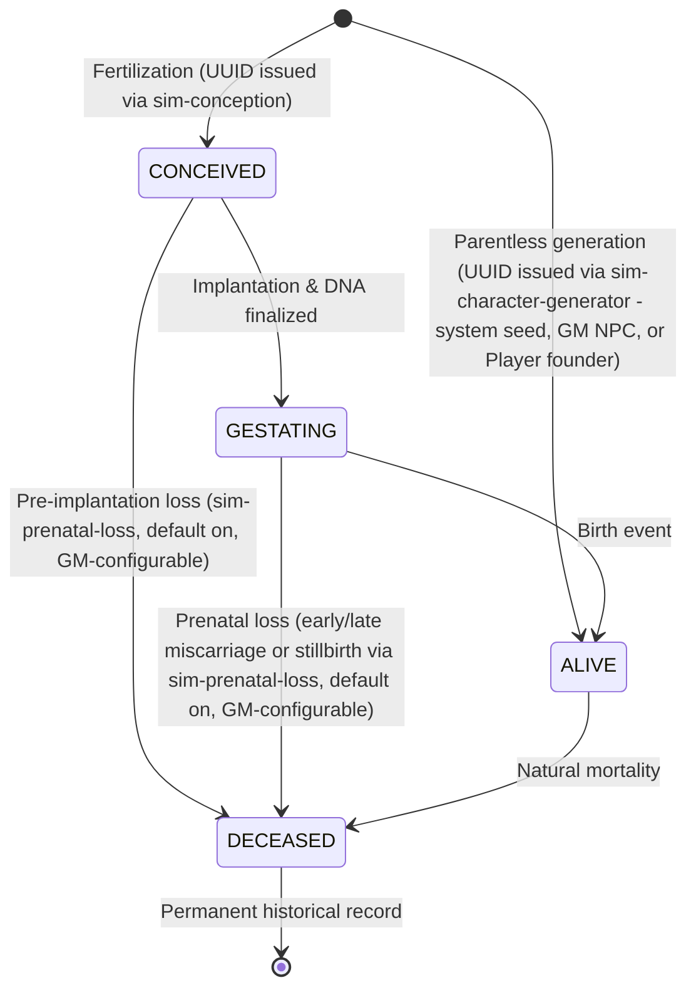
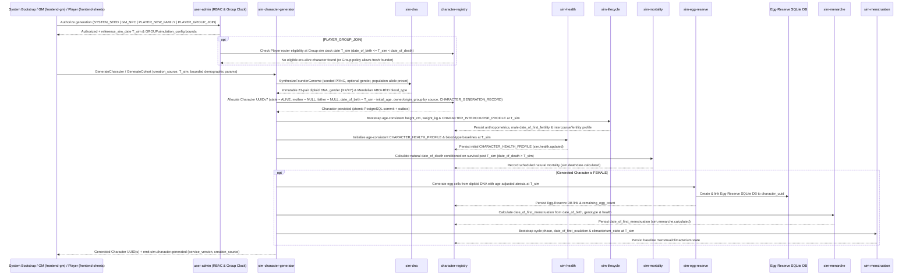
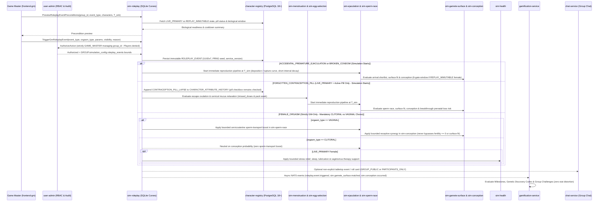

# PrincessPink — Technical Concept

## 1. Executive Summary & Vision

### 1.1 Core Idea
**PrincessPink** is a scientific, population-level simulation of human reproduction presented through a pen-and-paper role-playing game (RPG) interface inspired by classic tabletop systems (such as AD&D). Rather than focusing on combat or adventure, PrincessPink gamifies human biology, genetics, and generational lineage. Players interact with structured character sheets featuring comic-style face portraits that help them visualize the individuals they guide across generations.

### 1.2 Goals of the Simulation
- **Scientific Modeling:** Model the biological stages of human reproduction—hormonal cycles, gamete production, fertilization, genetic recombination, gestation (including both live birth and natural prenatal loss outcomes), aging, and natural mortality—using parameterized, reproducible scientific logic, while preserving an immutable, time-indexed history of every attribute change across each character's life.
- **Accessible Gamification:** Translate complex biological and genetic states into a familiar pen-and-paper character sheet experience so players and game masters can explore inheritance, family trees, and population dynamics intuitively—including bootstrapping founder populations, generating role-play NPCs, claiming unowned NPCs, creating new player characters aligned to any campaign's simulation era, letting already-simulated characters reappear in new Groups running during their living lifetime, triggering Game Master-driven tabletop role-play events (such as contraceptive lapses, premature ejaculation, or clitoral/vaginal female orgasm) with layered AD&D-style attribute checks and progressive clinical discovery, and tracking multi-generational Lineage Chronicles, a Genetic Discovery Codex, milestones, and campaign challenges without ever contradicting biological science.
- **Modular & Scalable Engineering:** Decompose the platform into focused Go microservices deployed on Kubernetes (Microsoft Azure AKS), enabling independent development, scaling, and scientific refinement of each biological process and character attribute.
- **Self-Contained Public Web Presence & Public Results Showcase:** Provide a built-in, pure-Go **Static Website Service** (`frontend-website` + `website-service`, see [ADR-0013](architecture/ADR-0013-static-website-service-and-public-results-presentation.md)) editable exclusively by a **System Admin (`SYSTEM_ADMIN`)** to present and manage the **Landing Page**, **Imprint**, and **Privacy Policy**, while natively rendering anonymized and opt-in **public services' results** (World Chat directory, scientific population observatory, public Dynasty Almanacs, and Genetic Discovery Codex statistics)—completely eliminating any need for third-party website generators or CMS tools such as Ghost, WordPress, or Drupal.

### 1.3 Non-Negotiable Content & Safety Principles
PrincessPink strictly enforces a **zero-violence, zero-nudity** policy:
- **No Violence or Gore:** Unlike adventure or combat RPGs (e.g., AD&D combat modules, World of Warcraft, GTA6), PrincessPink contains no combat mechanics, weapons, injury graphics, or violent narratives. Death occurs strictly through natural biological lifecycles.
- **No Nudity or Explicit Content:** Biological reproduction is represented purely as abstract, scientific data, state transitions, and tabletop-style attributes/events—never through explicit text, imagery, or adult themes.
- **Safe-by-Design Visuals:** Visual character representation is strictly limited to **comic-style face portraits** generated deterministically from genetic and age-related traits. Free-form user image uploads are avoided (or restricted/moderated if ever introduced) so inappropriate content cannot enter the platform.

---

## 2. Domain Model & Core Concepts

### 2.1 Core Entities & Relationships

```mermaid
erDiagram
    USER ||--o{ GROUP_MEMBERSHIP : "belongs to"
    GROUP ||--o{ GROUP_MEMBERSHIP : "contains"
    GROUP_MEMBERSHIP }o--o| CHARACTER : "selects 1 active PC at start"
    GROUP ||--o{ CHARACTER : "origin / hosts as NPC"
    USER |o--o{ CHARACTER : "owns (0..N roster; null while unowned NPC)"
    CHARACTER ||--o| OWNERSHIP_AGREEMENT : "child custody agreement"
    USER ||--o{ CHAT_MESSAGE : "sends"
    USER }o--o| WORLD_CHAT_SERVER : "selects preferred"
    WORLD_CHAT_SERVER ||--o{ CHAT_CHANNEL : "hosts world chat"
    GROUP ||--o| CHAT_CHANNEL : "has group chat"
    CHAT_CHANNEL ||--o{ CHAT_MESSAGE : "contains"
    CHARACTER ||--o| GENOME : "has immutable diploid"
    CHARACTER ||--o{ CHARACTER_PARENT : "child of (mother & father)"
    CHARACTER ||--o{ MENSTRUATION_CYCLE : "female records"
    CHARACTER ||--o| EGG_RESERVE_DB : "female carries SQLite DB from birth or generation"
    EGG_RESERVE_DB ||--|{ EGG_CELL : "stores haploid oocytes"
    CHARACTER ||--o{ EJACULATION_DB : "male generates SQLite DB"
    EJACULATION_DB ||--|{ SPERM_CELL : "contains haploid"
    CHARACTER ||--o{ LIFECYCLE_EVENT : "records"
    CHARACTER ||--o{ WEIGHT_ADJUSTMENT : "records GM role-play changes"
    CHARACTER ||--o| CHARACTER_HEALTH_PROFILE : "tracks lifecycle & RP health indicators"
    CHARACTER ||--o{ HEALTH_ADJUSTMENT : "records RP & GM health/lifestyle changes"
    CHARACTER ||--o| CHARACTER_INTERCOURSE_PROFILE : "tracks intercourse & fertility values"
    CHARACTER ||--o{ CHARACTER_MEDICAL_DRUG : "takes (gender-eligible RP drugs)"
    GROUP ||--o{ PREGNANCY : "records pregnancy outcomes"
    CHARACTER ||--o| PREGNANCY : "gestates as conceived offspring"
    CHARACTER ||--o{ PREGNANCY : "carries as maternal obstetric record"
    GROUP ||--o{ GROUP_CHARACTER_PARTICIPATION : "hosts active PCs & reappearing NPCs"
    CHARACTER ||--o{ GROUP_CHARACTER_PARTICIPATION : "appears in groups across lifetime"
    USER |o--o{ GROUP_CHARACTER_PARTICIPATION : "activates (owning Player or GM for unowned NPC)"
    CHARACTER ||--o{ CHARACTER_ATTRIBUTE_HISTORY : "stores immutable life attribute changes"
    CHARACTER ||--o{ NPC_OWNERSHIP_CLAIM : "records Player takeover of unowned NPC"
    USER ||--o{ NPC_OWNERSHIP_CLAIM : "claims unowned NPC when lacking era-alive PC"
    GROUP ||--o{ NPC_OWNERSHIP_CLAIM : "anchors sim clock period for NPC claim"
    CHARACTER ||--o| CHARACTER_GENERATION_RECORD : "records parentless generation"
    USER |o--o{ CHARACTER_GENERATION_RECORD : "triggers (GM / Player)"
    GROUP |o--o{ CHARACTER_GENERATION_RECORD : "anchors sim clock period"
    GROUP ||--o{ ROLEPLAY_EVENT : "hosts GM & tabletop role-play events"
    USER ||--o{ ROLEPLAY_EVENT : "initiates (GM-only for GM RP elements)"
    CHARACTER ||--o{ ROLEPLAY_EVENT : "participates as primary character"
    CHARACTER |o--o{ ROLEPLAY_EVENT : "participates as partner character"
    ROLEPLAY_EVENT |o--o{ EJACULATION_DB : "triggers encounter ejaculation"
    ROLEPLAY_EVENT |o--o{ PREGNANCY : "originates conception encounter"
    GROUP ||--o{ PARTNER_BOND : "tracks non-explicit tabletop bonds"
    CHARACTER ||--o{ PARTNER_BOND : "forms relationship bond"
    CHARACTER ||--o{ CHARACTER_MILESTONE : "earns life & dynasty milestones"
    USER ||--o{ GENETIC_CODEX_ENTRY : "unlocks scientific discoveries"
    CHARACTER ||--o{ GENETIC_CODEX_ENTRY : "triggers genetic/biological discovery"
    GROUP ||--o{ GROUP_CHALLENGE : "tracks optional campaign objectives"
    USER ||--o{ STATIC_PAGE_REVISION : "authors & publishes (SYSTEM_ADMIN)"
    STATIC_PAGE ||--|{ STATIC_PAGE_REVISION : "stores immutable versions"

    USER {
        uuid id PK
        string email UK
        string display_name
        string role "PLAYER | GAME_MASTER | SYSTEM_ADMIN"
        timestamp created_at
    }

    GROUP {
        uuid id PK
        string name
        uuid game_master_id FK
        date sim_start_date "mandatory at sim start (dd/MM/YYYY); starts at 0:00 h"
        string sim_clock_state "STOPPED | RUNNING"
        jsonb simulation_config "per-group sim tick rate (default: 1 sim year = 24h real time), weight/health bounds, prenatal loss toggle (default on) & prenatal care tier, character_generation limits & age policies, npc_ownership_claim & reappearance policies, roleplay_events pacing/cooldowns, discovery_mode (REALISTIC_FOG | CLINICAL_TRANSPARENT), campaign_challenges, opt-in public_visibility (default false) for public almanac/chronicle showcase, etc."
        timestamp created_at
    }

    GROUP_MEMBERSHIP {
        uuid id PK
        uuid group_id FK "unique with user_id"
        uuid user_id FK "unique with group_id"
        uuid selected_character_id FK "1 owned character alive at Group sim clock date (date_of_birth IS NOT NULL AND date_of_birth <= T_sim AND (date_of_death IS NULL OR T_sim < date_of_death)); non-child-in-origin-group; includes already-simulated owned characters in REPLAY_IMMUTABLE mode"
        timestamp joined_at
    }

    OWNERSHIP_AGREEMENT {
        uuid id PK
        uuid character_id FK "conceived/born child"
        uuid mother_player_id FK "nullable if mother is an unowned NPC"
        uuid father_player_id FK "nullable if father is an unowned NPC"
        uuid proposed_owner_user_id FK "mother_player_id or father_player_id"
        string status "PENDING | AGREED | REJECTED | CLOSED_PRENATAL_LOSS"
        timestamp agreed_at "nullable"
    }

    WORLD_CHAT_SERVER {
        uuid id PK
        string slug UK
        string display_name
        string region
        string language
        string category "GENERAL | ROLEPLAY | SCIENCE | NEWCOMER"
        string status "ONLINE | HIGH_LOAD | FULL | MAINTENANCE | DRAINING"
        int max_capacity
        timestamp created_at
    }

    CHAT_CHANNEL {
        uuid id PK
        string channel_type "GLOBAL | GROUP | DIRECT"
        uuid world_server_id FK "nullable, set for GLOBAL (World Chat)"
        uuid group_id FK "nullable, set for GROUP"
        string name
        timestamp created_at
    }

    CHAT_MESSAGE {
        uuid id PK
        uuid channel_id FK
        uuid sender_user_id FK
        uuid recipient_user_id FK "nullable, set for DIRECT"
        text body
        timestamp sent_at
    }

    CHARACTER {
        uuid id PK
        uuid owner_user_id FK "nullable while unowned NPC (conceived child, GM NPC, or system seed); assigned via OWNERSHIP_AGREEMENT or NPC_OWNERSHIP_CLAIM"
        uuid origin_group_id FK "nullable; group where conceived/born or generated as GM/seed NPC (children are always NPC here; null for Player-generated founders)"
        string creation_source "CONCEPTION | SYSTEM_SEED | GM_NPC | PLAYER_NEW_FAMILY | PLAYER_GROUP_JOIN"
        string name "nullable before birth"
        string gender "FEMALE | MALE"
        string blood_type "A+ | A- | B+ | B- | AB+ | AB- | O+ | O- (immutable, derived from diploid DNA)"
        bool rh_sensitized "female-only; true if Rh- mother became RhD-sensitized after an Rh+ birth or prenatal loss"
        string lifecycle_state "CONCEIVED | GESTATING | ALIVE | DECEASED"
        string life_simulation_status "LIVE_SIMULATING | COMPLETED (once COMPLETED, all stored attribute history is permanently immutable)"
        timestamp simulated_until_sim "nullable before birth; highest sim timestamp whose attribute changes are stored immutably"
        timestamp conceived_at_sim "nullable; null for parentless generated characters"
        date date_of_birth "nullable before birth; remains null on prenatal loss; populated at generation for parentless characters"
        date date_of_death "nullable while alive; set upon natural mortality or prenatal loss"
        date date_of_first_menstruation "female-only, nullable"
        float height_cm "nullable before birth; frontier height in cm (point-in-time values stored in CHARACTER_ATTRIBUTE_HISTORY)"
        float weight_kg "nullable before birth; frontier weight in kg, GM-adjustable only during LIVE_PRIMARY simulation"
    }

    CHARACTER_ATTRIBUTE_HISTORY {
        uuid id PK
        uuid character_id FK "character whose attribute changed"
        uuid source_group_id FK "nullable; group where change occurred"
        timestamp effective_at_sim "sim clock timestamp T_sim when attribute change occurred"
        string attribute_domain "APPEARANCE | ANTHROPOMETRIC | HEALTH | INTERCOURSE | MEDICATION | REPRODUCTION | LIFECYCLE"
        string attribute_key "e.g. eye_color, weight_kg, waking_heart_rate_bpm, fertility_score, contraception_pill"
        jsonb previous_value "nullable for initial baseline"
        jsonb new_value "immutable recorded attribute value as of effective_at_sim"
        string change_source "SIM_TICK | SIM_GENERATION | RP_LIFESTYLE | RP_MEDICATION | RP_EVENT | GM_ADJUSTMENT | GESTATION | PRENATAL_LOSS | LIFECYCLE"
        string service_version "producing microservice version"
        timestamp recorded_at "wall-clock append timestamp (REVOKE UPDATE, DELETE)"
    }

    GROUP_CHARACTER_PARTICIPATION {
        uuid id PK
        uuid group_id FK "group where character appears"
        uuid character_id FK "participating character UUID"
        string participation_role "PLAYER_CHARACTER | NPC"
        string simulation_mode "LIVE_PRIMARY | REPLAY_IMMUTABLE (at most 1 active LIVE_PRIMARY per character)"
        uuid activated_by_user_id FK "nullable for birth/seed; owning Player for PC or managing GM for unowned NPC"
        timestamp entry_sim_date "Group sim clock date T_sim when character entered"
        string status "ACTIVE | DEPARTED | ENDED"
        timestamp created_at
    }

    NPC_OWNERSHIP_CLAIM {
        uuid id PK
        uuid character_id FK "previously unowned NPC claimed by Player"
        uuid claiming_user_id FK "Player lacking an era-alive owned character for target_group_id"
        uuid target_group_id FK "Group whose sim clock date T_sim anchored the claim"
        date reference_sim_date "Group sim clock date T_sim verifying NPC era-liveness"
        string previous_creation_source "SYSTEM_SEED | GM_NPC | CONCEPTION"
        uuid approved_by_gm_id FK "nullable; set when GROUP.simulation_config requires GM approval"
        string status "CLAIMED | PENDING_GM_APPROVAL | REJECTED"
        timestamp claimed_at
    }

    CHARACTER_GENERATION_RECORD {
        uuid id PK
        uuid character_id FK, UK "generated parentless character UUID"
        string creation_source "SYSTEM_SEED | GM_NPC | PLAYER_NEW_FAMILY | PLAYER_GROUP_JOIN"
        uuid generated_by_user_id FK "nullable for SYSTEM_SEED; GM or Player UUID otherwise"
        uuid target_group_id FK "nullable; set for GM_NPC, group-scoped SYSTEM_SEED, or PLAYER_GROUP_JOIN"
        date reference_sim_date "sim clock date T_sim anchoring starting age & conditional survival"
        float initial_age_years "chronological age at generation"
        jsonb generation_params "validated non-PII generation parameters (gender, age band, cohort batch_id, optional bounded archetype)"
        string prng_seed "explicit deterministic PRNG seed"
        string service_version "producing sim-character-generator version"
        timestamp created_at
    }

    WEIGHT_ADJUSTMENT {
        uuid id PK
        uuid character_id FK
        uuid group_id FK
        uuid adjusted_by_gm_id FK
        float previous_weight_kg
        float new_weight_kg
        string reason "role-play rationale"
        timestamp adjusted_at_sim
    }

    CHARACTER_HEALTH_PROFILE {
        uuid id PK
        uuid character_id FK, UK
        string heart_health "ILL | HEALTHY_NOT_SPORTY | HEALTHY_NORMAL | HEALTHY_SPORTY"
        float waking_heart_rate_bpm "resting HR shortly after waking; simulated over lifecycle & RP"
        string muscle_condition "WEAK | NORMAL | SPORTY | BODY_BUILDER"
        int blood_pressure_systolic_mmhg
        int blood_pressure_diastolic_mmhg
        string respiratory_health "IMPAIRED | BELOW_AVERAGE | NORMAL | ATHLETIC"
        float vo2_max_ml_kg_min
        string metabolic_health "IMPAIRED | BORDERLINE | NORMAL | OPTIMAL"
        string immune_health "COMPROMISED | BELOW_AVERAGE | NORMAL | ROBUST"
        string sleep_recovery_quality "POOR | FAIR | GOOD | OPTIMAL"
        string stress_level "LOW | MODERATE | ELEVATED | HIGH"
        string rp_lifestyle_profile "active role-play training, rest & lifestyle inputs"
        timestamp updated_at_sim
    }

    HEALTH_ADJUSTMENT {
        uuid id PK
        uuid character_id FK
        uuid group_id FK
        uuid adjusted_by_user_id FK "Player (RP lifestyle) or GM (bounded health adjustment)"
        string actor_role "PLAYER | GAME_MASTER"
        string indicator_code "HEART_HEALTH | WAKING_HEART_RATE | MUSCLE_CONDITION | VAGINISMUS | ..."
        string previous_value
        string new_value
        string reason "role-play rationale"
        timestamp adjusted_at_sim
    }

    CHARACTER_INTERCOURSE_PROFILE {
        uuid id PK
        uuid character_id FK, UK
        float fertility_score "0..100; shaped by age, gender, health & body composition"
        float erection_quality "male-only, nullable; 0..100"
        float ejaculation_quality "male-only, nullable; 0..100 (reflects short-interval decay)"
        bool vaginismus "female-only, nullable; influences role play & intercourse completion"
        float libido_score "0..100; reproductive drive across age, hormones, health & cycle"
        float lubrication_quality "female-only, nullable; 0..100"
        int refractory_period_minutes "male-only, nullable; post-ejaculation recovery interval"
        float intercourse_stamina "0..100; cardiopulmonary & muscular endurance"
        string climacterium_state "female-only, nullable; PRE_MENARCHE | REPRODUCTIVE | PERIMENOPAUSAL | CLIMACTERIC"
        date date_of_first_ovulation "female-only, nullable; fertility_score = 0 prior"
        date climacterium_date "female-only, nullable; fertility_score = 0 from onset"
        date date_of_first_fertility "male-only, nullable; teenage pubertal fertility onset"
        timestamp updated_at_sim
    }

    CHARACTER_MEDICAL_DRUG {
        uuid id PK
        uuid character_id FK
        string drug_code "VIAGRA | CONTRACEPTION_PILL | ..."
        string eligible_gender "MALE | FEMALE | ALL"
        bool is_active "toggled via character sheet checkbox"
        timestamp started_at_sim
        timestamp stopped_at_sim "nullable while active"
        uuid updated_by_user_id FK
        timestamp updated_at_sim
    }

    MENSTRUATION_CYCLE {
        uuid id PK
        uuid character_id FK
        date start_date
        date end_date
        date ovulation_date
    }

    EGG_RESERVE_DB {
        uuid id PK
        uuid character_uuid UK
        int initial_egg_count
        int remaining_egg_count
        string sqlite_artifact_uri
        timestamp created_at_sim
    }

    EGG_CELL {
        bigint cell_id PK
        blob haploid_dna "22 autosomes + X"
        blob surface_profile "zona pellucida & oolemma receptors"
        float quality_score
        timestamp ovulated_at_sim "nullable"
        string status "DORMANT | SELECTED | VIABLE | FERTILIZED | EXPIRED | ATRESIA"
    }

    EJACULATION_DB {
        uuid id PK
        uuid father_id FK
        uuid roleplay_event_id FK "nullable; set when triggered by GM/tabletop ROLEPLAY_EVENT"
        string trigger_context "STANDARD | ACCIDENTAL_PREMATURE | BROKEN_CONDOM | FORGOTTEN_PILL | TIMED_ENCOUNTER"
        timestamp occurred_at_sim
        int sperm_count
        float erection_quality "0..100 at event"
        float ejaculation_quality "0..100 after short-interval decay"
        float quality_factor "decays with repeated short-interval ejaculations"
        string sqlite_artifact_uri
    }

    SPERM_CELL {
        bigint cell_id PK
        string sex_chromosome "X | Y"
        blob haploid_dna "22 autosomes + X/Y"
        blob surface_profile "acrosome & membrane ligands"
        float motility
        float viability
        float morphology
    }

    PREGNANCY {
        uuid id PK
        uuid character_id FK, UK "conceived offspring character UUID"
        uuid mother_id FK
        uuid father_id FK
        uuid group_id FK
        uuid gestation_cohort_id "nullable; links dizygotic/monozygotic twins from the same conception episode"
        uuid triggered_by_roleplay_event_id FK "nullable; set when initiated via ROLEPLAY_EVENT"
        string outcome "ONGOING | LIVE_BIRTH | PRENATAL_LOSS"
        string loss_stage "nullable; PRE_IMPLANTATION_LOSS | EARLY_MISCARRIAGE | LATE_MISCARRIAGE | STILLBIRTH"
        int gestational_age_days "simulated gestational days at resolution or latest checkpoint"
        bool is_clinically_recognized "false for subclinical pre-implantation loss"
        string risk_band "LOW | MODERATE | ELEVATED | HIGH"
        string primary_cause_category "nullable; CHROMOSOMAL_ANOMALY | RH_INCOMPATIBILITY | HYPERTENSIVE_PLACENTAL | ..."
        jsonb contributing_factors "structured clinical risk factors & normalized weights"
        timestamp started_at_sim
        timestamp resolved_at_sim "nullable while ONGOING"
        timestamp recovery_end_sim "nullable while ONGOING; end of maternal postpartum/post-loss physiological recovery window"
        bool is_reappearance_pregnancy "true when conceived by an already-simulated character in a reappearance Group without mutating maternal history"
        string service_version "producing sim-prenatal-loss / sim-gestation version"
    }

    ROLEPLAY_EVENT {
        uuid id PK
        uuid group_id FK
        uuid initiated_by_user_id FK "GM UUID for GM-only RP elements; Player UUID for allowed collaborative actions"
        string actor_role "GAME_MASTER | PLAYER"
        string event_type "ACCIDENTAL_PREMATURE_EJACULATION | BROKEN_CONDOM | FORGOTTEN_CONTRACEPTION_PILL | FEMALE_ORGASM | EMERGENCY_CONTRACEPTION | OVULATION_SHIFT | HYPEROVULATION_EVENT | POST_COITAL_REST_MODIFIER | TIMED_FERTILE_WINDOW_ENCOUNTER | ACUTE_LIFE_EVENT | CLINICAL_SUPPORT_EVENT | ENVIRONMENTAL_SEASON_EVENT"
        uuid primary_character_id FK "target/primary character UUID"
        uuid partner_character_id FK "nullable; paired partner character UUID for encounter events"
        string orgasm_type "nullable; mandatory CLITORAL | VAGINAL when event_type == FEMALE_ORGASM (GM-only)"
        bool simulation_triggered "true when event immediately starts the reproduction simulation pipeline"
        string encounter_protection "NONE | CONDOM | WITHDRAWAL | CONTRACEPTION_PILL | DUAL_METHOD"
        jsonb event_params "bounded parameters (e.g., missed_doses, deposition_mode, rupture_fraction, timing_offset_min, check_dc)"
        jsonb roll_outcome "deterministic seeded tabletop roll & biological modifier summary"
        string visibility "GROUP_PUBLIC | PARTICIPANTS_ONLY | GM_SECRET"
        string reason "non-explicit tabletop clinical/narrative rationale"
        timestamp occurred_at_sim
        string prng_seed "deterministic PRNG seed derived from (group_id, sim_tick, event_id)"
        string service_version "producing sim-roleplay version"
    }

    PARTNER_BOND {
        uuid id PK
        uuid group_id FK
        uuid character_a_id FK
        uuid character_b_id FK
        string bond_type "ACQUAINTANCE | PARTNER | SPOUSE | CO_PARENT"
        float synchrony_score "0..100; non-explicit tabletop familiarity & psychophysiological comfort"
        timestamp established_at_sim
        timestamp updated_at_sim
    }

    CHARACTER_MILESTONE {
        uuid id PK
        uuid character_id FK
        uuid group_id FK "nullable"
        string milestone_code "e.g. CARDIO_CHAMPION | CENTENARIAN | BLOODLINE_FOUNDER | TIMELESS_ANCESTOR"
        string category "HEALTH_STEWARDSHIP | LINEAGE_DYNASTY | GENETIC_DISCOVERY | ROLEPLAY_ARC | LONGEVITY"
        timestamp unlocked_at_sim
        string service_version "producing gamification-service version"
    }

    GENETIC_CODEX_ENTRY {
        uuid id PK
        uuid user_id FK "owning Player who observed the scientific phenomenon"
        uuid group_id FK "nullable"
        string discovery_code "e.g. RECESSIVE_O_BLOOD | SLOWER_SPERM_SURFACE_WIN | INFANT_EYE_SHIFT | REAPPEARANCE_BRANCH"
        uuid trigger_character_id FK "character whose biological event unlocked the codex entry"
        jsonb metadata "structured non-PII scientific observation summary"
        timestamp discovered_at_sim
    }

    GROUP_CHALLENGE {
        uuid id PK
        uuid group_id FK
        string challenge_code "e.g. FOUR_GEN_HISTORICAL | TRAIT_PRESERVATION | HEALTH_LONGEVITY | POPULATION_EQUILIBRIUM"
        jsonb target_config "GM-configured non-violent scientific objective thresholds"
        jsonb progress_state "live aggregated progress snapshot"
        string status "ACTIVE | COMPLETED | EXPIRED"
        timestamp created_at_sim
        timestamp completed_at_sim "nullable"
    }

    STATIC_PAGE {
        uuid id PK
        string slug "landing | imprint | privacy | custom slug (unique per locale)"
        string page_type "LANDING_PAGE | IMPRINT | PRIVACY_POLICY | CUSTOM_STATIC"
        string locale "default en"
        bool is_system_page "true for landing, imprint, privacy (protected from deletion/unpublish)"
        uuid current_published_revision_id FK "nullable until first publish; seeded on bootstrap for system pages"
        bigint version "optimistic concurrency lock"
        timestamp updated_at
    }

    STATIC_PAGE_REVISION {
        uuid id PK
        uuid page_id FK
        int revision_number "monotonic per page"
        string title
        string meta_description
        text content_markdown "SYSTEM_ADMIN authored Markdown source"
        text rendered_html "allow-list sanitized, policy-checked static HTML"
        string content_sha256 "ETag & integrity digest"
        jsonb showcase_config "enabled public service result widgets, ordering & captions"
        string status "DRAFT | PUBLISHED | ARCHIVED"
        string change_summary
        uuid author_user_id FK "SYSTEM_ADMIN UUID"
        uuid published_by_user_id FK "nullable; SYSTEM_ADMIN UUID"
        timestamp published_at "nullable"
        string service_version "producing website-service version"
        timestamp created_at
    }

    PUBLIC_RESULT_SNAPSHOT {
        uuid id PK
        string widget_key UK "world_chat_directory | population_stats | public_almanacs | codex_stats"
        string source_service "chat-world-registry | character-registry | sim-clock | gamification-service"
        jsonb payload "non-PII anonymized or opt-in public service result projection"
        string content_sha256
        timestamp refreshed_at
        timestamp expires_at
        string service_version
    }
```

### 2.2 Roles, Character Ownership & Group Participation Rules
- **Player (User):** Authenticated user identified by a unique `UUID`. A Player may own **multiple Characters** in their personal roster, decides exclusively whether any of their owned characters becomes active again in a new Group running during that character's lifetime, may **generate new parentless founder characters** (within configured roster quotas and cooldowns) either to **start a new family** (`PLAYER_NEW_FAMILY`) or to **join a Group when they do not already own a character that is alive in the time period shown by the Group's simulation clock** (`PLAYER_GROUP_JOIN`), or may alternatively **take permanent ownership of an eligible unowned NPC within the system** (`NPC_OWNERSHIP_CLAIM`) when lacking an owned character alive in that Group's time period. A Player has read/interaction access to the character sheets of their owned characters—including toggling gender-eligible **Medical Drugs** via checkboxes, setting non-pharmacological encounter barrier protection (e.g., `CONDOM` preference), proposing non-explicit **`PARTNER_BOND`** social relationships, initiating collaborative tabletop actions (such as fertility-awareness timed encounters or care-tier-eligible `EMERGENCY_CONTRACEPTION` requests in `LIVE_PRIMARY` mode), exploring their **Lineage Chronicle**, **Genetic Discovery Codex**, and **Character Milestones**, and updating their active character's **Role-Play Lifestyle & Training Profile** during live primary simulation (mutations are strictly disabled once a character's attribute timeline at `T_sim` or entire life has already been simulated; see [§2.8](#28-immutable-life-attribute-history-character-reappearance--npc-ownership-takeover); Players may **never** self-initiate GM-only Role-Play Elements such as `FEMALE_ORGASM`, `ACCIDENTAL_PREMATURE_EJACULATION`, `BROKEN_CONDOM`, or `FORGOTTEN_CONTRACEPTION_PILL`)—and can communicate via **Global / World Chat**, their assigned **Group Chat(s)**, and private **1-to-1 Direct Messages** with other Players.
- **Game Master (GM):** Authenticated user who manages one or more **Groups** (simulation worlds/campaigns). A Game Master has visibility into all active player characters and NPCs (both born NPC children and GM/system-generated or GM-activated reappearing NPCs) living within their group(s), may **generate parentless NPC characters** (`GM_NPC`, individually or in bounded cohorts) directly into their managed Group(s), and may **activate existing unowned characters (`owner_user_id = null`) as NPCs** (`GROUP_CHARACTER_PARTICIPATION.participation_role = NPC`) in their managed Group(s) when those unowned characters are alive during the Group's simulation time period (including already-simulated unowned characters in `REPLAY_IMMUTABLE` mode; a GM **may never** activate or reuse a Player-owned character as an NPC without the owning Player's decision). The Game Master initializes each Group's simulation by entering a mandatory start date (`dd/MM/YYYY`, always starting at `0:00 h`), controls group-level simulation settings (including adjusting the Group's per-group simulation tick rate—defaulting to **1 simulated year per 24 hours real time**—starting population, `character_generation`, `npc_ownership_claim`, and `reappearance` bounds/policies, role-play weight and health adjustment bounds, per-group **prenatal loss** settings—enabled by default in `GROUP.simulation_config` with configurable `prenatal_care_tier`, bounded `risk_multiplier`, pre-implantation tracking, or an opt-out toggle for sensitive campaigns—and per-group **`roleplay_events`**, **`discovery_mode`**, and **`campaign_challenges`** settings), may stop and resume the Group's simulation tick whenever role-play needs it, holds **exclusive authority to initiate Game Master Role-Play Elements** (`ROLEPLAY_EVENT` via `sim-roleplay`—specifically **Accidental / Premature Ejaculation**, **Broken Condom**, **Forgotten Contraception Pill** [all three immediately starting the reproduction simulation], **Female Orgasm** [strictly GM-only, with mandatory GM selection of `CLITORAL` vs. `VAGINAL`], plus additional scientifically grounded narrative/physiological events in [§2.9](#29-role-play-elements-game-mechanics--scientific-gamification)—subject to biological guardrails, `REPLAY_IMMUTABLE` protection, and immutable audit logging), may adjust a character's `weight_kg` and bounded role-play health and clinical intercourse indicators (such as `heart_health`, `waking_heart_rate_bpm` modifiers, `muscle_condition`, `vaginismus` narrative/therapy progression, or lifestyle/illness recovery arcs) within configured biological/role-play parameters strictly for characters in `LIVE_PRIMARY` simulation (never for already-simulated `REPLAY_IMMUTABLE` characters whose attribute history is sealed; with full audit logging), and participates in and moderates the **Group Chat** for his/her Group(s) alongside Global / World Chat and Direct Messages.
- **System Admin (`SYSTEM_ADMIN`):** Authenticated platform administrator (with **mandatory MFA** in all cloud environments and synchronous authorization checks in `user-admin`; see [ADR-0010](architecture/ADR-0010-user-admin-auth-rbac-and-group-management.md) and [ADR-0013](architecture/ADR-0013-static-website-service-and-public-results-presentation.md)) with exclusive access to the **Static Website Service** (`frontend-website` `/admin/website/*` → `website-service`) to edit, preview, version, publish, and roll back the **Landing Page**, **Imprint**, **Privacy Policy**, optional custom static pages, and **Public Service Results** showcase widgets. Under strict **separation of duties**, `SYSTEM_ADMIN` does **not** automatically grant Game Master powers inside any Group, access to Players' private character sheets, permission to trigger GM-only role-play events, or access to private Group Chats and 1-to-1 Direct Messages. Public self-registration always creates `PLAYER` accounts and can never self-assign `SYSTEM_ADMIN`.
- **One Character per Player per Group & Mandatory Sim-Clock Time-Period Eligibility:** Although a Player may own multiple Characters across their account, **within any single Group a Player plays only one Character**. **Players may only choose characters to enter a Group which are alive during the time period the Group simulates.** At the **start of the Group** (or upon joining an active Group if permitted by the GM), each Player selects that single active Character from the Characters they already own (`GROUP_MEMBERSHIP.selected_character_id`) that are **alive at the Group's simulation clock date (`T_sim`)**: specifically `owner_user_id == player_id`, not a child conceived/born in that Group (`NOT (creation_source == CONCEPTION AND origin_group_id == group_id)`), `date_of_birth IS NOT NULL`, `date_of_birth <= T_sim`, and `date_of_death IS NULL OR T_sim < date_of_death` (within the Group's configured playable age range). This point-in-time liveness check covers both currently live-simulating owned characters and **already-simulated owned characters** reappearing in `REPLAY_IMMUTABLE` mode during `[date_of_birth, date_of_death)`, while strictly excluding prenatal losses (`date_of_birth IS NULL`), unborn characters, and characters deceased at or before `T_sim`. **If a Player has no eligible owned character alive within the time period the Group simulates, the Player must either generate a new parentless character (`PLAYER_GROUP_JOIN`, anchored to `T_sim`; see [§2.7](#27-parentless-character-generation-founders-gm-npcs--player-creation)) or take permanent ownership of an eligible unowned NPC within the system (`NPC_OWNERSHIP_CLAIM`; see [§2.8](#28-immutable-life-attribute-history-character-reappearance--npc-ownership-takeover))** before entering the Group.
- **Immutable Life History, Character Reappearance & Additional-Children-Only Constraint:** **All attribute changes within the life of a character are stored** in an append-only temporal ledger (`CHARACTER_ATTRIBUTE_HISTORY`) so that the character may **reappear in any new Group running during the character's living lifetime (`[date_of_birth, date_of_death)`)**. **Stored attribute changes are permanently immutable once they have happened, and once the character's life has been simulated (`life_simulation_status == COMPLETED`), no attribute may ever be modified again.** The **only** things an already-simulated character may do are **participate in new simulations** (replaying their immutable attribute timeline as of each tick `T_sim`) and **have additional children**—and **female characters may only conceive further children within periods where the finished simulation of their life allows it from a biological view** (alive with projected delivery prior to immutable `date_of_death`, post-`date_of_first_ovulation` and pre-`climacterium_date`, stored `fertility_score(T_sim) > 0`, non-overlapping with any recorded `PREGNANCY` and its postpartum/post-loss recovery interval including forward lookahead against later recorded pregnancies, consistent with stored cycle/contraception/physiological state at `T_sim`, and with an unfertilized oocyte available in her retained `EGG_RESERVE_DB`; see [§2.8](#28-immutable-life-attribute-history-character-reappearance--npc-ownership-takeover)).
- **Reappearance Activation Authority & Unowned NPC Takeover:** The **decision whether a character becomes active again lies strictly with the Player who owns the character** (`owner_user_id IS NOT NULL`). Neither a Game Master nor another Player may activate a Player-owned character as an NPC. Conversely, **if a character has no owner (`owner_user_id IS NULL`)**, either (a) a **Game Master** managing a Group running during that character's lifetime may activate and use the character as an **NPC** in that Group (`GROUP_CHARACTER_PARTICIPATION`), or (b) a **Player who has no owned character alive in their target Group's time period** may claim permanent ownership of that eligible unowned NPC (`NPC_OWNERSHIP_CLAIM`, subject to atomic claim checks, no pending parental custody dispute, and `GROUP.simulation_config`), after which all future activation decisions belong solely to the new owning Player.
- **Parentless Generated Characters (System Seed, GM Role-Play NPCs & Player Founders):** To bootstrap the platform with initial population data (`SYSTEM_SEED`), populate campaigns with role-play NPCs (`GM_NPC`), or enable Players to establish new lineages (`PLAYER_NEW_FAMILY`) and join era-mismatched Groups (`PLAYER_GROUP_JOIN`), `sim-character-generator` creates fully initialized generation-`0` characters with no parents inside the system (`mother_uuid = null`, `father_uuid = null`). GM-generated and group-seeded NPCs have `owner_user_id = null` and `origin_group_id = group_id` (remaining NPCs within that Group unless claimed under explicit `GROUP.simulation_config.npc_ownership_claim` rules), whereas Player-generated founders have `owner_user_id = player_id` and `origin_group_id = null` (making them immediately playable in an eligible Group whose sim clock matches their lifespan).
- **Children as NPCs & Parental Ownership Agreement:** Every child **conceived or born during a simulation** enters the simulation as an **NPC (Non-Player Character)** with no Player owner (`owner_user_id = null`). When both biological parents are owned by Players, the child remains an unowned NPC until the **Players of the mother and the father reach a mutual agreement** (`OWNERSHIP_AGREEMENT`) deciding which of them takes ownership of the child; once both agree, `owner_user_id` is assigned and the child is added to that Player's personal character roster. When **one parent is owned by a Player and the other parent is an unowned NPC** (such as a GM-generated or system-seeded role-play NPC), the child likewise starts as an unowned NPC in `origin_group_id`, and the owning Player of the PC parent may claim future-group ownership via `OWNERSHIP_AGREEMENT` subject to the Group's `simulation_config` policy (e.g., GM counter-approval); children conceived by two unowned NPCs remain unowned NPCs (and may later be reused as NPCs by a GM or claimed via `NPC_OWNERSHIP_CLAIM` in another Group once eligible). If a pregnancy ends in **prenatal loss** before birth, any `PENDING` `OWNERSHIP_AGREEMENT` is automatically closed (`CLOSED_PRENATAL_LOSS`) while preserving parent links, any optional reserved name, and the permanent historical lineage record.
- **Future-Group-Only Playability for Children:** Even after parental ownership is agreed and assigned to a Player, **a child can never be played as a Player Character in the Group where the mother and father live** (`origin_group_id`). Within that origin Group, the child continues to live strictly as an NPC; the owning Player may only select and play that child in a **future Group** whose simulation clock time period falls within the child's living lifespan (continuing forward simulation past `simulated_until_sim` if uncompleted, or reappearing in `REPLAY_IMMUTABLE` mode if the child's entire life was already simulated in `origin_group_id`).

### 2.3 Agent / Character Lifecycle
Every Agent in the simulation is a **Character** assigned a globally unique, immutable **UUID** either **at the moment of conception** (`sim-conception`) or **at parentless character generation** (`sim-character-generator` for system seed data, GM role-play NPCs, and Player-generated founders). That UUID remains the canonical identifier for the character across all phases of existence:



- **Before Birth (`CONCEIVED`, `GESTATING` — Conception-Born Characters Only):** The character already exists in the system with a UUID, immutable diploid DNA, determined biological `gender` (`FEMALE` or `MALE`), immutable `blood_type` (`A+`, `A-`, `B+`, `B-`, `AB+`, `AB-`, `O+`, or `O-`), `origin_group_id`, mother/father references, and a linked `PREGNANCY` record (`outcome = ONGOING`). `date_of_birth` and `date_of_death` are `null`. Newly conceived children start as **NPCs** (`owner_user_id = null`) until parental ownership is agreed. Players may optionally assign or reserve a name prior to or at birth. While prenatal loss is enabled for the Group (default in `GROUP.simulation_config`), `sim-prenatal-loss` evaluates biological loss risk across implantation and gestation; if a prenatal loss occurs before birth, the character transitions directly from `CONCEIVED` or `GESTATING` to `DECEASED` (`date_of_birth` remains `null`, `date_of_death` records the simulated date of loss, `PREGNANCY.outcome = PRENATAL_LOSS`, any `PENDING` `OWNERSHIP_AGREEMENT` is closed as `CLOSED_PRENATAL_LOSS`, newborn-only services are not triggered, and maternal health and menstrual cycles enter stage-proportional physiological recovery; see [§2.6](#26-prenatal-loss--pregnancy-outcome-model)).
- **During Primary Life Simulation (`ALIVE`, `life_simulation_status = LIVE_SIMULATING`):** Characters enter `ALIVE` through either **live birth** (recording `date_of_birth` permanently and transitioning `PREGNANCY.outcome` to `LIVE_BIRTH`) or **parentless character generation** (`sim-character-generator`, which skips `CONCEIVED`/`GESTATING` and `PREGNANCY`, leaves `mother_uuid`, `father_uuid`, and `conceived_at_sim` `null`, synthesizes immutable diploid DNA, `gender`, and `blood_type`, sets `date_of_birth <= T_sim` for the target starting age, initializes age-consistent health, anthropometrics, intercourse/fertility, female Egg-Reserve/menarche/menstruation state, and schedules conditional natural mortality `date_of_death > T_sim`; see [§2.7](#27-parentless-character-generation-founders-gm-npcs--player-creation)). Once `ALIVE`, naturally born and parentless generated characters participate identically in the simulation, age with simulation time, and **append every dynamic attribute change immutably to `CHARACTER_ATTRIBUTE_HISTORY`** (advancing `simulated_until_sim`). At most one active Group may hold the character's `LIVE_PRIMARY` forward-simulation lock at a time so conflicting parallel timelines can never be forked. Children born in a Group (as well as GM-generated or group-seeded NPCs) live in that Group strictly as **NPCs**, whereas Player-generated founders (`origin_group_id = null`) may be selected in any Group where they are alive during the Group's sim-clock time period.
- **After Natural Death (`DECEASED`, `life_simulation_status = COMPLETED`) & Reappearance Across Groups:** Upon natural post-birth mortality (`ALIVE` → `DECEASED`) or prenatal loss (`CONCEIVED`/`GESTATING` → `DECEASED`), `date_of_death` is recorded permanently (with `date_of_birth` remaining `null` for prenatal losses) and `life_simulation_status` transitions permanently to `COMPLETED` (`simulated_until_sim = date_of_death`). The character record, UUID, immutable attribute history (`CHARACTER_ATTRIBUTE_HISTORY`), lineage links, and `PREGNANCY` outcome metadata remain permanently queryable for genealogy, family trees, obstetric history, and genetic heritage analysis. Crucially, while **prenatal losses (`date_of_birth = null`) never lived and can never reappear**, any live-born or parentless generated character whose life has finished simulating (`life_simulation_status == COMPLETED`) **may still reappear in new Groups whose simulation clock `T_sim` runs during `[date_of_birth, date_of_death)`** in read-only **`REPLAY_IMMUTABLE`** mode (point-in-time state `ALIVE` at `T_sim`)—solely to participate in the new simulation and potentially have additional children within biological constraints, with zero mutation to their sealed life history (see [§2.8](#28-immutable-life-attribute-history-character-reappearance--npc-ownership-takeover)).

### 2.4 Core & Gender-Specific Character Attributes
Every character carries both universal lifecycle attributes and biologically grounded **gender-specific attributes**:
- **Universal Core Attributes:**
  - `uuid`: Globally unique, permanent identifier from conception or parentless character generation onward.
  - `creation_source`: Immutable provenance classifying how the character entered the system (`CONCEPTION`, `SYSTEM_SEED`, `GM_NPC`, `PLAYER_NEW_FAMILY`, or `PLAYER_GROUP_JOIN`).
  - `name`: Player- or GM-assigned (or generator-assigned) name (optional prior to birth).
  - `gender`: Biological sex (`FEMALE` or `MALE`), determined permanently at conception by the sex chromosome pair (`XX` → `FEMALE`, `XY` → `MALE`) or synthesized with the immutable diploid genome during parentless character generation.
  - `blood_type`: Immutable human ABO + RhD blood group (`A+`, `A-`, `B+`, `B-`, `AB+`, `AB-`, `O+`, `O-`), determined permanently by `sim-dna` via Mendelian inheritance from maternal and paternal haploid alleles at conception—or synthesized directly from population ABO (`I^A`/`I^B`/`i` on chromosome 9) and RhD (`D`/`d` on chromosome 1) allele frequencies during parentless founder genome synthesis. Displayed on every character sheet and used across gestation, health, and mortality simulations.
  - `date_of_birth`: Simulated calendar date of birth (populated upon transition to `ALIVE` at birth or anchored to `T_sim - initial_age` at parentless character generation; remains `null` if prenatal loss occurs before birth).
  - `date_of_death`: Simulated calendar date of natural death or prenatal loss (nullable while living or gestating; populated upon transition to `DECEASED`).
  - `mother_uuid` / `father_uuid`: Immutable lineage references to both biological parents (`null` for parentless generated characters—initial system seeds, GM role-play NPCs, and Player-generated founders—who form generation-`0` roots of their family trees).
- **Visible Appearance Attributes (Shown on All Character Sheets):**
  - `eye_color`: Current expressed iris pigmentation (e.g., blue, gray, hazel, green, amber, brown).
  - `hair_color`: Current expressed hair pigmentation (e.g., blonde, red, light/dark brown, black, silver/gray, white).
  - `skin_color`: Current expressed skin pigmentation tone.
  - **Dynamic Changes After Birth & During Life:** While each character's pigmentation baseline is anchored in their immutable diploid DNA, `eye_color`, `hair_color`, and `skin_color` are **not static**—they may change after birth and throughout life based on developmental stage, aging, hormonal shifts, and environmental/biological factors (for example, newborn eye color darkening during infancy, childhood hair darkening or graying/whitening with age, and gradual age- or environment-driven skin tone shifts).
- **Physical Measurements & Medical Body Composition Attributes (Shown on All Character Sheets):**
  Every living character carries anthropometric measurements together with derived clinical values equivalent to those calculated by a medical body-composition scale, recalculated dynamically as age, growth, gestation, or role-play weight changes occur:
  - **Core Measurements:**
    - `height_cm`: Current height in **centimeters (`cm`)**, anchored in polygenic DNA and evolving naturally across developmental stages (birth length, infancy/childhood growth, pubertal growth spurt, adult plateau, and subtle late-life decline).
    - `weight_kg`: Current body mass in **kilograms (`kg`)**, evolving naturally with age, growth, and pregnancy (`sim-gestation`).
    - **Game Master Role-Play Weight Adjustment:** For tabletop role-play storytelling (e.g., lifestyle, nutrition, or narrative arcs), a **Game Master** may adjust `weight_kg` for any character (PC or NPC) within their managed Group(s) that is actively in **`LIVE_PRIMARY`** simulation (strictly forbidden for already-simulated `REPLAY_IMMUTABLE` characters whose attribute history is sealed; see [§2.8](#28-immutable-life-attribute-history-character-reappearance--npc-ownership-takeover)), strictly constrained by **bounded parameters** configured in `GROUP.simulation_config` and enforced by `character-registry`:
      - Age- and height-scaled **minimum and maximum physiological weight bounds** (e.g., safe BMI/pediatric percentile limits so impossible or harmful extremes cannot be entered, preserving the zero-violence/natural-lifecycle policy).
      - Configurable **maximum change per adjustment (`max_delta_kg` / `max_delta_pct`)** and optional cooldown period to keep weight transitions realistic for role-play.
      - Mandatory **role-play reason** and immutable audit recording (`WEIGHT_ADJUSTMENT` + append-only `CHARACTER_ATTRIBUTE_HISTORY`), emitting `character.weight.updated` so all derived medical body-composition metrics recalculate automatically.
  - **Derived Medical Body-Composition Values (Calculated from `height_cm`, `weight_kg`, `gender`, Age & Lifecycle State):**
    - `bmi`: **Body Mass Index (`kg/m²`)** (`weight_kg / (height_cm / 100)²`) with WHO adult classification band or age/sex-adjusted pediatric percentile band, interpreted alongside `muscle_condition` so athletic or body-builder lean mass is distinguished from excess adiposity.
    - `body_fat_percentage` & `body_fat_index`: **Body Fat Percentage (`%`) & Body Fat Index** (sex- and age-adjusted anthropometric estimate modulated by genotype, hormonal state, and `muscle_condition`, plus Fat Mass Index `fat_mass_kg / (height_cm / 100)²`).
    - `lean_body_mass_kg`: **Lean Body Mass / Fat-Free Mass (`kg`)** (non-adipose body mass derived from height, weight, sex, `muscle_condition`, and body fat percentage).
    - `muscle_mass_kg` & `muscle_mass_pct`: **Skeletal Muscle Mass (`kg` & `%`)** (estimated lean skeletal muscle share adjusted for sex, age stage, and `muscle_condition`).
    - `total_body_water_pct` & `total_body_water_l`: **Total Body Water (`%` & `L`)** (hydration volume and percentage estimated via sex-, age-, height-, and weight-adjusted clinical formulas such as Watson).
    - `bone_mass_kg`: **Estimated Bone Mass (`kg`)** (skeletal mineral mass reflecting pubertal bone accrual, resistance-training stimulus from `muscle_condition`, and age-related density shifts).
    - `visceral_fat_rating`: **Visceral Fat Rating (index)** (clinical scale indicator of abdominal/visceral adipose level, feeding into `heart_health` and `metabolic_health`).
    - `bmr_kcal`: **Basal Metabolic Rate (`kcal/day`)** (resting daily energy expenditure via Mifflin-St Jeor adjusted for lean mass / `muscle_condition`, `weight_kg`, `height_cm`, age, and `gender`).
    - `bsa_m2`: **Body Surface Area (`m²`)** (clinical body surface area via Mosteller/Du Bois formula from `height_cm` and `weight_kg`).
    - `ideal_weight_range_kg`: **Ideal / Healthy Weight Range (`kg`)** (reference weight band for the character's current `height_cm`, `gender`, and age stage).
- **Health & Fitness Indicators (Shown on All Character Sheets):**
  Every living character carries dynamic clinical health and physical conditioning indicators that are anchored in genetic predispositions, simulated continuously across the character's lifecycle by `sim-health`, and influenced by **Role Play** (Player lifestyle/training choices and bounded Game Master narrative adjustments):
  - **Heart Health (`heart_health`):** Categorical cardiovascular health classification with four states:
    - `ILL` *(ill)* — compromised or burdened cardiovascular function (e.g., genetic predisposition, chronic strain, or natural illness arc).
    - `HEALTHY_NOT_SPORTY` *(healthy not sporty)* — clinically healthy heart without regular aerobic conditioning.
    - `HEALTHY_NORMAL` *(healthy normal)* — balanced, everyday healthy cardiovascular function.
    - `HEALTHY_SPORTY` *(healthy sporty)* — well-conditioned aerobic cardiovascular fitness with high cardiac efficiency.
  - **Waking Heart Rate (`waking_heart_rate_bpm`):** Resting heart rate in beats per minute (`bpm`) measured **shortly after waking up**, **simulated continuously over the entire lifecycle of the character and influenced by Role Play**:
    - *Lifecycle Trajectory:* Follows realistic human physiological curves—higher in newborns and infants (~110–140 bpm), gradually declining through childhood (~80–110 bpm) and adolescence (~65–85 bpm), stabilizing in adulthood according to `heart_health` (e.g., ~45–59 bpm for `HEALTHY_SPORTY`, ~60–74 bpm for `HEALTHY_NORMAL`, ~75–90 bpm for `HEALTHY_NOT_SPORTY`, and elevated or unstable baselines for `ILL`), exhibiting physiological elevation during pregnancy (`sim-gestation`, typically +10–20 bpm due to increased blood volume and cardiac output), and shifting naturally in advanced age.
    - *Role-Play Influence:* Responds dynamically to Player role-play training/lifestyle routines (e.g., sustained endurance training progressively lowers waking heart rate; sedentary periods, poor sleep, or high stress elevate it), bounded GM health/lifestyle adjustments, `weight_kg` shifts, and active pharmacological interactions.
  - **Muscles / Muscular Conditioning (`muscle_condition`):** Qualitative musculoskeletal strength and conditioning tier with four states:
    - `WEAK` *(weak)* — low muscular tone/strength (e.g., deconditioning, recovery, or advanced-age sarcopenia).
    - `NORMAL` *(normal)* — everyday functional muscular development.
    - `SPORTY` *(sporty)* — athletic, well-toned musculature with strong functional endurance and lean mass.
    - `BODY_BUILDER` *(body builder)* — heavily developed skeletal muscle mass and strength, significantly increasing `muscle_mass_kg`, `lean_body_mass_kg`, and `bmr_kcal` while distinguishing muscular weight from excess adiposity in `BMI`.
  - **Blood Pressure (`blood_pressure_systolic_mmhg` / `blood_pressure_diastolic_mmhg` & band `LOW | NORMAL | ELEVATED | HIGH`):** Vascular hemodynamic indicator coupled to `heart_health`, `waking_heart_rate_bpm`, `blood_type` (modest non-O vascular/thrombotic predisposition), `visceral_fat_rating`, `BMI`, age, `stress_level`, and pregnancy (`sim-gestation`).
  - **Respiratory / Aerobic Health (`respiratory_health`: `IMPAIRED | BELOW_AVERAGE | NORMAL | ATHLETIC` & `vo2_max_ml_kg_min`):** Cardiopulmonary oxygenation and endurance capacity evolving across growth, role-play aerobic conditioning, and aging.
  - **Metabolic Health (`metabolic_health`: `IMPAIRED | BORDERLINE | NORMAL | OPTIMAL`):** Glycemic and endocrine-metabolic efficiency shaped by genetics, `visceral_fat_rating`, `BMI`, `muscle_condition`, age, and role-play nutrition/activity.
  - **Immune Health (`immune_health`: `COMPROMISED | BELOW_AVERAGE | NORMAL | ROBUST`):** Natural physiological defense and recovery resilience maturing in childhood, peaking in adulthood, and gradually declining with immunosenescence, with subtle baseline diversity shaped by `blood_type` surface-antigen expression.
  - **Sleep & Recovery Quality (`sleep_recovery_quality`: `POOR | FAIR | GOOD | OPTIMAL`):** Restorative sleep indicator shaped by role-play habits, age, pregnancy, and `stress_level`; directly modulates `waking_heart_rate_bpm`, endocrine alignment (`HOR`), and recovery speed.
  - **Stress & Allostatic Load (`stress_level`: `LOW | MODERATE | ELEVATED | HIGH`):** Physiological stress burden driven by role-play events and lifestyle; elevates `waking_heart_rate_bpm` and `blood_pressure` and modulates hormonal/reproductive regularity.
  - **Role-Play Influence & Bounded GM Adjustments (`HEALTH_ADJUSTMENT`):** During **`LIVE_PRIMARY`** simulation (strictly disabled once a character's attributes at `T_sim` or entire life are already simulated in `REPLAY_IMMUTABLE` mode; see [§2.8](#28-immutable-life-attribute-history-character-reappearance--npc-ownership-takeover)), Players may update their active character's role-play lifestyle and training profile (cardio training, strength training, sleep/rest habits, stress/recovery context) on the character sheet, causing `sim-health` to adapt `waking_heart_rate_bpm`, `heart_health`, `muscle_condition`, and related indicators gradually over simulated ticks. Game Masters may also apply bounded role-play health adjustments within `GROUP.simulation_config` physiological guardrails (preserving the zero-violence, natural-lifecycle policy) strictly for `LIVE_PRIMARY` characters with mandatory rationale and immutable audit logging (`HEALTH_ADJUSTMENT` + append-only `CHARACTER_ATTRIBUTE_HISTORY`), emitting `character.health.updated` so all derived attributes and simulation services recalculate automatically.
- **Core Reproduction Attributes (AD&D-Style RPG Stats, Shown on All Character Sheets):**
  Inspired by classic AD&D ability scores (e.g., Strength, Constitution), every character sheet displays **6 tabletop-style numeric attributes** (such as a `3–18` scale with derived positive/negative modifiers) specifically tailored to human reproduction. Derived from genotype, age, **health & fitness indicators** (`heart_health`, `waking_heart_rate_bpm`, `muscle_condition`, `blood_pressure`, `respiratory_health`, `metabolic_health`, `immune_health`, `sleep_recovery_quality`, `stress_level`), and lifecycle state, **these attributes directly modify the probability and mechanics of every reproduction try**:
  1. **Fertility (`FER`):** Baseline gamete production capacity and reproductive reserve (follicular/ovarian quality in females; spermatogenesis output in males), modulated by `metabolic_health`, `heart_health`, `sleep_recovery_quality`, and `stress_level`. Modifies gamete availability and base conception chance on each attempt.
  2. **Constitution (`CON`):** Overall physiological resilience and bodily health, directly shaped by `heart_health`, `blood_pressure`, `immune_health`, and `muscle_condition`. Modifies gamete viability, implantation stability, and gestation resilience during and after a reproduction try.
  3. **Vitality (`VIT`):** Cellular energy and metabolic vigor, directly shaped by `waking_heart_rate_bpm`, `respiratory_health` (`VO2 max`), `muscle_condition`, and `sleep_recovery_quality`. Modifies sperm motility/endurance during the race to the egg and oocyte vigor during the fertile window.
  4. **Hormonal Balance (`HOR`):** Endocrine regularity and cycle synchronization, directly shaped by `metabolic_health`, `stress_level`, `sleep_recovery_quality`, and extreme energy/muscular states. Modifies ovulation regularity, fertile-window clarity, cervical mucus permeability, and reproductive readiness on each try.
  5. **Receptivity (`REC`):** Biological readiness and synchronization of the reproductive environment (e.g., optimal fertile-window alignment, capacitation support, and implantation receptivity), influenced by `immune_health`, `metabolic_health`, and `stress_level`. Applies timing and environment modifiers to each reproduction attempt.
  6. **Compatibility (`COM`):** Molecular and surface-receptor affinity between gametes (zona pellucida / oolemma receptor and sperm ligand alignment). Modifies the gamete surface-fit check and fertilization fusion chance on each reproduction try.
- **Intercourse & Fertility Values (Shown on Character Sheets, Gender-Filtered Where Applicable):**
  Represented strictly as abstract, scientific, clinical/biological parameters in full compliance with the **zero-violence, zero-nudity** policy, every character carries dynamic intercourse and fertility values (`CHARACTER_INTERCOURSE_PROFILE`) that evolve across the lifecycle and directly influence both **Role Play** and the **reproduction simulation**:
  - **Fertility (`fertility_score`, numeric value `0–100`, All Characters):**
    A concrete, lifecycle-dynamic biological fertility index bounded strictly between **`0` and `100`** (complementing the tabletop `3–18` `FER` ability score, which models innate reproductive aptitude). `fertility_score` is calculated continuously from **age**, **`gender`**, **health indicators** (`heart_health`, `waking_heart_rate_bpm`, `muscle_condition`, `blood_pressure`, `respiratory_health`, `metabolic_health`, `immune_health`, `sleep_recovery_quality`, `stress_level`), and **body-composition values** (`height_cm`, `weight_kg`, `BMI`, `body_fat_percentage`, `visceral_fat_rating`, `lean_body_mass_kg`—e.g., severe underweight/low body fat or high visceral fat/obesity depresses fertility):
    - *Female (`gender == FEMALE`):* Strictly **`0`** before the character's **first ovulation** (`date_of_first_ovulation`) and strictly **`0`** upon entering **climacterium** (`climacterium_state == CLIMACTERIC` / `climacterium_date`). After first ovulation, fertility rises rapidly into peak young-adult levels—**young women are significantly more fertile than older women**—and then declines progressively with advancing age and diminishing ovarian reserve (`EGG_RESERVE_DB.remaining_egg_count`) through perimenopause until reaching `0` at climacterium.
    - *Male (`gender == MALE`):* Strictly **`0`** during childhood. Young boys become fertile (`fertility_score > 0`) at a character-specific pubertal onset point during their **teenage years** (`date_of_first_fertility`, driven by genotype, health, and body composition). From that onset, `fertility_score` **rises steadily until peaking around age 21**, and from ~21 onward **declines slowly downwards** across adulthood and advanced age (without an abrupt climacteric cliff, though still strongly modulated by health and body values).
  - **Quality of Erection (`erection_quality`, numeric value `0–100`, `gender == MALE`):**
    Clinical vascular-hemodynamic readiness score (`0` pre-pubertal/absent to `100` optimal) shaped by age (pubertal onset, young-adult peak, gradual age-related vascular decline), `heart_health`, `blood_pressure`, `waking_heart_rate_bpm`, `respiratory_health`, `metabolic_health`, `BMI` / `visceral_fat_rating`, `sleep_recovery_quality`, `stress_level`, `HOR`/`VIT`, and active **Viagra** (`VIAGRA`, which elevates `erection_quality` within safe cardiovascular bounds). Directly governs penetrative intercourse completion probability, daily ejaculation propensity, and intravaginal semen delivery efficiency in `sim-ejaculation` and `sim-sperm-race`.
  - **Quality of Ejaculation (`ejaculation_quality`, numeric value `0–100`, `gender == MALE`):**
    Clinical semen and gamete cohort quality score (`0–100`) shaped by age, `fertility_score`, `FER`/`CON`/`VIT`/`HOR`, health and body-composition indicators (`metabolic_health`, `heart_health`, `sleep_recovery_quality`, `stress_level`, `BMI`, `visceral_fat_rating`), and **short-interval ejaculation quality decay** (`quality_factor` decreasing with consecutive ejaculations within a short window and recovering across the refractory/replenishment interval). Directly scales simulated sperm count, motility, morphology, and viability in `sim-ejaculation` and the resulting per-ejaculation SQLite database (`EJACULATION_DB`).
  - **Vaginismus (`vaginismus`, boolean `true` / `false`, `gender == FEMALE`):**
    A clinical boolean flag indicating involuntary pelvic-floor muscle contraction impeding penetrative intercourse. **Influences Role Play** (guiding non-explicit tabletop storytelling, partner communication, comfort, and medical/therapeutic progression arcs; adjustable via audited Player/GM role-play updates in `HEALTH_ADJUSTMENT`) and **Simulation**: when `true`, standard penetrative reproduction attempts face a high physiological impediment probability—substantially reducing successful intravaginal insemination completion (`sim-ejaculation` / `sim-sperm-race` / `sim-conception`) until resolved or mitigated through role play, while leaving ovarian cycles and egg reserve unaffected.
  - **Additional Relevant Intercourse Values:**
    - **Libido / Reproductive Drive (`libido_score`, `0–100`, All Post-Pubertal Characters):** Endocrine and vitality-driven biological interest in reproductive interaction, modulated by age, `gender`, `HOR`, `VIT`, `sleep_recovery_quality`, `stress_level`, `heart_health`, `metabolic_health`, `body_fat_percentage`, female menstrual cycle phase (periovulatory elevation), and active medical drugs (`CONTRACEPTION_PILL`). Guides role-play initiative and modulates baseline reproductive-attempt / daily ejaculation propensity.
    - **Lubrication / Mucosal Readiness (`lubrication_quality`, `0–100`, `gender == FEMALE`):** Vaginal and cervical mucosal hydration/readiness shaped by age (declining toward/during climacterium), menstrual cycle phase (peaking near ovulation alongside permeable cervical mucus), `HOR`, `REC`, `total_body_water_pct`, `stress_level`, `sleep_recovery_quality`, and active `CONTRACEPTION_PILL`. Influences role-play comfort and modulates sperm survival and cervical mucus permeability in `sim-sperm-race` (interacting with `vaginismus`).
    - **Refractory / Recovery Period (`refractory_period_minutes`, `gender == MALE`):** Physiological recovery interval following ejaculation before subsequent erection/ejaculation readiness, shaped by age (shorter in young adults, lengthening with age), `heart_health`, `waking_heart_rate_bpm`, `respiratory_health` (`VO2 max`), `sleep_recovery_quality`, `stress_level`, and `VIAGRA`. Governs minimum spacing between consecutive ejaculations in `sim-ejaculation` and drives the short-interval `ejaculation_quality` decay curve (`quality_factor`).
    - **Intercourse Stamina (`intercourse_stamina`, `0–100`, All Characters):** Cardiopulmonary and musculoskeletal endurance during reproductive activity, derived directly from `heart_health`, `waking_heart_rate_bpm`, `respiratory_health` (`VO2 max`), `muscle_condition`, `BMI`, `sleep_recovery_quality`, `stress_level`, and age. Influences role-play pacing/fatigue and modulates attempt completion stability and ejaculatory reliability in `sim-ejaculation`.
    - **Climacterium State (`climacterium_state`, `gender == FEMALE`):** Reproductive lifespan stage (`PRE_MENARCHE`, `REPRODUCTIVE`, `PERIMENOPAUSAL`, `CLIMACTERIC`) tracked alongside `date_of_first_ovulation` and `climacterium_date` (derived from `EGG_RESERVE_DB.remaining_egg_count`, age, genotype, `HOR`, `metabolic_health`, and `stress_level`). Transitions female `fertility_score` smoothly to `0` at climacterium and halts ovulation/menstruation.
- **Female-Specific Attributes (`gender == FEMALE`):**
  - `date_of_first_menstruation`: Simulated calendar date of menarche (onset of the first menstrual cycle during puberty), calculated for a young female character by `sim-menarche`.
  - `egg_reserve_db`: Reference to the dedicated ovarian **Egg-Cell SQLite database** linked to the female character's `UUID`, generated at birth (or upon parentless female character generation with age-adjusted atresia) by `sim-egg-reserve` and queried each cycle by `sim-egg-selection` to choose the next ovulated egg cell.
  - `menstruation_dates`: Historical and current record of menstruation dates (cycle start/end dates, cycle length, and ovulation dates), influenced by active hormonal medication such as the **Contraception Pill**.
  - `ovarian_cycle_state` & `climacterium_state`: Current cycle phase (pre-menarche, menstrual, follicular, ovulation, luteal, pregnant, perimenopausal, climacteric/post-menopausal), `date_of_first_ovulation`, `climacterium_date`, and reference to any currently viable **egg cell (oocyte)** selected from her Egg-Cell SQLite database and its haploid DNA (or suppressed ovulation state when on hormonal contraception).
  - `vaginismus` & `lubrication_quality`: Female intercourse values (`vaginismus` boolean influencing role play and penetrative completion; `lubrication_quality` `0–100` influencing role-play comfort and sperm transport permeability).
  - `rh_sensitized`: Maternal RhD alloimmunization flag (`false` by default; applicable to `Rh-` females). Transitions to `true` if an `Rh-` mother becomes sensitized after an `Rh+` live birth or prenatal loss without RhIg prophylaxis, influencing maternal-fetal compatibility and prenatal-loss risk in subsequent `Rh+` pregnancies (`sim-prenatal-loss` / `sim-gestation` / `sim-birth-date`).
- **Male-Specific Attributes (`gender == MALE`):**
  - `spermatogenesis_state` & `date_of_first_fertility`: Teenage pubertal fertility onset (`date_of_first_fertility`), sperm production baseline, motility/morphology distributions, `erection_quality` (`0–100`), `ejaculation_quality` (`0–100`), `refractory_period_minutes`, and reproductive readiness.
  - `ejaculation_history`: References to recent ejaculation events, their timestamps (used to calculate short-interval `ejaculation_quality` decay), and their generated sperm-cell SQLite databases.
- **Medical Drugs (Role-Play Modifiers, Gender-Filtered Checkboxes on Character Sheet):**
  To support realistic medical and lifestyle role-play while strictly upholding the zero-violence, zero-nudity policy, characters can take **medical drugs** that directly influence biological simulation processes. On the character sheet (`frontend-sheets`), the **Player** controls whether and which medical drugs their character is currently taking by **clicking the checkbox in front of each medical drug available for the character's biological `gender`** (`CHARACTER_MEDICAL_DRUG`):
  - **Gender-Filtered Availability, Immutability & Extensibility:** Only drugs eligible for the character's `gender` (`MALE`, `FEMALE`, or `ALL` for future universal drugs) are presented as selectable checkboxes on the sheet and accepted by `character-registry`. Toggling a checkbox is permitted strictly during **`LIVE_PRIMARY`** simulation (for already-simulated `REPLAY_IMMUTABLE` characters, historical drug intervals are replayed read-only and checkboxes are locked; see [§2.8](#28-immutable-life-attribute-history-character-reappearance--npc-ownership-takeover)); during `LIVE_PRIMARY` play, toggling immediately persists the change to `CHARACTER_MEDICAL_DRUG` and append-only `CHARACTER_ATTRIBUTE_HISTORY` and emits `character.medication.updated` so simulation services and character sheet attributes recalculate.
  - **Viagra (`VIAGRA`, `gender == MALE`):**
    - Increases the male character's **`erection_quality`** score/modifier.
    - Increases the probability of **one or more ejaculations occurring within a single simulated day**.
    - Interacts with physiological **short-interval ejaculation quality decay**: with each consecutive ejaculation occurring within a short period of time, the **quality of the ejaculation decreases** (progressive reduction in sperm count/concentration, motility, morphology, and viability recorded in `EJACULATION_DB.quality_factor` and the generated sperm-cell SQLite cohort).
  - **Contraception Pill (`CONTRACEPTION_PILL`, `gender == FEMALE`):**
    - Influences the female character's **menstruation period** (modulating cycle cadence, regularity, duration, and withdrawal-bleed timing in `sim-menstruation`, including physiological transition behavior when starting or stopping the pill).
    - Strongly influences (reduces) the **chance of conceiving a baby** by suppressing or inhibiting ovulation (`sim-egg-selection`), lowering cervical mucus permeability (`sim-sperm-race`), and reducing implantation receptivity (`sim-conception`) according to versioned scientific efficacy parameters; if a rare breakthrough conception occurs while the pill remains active (or following a GM-initiated **`FORGOTTEN_CONTRACEPTION_PILL`** adherence lapse in `LIVE_PRIMARY` mode; see [§2.9.1](#291-game-master-initiated-role-play-elements-core--extended-catalog)), altered endometrial/hormonal support also elevates early prenatal-loss hazard in `sim-prenatal-loss`.
  - **Non-Pharmacological Encounter Barrier Protection (`CONDOM`, Non-Drug Role-Play Option):**
    - Distinct from systemic `CHARACTER_MEDICAL_DRUG` regimens, Players and GMs may declare encounter-level barrier contraception (`CONDOM`, `WITHDRAWAL`, `NONE`, or `DUAL_METHOD` alongside `CONTRACEPTION_PILL`) on `ROLEPLAY_EVENT` / encounter contexts (subject to `GROUP.simulation_config` era/care-tier availability). An intact condom prevents intravaginal sperm deposition so conception simulation does not deliver sperm to the cervix—unless a Game Master initiates the **`BROKEN_CONDOM`** role-play element, which breaches the barrier and immediately starts the reproduction simulation ([§2.9.1](#291-game-master-initiated-role-play-elements-core--extended-catalog)). Because barrier usage is encounter-scoped rather than a lifetime biological attribute, it remains compatible with both `LIVE_PRIMARY` and `REPLAY_IMMUTABLE` encounters without mutating stored character history.

### 2.5 Genetics, Gamete DNA & Phenotype Model
- **Diploid Character Genotype (Immutable):** Stored as a structured representation of 23 chromosome pairs (22 autosomal pairs + 1 sex chromosome pair, `XX` or `XY`), carrying allele definitions for modeled Mendelian and polygenic traits (e.g., facial geometry, eye/hair/skin pigmentation, ABO blood group alleles `I^A`/`I^B`/`i` on chromosome 9 and RhD factor alleles `D`/`d` on chromosome 1, baseline biological predispositions, and gamete surface receptor/ligand loci). For conception-born characters, the diploid genome pairs the mother's egg haploid DNA and father's winning sperm haploid DNA; for **parentless generated characters** (`sim-character-generator`), `sim-dna` synthesizes an equally complete, immutable diploid genome from versioned read-only SQLite population allele-frequency reference tables (Hardy-Weinberg equilibrium, avoiding lethal homozygous recessive combinations) so their `gender`, Mendelian `blood_type`, phenotype, and future offspring gametes obey the exact same genetic laws.
- **Egg Cell (Oocyte) Haploid DNA, Surface Profile & Ovarian Egg-Reserve SQLite Database:** Mirroring human biology, a female character carries her lifetime supply of egg cells from birth. When a girl is born (`gender == FEMALE`)—or when a parentless female character is generated by `sim-character-generator`—`sim-egg-reserve` generates her egg cells via simulated meiosis from her diploid DNA and stores them in a **dedicated SQLite database explicitly linked to her `character_uuid`** (applying natural age-adjusted follicular atresia for parentless females generated at age `> 0`). Each stored egg cell carries its own **haploid DNA** (22 single autosomes + 1 `X` chromosome, calculated via simulated meiosis with homologous crossover/recombination, independent assortment, and rare point mutations from her diploid DNA), an egg **surface profile** (zona pellucida and oolemma binding receptors), and baseline viability/quality traits. During each menstrual cycle after menarche, `sim-egg-selection` queries the female character's linked Egg-Cell SQLite database to determine **which specific egg cell drops (ovulates) during her next cycle**.
- **Sperm Cell Haploid DNA, Surface Profile & Ejaculation SQLite Database:** Each ejaculation event by a male character builds a **dedicated SQLite database** containing all simulated sperm cells included in that ejaculation. Every sperm cell record is individually calculated from the father's diploid DNA via simulated meiosis—yielding its own unique **haploid DNA** (22 single autosomes + either an `X` or `Y` sex chromosome) alongside cell-level physical traits (motility, morphology, viability) and a **surface profile** (acrosome/membrane binding ligands).
- **Offspring DNA Calculation from Mother and Father:** Fertilization requires not only that a sperm cell reaches the egg, but also that its surface profile **fits the egg cell's surface**—just as in biology, the fastest sperm cell does not always win. When a surface-compatible winning sperm cell fertilizes a specific egg cell, the new character's immutable diploid DNA (23 chromosome pairs) is calculated directly by pairing the **egg cell's haploid DNA** (from the mother) with the **winning sperm cell's haploid DNA** (from the father's ejaculation SQLite database). This guarantees true gamete-level Mendelian and polygenic inheritance and naturally determines the offspring's `gender` (`XX` or `XY`) and immutable `blood_type` (combining one maternal and one paternal allele at both the ABO and RhD loci).
- **Phenotype (Derived):** Computed dynamically by Character Sheet Attribute Microservices from the character's immutable genotype combined with current simulation state (age derived from `date_of_birth` / `date_of_death`, gender, `height_cm`, `weight_kg`, hormonal phase, health & fitness indicators, intercourse & fertility profile, and role-play lifestyle state). This includes `eye_color`, `hair_color`, and `skin_color`, which can evolve after birth and across life stages, derived medical body-composition metrics (`BMI`, Body Fat Index, Lean Body Mass, Muscle Mass, Total Body Water, Bone Mass, Visceral Fat, BMR, BSA, Ideal Weight Range), dynamic health & fitness indicators (`heart_health`, lifecycle-simulated `waking_heart_rate_bpm`, `muscle_condition`, `blood_pressure`, `respiratory_health`, `metabolic_health`, `immune_health`, `sleep_recovery_quality`, `stress_level`), intercourse & fertility values (`fertility_score` `0–100`, `erection_quality`, `ejaculation_quality`, `vaginismus`, `libido_score`, `lubrication_quality`, `refractory_period_minutes`, `intercourse_stamina`, `climacterium_state`), as well as the character's 6 AD&D-style reproduction attributes.
- **Comic Face Portrait:** Derived deterministically from facial phenotype traits (including current `eye_color`, `hair_color`, and `skin_color`), gender, and current age stage, producing a stylized comic-art portrait (head/shoulders only) displayed on the character sheet.

### 2.6 Prenatal Loss & Pregnancy Outcome Model
In real human reproduction, not every conception progresses to live birth. PrincessPink models **prenatal loss** (natural embryo or fetal loss prior to birth) as a first-class, scientifically grounded pregnancy outcome evaluated by a dedicated microservice (**`sim-prenatal-loss`**) and persisted via the `PREGNANCY` entity, in strict compliance with the **zero-violence, zero-nudity** policy:

- **Clinical, Non-Graphic Framing:** Prenatal loss occurs exclusively through natural biological and clinical mechanisms (genetic/chromosomal viability, placental/hemodynamic insufficiency, endocrine/metabolic imbalance, maternal-fetal Rh incompatibility, etc.)—never through violence, trauma, injury, or graphic prose. Character sheets and event logs expose strictly structured clinical metadata (`outcome`, `loss_stage`, `gestational_age_days`, `risk_band`, and structured `primary_cause_category` / `contributing_factors`).
- **Gestational Loss Stages & Lifecycle Transitions:**
  1. **Pre-Implantation / Early Embryonic Loss (`PRE_IMPLANTATION_LOSS`, `CONCEIVED` → `DECEASED`, ~0–14 days post-fertilization):** Fertilization succeeds and diploid DNA is synthesized, but embryonic cleavage arrests or implantation fails before sustained clinical gestation begins (`is_clinically_recognized = false`). Evaluated right after `sim-dna` finalizes diploid DNA (toggleable via `prenatal_loss.track_pre_implantation_loss`).
  2. **Early Pregnancy Loss / First-Trimester Miscarriage (`EARLY_MISCARRIAGE`, `GESTATING` → `DECEASED`, ~weeks 5–12 of gestation):** Clinically recognized first-trimester loss (`is_clinically_recognized = true`), representing the largest share of recognized prenatal losses and predominantly driven by embryonic chromosomal/genetic viability, oocyte/sperm quality, maternal age, and luteal/hormonal support.
  3. **Second-Trimester / Late Miscarriage (`LATE_MISCARRIAGE`, `GESTATING` → `DECEASED`, ~weeks 13–19 of gestation):** Clinically recognized mid-gestation loss (`is_clinically_recognized = true`), progressively influenced by maternal hemodynamic/placental perfusion, maternal-fetal RhD alloimmunization, immune/metabolic health, and extreme body composition.
  4. **Late Fetal Demise / Stillbirth (`STILLBIRTH`, `GESTATING` → `DECEASED`, ≥20 weeks of gestation up to scheduled delivery):** Rare late-gestation prenatal loss prior to live birth (`is_clinically_recognized = true`), driven by hypertensive/placental insufficiency, sensitized RhD incompatibility, severe metabolic/respiratory/cardiovascular burden, extreme maternal BMI/visceral fat, and post-term gestational overshoot.
- **Available Simulation Data & Biological Reasons Feeding `sim-prenatal-loss`:**
  Rather than using a flat random roll, `sim-prenatal-loss` synthesizes every relevant biological, genetic, health, and clinical signal already modeled in PrincessPink using versioned read-only SQLite baseline hazard curves and risk-factor odds ratios:

  | Data Source in PrincessPink | Biological Reasons & Modeled Risk Mechanisms | Structured Cause Categories |
  | :--- | :--- | :--- |
  | **Diploid `GENOME`, `EGG_CELL`, `SPERM_CELL`, `EJACULATION_DB` (`sim-dna`, `sim-egg-reserve`, `sim-ejaculation`)** | Meiotic nondisjunction / chromosomal aneuploidy correlated with maternal oocyte age and selected `EGG_CELL.quality_score`; paternal gamete DNA integrity reflected by winning `SPERM_CELL.morphology` & `viability`, `EJACULATION_DB.ejaculation_quality`, and short-interval decay `quality_factor`; lethal homozygous recessive allele combinations or rare deleterious de novo mutations in diploid `GENOME` (naturally reflecting close pedigree relatedness from `CHARACTER_PARENT` lineage). | `CHROMOSOMAL_ANOMALY`, `LETHAL_GENETIC_LOAD` |
  | **Maternal & Paternal Age and Reproductive Stage (`CHARACTER.date_of_birth`, `CHARACTER_INTERCOURSE_PROFILE`, `EGG_RESERVE_DB`)** | U-shaped maternal age hazard curve (mildly elevated risk in early post-menarche adolescence, lowest baseline risk in prime young adulthood ~20–29, progressive increase ≥30, steep rise ≥35–40 through `climacterium_state == PERIMENOPAUSAL` and depleted `remaining_egg_count` / low `fertility_score`); modest independent paternal age increase in early chromosomal loss (>40–45). | `MATERNAL_AGE_FACTOR`, `PATERNAL_AGE_FACTOR` |
  | **Maternal-Fetal Blood Type & RhD Status (`CHARACTER.blood_type`, `CHARACTER.rh_sensitized`)** | Sensitized `Rh-` mother (`rh_sensitized == true`) carrying an `Rh+` fetus carries substantially elevated second-trimester and late fetal loss hazard (hemolytic disease / hydrops), modulated by `prenatal_care_tier` and RhIg prophylaxis; modest maternal non-`O` (`A`, `B`, `AB`) vascular/thrombotic predisposition subtly raises placental perfusion risk when combined with elevated blood pressure or cardiovascular strain. | `RH_INCOMPATIBILITY`, `PLACENTAL_VASCULAR_FACTOR` |
  | **Maternal Health & Fitness Indicators (`CHARACTER_HEALTH_PROFILE`, `sim-health`)** | `heart_health == ILL` and excessive gestational `waking_heart_rate_bpm` strain (placental hypoperfusion); `blood_pressure` (`HIGH` / gestational hypertension); `metabolic_health` (`IMPAIRED` / `BORDERLINE` glycemic-endocrine instability); `immune_health` (`COMPROMISED` / `BELOW_AVERAGE` natural infectious/immunological vulnerability); `respiratory_health` (`IMPAIRED` / low `vo2_max_ml_kg_min` oxygenation limit); `sleep_recovery_quality == POOR` & chronic `stress_level` (`ELEVATED` / `HIGH` endocrine/allostatic disruption); extreme `muscle_condition` (`WEAK` frailty or severe athletic energy deficit with very low body fat). Healthy indicators (`HEALTHY_SPORTY`/`HEALTHY_NORMAL`, `OPTIMAL` metabolic/sleep, `ROBUST` immune) act protectively. | `CARDIOVASCULAR_PLACENTAL`, `HYPERTENSIVE_PLACENTAL`, `METABOLIC_ENDOCRINE`, `IMMUNE_INFECTIOUS`, `OXYGENATION_LIMITATION`, `ALLOSTATIC_STRESS` |
  | **Maternal Anthropometrics & Body Composition (`height_cm`, `weight_kg`, `BMI`, `body_fat_percentage`, `visceral_fat_rating`, `WEIGHT_ADJUSTMENT`)** | Severe maternal underweight / critically low `body_fat_percentage` (nutritional/endocrine insufficiency) and severe obesity / high `BMI` & elevated `visceral_fat_rating` (pro-inflammatory, metabolic, and hypertensive placental burden), plus abrupt negative gestational weight shifts recorded in bounded GM `WEIGHT_ADJUSTMENT` history. | `BODY_COMPOSITION_FACTOR` |
  | **6 AD&D-Style Reproduction Attributes (`CON`, `HOR`, `REC`, `VIT`, `FER`)** | Maternal `CON` (gestation physiological resilience), `HOR` (luteal progesterone & endocrine pregnancy maintenance), `REC` (endometrial implantation receptivity), and parental `VIT` / `FER` (gamete and cellular vigor) directly scale stage-specific survival probabilities. | `HORMONAL_INSUFFICIENCY`, `IMPLANTATION_FAILURE` |
  | **Obstetric History, Medications & Gestational Timing (`PREGNANCY`, `CHARACTER_MEDICAL_DRUG`, `sim-birth-date`)** | Prior consecutive `PRENATAL_LOSS` outcomes in maternal `PREGNANCY` history modestly raise recurrent-loss baseline hazard; short inter-pregnancy intervals following a recent live birth or late loss reflect incomplete maternal recovery; rare breakthrough conceptions occurring while `CONTRACEPTION_PILL` remains active experience elevated early implantation/hormonal instability; post-term gestational duration overshoot (`>41–42` weeks from `sim-birth-date`) modestly raises late placental-aging hazard. | `RECURRENT_LOSS_HISTORY`, `SHORT_INTERPREGNANCY_INTERVAL`, `MEDICATION_IMPLANTATION_FACTOR`, `POST_TERM_PLACENTAL_AGING` |

- **Per-Group Configuration (`GROUP.simulation_config` — Default On, GM-Configurable):**
  Recognizing both scientific realism and tabletop campaign sensitivity, prenatal loss is **enabled by default** and configurable per Group by the Group's Game Master (with immutable audit logging in `user_admin.audit_logs`):
  - `prenatal_loss.enabled` (`bool`, default `true`): Enables or disables prenatal loss evaluation for the Group. When set to `false`, all conceptions proceed from `CONCEIVED` → `GESTATING` → `ALIVE` with zero prenatal loss.
  - `prenatal_loss.prenatal_care_tier` (`HISTORICAL | STANDARD | ADVANCED`, default `STANDARD`): Models population-level clinical prenatal care—scaling preventable hypertensive, metabolic, infectious, post-term, and RhD alloimmunization hazards (including RhIg prophylaxis coverage that prevents maternal `rh_sensitized` conversion after an `Rh+` birth or prenatal loss).
  - `prenatal_loss.risk_multiplier` (bounded float, e.g., `0.25–2.0`, default `1.0`): Bounded scientific calibration scalar allowing Game Masters to soften or intensify baseline hazards within physiological guardrails.
  - `prenatal_loss.track_pre_implantation_loss` (`bool`, default `true`): Controls whether subclinical `CONCEIVED` → `DECEASED` pre-implantation losses are evaluated and logged separately or only clinically recognized `GESTATING` → `DECEASED` losses are simulated.
- **Downstream Simulation & Maternal Recovery Effects on Prenatal Loss:**
  1. **Character Record & Ownership Cleanup (`character-registry`):** Transitions the unborn character to `lifecycle_state = DECEASED`, records `date_of_death` (leaving `date_of_birth = null`), finalizes `PREGNANCY` (`outcome = PRENATAL_LOSS`, `loss_stage`, `gestational_age_days`, `primary_cause_category`, `contributing_factors`, `service_version`), and automatically closes any `PENDING` `OWNERSHIP_AGREEMENT` as `CLOSED_PRENATAL_LOSS`.
  2. **No Newborn Initialization:** `sim.character.born` is **not** emitted; newborn-only pipelines (`sim-egg-reserve`, `sim-menarche`, newborn `sim-health`, and `sim-mortality`) are never invoked for a prenatal loss.
  3. **Gestation Termination & RhD Sensitization (`sim-gestation`):** Halts active gestation tracking, cancels the scheduled `date_of_birth`, and evaluates whether an unsensitized `Rh-` mother carrying an `Rh+` fetus beyond pre-implantation becomes `rh_sensitized = true` (governed by `prenatal_care_tier` / RhIg prophylaxis).
  4. **Maternal Physiological Recovery (`sim-health`, `sim-menstruation`, `sim-lifecycle`):** Gradually reverts pregnancy hemodynamic shifts (`waking_heart_rate_bpm`, blood pressure, pregnancy weight trajectory) and applies a bounded stage-proportional physiological recovery period (`stress_level`, `sleep_recovery_quality`) in `sim-health`; transitions the mother out of the `pregnant` ovarian cycle state in `sim-menstruation` so follicular recruitment and ovulation resume after a stage-appropriate recovery interval; and restores non-pregnant `fertility_score` and `CHARACTER_INTERCOURSE_PROFILE` baselines in `sim-lifecycle`.

### 2.7 Parentless Character Generation (Founders, GM NPCs & Player Creation)
Although PrincessPink's core loop simulates multi-generational inheritance from biological parents, the platform must also generate **parentless (founder) characters** (`mother_uuid = null`, `father_uuid = null`, generation `0`) so the simulation can start with generated population data, Game Masters can populate role-play worlds with living NPCs, and Players can establish new families or join Groups running in any simulation time period. Parentless generation is performed by a dedicated, independently versioned microservice (**`sim-character-generator`**) and audited via `CHARACTER_GENERATION_RECORD`:

#### Creation Pathways & Authorization Matrix

| Pathway (`creation_source`) | Authorized Actor | Use Case & Trigger | Ownership & Group Scoping | Sim-Clock Anchor (`T_sim`) & Playability |
| :--- | :--- | :--- | :--- | :--- |
| **`SYSTEM_SEED`** | Internal platform bootstrap / operator CLI / automated test harness *(never exposed on public Player/GM routes)* | Seed a fresh system deployment, initialize a new world's starter cohort, or generate deterministic multi-character fixtures for simulation/integration tests. | `owner_user_id = null` (unowned founder/NPC, or optional dev/test fixture assignment); `origin_group_id = group_id` when seeding a specific Group, or `null` for a global starter pool. | Anchored to explicit bootstrap `reference_sim_date` (or target Group's `sim_start_date`) with configurable cohort size, sex balance, and age distribution. |
| **`GM_NPC`** | `GAME_MASTER` managing Group `G` | Generate single or bounded-batch **role-play NPCs** inside Group `G` (in `LOBBY` or while `ACTIVE`) so Players have biologically complete townspeople, neighbors, and potential partners for Role Play. | `owner_user_id = null` (unowned NPC); `origin_group_id = G` (strictly hosted as an NPC in Group `G`; never directly selectable as a PC). | Anchored to Group `G`'s current sim clock date `T_sim` (`sim_start_date` in `LOBBY` or current `sim_tick` in `ACTIVE`), using GM-selected or randomized age/gender within `GROUP.simulation_config` physiological guardrails. |
| **`PLAYER_NEW_FAMILY`** | Authenticated `PLAYER` (or `GAME_MASTER` acting on own personal roster) | Start a brand-new independent family tree / bloodline (generation `0`) in the Player's personal character roster. | `owner_user_id = player_id`; `origin_group_id = null` (not born inside any Group). | Anchored to a Player-chosen reference era/birth year (or platform default starting era) and bounded starting age; playable in any future Group whose sim clock falls within the character's living lifespan (`date_of_birth <= T_sim < date_of_death`). |
| **`PLAYER_GROUP_JOIN`** | Authenticated `PLAYER` joining Group `G` | Enable a Player to join Group `G` when they **do not own an eligible character alive in the time period shown by Group `G`'s simulation clock (`T_sim`)** (e.g., existing roster characters belong to a different century, already passed away before `T_sim`, are not yet born at `T_sim`, or were conceived/born in Group `G`)—as one of two mandatory fallback options alongside **taking ownership of an eligible unowned NPC** (`NPC_OWNERSHIP_CLAIM`; see [§2.8](#28-immutable-life-attribute-history-character-reappearance--npc-ownership-takeover)). | `owner_user_id = player_id`; `origin_group_id = null` (eligible to be selected immediately as `GROUP_MEMBERSHIP.selected_character_id` in Group `G`; `target_group_id = G` recorded in `CHARACTER_GENERATION_RECORD` for audit). | Anchored strictly to Group `G`'s sim clock date `T_sim` (`GROUP.sim_start_date` in `LOBBY`/at start, or current `sim_tick` when joining an `ACTIVE` Group) within `GROUP.simulation_config.character_generation.player_starting_age_range_years`, guaranteeing `date_of_birth <= T_sim < date_of_death`. |

#### Sim-Clock Time-Period Eligibility for Group Participation
Because every Group runs an independent `sim-clock` initialized with its own `sim_start_date` (`dd/MM/YYYY` at `0:00 h`), two Groups may operate decades or centuries apart. When a Player joins Group `G` and selects their active PC (`GROUP_MEMBERSHIP.selected_character_id`), `user-admin` and `character-registry` enforce strict **point-in-time era liveness** against Group `G`'s clock date `T_sim`:
- **Eligibility Rule:** A character `C` is selectable by Player `P` to enter Group `G` at `T_sim` if and only if `C.owner_user_id == P`, `NOT (C.creation_source == CONCEPTION AND C.origin_group_id == G)` (children conceived/born in `G` remain NPCs in `G`), `C.date_of_birth IS NOT NULL`, `C.date_of_birth <= T_sim`, and `C.date_of_death IS NULL OR T_sim < C.date_of_death` (with chronological age `T_sim - C.date_of_birth` within valid biological / Group-configured playable bounds, and not concurrently locked in `LIVE_PRIMARY` simulation in another active Group). Note that **point-in-time liveness at `T_sim`** explicitly allows an owned character whose primary life simulation has already completed (`life_simulation_status == COMPLETED`, final global `lifecycle_state == DECEASED` at a later date `date_of_death > T_sim`) to reappear in Group `G` in `REPLAY_IMMUTABLE` mode during `[date_of_birth, date_of_death)`.
- **Mandatory Two-Path Fallback When Lacking an Era-Alive Character:** Setting `GROUP.sim_start_date` in `LOBBY` lets invited Players immediately see which owned roster characters are alive during the Group's planned start date. If a Player has **no** eligible owned character alive during Group `G`'s simulated time period `T_sim` (at Group start or when invited to an already `ACTIVE` Group), the Player **cannot** enter with an era-ineligible character and **must** either:
  1. **Generate a new parentless character** (`PLAYER_GROUP_JOIN`) anchored to `T_sim` via `sim-character-generator`, **or**
  2. **Take ownership of an eligible unowned NPC within the system** (`NPC_OWNERSHIP_CLAIM`) that is alive during `T_sim` (see [§2.8.5](#285-mandatory-era-alive-entry--player-npc-ownership-takeover-npc_ownership_claim)).

#### Age-Consistent Biological & Genetic Bootstrapping
A parentless character enters directly in `lifecycle_state = ALIVE` (`conceived_at_sim = null`, `mother_uuid = null`, `father_uuid = null`, no offspring `PREGNANCY` record) and is initialized so that it is **biologically indistinguishable** from a character who aged naturally from birth to `initial_age_years` at `T_sim`:
1. **Immutable Founder Diploid DNA, Gender & Mendelian Blood Type (`sim-dna`):** Synthesizes 23 chromosome pairs (`22` autosomes + `XX` or `XY`) from versioned read-only SQLite population allele-frequency tables (Hardy-Weinberg equilibrium, filtering out embryonically lethal homozygous combinations because the character is generated already `ALIVE`). Derives `gender` (`XX` → `FEMALE`, `XY` → `MALE`), immutable ABO + RhD `blood_type`, pigmentation/facial traits, polygenic growth potential, health predispositions, and gamete surface receptor/ligand genetics directly from the synthesized diploid genome so all future offspring inherit true Mendelian/polygenic DNA.
2. **Birth Date, Anthropometrics & Health Baseline (`sim-lifecycle`, `sim-health`):** Sets `date_of_birth = T_sim - initial_age_years` (with deterministic calendar-day jitter via seeded PRNG when an age band is specified), initializes age- and sex-consistent `height_cm` and `weight_kg` along the character's polygenic growth curve, and computes an initial `CHARACTER_HEALTH_PROFILE` (`heart_health`, lifecycle-calibrated `waking_heart_rate_bpm`, `muscle_condition`, `blood_pressure`, `respiratory_health` / `VO2 max`, `metabolic_health`, `immune_health`, `sleep_recovery_quality`, `stress_level`) reflecting the synthesized genotype, `blood_type` baselines, and age stage.
3. **Age-Consistent Female Reproductive State (`sim-egg-reserve`, `sim-menarche`, `sim-menstruation`):** For every generated `FEMALE` character, `sim-egg-reserve` builds her UUID-linked **Egg-Reserve SQLite database** (`egg_reserve_<character_uuid>.sqlite`) via simulated meiosis from her synthesized diploid DNA and applies **age-adjusted follicular atresia** so `remaining_egg_count` reflects her starting age (higher reserves in young women, declining through perimenopause, depleted at climacterium). `sim-menarche` calculates `date_of_first_menstruation` from `date_of_birth`, genotype, and health trajectory; for post-menarche females, `sim-menstruation` establishes `date_of_first_ovulation`, initializes an active ovarian cycle phase (plus a baseline cycle anchor so LMP-based `sim-birth-date` works immediately), or sets `climacterium_state = CLIMACTERIC` / `climacterium_date <= T_sim` with `fertility_score = 0` when generated post-climacterium. `rh_sensitized` defaults to `false`.
4. **Age-Consistent Male & Universal Intercourse Profile (`sim-lifecycle`):** For generated `MALE` characters, calculates `date_of_first_fertility` (teenage pubertal onset) and initializes `fertility_score` (`0` pre-puberty, rising toward peak ~age 21, declining slowly thereafter), `erection_quality`, `ejaculation_quality`, and `refractory_period_minutes`. For all generated characters, initializes `libido_score`, `intercourse_stamina`, and (for females) `vaginismus` and `lubrication_quality` from versioned age/health reference curves.
5. **Conditional Natural Mortality (`sim-mortality`):** Computes the character's scheduled natural `date_of_death` **conditioned on survival past `T_sim`** (`date_of_death > T_sim`), guaranteeing every generated living character is alive in the target time period while obeying the same natural actuarial life tables and health modifiers as naturally born characters.

#### Configuration, Anti-Abuse Guardrails & Safety Compliance
- **Per-Group Configuration (`GROUP.simulation_config.character_generation`):** Configures GM NPC limits (`max_gm_npcs`, `max_batch_size`, allowed NPC age bounds), Player group-join policy (`allow_player_generation_on_join` default `true`, `require_no_era_alive_character`, bounded `player_starting_age_range_years` e.g. `18–35`, `max_player_generated_per_group`), and optional population demographic/allele preset references.
- **Anti-Stat-Farming & Resource Protection:** Players and GMs may provide only bounded, non-exploitative demographic inputs (such as `name`, `gender`, target age/age band, era/birth year for `PLAYER_NEW_FAMILY`, or GM-allowed starting lifestyle archetypes). All genetic loci, `blood_type`, biological predispositions, and AD&D reproduction stats (`FER`, `CON`, `VIT`, `HOR`, `REC`, `COM`) are rolled strictly server-side using explicit deterministic seeded PRNGs (`math/rand/v2`), paired with per-player roster quotas, generation cooldowns, and rate limits to prevent infinite stat-rerolling or Egg-Reserve SQLite storage exhaustion.
- **Auditability & Zero-Violence / Zero-Nudity Compliance:** Every parentless generation writes an immutable `CHARACTER_GENERATION_RECORD` (recording `creation_source`, `generated_by_user_id`, `target_group_id`, `reference_sim_date`, `prng_seed`, and `service_version`) and a corresponding entry in `user_admin.audit_logs`. Generated characters strictly follow PrincessPink's safe-by-design visuals (deterministic comic-art face portrait rendered from synthesized phenotype and age stage, zero custom image uploads) and natural-lifecycle rules.

### 2.8 Immutable Life Attribute History, Character Reappearance & NPC Ownership Takeover
Because PrincessPink Groups run independent simulation clocks across arbitrary eras, a character whose life (or life segment) was simulated in one Group can be brought back into a **new Group whose simulation clock runs during that character's living lifetime (`[date_of_birth, date_of_death)`)**. To guarantee historical consistency, prevent retroactive retconning, uphold biological realism, and preserve clear Player vs. Game Master agency, PrincessPink enforces five interlocking domain rules:

#### 2.8.1 Append-Only Immutable Attribute-Change Ledger (`CHARACTER_ATTRIBUTE_HISTORY`)
- **Complete Lifetime Storage:** Every dynamic attribute change during a character's primary life simulation is recorded as a time-indexed, append-only row in PostgreSQL 18+ (`character_registry.character_attribute_history`), keyed by `uuidv7()` and indexed on `(character_id, attribute_key, effective_at_sim DESC)`. Stored domains cover:
  - Visible appearance transitions (`eye_color`, `hair_color`, `skin_color`),
  - Anthropometrics (`height_cm`, `weight_kg`, and audited GM `WEIGHT_ADJUSTMENT` transitions),
  - Health & fitness indicators (`CHARACTER_HEALTH_PROFILE` fields including `heart_health`, `waking_heart_rate_bpm`, `muscle_condition`, `blood_pressure`, `respiratory_health` / `vo2_max_ml_kg_min`, `metabolic_health`, `immune_health`, `sleep_recovery_quality`, `stress_level`, `rp_lifestyle_profile`, and `HEALTH_ADJUSTMENT`),
  - Intercourse & fertility values (`CHARACTER_INTERCOURSE_PROFILE`: `fertility_score`, `erection_quality`, `ejaculation_quality`, `vaginismus`, `libido_score`, `lubrication_quality`, `refractory_period_minutes`, `intercourse_stamina`, `climacterium_state`, `date_of_first_ovulation`, `climacterium_date`, `date_of_first_fertility`),
  - Medical drug state intervals (`CHARACTER_MEDICAL_DRUG`: `started_at_sim`, `stopped_at_sim`),
  - Female reproductive milestones & cycles (`date_of_first_menstruation`, `MENSTRUATION_CYCLE` intervals, `rh_sensitized` transition timestamp),
  - Lifecycle transitions (`CONCEIVED`, `GESTATING`, `ALIVE`, `DECEASED`, `date_of_birth`, `date_of_death`) and `PREGNANCY` timelines (including `started_at_sim`, `resolved_at_sim`, and `recovery_end_sim`).
- **Two-Layer Immutability Guarantee:**
  1. **Per-Event Immutability (`T_sim <= simulated_until_sim`):** Once an attribute change has happened at `T_sim`, its row in `character_registry.character_attribute_history` is **permanently immutable**—enforced both in service logic (`character-registry`) and at the PostgreSQL privilege level (`REVOKE UPDATE, DELETE` from `character_registry_app`). Past attribute values can never be edited, overwritten, or re-rolled.
  2. **Completed-Life Seal (`life_simulation_status == COMPLETED`):** Once a character's life has been simulated through natural mortality (`simulated_until_sim == date_of_death`), `life_simulation_status` transitions irreversibly from `LIVE_SIMULATING` to `COMPLETED`. From that moment onward, the character's entire lifetime attribute timeline is permanently sealed.
- **Single-Primary-Writer Invariant (No Timeline Forks):** A character may have **at most one active `LIVE_PRIMARY` Group** (`UNIQUE (character_id) WHERE simulation_mode = 'LIVE_PRIMARY' AND status = 'ACTIVE'` in `GROUP_CHARACTER_PARTICIPATION`) advancing `simulated_until_sim` forward. If a character's earlier Group was `ARCHIVED` before reaching `date_of_death`, all already-simulated attribute changes (`<= simulated_until_sim`) remain strictly immutable; a future Group may replay `[entry_sim_date, simulated_until_sim]` read-only and only resume forward `LIVE_PRIMARY` writes once its clock passes `simulated_until_sim`.
- **Point-in-Time ("As-Of `T_sim`") State Reconstruction:** Whenever a character appears in any Group `G` at simulation clock date `T_sim`, `character-registry` reconstructs the character's exact canonical state **as of `T_sim`** (delta ledger + periodic milestone checkpoints for bounded query latency), passing only attributes valid at `T_sim` to `sheet-aggregator` and `attr-*` services—so reappearing characters appear with their exact historical age, appearance, weight, health, fertility, and medication state at `T_sim` without leaking future timeline states onto Group `G`'s active sheet.

#### 2.8.2 Strict Capabilities & Restrictions for Already-Simulated Characters (`REPLAY_IMMUTABLE`)
When an already-simulated character (`life_simulation_status == COMPLETED`, or during any already-simulated interval `T_sim <= simulated_until_sim`) enters a new Group `G` running during `[date_of_birth, date_of_death)`, they participate strictly in **`REPLAY_IMMUTABLE`** mode:

| Action / Capability | `LIVE_PRIMARY` (Unsimulated Future `T_sim > simulated_until_sim`) | `REPLAY_IMMUTABLE` (Already-Simulated Life / `T_sim <= simulated_until_sim`) |
| :--- | :--- | :--- |
| **Appear & participate in Group `G` (`[date_of_birth, date_of_death)`)** | Allowed (1 active `LIVE_PRIMARY` Group at a time) | **Allowed** (replays immutable attributes as of `T_sim`; participation ends naturally when `G`'s clock reaches immutable `date_of_death`) |
| **Have additional children (reproduction & offspring creation)** | Allowed (standard biological pipeline) | **Allowed** — creates new child `CHARACTER` + `PREGNANCY` in Group `G` without mutating the parent's stored attribute history; **females strictly gated by Biological Window Validator ([§2.8.3](#283-female-biological-window-validation-for-additional-children))** |
| **Player RP Lifestyle/Training updates & Medical Drug toggles** | Allowed (owned active living PC) | **Strictly Forbidden** (stored attributes & medication intervals at `T_sim` are immutable) |
| **GM `WEIGHT_ADJUSTMENT` & bounded `HEALTH_ADJUSTMENT`** | Allowed (within `simulation_config` bounds) | **Strictly Forbidden** (stored attribute history is permanently immutable) |
| **Simulation services mutating character attributes (`sim-health`, `sim-lifecycle`, `sim-mortality`, `sim-menarche`, `sim-menstruation`)** | Allowed (appends new immutable rows to `CHARACTER_ATTRIBUTE_HISTORY`) | **Strictly Forbidden** (read-only replay from stored history; `date_of_death` and stored trajectories never change) |

#### 2.8.3 Female Biological Window Validation for Additional Children
An already-simulated **female** character reappearing in a new Group `G` **may only conceive further children within periods where the finished simulation of her life allows it from a biological view**. Before `sim-conception` (or `sim-egg-selection`) permits conception for a `REPLAY_IMMUTABLE` female at candidate timestamp `T_sim`, `character-registry` and the reproduction pipeline acquire a per-mother PostgreSQL row lock (`FOR UPDATE` on the mother's character row, backed by temporal overlap protection on `PREGNANCY`) and enforce **all six biological gates**:

1. **Living & Pre-Mortality Gestation Feasibility:** `mother.date_of_birth <= T_sim < mother.date_of_death`, AND the projected delivery date calculated by `sim-birth-date` strictly precedes her immutable `date_of_death` (`projected_birth_date < mother.date_of_death`), ensuring a new pregnancy cannot run past her sealed natural death date.
2. **Fertile Reproductive Lifespan Window:** `T_sim` falls strictly after her recorded first ovulation and before her recorded climacterium onset (`date_of_first_ovulation <= T_sim < climacterium_date`), with her immutable historical `climacterium_state(T_sim) != CLIMACTERIC` and immutable historical `fertility_score(T_sim) > 0`.
3. **Immutable Stored Cycle, Contraception & Physiological State at `T_sim`:** `T_sim` must align with an ovulatory fertile window in her stored historical `MENSTRUATION_CYCLE` timeline and respect her immutable stored `CONTRACEPTION_PILL` state, `vaginismus(T_sim)`, `lubrication_quality(T_sim)`, `CHARACTER_HEALTH_PROFILE(T_sim)`, `height_cm(T_sim)`/`weight_kg(T_sim)`, `rh_sensitized(T_sim)`, and 6 AD&D attributes as of `T_sim` (read-only; never altered).
4. **Past-Pregnancy & Physiological Recovery Non-Overlap:** `T_sim` must **not** fall inside any already-recorded `PREGNANCY` for this mother—whether from her original finished life simulation or from an earlier reappearance Group—including both active gestation `[P.started_at_sim, P.resolved_at_sim]` and the mandatory post-pregnancy physiological recovery / postpartum or post-loss interval `[P.resolved_at_sim, P.recovery_end_sim]`.
5. **Forward-Lookahead Gestation & Recovery Non-Overlap:** The full projected gestation plus minimum postpartum physiological recovery span `[T_sim, projected_birth_date + min_postpartum_recovery]` must **not** overlap any subsequent recorded pregnancy `P_next` in her finished life simulation or another reappearance Group (`projected_recovery_end_sim <= P_next.started_at_sim`). A female cannot conceive an additional child a few months before she was already recorded as pregnant in her finished life history.
6. **Unfertilized Oocyte Availability in Retained `EGG_RESERVE_DB`:** Her UUID-linked `EGG_RESERVE_DB` (`egg_reserve_<character_uuid>.sqlite`) is **retained / archived rather than permanently deleted upon menopause or death** and hydrated on demand during reappearance. Under per-`character_uuid` locking, `sim-egg-selection` verifies and reserves an unconsumed, never-`FERTILIZED` oocyte for that cycle (either that historical cycle's unfertilized `EXPIRED` oocyte or an eligible unused oocyte, atomically transitioning it to `FERTILIZED` upon conception) so the same egg cell can never be fertilized twice across Groups.

When all six gates pass and fertilization succeeds:
- The new child receives a fresh `UUIDv7` (`origin_group_id = G`, `owner_user_id = null` starting as an NPC subject to normal parental `OWNERSHIP_AGREEMENT`) and a new `PREGNANCY` record (`group_id = G`, `is_reappearance_pregnancy = true`, `recovery_end_sim` computed) that immediately reserves that gestational + recovery period against any other Group.
- `sim-gestation` and `sim-prenatal-loss` (if enabled in `G.simulation_config`) track the new offspring using the mother's immutable point-in-time health, body-composition, blood-type, and `rh_sensitized` snapshots at each tick `T_sim`, **without writing any mutation back to the mother's `CHARACTER_ATTRIBUTE_HISTORY`, `rh_sensitized` history, or `date_of_death`**.

For an already-simulated **male** character reappearing in Group `G`, biological eligibility requires `date_of_birth <= T_sim < date_of_death`, `T_sim >= date_of_first_fertility`, and immutable stored `fertility_score(T_sim) > 0`; `sim-ejaculation` reads his immutable stored `erection_quality(T_sim)`, `ejaculation_quality(T_sim)`, `refractory_period_minutes(T_sim)`, `VIAGRA(T_sim)`, and health snapshot without mutating history while generating fresh event-scoped `EJACULATION_DB` sperm cohorts (still subject to Group-local short-interval ejaculation decay).

#### 2.8.4 Reappearance Activation Decision Authority (Owning Player vs. Game Master)
Who decides whether an existing character becomes active again in a Group `G` is strictly partitioned by ownership (`CHARACTER.owner_user_id`):
- **Owned Character (`owner_user_id IS NOT NULL`) → Owning Player Only:** Only the authenticated Player who owns the character (`owner_user_id == player_id`) may decide to activate that character in Group `G` by selecting it as their single active Player Character (`GROUP_MEMBERSHIP.selected_character_id` → `GROUP_CHARACTER_PARTICIPATION` with `participation_role = PLAYER_CHARACTER`, `activated_by_user_id = player_id`). **No Game Master and no other Player may unilaterally activate, pull, or reuse a Player-owned character as an NPC.**
- **Unowned Character (`owner_user_id IS NULL`) → Game Master May Activate as NPC:** If a character has **no owner** (e.g., an unowned `SYSTEM_SEED` character, a prior `GM_NPC`, or an unclaimed born NPC child), a **Game Master** managing Group `G` may decide to activate and use that character as an **NPC** (`GROUP_CHARACTER_PARTICIPATION` with `participation_role = NPC`, `activated_by_user_id = gm_id`), provided:
  1. The character is alive during Group `G`'s simulated time period (`date_of_birth IS NOT NULL AND date_of_birth <= T_sim AND (date_of_death IS NULL OR T_sim < date_of_death)`),
  2. The character is not concurrently active in `LIVE_PRIMARY` mode in another `ACTIVE` Group (if `life_simulation_status == COMPLETED`, it enters strictly in `REPLAY_IMMUTABLE` mode),
  3. Activation complies with `GROUP.simulation_config` NPC caps and is recorded in `user_admin.audit_logs`.

#### 2.8.5 Mandatory Era-Alive Entry & Player NPC Ownership Takeover (`NPC_OWNERSHIP_CLAIM`)
**Players may only choose characters to enter a Group which are alive during the time period the Group simulates.** Whenever an invited Player joins Group `G` at sim clock date `T_sim` and owns **zero** eligible characters alive during `T_sim`, the Player **must** resolve entry through one of two enforced paths:
1. **Generate a New Character (`PLAYER_GROUP_JOIN`):** Create a new parentless founder character anchored to `T_sim` via `sim-character-generator` (see [§2.7](#27-parentless-character-generation-founders-gm-npcs--player-creation)), **or**
2. **Take Ownership of an Unowned NPC Within the System (`NPC_OWNERSHIP_CLAIM`):** Browse eligible unowned NPCs alive during `T_sim` and permanently claim ownership of one to enter Group `G` as their active Player Character.

**Invariants & Guardrails for `NPC_OWNERSHIP_CLAIM`:**
- **No Era-Alive Character Precondition:** `user-admin` and `character-registry` verify that the claiming Player currently owns no eligible character alive at Group `G`'s `T_sim` (preventing roster hoarding of system NPCs when the Player already has an eligible PC for that era).
- **Target NPC Eligibility:** The target character `C` must satisfy:
  - Currently unowned (`C.owner_user_id IS NULL`),
  - Alive during Group `G`'s time period (`C.date_of_birth IS NOT NULL AND C.date_of_birth <= T_sim AND (C.date_of_death IS NULL OR T_sim < C.date_of_death)`) and within Group `G`'s playable age range,
  - **No `PENDING` parental `OWNERSHIP_AGREEMENT`** (external Players cannot hijack a newborn/child while its biological parents' Players are negotiating custody),
  - **Never a child conceived/born in Group `G`** (`NOT (C.creation_source == CONCEPTION AND C.origin_group_id == G)`), strictly preserving Future-Group-Only Playability for children; claiming a non-conceived `GM_NPC` generated specifically in Group `G` (`C.origin_group_id == G && C.creation_source == GM_NPC`) is disallowed by default unless explicitly permitted/approved by Group `G`'s GM via `GROUP.simulation_config.npc_ownership_claim.allow_same_group_gm_npc`,
  - Not currently locked in active `LIVE_PRIMARY` simulation in another `ACTIVE` Group without that Group's GM release/approval (preventing abrupt mid-session hijacking of another GM's live-simulating NPC).
- **Atomic Ownership Transfer & Immutability Preservation:** Executed atomically in PostgreSQL 18+ via `UPDATE character_registry.characters SET owner_user_id = $player_id WHERE id = $char_id AND owner_user_id IS NULL RETURNING OLD, NEW`, paired with an immutable `NPC_OWNERSHIP_CLAIM` row, a `user_admin.audit_logs` entry, and a transactional outbox event `character.ownership.claimed`. Once claimed:
  - The character belongs permanently to the Player's roster (all **future** activation decisions now belong exclusively to the owning Player under [§2.8.4](#284-reappearance-activation-decision-authority-owning-player-vs-game-master); no GM may pull the character into new Groups as an NPC).
  - If the claimed NPC's life (or a segment `<= simulated_until_sim`) was **already simulated**, claiming ownership **never unlocks or alters** its stored attribute history—the character enters Group `G` strictly in `REPLAY_IMMUTABLE` mode during all already-simulated timestamps!
- **Per-Group Policy & Anti-Abuse (`GROUP.simulation_config.npc_ownership_claim`):** Configures `enabled` (default `true`), `require_gm_approval` (`bool`), allowed `creation_source` pool (`SYSTEM_SEED`, `GM_NPC`, unclaimed `CONCEPTION` from prior Groups), `allow_same_group_gm_npc` (default `false`), playable age bounds, and per-player claim quotas/cooldowns.

### 2.9 Role-Play Elements, Game Mechanics & Scientific Gamification
To bridge rigorous biological simulation with an engaging, tabletop pen-and-paper RPG experience—while strictly upholding the **zero-violence, zero-nudity** policy ([§1.3](#13-non-negotiable-content--safety-principles)), **immutable life-history rules** ([§2.8](#28-immutable-life-attribute-history-character-reappearance--npc-ownership-takeover)), and **scientific accuracy**—PrincessPink models structured **Game Master-initiated Role-Play Elements**, **AD&D-inspired tabletop mechanics**, and **non-distorting scientific gamification**, orchestrated by the independently versioned **`sim-roleplay`** and **`gamification-service`** microservices.

#### 2.9.1 Game Master-Initiated Role-Play Elements (Core & Extended Catalog)
Game Masters can inject dramatic, biologically grounded turning points into active Groups (`GROUP.status == ACTIVE`) via the **GM Role-Play Event Console** (`frontend-gm` → `sim-roleplay`), recorded immutably in `ROLEPLAY_EVENT` and `user_admin.audit_logs` with a deterministic PRNG seed `(group_id, sim_tick, event_id)`. **None of these elements may ever override hard biological laws** (such as pre-ovulation or post-climacteric `fertility_score == 0`, missing oocytes, gamete surface incompatibility in `sim-gamete-surface`, or the six `ValidateFemaleBiologicalWindow` gates for `REPLAY_IMMUTABLE` females); all physiological modifiers come from versioned read-only SQLite reference tables in `sim-roleplay`.

##### Core GM-Initiated Role-Play Elements
1. **Accidental / Premature Ejaculation (`ACCIDENTAL_PREMATURE_EJACULATION`) — *Simulation Starts Immediately*:**
   - *Authorization:* Strictly **`GAME_MASTER`** managing Group `G`.
   - *Biological & Simulation Mechanics:* Immediately starts the full reproduction simulation pipeline at Group `G`'s current `T_sim` (`sim-ejaculation` → `sim-sperm-race` → `sim-gamete-surface` → `sim-conception` → `sim-dna` → `sim-prenatal-loss` / `sim-gestation`), even when `sim-clock` is paused (`STOPPED`) for a tabletop role-play scene. `sim-ejaculation` verifies male biological readiness (`date_of_first_fertility <= T_sim < date_of_death`, `fertility_score > 0`), generates a full per-ejaculation SQLite sperm-cell database (`EJACULATION_DB`, `trigger_context = ACCIDENTAL_PREMATURE`) from the father's diploid DNA incorporating his real `erection_quality`, `ejaculation_quality`, active `VIAGRA`, and short-interval decay `quality_factor`, and updates his Group-local `ejaculation_history` and `refractory_period_minutes`. `sim-sperm-race` applies a versioned **deposition-location delivery modifier** (e.g., `EARLY_INTRAVAGINAL` vs. `PERI_INTROITAL_PROXIMITY` / failed withdrawal from SQLite reference curves—where early intravaginal retains near-normal sperm delivery while peri-introital proximity sharply lowers effective cervical entry without making conception impossible when motile sperm meet fertile cervical mucus, and realistically models rare non-penetrative proximity bypass of `vaginismus` at a steep attenuation factor).
   - *Reappearance (`REPLAY_IMMUTABLE`) Compatibility:* Permitted as a Group-local encounter trigger without mutating stored parent attributes; for `REPLAY_IMMUTABLE` females, conception remains strictly gated by all six `ValidateFemaleBiologicalWindow` checks.
2. **Broken Condom (`BROKEN_CONDOM`) — *Simulation Starts Immediately*:**
   - *Authorization:* Strictly **`GAME_MASTER`** managing Group `G`.
   - *Biological & Simulation Mechanics:* Models mechanical failure of barrier contraception (`encounter_protection = CONDOM` or `DUAL_METHOD`) during an encounter where semen would otherwise have been contained. Breaches the barrier and **immediately starts the reproduction simulation pipeline** (`sim-ejaculation` [`trigger_context = BROKEN_CONDOM`] → `sim-sperm-race` → `sim-gamete-surface` → `sim-conception` → `sim-dna` → `sim-prenatal-loss` / `sim-gestation`) at `T_sim`. `sim-sperm-race` applies a versioned **barrier-rupture deposition-fraction curve** (e.g., `PARTIAL_TEAR` vs. `COMPLETE_RUPTURE` from read-only SQLite tables) scaling the fraction of the `EJACULATION_DB` sperm cohort reaching the vaginal fornices and cervix—interacting naturally with female `lubrication_quality`, cycle phase, `vaginismus`, active `CONTRACEPTION_PILL` (if dual-method was used), and any paired `FEMALE_ORGASM` modifier. If no viable egg cell is present or no sperm passes `sim-gamete-surface`, conception naturally does not occur.
   - *Reappearance (`REPLAY_IMMUTABLE`) Compatibility:* Permitted as a Group-local encounter trigger (zero parent attribute mutation; female strictly gated by `ValidateFemaleBiologicalWindow`).
3. **Forgotten Contraception Pill (`FORGOTTEN_CONTRACEPTION_PILL`) — *Simulation Starts Immediately*:**
   - *Authorization:* Strictly **`GAME_MASTER`** managing Group `G`.
   - *Preconditions:* Target female must be in **`LIVE_PRIMARY`** simulation (strictly **denied** for `REPLAY_IMMUTABLE` characters whose stored `CONTRACEPTION_PILL` and `MENSTRUATION_CYCLE` history are permanently immutable), post-menarche, pre-climacteric, and currently have `CHARACTER_MEDICAL_DRUG(CONTRACEPTION_PILL).is_active == true`.
   - *Biological & Simulation Mechanics:* Models a clinical pill-adherence lapse parameterized by bounded `missed_doses` (`1`, `2`, `3+`) and current pill-pack week using versioned read-only SQLite pharmacology curves (reflecting real-world typical-use escape-ovulation risk, especially when doses are missed near the start of a pack). Immediately:
     1. Appends an immutable `CONTRACEPTION_PILL_LAPSE` (`change_source = RP_EVENT`) entry to `CHARACTER_ATTRIBUTE_HISTORY` without permanently unchecking the Player's `CONTRACEPTION_PILL` checkbox (adherence resumes automatically across subsequent ticks as the lapse window decays);
     2. Invokes `sim-menstruation` and `sim-egg-selection` to evaluate **temporary suppression-breakthrough / escape ovulation** (potentially selecting an egg cell from her UUID-linked `EGG_RESERVE_DB` and causing minor cycle/breakthrough-bleeding perturbation) and relaxes progestin-mediated cervical-mucus and endometrial barriers proportionally to `missed_doses`;
     3. **Immediately starts the reproduction simulation pipeline** (`sim-ejaculation` [`trigger_context = FORGOTTEN_PILL`] → `sim-sperm-race` → `sim-gamete-surface` → `sim-conception` → `sim-dna` → `sim-prenatal-loss` / `sim-gestation`) at `T_sim`. If breakthrough conception occurs while the pill regimen continues, `sim-prenatal-loss` naturally applies its existing `MEDICATION_IMPLANTATION_FACTOR` hazard curve.
4. **Female Orgasm (`FEMALE_ORGASM`) — *Strictly GM-Only; Mandatory Choice (`CLITORAL` vs. `VAGINAL`)*:**
   - *Authorization:* **ONLY a Game Master (`GAME_MASTER` managing Group `G`) may initiate this role-play element.** `user-admin` (`AuthorizationService`) and `sim-roleplay` strictly reject any `PLAYER` attempt with `codes.PermissionDenied`.
   - *Mandatory GM Classification:* Every `FEMALE_ORGASM` invocation **must explicitly specify `orgasm_type` as either `CLITORAL` or `VAGINAL`** (no implicit default; missing or invalid values are rejected with `codes.InvalidArgument`). All UI controls, event records, and Group Chat notices remain strictly clinical, abstract, and zero-nudity.
   - *Biological & Simulation Mechanics:*
     - **`VAGINAL` (`orgasm_type == VAGINAL`) — Improves Pregnancy Probability:** Grounded in reproductive physiology (oxytocin release, rhythmic cervicouterine peristaltic contractions, and cervical tenting/dipping into the seminal pool during pericoital timing), a GM-initiated **vaginal orgasm directly improves the chance that the woman gets pregnant** during the associated reproductive encounter (and may be paired directly with a standard encounter, `ACCIDENTAL_PREMATURE_EJACULATION`, `BROKEN_CONDOM`, or `FORGOTTEN_CONTRACEPTION_PILL`—starting or modulating the encounter pipeline at `T_sim`):
       1. **`sim-sperm-race` (Cervicouterine Transport & Retention Boost):** Applies a bounded, versioned sperm-retention and upward-transport multiplier from read-only SQLite physiology tables (modulated by pericoital timing alignment relative to ejaculation), reducing immediate retrograde semen loss and increasing the viable sperm arrival cohort reaching the oviductal ampulla.
       2. **`sim-conception` (Receptive Environment Synergy):** Applies a modest, bounded positive modifier synergizing with `REC` and capacitation readiness when a viable ovulated egg cell is present.
       3. **Strict Biological Guardrails:** Never manufactures an oocyte, never causes pregnancy when `fertility_score == 0` (pre-ovulation, climacteric, or pre-pubertal partner), never bypasses `sim-gamete-surface` receptor–ligand fit, and never bypasses the six `ValidateFemaleBiologicalWindow` gates for `REPLAY_IMMUTABLE` females.
     - **`CLITORAL` (`orgasm_type == CLITORAL`) — Neutral on Conception Probability, Positive Non-Conception Physiology:** Biologically distinct clitoral/pudendal reflex with **zero direct cervicouterine sperm-transport or conception-probability boost** in `sim-sperm-race` / `sim-conception`. During `LIVE_PRIMARY` simulation, applies bounded non-conception physiological and role-play benefits via `sim-health` / `sim-lifecycle` (modest `stress_level` relief, improved `sleep_recovery_quality` and `lubrication_quality`, and constructive milestone credit for therapeutic `vaginismus` role-play arcs). In `REPLAY_IMMUTABLE` mode, records only the encounter event with zero mutation to stored character history.

##### Extended Scientifically Grounded Role-Play Elements
To enrich tabletop storytelling without ever contradicting human biology, `sim-roleplay` supports seven additional bounded, non-violent, zero-nudity role-play elements:

| Event Type (`event_type`) | Authorized Actor | Starts Sim? | `REPLAY_IMMUTABLE`? | Biological Mechanism & Affected Microservices |
| :--- | :--- | :--- | :--- | :--- |
| **`ACCIDENTAL_PREMATURE_EJACULATION`** | GM only (`Group G`) | **Yes** | Allowed *(encounter-only; 6-gate check for females)* | Immediate `sim-ejaculation` (`EJACULATION_DB` + short-interval decay) → `sim-sperm-race` (deposition-location delivery curve, `vaginismus` proximity attenuation) → `sim-gamete-surface` → `sim-conception`. |
| **`BROKEN_CONDOM`** | GM only (`Group G`) | **Yes** | Allowed *(encounter-only; 6-gate check for females)* | Breaches barrier contraception (`CONDOM`/`DUAL_METHOD`); immediate `sim-ejaculation` → `sim-sperm-race` (versioned partial/complete rupture deposition fraction) → `sim-gamete-surface` → `sim-conception`. |
| **`FORGOTTEN_CONTRACEPTION_PILL`** | GM only (`Group G`) | **Yes** | **Denied** *(`LIVE_PRIMARY` + active pill only)* | Temporary adherence lapse (`missed_doses` + pack week) appended to `CHARACTER_ATTRIBUTE_HISTORY`; `sim-menstruation` / `sim-egg-selection` escape-ovulation & mucus relaxation → immediate reproduction simulation. |
| **`FEMALE_ORGASM` (`CLITORAL` \| `VAGINAL`)** | **GM only** (`Group G`) | Optional *(modulates/starts linked encounter)* | Allowed *(encounter-only; zero history write; 6-gate check)* | Mandatory GM choice: **`VAGINAL`** boosts cervicouterine sperm retention/transport (`sim-sperm-race`) and receptive synergy (`sim-conception`), increasing conception chance; **`CLITORAL`** has zero conception boost and provides bounded `LIVE_PRIMARY` stress/sleep/lubrication/`vaginismus` relief (`sim-health`). |
| **`EMERGENCY_CONTRACEPTION`** | GM (`Group G`) or Player (`LIVE_PRIMARY`, GM/config-permitted) | No *(modulates impending ovulation)* | **Denied** *(`LIVE_PRIMARY` only)* | Available only in `STANDARD`/`ADVANCED` `prenatal_care_tier` (unavailable in `HISTORICAL`) within ≤72–120 sim hours post-encounter (e.g., after `BROKEN_CONDOM` or `FORGOTTEN_CONTRACEPTION_PILL`). Delays/inhibits impending ovulation in `sim-menstruation`/`sim-egg-selection` (attenuated at very high BMI per clinical pharmacokinetics); **strictly ineffective once fertilization/implantation has already occurred**. |
| **`OVULATION_SHIFT`** | GM only (`Group G`) | No *(updates cycle timing)* | **Denied** *(`LIVE_PRIMARY` only)* | Bounded physiological perturbation of follicular phase length (±2–6 days via stress, travel, or circadian shift in `sim-menstruation`), shifting the actual fertile window relative to calendar expectations while preserving realistic luteal phase length (~12–16 days). |
| **`HYPEROVULATION_EVENT`** | GM only (`Group G`) | No *(arms twin ovulation for cycle)* | **Denied** *(`LIVE_PRIMARY` only)* | Bounded polygenic/age-informed release of **two oocytes** from `EGG_RESERVE_DB` in a single cycle (`sim-egg-selection`), enabling **fraternal (dizygotic) twins** if two separate sperm cells pass `sim-sperm-race` and `sim-gamete-surface`—linking both offspring `PREGNANCY` rows via `gestation_cohort_id` (alongside rare natural monozygotic splitting after `sim-dna`). |
| **`TIMED_FERTILE_WINDOW_ENCOUNTER`** | GM or Collaborative Player (`Group G`) | **Yes** | Allowed *(encounter-only; 6-gate check for females)* | Fertility-awareness role-play synchronizing an encounter with peak periovulatory cervical mucus (`T_ovulation - 2d .. T_ovulation`), optimizing timing alignment in `sim-sperm-race` without inflating biological fertility caps. |
| **`POST_COITAL_REST_MODIFIER`** | GM only (`Group G`) | Modulates linked encounter | Allowed *(encounter-only)* | Brief supine post-ejaculation rest vs. immediate standing applies a small, scientifically bounded retrograde-retention modifier in `sim-sperm-race` (never acting as reliable contraception). |
| **`ACUTE_LIFE_EVENT`** | GM only (`Group G`) | No *(updates health/endocrine arc)* | **Denied** *(`LIVE_PRIMARY` only)* | Non-violent life events (seasonal viral illness, exam/career stress spike, restorative sabbatical, athletic training block, nutritional shift) applied within `GROUP.simulation_config` guardrails in `sim-health`, naturally rippling into `waking_heart_rate_bpm`, `stress_level`, `immune_health`, cycle regularity, and ~74-day spermatogenesis lag in `sim-ejaculation`. |
| **`CLINICAL_SUPPORT_EVENT`** | GM only (`Group G`) | No *(clinical/therapeutic progression)* | **Denied** *(`LIVE_PRIMARY` only)* | Care-tier-gated (`STANDARD`/`ADVANCED`) non-explicit milestones: pelvic-floor physical therapy / counseling progress resolving `vaginismus` across audited milestones (`HEALTH_ADJUSTMENT`), prenatal checkups refining `attr-pregnancy-status` insight, and RhIg prophylaxis preventing `rh_sensitized` conversion. |
| **`ENVIRONMENTAL_SEASON_EVENT`** | GM only (`Group G`) | No *(seasonal/thermal modifier)* | **Denied** *(`LIVE_PRIMARY` only)* | Subtle real-world physiological effects: seasonal UV melanin shift (`skin_color`), vitamin-D/immune seasonal modulation (`sim-health`), or transient heat/fever-induced spermatogenesis dip lowering `ejaculation_quality` for ~60–75 simulated days (`sim-ejaculation`). |

#### 2.9.2 Pen-and-Paper RPG Game Mechanics (AD&D-Inspired, Biologically Faithful)
1. **Layered AD&D Attribute & Skill Checks (Zero Biological Override):**
   - Builds directly on the 6 existing tabletop reproduction attributes (`FER`, `CON`, `VIT`, `HOR`, `REC`, `COM`) via deterministic seeded `d20` + modifier resolution (`ResolveTabletopCheck` in `sim-roleplay`) logged in `ROLEPLAY_EVENT.roll_outcome`:
     - Examples: *Fertility Awareness Reading* (`HOR` / `REC` — reveals sharper fertile-window estimates in `REALISTIC_FOG` mode), *Vaginismus Therapeutic Session* (`CON` / `REC` — advances audited resolution milestones), *Endurance & Conditioning Milestone* (`CON` / `VIT` — reinforces `sim-health` aerobic/muscular progression), *Prenatal Care Diligence* (`CON` / `HOR` — reduces preventable gestational stress/care risk within `prenatal_care_tier`), and *Partner Communication & Synchrony* (`COM` / `REC` — advances `PARTNER_BOND.synchrony_score`).
   - **Hard Scientific Boundary:** A critical `20` on a tabletop check **never** overrides biological impossibilities (cannot impregnate a pre-ovulation, climacteric, or anovulatory character, cannot alter immutable DNA, cannot skip `sim-gamete-surface` fit, and cannot bypass `REPLAY_IMMUTABLE` locks).
2. **Fog of War & Progressive Clinical Discovery (`GROUP.simulation_config.discovery_mode`):**
   - Mirrors real human biology where internal cellular states are not instantaneously known, configurable per Group as **`REALISTIC_FOG`** *(default)* or **`CLINICAL_TRANSPARENT`**:
     - *Conception & Early Gestation:* Pre-implantation conceptions (`0–14` days) remain hidden from Players (visible to the GM in supervisory view) until observable cues emerge—missed menstruation (`sim-menstruation`), rising `waking_heart_rate_bpm` (`sim-health`), or an early pregnancy test (`STANDARD`/`ADVANCED` care tiers).
     - *Fertile Window Inference:* In `REALISTIC_FOG`, Players infer ovulation from observable character-sheet cues (`menstruation_dates`, `lubrication_quality` surge, periovulatory `libido_score` lift, and waking physiological cues) rather than a raw omniscient countdown.
     - *Offspring Traits:* Fetal `gender`, `blood_type`, and visible appearance remain concealed until care-tier-appropriate prenatal screening (`ADVANCED`) or live birth (`HISTORICAL`/`STANDARD`), with `eye_color` and `hair_color` maturing naturally after birth.
3. **Pause-and-Play Scene Resolution, GM Precondition Previews & Chat Integration:**
   - When a GM pauses `sim-clock` (`STOPPED`) to play out a tabletop scene in Group Chat, simulation-starting GM role-play events (`ACCIDENTAL_PREMATURE_EJACULATION`, `BROKEN_CONDOM`, `FORGOTTEN_CONTRACEPTION_PILL`, encounter-linked `FEMALE_ORGASM`) execute immediately at the frozen `T_sim` (with deterministic sub-tick sequence ordering), queuing downstream gestation ticks until `sim-clock` resumes.
   - `frontend-gm` calls `sim-roleplay.PreviewRoleplayEventPreconditions` before firing so the GM sees exact biological readiness (`LIVE_PRIMARY` vs. `REPLAY_IMMUTABLE`, `CONTRACEPTION_PILL` status, `ValidateFemaleBiologicalWindow` gate status, and `GROUP.simulation_config.roleplay_events` cooldowns/caps).
   - Events support three visibility scopes (`GROUP_PUBLIC` posted as a non-explicit tabletop card in Group Chat, `PARTICIPANTS_ONLY` whispered to affected Players, or `GM_SECRET` for hidden twists such as an unnoticed `FORGOTTEN_CONTRACEPTION_PILL` or `OVULATION_SHIFT`).
4. **Partner Bonds & Relationship Synchrony (`PARTNER_BOND`):**
   - Tracks strictly non-explicit social ties (`ACQUAINTANCE`, `PARTNER`, `SPOUSE`, `CO_PARENT`) and a `0–100` `synchrony_score` built through collaborative role-play within a Group. Higher synchrony provides realistic psychophysiological benefits during `LIVE_PRIMARY` play (lower encounter `stress_level`, stronger `lubrication_quality`, faster `vaginismus` therapy milestones, and streamlined `OWNERSHIP_AGREEMENT` coordination) while **never** modifying DNA or `sim-gamete-surface` molecular receptor compatibility.

#### 2.9.3 Scientific Gamification (Zero Biological Distortion & Non-P2W)
Gamification in PrincessPink rewards **curiosity, multi-generational stewardship, healthy lifestyle role-play, and scientific literacy**—and **strictly prohibits** buying or earning biologically impossible stat buffs, DNA rerolls, or menopause bypasses:

1. **Lineage & Dynasty Chronicle:** Tracks a Player's bloodlines across Groups and centuries—generation depth (`Gen 0` founder onward), total living and historical descendants, twin branches (`gestation_cohort_id`), genetic heterozygosity / outcrossing diversity score, and cross-Group `REPLAY_IMMUTABLE` ancestor appearances.
2. **Genetic Discovery Codex (`GENETIC_CODEX_ENTRY`):** A collectible scientific field journal per Player/Group that unlocks educational tabletop entries when characters naturally observe real biological phenomena in play—for example:
   - *Mendelian & Blood-Type Discoveries:* Recessive Type `O` offspring born to heterozygous `A`/`B` parents, observing all 8 ABO/RhD blood types across a dynasty, or preventing `rh_sensitized` via RhIg prophylaxis;
   - *Gamete & Fertilization Discoveries:* Recording a fertilization where a slower, surface-compatible sperm cell out-matched a faster incompatible candidate in `sim-gamete-surface`, or observing natural dizygotic twins;
   - *Lifecycle & Phenotype Discoveries:* Observing newborn iris pigmentation darkening, natural elder hair silvering, or extending a bloodline through an already-simulated `REPLAY_IMMUTABLE` character's open biological window.
3. **Character Life Milestones & Tabletop Badges (`CHARACTER_MILESTONE`):** Purely cosmetic chronicle titles earned through authentic simulation and role-play (zero stat inflation, zero violence/nudity):
   - *Health Stewardship:* e.g., **Cardio Champion** (sustaining `HEALTHY_SPORTY` and athletic `waking_heart_rate_bpm` via `LIVE_PRIMARY` training), **Iron Conditioning** (`SPORTY`/`BODY_BUILDER` milestone), **Centenarian** (reaching age 100 naturally), **Therapeutic Breakthrough** (resolving `vaginismus` through audited clinical role-play).
   - *Lineage & Dynasty:* e.g., **Bloodline Founder** (Gen `0` founder establishing a 3-generation tree), **Golden Dynasty** (5+ continuous generations), **Rare Recessive** (natural expression of rare recessive pigmentation/blood-type traits), **Double Blessing** (natural twin birth), **Timeless Ancestor** (already-simulated character adding a biologically valid branch in a new Group).
   - *Campaign Storytelling:* e.g., **Plot Twist** (navigating a GM-triggered `BROKEN_CONDOM`, `FORGOTTEN_CONTRACEPTION_PILL`, or `ACCIDENTAL_PREMATURE_EJACULATION` arc).
4. **Optional Group Campaign Challenges (`GROUP_CHALLENGE`) & Post-Campaign Dynasty Almanac:**
   - Game Masters may activate optional non-violent tabletop objectives in `GROUP.simulation_config.campaign_challenges` (e.g., *Four-Generation Historical Survival* under `HISTORICAL` prenatal care, *Recessive Trait Preservation* tracing a founder's green eyes or `O-` blood type across 3+ generations purely through natural inheritance, *Cardiovascular Longevity* raising cohort `heart_health`, or *100-Year Population Equilibrium*).
   - When a Group transitions to `ARCHIVED` (or at decade milestones), `gamification-service` compiles a non-PII, zero-nudity **Dynasty Almanac**: population pyramid, average lifespan, ABO/RhD allele frequency shifts, conception vs. prenatal-loss cohorts, unlocked Codex discoveries, and notable GM role-play turning points.

---

## 3. System Architecture Overview

### 3.1 Architectural Style
PrincessPink follows a **distributed microservices architecture** written exclusively in **Go** (see [ADR-0011](architecture/ADR-0011-go-as-sole-programming-language.md)) and deployed on **Kubernetes** via **Microsoft Azure Kubernetes Service (AKS)**. Services are organized into six primary functional domains:
1. **Frontend Microservices (Go + Gin)** — UI rendering, BFF aggregation, auth/session handling, public static/showcase website rendering and System Admin editorial UI (`frontend-website`), real-time chat UI/WebSocket edge, and user experience.
2. **User Administration Service** — Identity, authentication, RBAC (`PLAYER` / `GAME_MASTER` / `SYSTEM_ADMIN`)/group authorization, backed by central **PostgreSQL**.
3. **Character Sheet & Attribute Microservices** — Composable character sheet aggregation with one dedicated microservice per calculated attribute/value.
4. **Scientific Simulation Microservices** — Discrete biological process services coordinated via synchronous RPCs and asynchronous domain events, using **local SQLite** databases where appropriate.
5. **Real-Time Chat & Communication Microservices** — Global Chat (World of Warcraft-style), Group Chat (Game Master and Group members), and 1-to-1 Direct Messaging between Players.
6. **Static Website & Public Showcase Service** — Authoritative pure-Go static website and public-results backend (`website-service`, [ADR-0013](architecture/ADR-0013-static-website-service-and-public-results-presentation.md)) managing editable **Landing Page**, **Imprint**, **Privacy Policy**, and optional custom static pages for `SYSTEM_ADMIN`, and aggregating non-PII/opt-in **public services' results** natively without Ghost, WordPress, Drupal, or other third-party website generators.

### 3.2 High-Level Architecture Diagram

```mermaid
flowchart TB
    Client[Web Browser / Visitor, Player, GM & System Admin] -->|HTTPS / wss TLS 1.3| Edge[Azure Front Door]

    subgraph VNet["Azure Virtual Network (Private Cloud Subnets — All Cloud Traffic Encrypted: TLS 1.3 / mTLS)"]
        subgraph IngressSub["Namespace: ingress | Subnet: snet-ingress"]
            Ingress[AKS Ingress / App Gateway for Containers]
        end

        subgraph AKS["Azure Kubernetes Service (AKS — 1:1 Namespace-to-Private-Subnet Isolation)"]
            subgraph FrontendNS["Namespace: frontend | Private Subnet: snet-frontend (Go + Gin)"]
                AuthGW[Auth / Session Gateway]
                WebsiteUI[Static Website & Admin Editor UI]
                SheetUI[Character Sheet Web Service]
                GMUI[Game Master Dashboard Service]
                PortraitUI[Comic Portrait Service]
                ChatUI[Chat UI / WebSocket Gateway]
            end

            subgraph WebsiteNS["Namespace: website | Private Subnet: snet-website"]
                WebsiteSvc[Static Website & Public Results Service]
            end

            subgraph AuthNS["Namespace: user-admin | Private Subnet: snet-user-admin"]
                UserAdmin[User & Group Admin Service]
            end

            subgraph ChatNS["Namespace: chat | Private Subnet: snet-chat"]
                ChatSvc[Chat Service\nWorld / Group / 1-to-1 DM]
                ChatWorldReg[World Chat Server Registry]
            end

            subgraph SheetNS["Namespace: character-sheet | Private Subnet: snet-character-sheet"]
                SheetAgg[Character Sheet Aggregator]
                CharReg[Character Registry Service]
                Gamify[Gamification & Chronicle Service]
                AttrAge[Attr: Biological Age]
                AttrFert[Attr: Fertility Index]
                AttrGen[Attr: Genetic Traits]
                AttrHorm[Attr: Hormonal State]
                AttrLineage[Attr: Lineage & Pedigree]
                AttrN[Attr: ... N Attribute Services]
            end

            subgraph SimNS["Namespace: simulation | Private Subnet: snet-simulation"]
                SimClock[Simulation Clock Service]
                CharGen[Character Generator Service]
                RoleplaySim[Role-Play Event & Check Service]
                EggReserve[Egg-Cell Reserve Service]
                EggSelect[Egg-Cell Selection Service]
                Menarche[First Menstruation Service]
                Menstruation[Menstruation Cycle Service]
                Ejaculation[Ejaculation Service]
                SpermRace[Race-to-the-Egg Service]
                GameteSurface[Gamete Surface Compatibility Service]
                Conception[Conception Service]
                DNACalc[DNA Calculation Service]
                PrenatalLoss[Prenatal Loss Service]
                BirthDate[Birth Date Calculation Service]
                Gestation[Gestation Service]
                HealthSim[Health & Fitness Simulation Service]
                Mortality[Date of Death Service]
                Lifecycle[Lifecycle Service]
            end

            subgraph MsgNS["Namespace: messaging | Private Subnet: snet-messaging"]
                EventBus[(Event Bus / Message Broker\nNATS JetStream or Azure Service Bus)]
            end
        end

        subgraph PGSub["Delegated Private Subnet: snet-postgresql"]
            PG[(Central PostgreSQL 18+\nAzure Database for PostgreSQL)]
        end
    end

    Edge -->|TLS 1.3| Ingress
    Ingress -->|TLS 1.3 / mTLS| AuthGW
    AuthGW --> WebsiteUI
    AuthGW --> SheetUI
    AuthGW --> GMUI
    AuthGW --> PortraitUI
    AuthGW --> ChatUI

    AuthGW --> UserAdmin
    WebsiteUI --> WebsiteSvc
    WebsiteSvc --> UserAdmin
    WebsiteSvc --> PG
    WebsiteSvc --> ChatWorldReg
    WebsiteSvc --> Gamify
    WebsiteSvc --> CharReg
    WebsiteSvc --> SimClock
    EventBus <--> WebsiteSvc
    ChatUI --> ChatSvc
    ChatUI --> ChatWorldReg
    ChatSvc --> ChatWorldReg
    ChatSvc --> UserAdmin
    ChatSvc --> PG
    ChatWorldReg --> PG
    EventBus <--> ChatSvc
    EventBus <--> ChatWorldReg
    UserAdmin --> PG
    CharReg --> PG
    Gamify --> PG

    SheetUI --> SheetAgg
    SheetUI --> Gamify
    GMUI --> RoleplaySim
    GMUI --> Gamify
    SheetAgg --> CharReg
    SheetAgg --> Gamify
    SheetAgg --> AttrAge
    SheetAgg --> AttrFert
    SheetAgg --> AttrGen
    SheetAgg --> AttrHorm
    SheetAgg --> AttrLineage
    SheetAgg --> AttrN

    SimClock --> EventBus
    EventBus <--> CharGen
    EventBus <--> RoleplaySim
    EventBus <--> Gamify
    EventBus <--> EggReserve
    EventBus <--> EggSelect
    EventBus <--> Menarche
    EventBus <--> Menstruation
    EventBus <--> Ejaculation
    EventBus <--> SpermRace
    EventBus <--> GameteSurface
    EventBus <--> Conception
    EventBus <--> DNACalc
    EventBus <--> PrenatalLoss
    EventBus <--> BirthDate
    EventBus <--> Gestation
    EventBus <--> HealthSim
    EventBus <--> Mortality
    EventBus <--> Lifecycle
    EventBus <--> CharReg
```



**Cloud Network Placement & Encryption Rules ([ADR-0012](architecture/ADR-0012-private-subnet-isolation-and-encrypted-cloud-communication.md)):**
- **Private / Non-Public Subnets:** All PrincessPink backend services (`website`, `user-admin`, `chat`, `character-sheet`, `simulation`, `messaging`, and `observability`—as well as `frontend` pods behind edge ingress) run exclusively in **private / non-public Azure VNet subnets** with no public IPs, matching the delegated private subnet (`snet-postgresql`) used by **Azure Database for PostgreSQL Flexible Server (18+)**.
- **1:1 Namespace-to-Subnet Isolation:** Services within the **same Kubernetes namespace** share the **same private subnet**, whereas services in **different namespaces** are always placed in **different private subnets** (enforced via Azure CNI per-namespace node pools/pod subnets, pod placement policies, per-subnet Azure NSGs, and default-deny Kubernetes `NetworkPolicy`).
- **All Cloud Communication Encrypted:** Every link shown above—both external (`HTTPS` / `wss://` TLS 1.3) and **within the cloud** (ingress-to-frontend TLS 1.3/mTLS, intra- and cross-subnet gRPC mTLS, NATS JetStream / Service Bus TLS 1.3/mTLS, PostgreSQL TLS 1.3 `sslmode=verify-full`, OTLP/Prometheus observability TLS 1.3/mTLS, and Azure PaaS Private Endpoints)—is strictly encrypted with zero plaintext hops.

### 3.3 Repository & Go Workspace Layout
The repository is structured as a Go multi-module workspace (`go.work`) to keep shared contracts and service implementations cleanly separated:

```text
princesspink/
├── go.work                  # Go workspace coordinating shared libs and services
├── Makefile                 # Common build, test, lint, and container targets
├── libs/                    # Shared Go libraries (proto/gRPC contracts, auth middleware,
│                            #   UUID helpers, telemetry, common errors, config)
├── services/                # Independently deployable Go microservices
│   ├── frontend-gateway/
│   ├── frontend-website/    # Public Landing Page, Imprint, Privacy Policy, Public Service Results UI & SYSTEM_ADMIN editor
│   ├── frontend-sheets/
│   ├── frontend-gm/
│   ├── frontend-chat/       # In-app chat UI, World Server selector & WebSocket edge gateway
│   ├── website-service/     # Authoritative static website content, immutable revisions & public service results aggregator
│   ├── chat-service/        # World, Group (GM + Players), and 1-to-1 DM chat service
│   ├── chat-world-registry/ # World Chat Server directory, live occupancy & server selection
│   ├── user-admin/
│   ├── character-registry/
│   ├── sheet-aggregator/
│   ├── gamification-service/ # Evaluates Lineage Chronicle, Genetic Discovery Codex, Milestones, Challenges & Dynasty Almanac
│   ├── attr-*/              # Dedicated attribute calculation microservices
│   ├── portrait-renderer/
│   ├── sim-clock/
│   ├── sim-character-generator/ # Generates parentless founder characters (system seed, GM NPCs, Player new family / group join)
│   ├── sim-roleplay/        # GM-initiated role-play events (premature ejaculation, broken condom, forgotten pill, clitoral/vaginal female orgasm, etc.) & AD&D checks
│   ├── sim-egg-reserve/     # Generates & stores female character's egg cells in UUID-linked SQLite DB
│   ├── sim-egg-selection/   # Determines which egg cell drops during the girl's next cycle
│   ├── sim-menarche/        # Calculates date of first menstruation for a young girl
│   ├── sim-menstruation/
│   ├── sim-ejaculation/
│   ├── sim-sperm-race/
│   ├── sim-gamete-surface/
│   ├── sim-conception/
│   ├── sim-dna/
│   ├── sim-prenatal-loss/   # Evaluates prenatal pregnancy loss risk & outcomes across implantation & gestation
│   ├── sim-birth-date/      # Calculates date of birth from mother's last menstruation or conception date
│   ├── sim-gestation/
│   ├── sim-health/          # Simulates heart health, lifecycle waking HR, muscle condition & clinical health indicators
│   ├── sim-mortality/       # Calculates natural date of death for each character
│   └── sim-lifecycle/
├── docs/
│   ├── Concept.md           # This technical concept
│   ├── api/                 # OpenAPI & Protobuf API specifications
│   ├── architecture/        # ADRs, sequence diagrams, infrastructure specs
│   └── runbooks/            # Operational & incident response runbooks
└── .github/workflows/       # CI/CD pipelines (lint, test, build, deploy)
```

### 3.4 Inter-Service Communication Patterns
- **End-to-End Encryption Across All External & Cloud-Internal Hops ([ADR-0012](architecture/ADR-0012-private-subnet-isolation-and-encrypted-cloud-communication.md)):** Every communication path in PrincessPink—including all internal traffic within the Azure VNet (both intra-subnet within a namespace and cross-subnet across namespaces)—is encrypted using **TLS 1.3 / mTLS**. Plaintext cloud hops (plaintext HTTP behind ingress, insecure gRPC, plaintext NATS, non-`verify-full` PostgreSQL, or insecure OTLP/metrics endpoints) are strictly prohibited outside local development.
- **External / Frontend HTTP & WebSockets:** REST/HTML over HTTPS (**TLS 1.3**) using the **Gin** framework—serving unauthenticated public static/showcase routes (`/`, `/imprint`, `/privacy`, `/pages/:slug`, `/public/*`) via `frontend-website`, authenticated Player/GM/System Admin application routes via `frontend-gateway`, and authenticated **WebSockets** over TLS (`wss://`, TLS 1.3) in `frontend-chat` for real-time bi-directional Global, Group, and 1-to-1 Direct Message chat delivery. Edge ingress (`snet-ingress`) re-encrypts traffic to `frontend-*` (`snet-frontend`) over **TLS 1.3 / mTLS**.
- **Internal Synchronous RPC:** **gRPC with Protocol Buffers over mandatory mTLS (TLS 1.3)** (`libs/proto`, see [ADR-0005](architecture/ADR-0005-shared-grpc-protobuf-contracts.md) & [ADR-0012](architecture/ADR-0012-private-subnet-isolation-and-encrypted-cloud-communication.md)) for low-latency, strongly typed internal calls (especially the high fan-out from `sheet-aggregator` to individual `attr-*` services, authorization/group-membership and `SYSTEM_ADMIN` checks against `user-admin`, static website page publishing and public-results aggregation via `website-service` [`libs/proto/website/v1` — `GetPublishedPage`, `SavePageDraft`, `PublishPageRevision`, `RollbackPageRevision`, `GetPublicShowcaseData`] plus read-only public summary RPCs on `chat-world-registry`, `gamification-service`, `character-registry`, and `sim-clock`, point-in-time state reconstruction `GetCharacterStateAtSimTick`, female biological-window validation `ValidateFemaleBiologicalWindow`, atomic NPC takeover `ClaimNpcOwnership`, GM unowned-NPC activation `ActivateGroupNpc`, parentless character/cohort generation via `sim-character-generator`, founder diploid genome synthesis in `sim-dna`, GM role-play event initiation, precondition previews, and tabletop checks via `sim-roleplay` [`TriggerGmRoleplayEvent`, `PreviewRoleplayEventPreconditions`, `ResolveTabletopCheck`], chronicle/codex/challenge reads via `gamification-service` [`GetDynastyChronicle`, `GetGeneticCodex`, `GetGroupChallenges`, `GenerateDynastyAlmanac`], and direct calculation queries to `sim-prenatal-loss`, `sim-birth-date`, `sim-egg-selection`, `sim-menarche`, `sim-health`, and `sim-mortality`).
- **Internal Asynchronous Events:** An encrypted event broker (**NATS JetStream** inside AKS `snet-messaging` with mandatory **TLS 1.3 / mTLS** on all client, cluster-route, leaf-node, and JetStream replication links, or **Azure Service Bus** over Private Endpoint with TLS 1.3) for decoupled, reliable propagation of simulation ticks, clock lifecycle changes, chat pub/sub fan-out across pods, website publication/cache-invalidation events (`website.page.published`, `website.page.rolled_back`, `website.public_results.refreshed`), and biological/character/role-play/gamification domain events (e.g., `sim.clock.started`, `sim.clock.stopped`, `sim.clock.resumed`, `sim.clock.config.updated`, `sim.tick.advanced`, `sim.character.generated`, `sim.egg_reserve.created`, `sim.menarche.calculated`, `sim.egg.selected`, `sim.ovulation.triggered`, `sim.climacterium.reached`, `sim.gamete_surface.matched`, `sim.conception.occurred`, `sim.dna.calculated`, `sim.prenatal_loss.evaluated`, `sim.prenatal_loss.occurred`, `sim.birthdate.calculated`, `sim.character.born`, `character.history.appended`, `character.life.completed`, `character.reappearance.activated`, `character.ownership.claimed`, `character.weight.updated`, `character.health.updated`, `character.intercourse.updated`, `sim.health.updated`, `sim.fertility.updated`, `character.medication.updated`, `roleplay.event.triggered`, `roleplay.encounter.started`, `roleplay.orgasm.recorded`, `roleplay.contraception.lapsed`, `roleplay.check.resolved`, `gamification.milestone.unlocked`, `gamification.codex.discovered`, `gamification.challenge.updated`, `sim.deathdate.calculated`, `sim.character.deceased`).
- **Correlation & Idempotency:** Every request and event carries a `correlation_id`, `group_id`, and `character_uuid` (standardized on RFC 9562 UUIDv7 via `libs/uuid`, see [ADR-0007](architecture/ADR-0007-shared-uuid-utilities.md)). Event consumers must be idempotent to safely handle at-least-once delivery.

### 3.5 Independent Microservice Versioning
Every microservice in PrincessPink has **its own independent version number** (following **Semantic Versioning**, `MAJOR.MINOR.PATCH`, e.g., `1.3.0`) rather than sharing a single monolithic platform release version:
- **Per-Service Ownership & Release Cadence:** Each service directory under `services/<service-name>/` maintains its own version metadata (e.g., a `VERSION` file and scoped Git release tags such as `sim-gamete-surface/v1.2.0` or `attr-eye-color/v0.4.1`). This lets scientific models, attribute calculators, and frontend services evolve, test, and deploy independently.
- **Runtime Introspection & Contracts:** Each service embeds its version at build time (`-ldflags`) and exposes it via `/healthz` / `/version` endpoints, gRPC response payloads/metadata (e.g., `service_version`), OpenTelemetry `service.version` resource attributes, and structured log entries.
- **Scientific Reproducibility & Deployment Traceability:** Container images pushed to Azure Container Registry (ACR) and deployed to AKS are tagged with each microservice's own version number. Simulation events and character sheet calculations record the producing microservice version so historical outcomes remain fully auditable even as individual biological models are refined.

---

## 4. Subsystem Specifications

### 4.1 Frontend Microservices (Go + Gin)
The frontend is composed of multiple Go microservices built with the **Gin** HTTP framework, following a Backend-for-Frontend (BFF) / micro-frontend architecture:

| Service | Responsibilities |
| :--- | :--- |
| `frontend-gateway` | Edge routing (forwarding unauthenticated public website routes to `frontend-website`, authenticated Player/GM routes to `frontend-sheets`/`frontend-gm`/`frontend-chat`, and MFA-verified `SYSTEM_ADMIN` routes to `/admin/website/*`), authentication/session management (interacting with `user-admin`), CSRF protection, rate limiting, and authorization context injection. |
| `frontend-website` | Pure-Go + Gin public static website renderer and **`SYSTEM_ADMIN`-only editorial portal** (see [§4.6](#46-static-website--public-service-results-subsystem) & [ADR-0013](architecture/ADR-0013-static-website-service-and-public-results-presentation.md)). Serves the **Landing Page** (`/`), **Imprint** (`/imprint`), **Privacy Policy** (`/privacy`), optional custom static pages (`/pages/:slug`), and native **Public Service Results** showcase views (`/public/worlds`, `/public/statistics`, `/public/almanacs`, `/public/codex`, `/public/status`) with strong `ETag`/`Cache-Control` and strict CSP headers—eliminating any need for Ghost, WordPress, Drupal, or other third-party website generators. Provides `/admin/website/*` for System Admins to author Markdown drafts, configure public-service result widgets, preview, publish, and roll back immutable page revisions via `website-service` over mTLS gRPC (zero direct database access). |
| `frontend-sheets` | Renders the pen-and-paper character sheet UI strictly as of the active Group's simulation clock date `T_sim` (applying progressive clinical discovery rules under `GROUP.simulation_config.discovery_mode`), displays the Player's multi-character roster (highlighting point-in-time era eligibility across both live-simulating and already-simulated owned characters against any invited Group's `T_sim`), handles single-character selection at Group start/join (enforcing that Players only pick characters alive during `T_sim`), provides **both** Group-entry fallback workflows when the Player owns no character alive at `T_sim`—either **generating a new parentless founder** (`PLAYER_GROUP_JOIN`, alongside `PLAYER_NEW_FAMILY` for the personal roster) or **browsing and claiming permanent ownership of an eligible unowned NPC** (`NPC_OWNERSHIP_CLAIM`)—clearly labels **`REPLAY_IMMUTABLE`** sheets for already-simulated characters (locking Medical Drug checkboxes and RP Lifestyle/Training edits while permitting reproduction / additional children within valid biological windows), and handles character naming, parental child-ownership agreements, gender-filtered **Medical Drugs (Role Play)** checkboxes, non-pharmacological **Encounter Barrier Protection** (`CONDOM` preference), **Role-Play Lifestyle & Training Profile** controls (in `LIVE_PRIMARY` mode), gender-filtered **Intercourse & Fertility Values**, non-explicit **`PARTNER_BOND`** status, collaborative **Tabletop Attribute Check** rolls and care-tier-gated `EMERGENCY_CONTRACEPTION` requests (`LIVE_PRIMARY`), clinical **Pregnancy Status & Outcome History** (including biological-window eligibility cues for reappearing females), **Lineage Chronicle**, **Genetic Discovery Codex**, **Character Milestones**, **Group Challenges**, and allowed player actions (never exposing GM-only triggers such as `FEMALE_ORGASM`). |
| `frontend-gm` | Game Master portal for managing groups, inviting/assigning players, verifying group-start character selections (including point-in-time era liveness), inspecting all group player characters and NPCs (born children, GM/system-generated NPCs, and GM-activated reappearing unowned NPCs), **generating parentless role-play NPCs** (`GM_NPC`, single or bounded cohort anchored to `T_sim`), **browsing and activating eligible unowned NPCs (`owner_user_id = null`, alive at `T_sim`) as NPCs** into the managed Group (never Player-owned characters), operating the **GM Role-Play Event Console** (with biological precondition previews, visibility selectors [`GROUP_PUBLIC`/`PARTICIPANTS_ONLY`/`GM_SECRET`], and GM-exclusive triggers for **Accidental / Premature Ejaculation**, **Broken Condom**, **Forgotten Contraception Pill**, **Female Orgasm** with mandatory `CLITORAL` vs. `VAGINAL` selector, plus extended events such as `OVULATION_SHIFT`, `HYPEROVULATION_EVENT`, `EMERGENCY_CONTRACEPTION`, `POST_COITAL_REST_MODIFIER`, `ACUTE_LIFE_EVENT`, `CLINICAL_SUPPORT_EVENT`, and `ENVIRONMENTAL_SEASON_EVENT`), applying bounded role-play `weight_kg`, health-indicator, and clinical intercourse-state (e.g., `vaginismus`) adjustments strictly for `LIVE_PRIMARY` characters (controls locked for `REPLAY_IMMUTABLE` characters), entering the mandatory simulation start date (`dd/MM/YYYY`, starting at `0:00 h`), adjusting the per-group simulation tick rate (default: 1 simulated year = 24 hours real time), stopping/resuming the simulation tick for role-play, configuring per-group `character_generation`, `npc_ownership_claim`, `reappearance`, `roleplay_events`, `discovery_mode`, `campaign_challenges`, and **prenatal loss** settings in `GROUP.simulation_config`, reviewing any pending GM approvals for `NPC_OWNERSHIP_CLAIM`, and viewing group population/pregnancy analytics and **Dynasty Almanacs**. |
| `frontend-chat` | Renders the in-app chat interface (Global / World Chat with World Chat Server selector, Group Chat with non-explicit structured tabletop event & attribute-check roll cards, and 1-to-1 Direct Messages / GM whispers) and manages authenticated WebSocket connections to `chat-service` and `chat-world-registry`. |
| `portrait-renderer` | Generates and serves comic-style face portraits (SVG or rasterized PNG/WebP) from a character's phenotypic facial traits and age stage. |

**UI/UX Design Principles:**
- **Pen-and-Paper Character Sheet Aesthetic:** Structured layout inspired by classic tabletop RPG sheets—Header (Player-assigned Name, Character UUID, Gender, immutable **Blood Type** [`A+`..`O-`], Lifecycle Status including clinical `DECEASED (Prenatal Loss)` indicator when applicable, Comic Face Portrait for born and generated characters), Visible Appearance (`eye_color`, `hair_color`, `skin_color` reflecting current life-stage pigmentation), Physical & Medical Body Composition (`height_cm`, `weight_kg`, `BMI`, Body Fat Index/Percentage, Lean Body Mass, Skeletal Muscle Mass, Total Body Water, Bone Mass, Visceral Fat Rating, BMR, BSA, Ideal Weight Range), **Health & Fitness Indicators** (`heart_health`, lifecycle-simulated & role-play-influenced `waking_heart_rate_bpm`, `muscle_condition`, `blood_pressure`, `respiratory_health` / `VO2 max`, `metabolic_health`, `immune_health`, `sleep_recovery_quality`, `stress_level`, plus Role-Play Lifestyle & Training controls), **Intercourse & Fertility Values** (universal `fertility_score` `0–100`, `libido_score`, and `intercourse_stamina`, plus gender-filtered male `erection_quality`, `ejaculation_quality`, `refractory_period_minutes` or female `vaginismus`, `lubrication_quality`, `climacterium_state`), Core AD&D-Style Reproduction Attributes (`FER`, `CON`, `VIT`, `HOR`, `REC`, `COM` with scores, modifiers, and tabletop roll log), **Medical Drugs & Encounter Protection (Role Play)** (gender-filtered checkboxes for active medical drugs such as Viagra for males or the Contraception Pill for females, plus non-pharmacological encounter barrier protection such as `CONDOM`), Core Biological Stats, Genetic & Hereditary Summary (including ABO/RhD allele breakdown and female `rh_sensitized` status when applicable), Reproductive Cycle & Clinical Pregnancy Status Indicators (filtered by `discovery_mode`, showing gestational progress, abstract `risk_band`, biological-window eligibility cues for reappearing females, and non-graphic obstetric outcome history), and **Partner Bonds, Milestones, Genetic Discovery Codex & Lineage Chronicle**.
- **Rendering Strategy:** Server-rendered HTML templates (Go `html/template` or `templ`) enhanced with lightweight progressive interactivity (e.g., HTMX) or a clean JSON API served by Gin—keeping the entire frontend stack Go-native and fast.

---

### 4.2 User Administration & Security Service
The `user-admin` microservice is the authoritative source of identity, group membership, and access control, backed by a **central PostgreSQL database** (see [ADR-0010](architecture/ADR-0010-user-admin-auth-rbac-and-group-management.md)).

#### Core Responsibilities
- User registration, login, logout, password reset, and profile management.
- Issuing and validating authentication credentials (UUID-keyed user identities).
- Managing Groups (campaigns), Game Master / Player memberships, and enforcing the **one-character-per-player-per-group** selection rule (verifying strict point-in-time era liveness `date_of_birth IS NOT NULL AND date_of_birth <= T_sim AND (date_of_death IS NULL OR T_sim < date_of_death)`, owning-Player exclusivity for owned characters, GM activation of unowned NPCs, and mandatory `PLAYER_GROUP_JOIN` generation or `NPC_OWNERSHIP_CLAIM` takeover when a Player lacks an era-alive character).
- Answering authorization queries (e.g., *"Can User `U` view/act on Character `C`?"*, *"Can User `U` select Character `C` for Group `G` at `T_sim`?"*, *"Can User `U` mutate attributes of Character `C` at `T_sim` (denied if `REPLAY_IMMUTABLE` / already simulated)?"*, *"Can GM `M` initiate GM-only Role-Play Event `E`—including `FEMALE_ORGASM` [`CLITORAL` | `VAGINAL`], `ACCIDENTAL_PREMATURE_EJACULATION`, `BROKEN_CONDOM`, or `FORGOTTEN_CONTRACEPTION_PILL`—in Group `G` (strictly denied for Players and non-managing GMs)?"*, *"Can GM `M` activate unowned NPC `C` in Group `G` (denied if `owner_user_id IS NOT NULL`)?"*, *"Can Player `P` generate a parentless character (`PLAYER_NEW_FAMILY`, `PLAYER_GROUP_JOIN`) or claim ownership of unowned NPC `C` (`NPC_OWNERSHIP_CLAIM`) for Group `G`?"*, *"Is User `U` an MFA-verified `SYSTEM_ADMIN` authorized to edit, preview, publish, or roll back pages in `website-service`?"*).

#### State-of-the-Art Security Measures
- **Password Hashing:** `Argon2id` with per-user cryptographically random salts and tuned memory/iteration parameters.
- **Authentication & Sessions:** OAuth 2.0 / OpenID Connect (OIDC) compatible token flow or secure, `HttpOnly`, `Secure`, `SameSite=Strict` session cookies paired with short-lived signed JWTs (Ed25519 / RS256) and rotating refresh tokens with reuse detection.
- **Multi-Factor Authentication (MFA):** Support for TOTP (RFC 6238) and optional WebAuthn/Passkeys—strongly recommended (and mandatory in staging/prod) for `GAME_MASTER` accounts, and **strictly mandatory in all cloud environments (`dev`, `staging`, `prod`) for `SYSTEM_ADMIN` accounts**.
- **Authorization Model (RBAC + Ownership/Group Scoping):**
  - `PLAYER`: Read/roster access to all characters where `character.owner_user_id == current_user.id`; exclusive decision authority over whether any owned character becomes active again in a new Group; permission to generate new parentless founder characters (`PLAYER_NEW_FAMILY` for their personal roster, or `PLAYER_GROUP_JOIN` anchored to Group `G`'s sim clock date `T_sim` when they lack an eligible owned character alive during `T_sim`) **or** to claim permanent ownership of an eligible unowned NPC in the system (`NPC_OWNERSHIP_CLAIM`) when lacking an era-alive character for Group `G`, strictly bounded by roster quotas, cooldowns, and `GROUP.simulation_config` policies. Within any Group `G`, active play access is restricted to the single Character selected by the Player (`GROUP_MEMBERSHIP.selected_character_id`), which must be already owned by the Player, **must not** be a child conceived/born in Group `G` (`NOT (creation_source == CONCEPTION AND origin_group_id == G)`), and **must be alive in the time period shown by Group `G`'s simulation clock** (`date_of_birth IS NOT NULL`, `date_of_birth <= T_sim`, `date_of_death IS NULL OR T_sim < date_of_death`—allowing already-simulated owned characters to reappear in `REPLAY_IMMUTABLE` mode). For their active owned character in **`LIVE_PRIMARY`** simulation, a Player may toggle gender-eligible **Medical Drugs** via checkboxes, update their **Role-Play Lifestyle & Training Profile**, declare encounter barrier protection (`CONDOM`), propose non-explicit `PARTNER_BOND` relationships, roll allowed collaborative tabletop checks, and request care-tier-eligible `EMERGENCY_CONTRACEPTION` (when permitted by `GROUP.simulation_config`); for **`REPLAY_IMMUTABLE`** characters (already-simulated life or `T_sim <= simulated_until_sim`), all attribute, lifestyle, and medication mutations are strictly denied and only simulation participation and biologically valid additional children are permitted. Players may **never** initiate GM-only Role-Play Elements (`FEMALE_ORGASM`, `ACCIDENTAL_PREMATURE_EJACULATION`, `BROKEN_CONDOM`, `FORGOTTEN_CONTRACEPTION_PILL`, `OVULATION_SHIFT`, `HYPEROVULATION_EVENT`, `ACUTE_LIFE_EVENT`, etc.). Players of a child's biological parent(s) may also initiate and confirm the child's `OWNERSHIP_AGREEMENT` while the child is an unowned NPC (`owner_user_id == null`), and may browse their own Lineage Chronicle, Genetic Discovery Codex, and Milestones.
  - `GAME_MASTER`: Read/supervisory access to all active player characters and NPCs (born children, GM/system-generated NPCs, and GM-activated reappearing unowned NPCs) living in `managed_groups(current_user.id)`; permission to generate parentless role-play NPCs (`GM_NPC`) and to **activate existing unowned characters (`owner_user_id == null`, alive during Group `G`'s `T_sim`) as NPCs** (`GROUP_CHARACTER_PARTICIPATION`) within `GROUP.simulation_config` bounds (**strictly denied** for any Player-owned character); **exclusive authority to initiate Game Master Role-Play Elements** (`ROLEPLAY_EVENT` via `sim-roleplay`—specifically `ACCIDENTAL_PREMATURE_EJACULATION`, `BROKEN_CONDOM`, `FORGOTTEN_CONTRACEPTION_PILL`, **GM-only `FEMALE_ORGASM` with mandatory `CLITORAL` vs. `VAGINAL` decision**, plus extended events in [§2.9.1](#291-game-master-initiated-role-play-elements-core--extended-catalog), subject to biological and `REPLAY_IMMUTABLE` guardrails); initialize the Group's simulation start date (`dd/MM/YYYY` at `0:00 h`, also previewable in `LOBBY`); adjust the Group's per-group simulation tick configuration, `character_generation`, `npc_ownership_claim`, `reappearance`, `roleplay_events`, `discovery_mode`, `campaign_challenges`, and prenatal-loss settings; stop and resume the Group's simulation tick for role-play; and adjust character `weight_kg` and bounded role-play health indicators strictly for **`LIVE_PRIMARY`** characters within `GROUP.simulation_config` guardrails (**strictly denied** for `REPLAY_IMMUTABLE` already-simulated characters).
  - `SYSTEM_ADMIN`: Exclusive administrative access to the **Static Website Service** (`frontend-website` `/admin/website/*` → `website-service`) to view drafts, edit, preview, publish, and roll back the **Landing Page**, **Imprint**, **Privacy Policy**, optional custom static pages, and **Public Service Results** showcase widgets, with mandatory MFA (`REQUIRE_ADMIN_MFA=true` in all cloud environments) and synchronous `AuthorizationService` verification on every administrative read or mutation. Under strict **separation of duties**, `SYSTEM_ADMIN` confers zero implicit Game Master privileges over Groups, private character sheets, GM-only role-play triggers, private Group Chats, or 1-to-1 Direct Messages; public self-registration always assigns `PLAYER`.
  - **System Bootstrap (`SYSTEM_SEED` & Initial `SYSTEM_ADMIN`):** Internal operator/bootstrap-only paths isolated from public Player/GM browser routes (enforced via internal mTLS/service identity) for initializing fresh deployments, starter worlds, deterministic test fixtures, and initial `SYSTEM_ADMIN` provisioning.
  - Enforcement occurs at both `frontend-gateway` (coarse-grained) and backend services such as `website-service` / `sheet-aggregator` / `character-registry` / `sim-character-generator` / `sim-roleplay` / `gamification-service` (fine-grained defense in depth).
- **Transport, Subnet Isolation & Service Security ([ADR-0012](architecture/ADR-0012-private-subnet-isolation-and-encrypted-cloud-communication.md)):** All communication externally and within the cloud happens encrypted—TLS 1.3 externally, TLS 1.3 / mTLS from edge ingress to `frontend`, mTLS (TLS 1.3) between all Kubernetes pods (both within and across namespaces), TLS 1.3 / mTLS on NATS JetStream and observability pipelines, and TLS 1.3 (`sslmode=verify-full`) to PostgreSQL 18+. `user-admin` and all other backend services (`website`, `chat`, `character-sheet`, `simulation`, `messaging`, `observability`) reside exclusively in private / non-public per-namespace VNet subnets (`snet-user-admin`, `snet-website`, etc.) with zero public internet exposure.
- **Audit Logging:** Immutable audit trail in PostgreSQL recording authentication events, role/group changes, **`SYSTEM_ADMIN` static website edits, publishes, rollbacks, and public-showcase configuration changes**, GM access to player character sheets, GM simulation clock and `GROUP.simulation_config` operations (start-date initialization, per-group sim tick rate adjustments, stop/resume actions, `character_generation`, `npc_ownership_claim`, `reappearance`, `roleplay_events`, `discovery_mode`, `campaign_challenges`, opt-in `public_visibility`, and prenatal-loss configuration changes), parentless character generation events (`SYSTEM_SEED`, `GM_NPC`, `PLAYER_NEW_FAMILY`, `PLAYER_GROUP_JOIN`), Player NPC ownership claims (`NPC_OWNERSHIP_CLAIM`), GM activation of unowned NPCs (`GROUP_CHARACTER_PARTICIPATION`), **GM-initiated Role-Play Events** (`ROLEPLAY_EVENT` including `ACCIDENTAL_PREMATURE_EJACULATION`, `BROKEN_CONDOM`, `FORGOTTEN_CONTRACEPTION_PILL`, `FEMALE_ORGASM` with `orgasm_type`, and extended events), GM role-play `weight_kg` adjustments, Player role-play lifestyle/training and GM bounded health-indicator adjustments (`HEALTH_ADJUSTMENT`), and Player role-play medical drug checkbox changes.

---

### 4.3 Character Sheet & Attribute Microservices
To maximize modularity, independent scaling, and scientific maintainability, **each attribute or derived value displayed on a character sheet is computed by a dedicated Go microservice**.

#### Components
1. **Character Registry (`character-registry`):**
   - Owns the canonical character record (`UUID`, nullable `owner_user_id`, `origin_group_id`, immutable `creation_source`, player/GM-assigned `name`, `gender`, immutable `blood_type`, female `rh_sensitized` status, `lifecycle_state`, `life_simulation_status` [`LIVE_SIMULATING` | `COMPLETED`], `simulated_until_sim`, nullable `conceived_at_sim`, `date_of_birth`, `date_of_death`, frontier `height_cm`/`weight_kg`, nullable `mother_uuid`/`father_uuid`, and immutable diploid genome reference), alongside `CHARACTER_ATTRIBUTE_HISTORY`, `GROUP_CHARACTER_PARTICIPATION`, `NPC_OWNERSHIP_CLAIM`, `CHARACTER_GENERATION_RECORD`, `PREGNANCY` (including `gestation_cohort_id`, `triggered_by_roleplay_event_id`, `recovery_end_sim`, and `is_reappearance_pregnancy`), `OWNERSHIP_AGREEMENT`, `WEIGHT_ADJUSTMENT`, `CHARACTER_HEALTH_PROFILE`, `CHARACTER_INTERCOURSE_PROFILE`, `HEALTH_ADJUSTMENT`, `CHARACTER_MEDICAL_DRUG`, `ROLEPLAY_EVENT`, and `PARTNER_BOND` in PostgreSQL 18+.
   - **Immutable Temporal Attribute Ledger & As-Of Reconstruction:** Appends every dynamic attribute change during `LIVE_PRIMARY` simulation into append-only `character_registry.character_attribute_history` (`REVOKE UPDATE, DELETE`, emitting `character.history.appended`), advances `simulated_until_sim`, seals `life_simulation_status = COMPLETED` once natural mortality is reached (`character.life.completed`), enforces at most one active `LIVE_PRIMARY` Group per character, and serves `GetCharacterStateAtSimTick(character_uuid, sim_tick)` to reconstruct exact historical attributes as of any `T_sim` for reappearing characters.
   - **Strict Immutability Enforcement (`REPLAY_IMMUTABLE`):** Rejects any write to character attributes, `WEIGHT_ADJUSTMENT`, `HEALTH_ADJUSTMENT`, Player RP lifestyle updates, or `CHARACTER_MEDICAL_DRUG` toggles whenever `life_simulation_status == COMPLETED` or `T_sim <= simulated_until_sim`, allowing already-simulated characters solely to appear in new Groups and conceive additional children.
   - **Female Biological-Window Validation & Transactional Overlap Locking:** Exposes `ValidateFemaleBiologicalWindow(mother_uuid, group_id, candidate_conception_sim, projected_birth_date)` under a per-mother PostgreSQL row lock (`FOR UPDATE`), checking all six biological gates (living & pre-`date_of_death` projected birth, post-`date_of_first_ovulation` / pre-`climacterium_date` with stored `fertility_score > 0`, immutable stored cycle/contraception/health state, non-overlap with past pregnancies + recovery intervals, forward lookahead against later recorded pregnancies, and unfertilized oocyte availability) before recording a reappearance `PREGNANCY` (`is_reappearance_pregnancy = true`) without mutating maternal attribute history.
   - **Era-Liveness Verification, Ownership & Activation Control:** Answers `user-admin`'s `CharacterOwnershipVerifier` with strict point-in-time era liveness (`date_of_birth IS NOT NULL AND date_of_birth <= T_sim AND (date_of_death IS NULL OR T_sim < date_of_death)`, non-child-in-origin-group, including completed-life owned characters); enforces owning-Player-only activation for owned characters vs. GM `ActivateGroupNpc` strictly for unowned characters (`owner_user_id IS NULL`); executes atomic `ClaimNpcOwnership` (`UPDATE ... WHERE owner_user_id IS NULL RETURNING OLD, NEW`) for Players lacking an era-alive owned character (verifying no `PENDING` parental `OWNERSHIP_AGREEMENT`, non-child-in-origin-group, and non-`LIVE_PRIMARY` conflict, emitting `character.ownership.claimed`); persists parentless founders from `sim-character-generator`; manages child `OWNERSHIP_AGREEMENT` transitions (including `CLOSED_PRENATAL_LOSS`); and validates `LIVE_PRIMARY` GM/Player attribute/drug updates against Group bounds and `gender` eligibility.
2. **Character Sheet Aggregator (`sheet-aggregator`):**
   - Receives a sheet request for `(character_uuid, group_id, sim_tick)` (after verifying Player/GM authorization).
   - Fetches the canonical point-in-time snapshot **as of `sim_tick`** via `character-registry.GetCharacterStateAtSimTick` (including `simulation_mode` [`LIVE_PRIMARY` | `REPLAY_IMMUTABLE`], `gender`, `blood_type`, `rh_sensitized`, `date_of_birth`, `date_of_death` masked appropriately for active in-era replay views, point-in-time `lifecycle_state`, `height_cm`, `weight_kg`, `PREGNANCY` status/history as of `sim_tick`, `CHARACTER_HEALTH_PROFILE`, `CHARACTER_INTERCOURSE_PROFILE`, and active medical drugs at `sim_tick`) and executes a **concurrent parallel fan-out** (via Go `errgroup` + gRPC with strict per-call deadlines) to all applicable universal and **gender-specific** Attribute Microservices.
   - Aggregates results into a unified `CharacterSheet` response (explicitly signaling `is_immutable_replay` so `frontend-sheets` and `frontend-gm` disable mutation controls for already-simulated characters, and filtering Player-visible fields according to `GROUP.simulation_config.discovery_mode` [`REALISTIC_FOG` vs. `CLINICAL_TRANSPARENT`] so subclinical pregnancies and future/unrevealed traits respect realistic clinical fog of war while remaining visible in GM supervisory mode).
   - Supports **graceful degradation**: if a non-critical attribute service is temporarily unavailable, the sheet still renders with a clearly marked `"unavailable"` field rather than failing the entire page.
   - Caches attribute results keyed by `(character_uuid, sim_tick)`: short-lived (invalidated upon live mutation events `character.weight.updated`, `character.health.updated`, `character.intercourse.updated`, `sim.health.updated`, `sim.fertility.updated`, `character.medication.updated`, `roleplay.event.triggered`, `roleplay.contraception.lapsed`, `sim.prenatal_loss.evaluated`, `sim.prenatal_loss.occurred`) for `LIVE_PRIMARY` characters, and **long-lived immutable caching** for already-simulated timestamps (`sim_tick <= simulated_until_sim`), invalidated only for pregnancy/lineage/milestone attributes upon a newly added reappearance child or unlocked chronicle badge.
3. **Gamification & Chronicle Service (`gamification-service`):**
   - Independently versioned Go microservice in the `character-sheet` namespace (`snet-character-sheet`) consuming asynchronous domain events (`sim.conception.occurred`, `sim.gamete_surface.matched`, `sim.character.born`, `sim.health.updated`, `character.reappearance.activated`, `roleplay.event.triggered`, `sim.character.deceased`) to evaluate and persist purely non-distorting gamification state (`CHARACTER_MILESTONE`, `GENETIC_CODEX_ENTRY`, `GROUP_CHALLENGE`) in PostgreSQL 18+ (`gamification.*` schema).
   - Serves synchronous gRPC queries (`GetDynastyChronicle`, `GetGeneticCodex`, `GetGroupChallenges`, `GenerateDynastyAlmanac`) for `frontend-sheets`, `frontend-gm`, and `sheet-aggregator`. Strictly read-only with respect to biology—never writes to `character_registry` biological attributes or alters simulation probabilities.
4. **Standardized Attribute Microservice Contract:**
   Every `attr-*` microservice implements a shared gRPC interface defined in `libs/proto/attribute/v1`:
   ```protobuf
   service AttributeCalculator {
     rpc Calculate(CalculateRequest) returns (CalculateResponse);
   }
   ```
   - `CalculateRequest`: `character_uuid`, `sim_tick`, optional context snapshot (`gender`, `blood_type`, `rh_sensitized`, `date_of_birth`, `date_of_death`, `height_cm`, `weight_kg`, health & fitness profile snapshot, intercourse & fertility profile snapshot, active medical drugs, genome digest, lifecycle state).
   - `CalculateResponse`: `attribute_key`, `display_name`, `value`, `unit`, `confidence_or_range`, `computed_at_tick`, `schema_version`, `service_version`.
   - Examples of Attribute Microservices:
     - `attr-biological-age` (chronological & developmental stage derived from `date_of_birth` and `date_of_death` / current `sim_tick`)
     - `attr-blood-type` (immutable ABO + RhD **Blood Type** [`A+`, `A-`, `B+`, `B-`, `AB+`, `AB-`, `O+`, `O-`] derived from diploid DNA, Mendelian allele summary [`I^A`/`I^B`/`i`, `D`/`d`], maternal `rh_sensitized` status for `Rh-` females, and blood/maternal-fetal compatibility indicators)
     - `attr-height` (current `height_cm` derived from polygenic genotype, age, and developmental growth trajectory)
     - `attr-weight` (current `weight_kg` reflecting developmental/gestational trajectory and any bounded GM role-play weight adjustments)
     - `attr-bmi` (**Body Mass Index (`kg/m²`)** and WHO/age-adjusted classification band derived from `height_cm`, `weight_kg`, `gender`, and age)
     - `attr-body-fat-index` (**Body Fat Percentage (`%`) & Body Fat Index** estimated from `height_cm`, `weight_kg`, `gender`, age, `muscle_condition`, and genotype/hormonal modifiers)
     - `attr-lean-body-mass` (**Lean Body Mass / Fat-Free Mass (`kg`)** derived from `height_cm`, `weight_kg`, `gender`, `muscle_condition`, and body fat composition)
     - `attr-muscle-mass` (**Skeletal Muscle Mass (`kg` & `%`)** estimated for the character's sex, age, `muscle_condition`, and body composition)
     - `attr-body-water` (**Total Body Water (`%` & `L`)** estimated hydration share and volume)
     - `attr-bone-mass` (**Estimated Bone Mass (`kg`)** reflecting skeletal mineral mass across growth, muscular loading, and aging)
     - `attr-visceral-fat` (**Visceral Fat Rating (index)** estimating abdominal adipose level)
     - `attr-bmr` (**Basal Metabolic Rate (`kcal/day`)** resting daily energy expenditure via Mifflin-St Jeor adjusted for `muscle_condition` / lean mass)
     - `attr-body-surface-area` (**Body Surface Area (`m²`)** clinical BSA via Mosteller/Du Bois)
     - `attr-ideal-weight` (**Ideal / Healthy Weight Range (`kg`)** reference band for current height, sex, and age)
     - `attr-heart-health` (**Heart Health** classification: `ILL`, `HEALTHY_NOT_SPORTY`, `HEALTHY_NORMAL`, `HEALTHY_SPORTY`, derived from `sim-health`, genotype, body composition, and role-play lifestyle)
     - `attr-waking-heart-rate` (**Waking Heart Rate (`bpm`)** resting heart rate shortly after waking up, simulated across the character's lifecycle and influenced by role-play, with age-stage reference band)
     - `attr-muscle-condition` (**Muscles / Muscular Conditioning** tier: `WEAK`, `NORMAL`, `SPORTY`, `BODY_BUILDER`, reflecting lifecycle progression and role-play training/lifestyle)
     - `attr-blood-pressure` (**Blood Pressure (`mmHg`)** systolic/diastolic values and clinical band: `LOW`, `NORMAL`, `ELEVATED`, `HIGH`)
     - `attr-respiratory-health` (**Respiratory / Aerobic Health** tier: `IMPAIRED`, `BELOW_AVERAGE`, `NORMAL`, `ATHLETIC` and estimated `VO2 max`)
     - `attr-metabolic-health` (**Metabolic Health** tier: `IMPAIRED`, `BORDERLINE`, `NORMAL`, `OPTIMAL` reflecting glycemic and endocrine-metabolic stability)
     - `attr-immune-health` (**Immune Health** tier: `COMPROMISED`, `BELOW_AVERAGE`, `NORMAL`, `ROBUST` reflecting lifecycle defense and recovery resilience)
     - `attr-sleep-recovery` (**Sleep & Recovery Quality** tier: `POOR`, `FAIR`, `GOOD`, `OPTIMAL` reflecting role-play rest habits, stress, and pregnancy load)
     - `attr-stress-level` (**Stress & Allostatic Load** tier: `LOW`, `MODERATE`, `ELEVATED`, `HIGH` driven by role-play events and lifestyle)
     - `attr-eye-color` (current expressed eye color derived from genotype and age/developmental stage, accounting for post-birth and lifetime color changes)
     - `attr-hair-color` (current expressed hair color derived from genotype, age, and lifecycle state, accounting for post-birth darkening and age-related graying/whitening)
     - `attr-skin-color` (current expressed skin color derived from genotype, age, hormonal state, and environmental/seasonal modifiers)
     - `attr-repro-fertility` (AD&D-style **Fertility (`FER`)** score & modifier applied to reproduction tries)
     - `attr-repro-constitution` (AD&D-style **Constitution (`CON`)** score & modifier applied to reproduction tries and gestation stability)
     - `attr-repro-vitality` (AD&D-style **Vitality (`VIT`)** score & modifier influencing gamete vigor and endurance)
     - `attr-repro-hormonal-balance` (AD&D-style **Hormonal Balance (`HOR`)** score & modifier influencing cycle regularity and readiness)
     - `attr-repro-receptivity` (AD&D-style **Receptivity (`REC`)** score & modifier influencing fertile-window and implantation mechanics)
     - `attr-repro-compatibility` (AD&D-style **Compatibility (`COM`)** score & modifier influencing gamete surface-fit and fusion rolls)
     - `attr-menstruation-history` *(female-specific)* (`date_of_first_menstruation` / menarche, `date_of_first_ovulation`, `climacterium_state`, `climacterium_date`, historical `menstruation_dates`, current cycle phase & next predicted cycle, reflecting any active **Contraception Pill** cycle modulation and post-loss recovery intervals)
     - `attr-pregnancy-status` *(female-specific)* (active gestation progress/trimester, scheduled `date_of_birth`, abstract clinical `risk_band` [`LOW`, `MODERATE`, `ELEVATED`, `HIGH`] synthesized from `sim-prenatal-loss` without exposing raw RNG draws, biological-window eligibility cue for `REPLAY_IMMUTABLE` females indicating whether her finished life timeline allows conception at `T_sim`, and non-graphic obstetric outcome history of live births and clinically recognized prenatal losses)
     - `attr-spermatogenesis-profile` *(male-specific)* (`date_of_first_fertility`, baseline sperm count/motility/viability parameters, daily ejaculation frequency propensity, and short-interval ejaculation quality decay)
     - `attr-fertility-index` (**Fertility (`fertility_score`, `0–100`)** derived from age, `gender`, health indicators, and body-composition values: strictly `0` for females before first ovulation and at/after climacterium with young women more fertile than older women; strictly `0` for pre-pubertal boys, becoming fertile during teenage years, rising until ~age 21, and declining slowly thereafter)
     - `attr-erection-quality` *(male-specific)* (**Quality of Erection (`erection_quality`, `0–100`)** derived from age, cardiovascular/health/body-composition indicators, and active **Viagra** within safe hemodynamic bounds)
     - `attr-ejaculation-quality` *(male-specific)* (**Quality of Ejaculation (`ejaculation_quality`, `0–100`)** derived from age, `fertility_score`, health/body values, and short-interval decay `quality_factor`)
     - `attr-vaginismus` *(female-specific)* (**Vaginismus (`vaginismus`, boolean)** role-play and physiological penetrative-completion indicator, supporting audited Player/GM role-play progression)
     - `attr-libido` (**Libido / Reproductive Drive (`libido_score`, `0–100`)** derived from age, `gender`, hormones, health indicators, menstrual cycle phase, and active medications)
     - `attr-lubrication-quality` *(female-specific)* (**Lubrication / Mucosal Readiness (`lubrication_quality`, `0–100`)** derived from cycle phase, age/`climacterium_state`, hydration, hormones, stress, and active **Contraception Pill**)
     - `attr-refractory-period` *(male-specific)* (**Refractory / Recovery Period (`refractory_period_minutes`)** post-ejaculation recovery interval driven by age, cardiovascular/sleep/stress health, and **Viagra**)
     - `attr-intercourse-stamina` (**Intercourse Stamina (`intercourse_stamina`, `0–100`)** cardiopulmonary and muscular endurance derived from `heart_health`, `waking_heart_rate_bpm`, `VO2 max`, `muscle_condition`, `BMI`, sleep, and stress)
     - `attr-medical-drugs` (active gender-eligible medical drugs toggled by the Player, temporary GM-triggered `CONTRACEPTION_PILL_LAPSE` indicators, non-pharmacological encounter barrier protection such as `CONDOM`, and their derived pharmacological/reproductive modifiers)
     - `attr-hormonal-profile` (gender-specific abstracted endocrine indicators)
     - `attr-genetic-traits` (expressed Mendelian/polygenic phenotypic traits)
     - `attr-health-vitality` (overall biological vitality score synthesized from `heart_health`, `waking_heart_rate_bpm`, `muscle_condition`, `blood_pressure`, `respiratory_health`, `metabolic_health`, `immune_health`, `sleep_recovery_quality`, and `stress_level`)
     - `attr-lineage-depth` (generation number—`0` / founder root for parentless generated characters—mother/father, ancestors, live-born descendants, twin cohorts, genetic heterozygosity index, and permanent historical prenatal-loss lineage records)
     - `attr-partner-bond` (non-explicit Group social bonds [`ACQUAINTANCE` | `PARTNER` | `SPOUSE` | `CO_PARENT`], `synchrony_score`, and psychophysiological comfort/stress modifiers in `LIVE_PRIMARY` mode)
     - `attr-milestones` (cosmetic `CHARACTER_MILESTONE` chronicle titles, unlocked `GENETIC_CODEX_ENTRY` highlights, and active `GROUP_CHALLENGE` progress sourced from `gamification-service`)
     - `attr-portrait-traits` (structured facial feature vector—including current eye, hair, and skin colors—consumed by `portrait-renderer`)

---

### 4.4 Scientific Simulation Engine Microservices
The simulation engine decomposes human reproduction and life cycles into independent Go microservices. Each service encapsulates a specific biological subsystem and its scientific parameters.

#### Simulation Microservices Catalog

| Microservice | Biological Scope & Responsibilities | Storage |
| :--- | :--- | :--- |
| `sim-clock` | Manages independent per-group simulation time (discrete ticks / calendar dates) and publishes `sim.tick.advanced` events. Defaults to **1 simulated year per 24 hours real time**, allows each Group's Game Master to adjust the Group's sim tick rate and stop/resume ticks whenever role-play requires it, and requires a Game Master-entered start date (`dd/MM/YYYY`) starting strictly at `0:00 h` when launching a simulation. | PostgreSQL / State store |
| `sim-character-generator` | Independently versioned microservice that generates biologically complete **parentless (founder) characters** (`mother_uuid = null`, `father_uuid = null`, generation `0`, entering directly in `lifecycle_state = ALIVE`) across all authorized pathways: **system bootstrap seeding** (`SYSTEM_SEED`, single or cohort), **Game Master role-play NPC generation** (`GM_NPC`, `owner_user_id = null`, `origin_group_id = group_id`, anchored to the Group's sim clock `T_sim`), and **Player founder generation**—either to **start a new family** (`PLAYER_NEW_FAMILY`) or to **join a Group when the Player lacks a character alive in the time period shown by the sim clock** (`PLAYER_GROUP_JOIN`, `owner_user_id = player_id`, `origin_group_id = null`, anchored to `T_sim`). Uses deterministic server-side seeded PRNGs (`math/rand/v2`) to prevent stat-farming, invokes `sim-dna` for founder diploid genome synthesis (immutable 23-pair DNA, `gender`, and Mendelian ABO/RhD `blood_type`), coordinates age-consistent initialization across `character-registry`, `sim-health`, `sim-lifecycle`, `sim-mortality` (conditional survival `date_of_death > T_sim`), and (for `FEMALE` characters) `sim-egg-reserve` (age-adjusted atresia), `sim-menarche`, and `sim-menstruation`, records `CHARACTER_GENERATION_RECORD`, and publishes `sim.character.generated` tagged with its own `service_version`. | Local read-only SQLite (founder demographic age/sex distributions, population trait priors & generation presets) |
| `sim-roleplay` | Independently versioned microservice orchestrating **Game Master-initiated Role-Play Elements** and **AD&D-style tabletop checks** ([§2.9](#29-role-play-elements-game-mechanics--scientific-gamification)) while enforcing strict RBAC (`user-admin`), `REPLAY_IMMUTABLE` protection, and biological realism. Handles GM-only triggers for **`ACCIDENTAL_PREMATURE_EJACULATION`** (starts simulation), **`BROKEN_CONDOM`** (starts simulation), **`FORGOTTEN_CONTRACEPTION_PILL`** (`LIVE_PRIMARY` + active pill only; starts simulation), and **GM-only `FEMALE_ORGASM`** (mandating explicit GM selection of **`CLITORAL`** vs. **`VAGINAL`**, where `VAGINAL` applies a versioned cervicouterine sperm-transport & receptive-environment boost improving conception probability and `CLITORAL` remains conception-neutral with bounded `LIVE_PRIMARY` stress/recovery/lubrication/`vaginismus` relief), as well as extended events (`EMERGENCY_CONTRACEPTION`, `OVULATION_SHIFT`, `HYPEROVULATION_EVENT`, `TIMED_FERTILE_WINDOW_ENCOUNTER`, `POST_COITAL_REST_MODIFIER`, `ACUTE_LIFE_EVENT`, `CLINICAL_SUPPORT_EVENT`, `ENVIRONMENTAL_SEASON_EVENT`) and deterministic seeded `d20` attribute checks (`ResolveTabletopCheck`). Works seamlessly even while `sim-clock` is paused (`STOPPED`) for tabletop scenes, exposes `PreviewRoleplayEventPreconditions`, persists immutable `ROLEPLAY_EVENT` records, and emits `roleplay.event.triggered`, `roleplay.encounter.started`, `roleplay.orgasm.recorded`, `roleplay.contraception.lapsed`, and `roleplay.check.resolved` tagged with `service_version`. | Local read-only SQLite (versioned vaginal-orgasm transport curves, missed-pill breakthrough pharmacology, broken-condom rupture fractions, premature-ejaculation deposition curves, emergency-contraception BMI/time efficacy curves, thermal spermatogenesis curves & tabletop check DC tables) |
| `sim-egg-reserve` | Triggered at the birth of every female character (`sim.character.born` with `gender == FEMALE`) and upon generation of every parentless female character (`sim.character.generated` with `gender == FEMALE`). Generates her **egg cells (oocytes)**—each with its unique haploid DNA (22 autosomes + `X` via simulated meiosis from her diploid DNA), surface receptor profile, and baseline quality/viability traits—and stores them in a **dedicated SQLite database explicitly linked to her `character_uuid`**, applying natural age-adjusted follicular atresia for parentless females generated at age `> 0`. Retains/archives the database (never permanently deleting it upon menopause or death) so already-simulated females reappearing in new Groups during their fertile lifetime can hydrate and supply unfertilized oocytes. | Local SQLite (meiosis, receptor & age-atresia reference tables) + **Per-Female-Character Egg-Reserve SQLite DB** (linked to `character_uuid`, retained/archived for reappearance) |
| `sim-egg-selection` | Opens the **Egg-Cell SQLite database linked to a post-menarche female character's `character_uuid`** and determines **which specific egg cell drops (ovulates) during her next cycle** (modeling follicular recruitment, atresia, and dominant follicle selection modulated by age, `fertility_score`, `FER`, `HOR`, `REC`, subtle versioned ABO blood-type ovarian-reserve variance, maternal health & body-composition indicators such as `metabolic_health`, `immune_health`, `heart_health`, `BMI`, `body_fat_percentage`, and `stress_level`, active medical drugs such as the **Contraception Pill**, which suppresses or strongly inhibits ovulation unless temporarily relaxed by a GM-initiated `FORGOTTEN_CONTRACEPTION_PILL` adherence lapse in `LIVE_PRIMARY` mode, `EMERGENCY_CONTRACEPTION` pre-ovulatory delay, and `HYPEROVULATION_EVENT` dual-oocyte release for dizygotic twins). Halts ovulation once `climacterium_state == CLIMACTERIC` (`fertility_score == 0`) or `remaining_egg_count == 0`. For **`REPLAY_IMMUTABLE` already-simulated females** reappearing in a new Group during an open biological window ([§2.8.3](#283-female-biological-window-validation-for-additional-children)), hydrates her retained Egg-Reserve DB under per-`character_uuid` locking and selects an unconsumed, never-`FERTILIZED` oocyte for that historical cycle (never reusing an already-`FERTILIZED` egg cell across Groups). Marks the chosen egg cell as selected/ovulated (or atomically `FERTILIZED` upon conception) and supplies its haploid DNA and surface profile to `sim-menstruation`, `sim-gamete-surface`, and `sim-conception`. | Local SQLite (follicular selection & atresia curves) + reads/updates **Per-Female-Character Egg-Reserve SQLite DB** |
| `sim-menarche` | Calculates for a female character (**Girl**, whether live-born or generated parentless via `sim-character-generator`) when her **first menstruation (menarche)** occurs (`date_of_first_menstruation`), based on her `date_of_birth`, genotype, developmental trajectory, hormonal/health attributes (`HOR`, `CON`, `VIT`), and health/body indicators (`metabolic_health`, `heart_health`, `BMI`, `body_fat_percentage`, `muscle_condition` / athletic energy balance, and `stress_level`). Publishes `sim.menarche.calculated` to `character-registry` and `sim-menstruation` (immutable once recorded; never recalculated during `REPLAY_IMMUTABLE` reappearance). | Local SQLite (pubertal onset & menarche statistical distributions) |
| `sim-menstruation` | Tracks female-specific reproductive milestones (`date_of_first_menstruation` from `sim-menarche`, `date_of_first_ovulation`, `menstruation_dates`, `climacterium_state`, and `climacterium_date`), bootstraps age-consistent cycle phases (plus a baseline cycle anchor for LMP calculation, or `CLIMACTERIC` / `climacterium_date <= T_sim` if already post-climacteric) for parentless female characters created by `sim-character-generator`, simulates ovarian/menstrual cycles (menstrual, follicular, ovulation, luteal phases) during `LIVE_PRIMARY` simulation modulated by the mother's `fertility_score` (`0` prior to first ovulation and `0` upon climacterium), reproduction attributes (`FER`, `HOR`, `REC`), health & body indicators, subtle ABO blood-type hemostatic variance, active medical drugs (e.g., **Contraception Pill**), and bounded `LIVE_PRIMARY` GM role-play events (`FORGOTTEN_CONTRACEPTION_PILL` breakthrough-ovulation & bleeding perturbation, `OVULATION_SHIFT` follicular timing variance, and `EMERGENCY_CONTRACEPTION` pre-ovulatory delay), evaluates perimenopause and **climacterium** transition (emitting `sim.climacterium.reached` and zeroing female `fertility_score`), computes cycle-phase `lubrication_quality` and `libido_score` modifiers, handles stage-proportional post-loss cycle resumption upon `sim.prenatal_loss.occurred`, and coordinates with `sim-egg-selection` each cycle. For **`REPLAY_IMMUTABLE` already-simulated females**, operates strictly read-only—replaying stored historical `MENSTRUATION_CYCLE` timelines, `date_of_first_ovulation`, `climacterium_date`, and stored `CONTRACEPTION_PILL` state at `T_sim` without altering history, and supplying biological-window checks to `sim-conception` ([§2.8.3](#283-female-biological-window-validation-for-additional-children)). | Local SQLite (cycle state, climacterium & hormone lookup tables) + consumes `sim-egg-selection` |
| `sim-ejaculation` | Models male spermatogenesis, **`erection_quality` (`0–100`)**, **`ejaculation_quality` (`0–100`)**, **`refractory_period_minutes`**, and ejaculation events (including immediate invocation triggered by `sim-roleplay` for **`ACCIDENTAL_PREMATURE_EJACULATION`**, **`BROKEN_CONDOM`**, **`FORGOTTEN_CONTRACEPTION_PILL`**, or **`TIMED_FERTILE_WINDOW_ENCOUNTER`**) modulated by age (strictly `0` fertility pre-puberty, teenage onset at `date_of_first_fertility`, rising to peak around age 21, and slowly declining thereafter), `fertility_score`, `libido_score`, `intercourse_stamina`, the father's reproduction attributes (`FER`, `CON`, `VIT`, `HOR`), cardiovascular, body-composition & general health indicators (`heart_health` and `blood_pressure` directly affecting vascular `erection_quality` and safe **Viagra** response bounds, `waking_heart_rate_bpm`, `respiratory_health`, `muscle_condition`, `BMI`, `visceral_fat_rating`, `metabolic_health`, `sleep_recovery_quality`, `stress_level`, and ~74-day spermatogenesis lag following `LIVE_PRIMARY` `ACUTE_LIFE_EVENT` or thermal `ENVIRONMENTAL_SEASON_EVENT` stress), and active medical drugs (e.g., **Viagra**, which increases `erection_quality`, modestly shortens functional `refractory_period_minutes`, and raises the probability of **one or more ejaculations within a single day**). For **`REPLAY_IMMUTABLE` already-simulated males**, reads immutable historical `fertility_score`, `erection_quality`, `ejaculation_quality`, `refractory_period_minutes`, `VIAGRA`, and health snapshots as of `T_sim` (requiring `date_of_first_fertility <= T_sim < date_of_death` and stored `fertility_score(T_sim) > 0`) without mutating stored history. Evaluates intercourse completion readiness (factoring `erection_quality`, `intercourse_stamina`, and partner `vaginismus` impediment) and tracks Group-local recent ejaculation timestamps so that **with each ejaculation within a short period of time, the quality of the ejaculation decreases** (`quality_factor`). For each completed ejaculation, performs meiosis from the father's immutable diploid DNA and **builds a dedicated per-ejaculation SQLite database** containing all simulated **sperm cells** tagged with `roleplay_event_id` and `trigger_context`. | Local SQLite (reference distributions, fertility/erection curves, thermal lag & ejaculation-interval decay curves) + **Per-Ejaculation SQLite DB artifact** |
| `sim-sperm-race` | Opens/reads the per-ejaculation SQLite database of sperm cells, simulates sperm transport ("race to the egg"): semen deposition efficiency (`erection_quality`, `ejaculation_quality`, partner `vaginismus` impediment, and encounter modifiers from `sim-roleplay`—including **`ACCIDENTAL_PREMATURE_EJACULATION`** deposition-location attenuation, **`BROKEN_CONDOM`** rupture deposition fraction, **`POST_COITAL_REST_MODIFIER`**, **`TIMED_FERTILE_WINDOW_ENCOUNTER`** peak mucus alignment, and GM-only **`FEMALE_ORGASM`** where **`VAGINAL`** applies a bounded cervicouterine oxytocin/peristalsis retention and upward-transport boost while **`CLITORAL`** remains strictly neutral on sperm transport), vaginal/cervical mucosal friendliness (`lubrication_quality` and cervical mucus permeability coupled to cycle phase, active **Contraception Pill** or temporary `FORGOTTEN_CONTRACEPTION_PILL` relaxation, health-modulated `metabolic_health`/`immune_health`/`stress_level`, and parental `HOR`/`REC`/`VIT` modifiers), capacitation, attrition curves, and chemotaxis, and produces an **arrival-ordered shortlist of viable candidate sperm cells** reaching the egg (since the fastest cell does not automatically win if its surface does not fit). | Local SQLite (reference physics/biology curves) + reads Ejaculation SQLite DB |
| `sim-gamete-surface` | Evaluates molecular **surface compatibility between each arriving sperm cell and the viable egg cell** (modeling zona pellucida glycoprotein and oolemma receptor–ligand binding, modulated by parental `COM` and `REC` attributes; supports evaluating two ovulated oocytes independently during a `HYPEROVULATION_EVENT`). Iterates through arriving candidates from `sim-sperm-race`: if the fastest sperm cell's surface does not fit the egg cell, it is rejected and subsequent arriving candidates are tested until a surface-compatible sperm cell binds—or no candidate fits, resulting in non-fertilization—and emits `sim.gamete_surface.matched` (including arrival rank so `gamification-service` can unlock Codex discoveries when a slower compatible sperm wins). | Local SQLite (receptor–ligand compatibility matrices) + reads Ejaculation SQLite DB & selected Egg surface profile |
| `sim-conception` | Pairs the surface-compatible winning sperm cell (confirmed by `sim-gamete-surface`) with the viable egg cell (selected by `sim-egg-selection` / tracked by `sim-menstruation`), evaluates oocyte availability window, maternal & paternal `fertility_score` (requiring both `> 0`; zeroing conception if female is pre-ovulatory or climacteric, or male is pre-pubertal), `vaginismus` penetrative-impediment gating, membrane fusion, polyspermy block, active **Contraception Pill** (or `FORGOTTEN_CONTRACEPTION_PILL` lapsed) efficacy/implantation modifiers, GM-only **`FEMALE_ORGASM` (`VAGINAL`)** receptive-environment synergy (strictly zero boost for `CLITORAL`), and parental `CON`/`REC` plus health-indicator implantation modifiers. Supports linking multiple conceptions from the same cycle (`HYPEROVULATION_EVENT` dizygotic twins or rare monozygotic split) via `PREGNANCY.gestation_cohort_id` and records `triggered_by_roleplay_event_id`. When the mother is an already-simulated **`REPLAY_IMMUTABLE`** female, invokes `character-registry.ValidateFemaleBiologicalWindow` under transactional per-mother locking to verify all six biological-window gates (living & projected birth `< mother.date_of_death`, post-ovulation / pre-climacterium, immutable stored cycle/contraception state, no overlap with prior pregnancies/recovery, no forward-lookahead collision with later recorded pregnancies, and unfertilized oocyte availability) before allowing conception; records `PREGNANCY.is_reappearance_pregnancy = true` without mutating either already-simulated parent's stored attribute history. Allocates a new **Character UUID** upon successful fertilization and emits `sim.conception.occurred` with mother UUID, father UUID, egg-cell DNA, and winning sperm-cell DNA. | Local SQLite / Event-driven |
| `sim-dna` | Provides meiosis/gamete-DNA synthesis utilities (for egg cells and sperm cells), performs fertilization DNA combination—merging the **egg cell's haploid DNA** (mother) and the **winning sperm cell's haploid DNA** (father) into a conceived character's immutable 23-pair diploid **DNA**—and provides **founder diploid genome synthesis** for `sim-character-generator` (sampling population allele-frequency reference tables in Hardy-Weinberg equilibrium while filtering out lethal homozygous combinations). In both pathways, determines biological `gender` (`XX` → `FEMALE`, `XY` → `MALE`), derives the character's immutable **`blood_type`** (`A+`, `A-`, `B+`, `B-`, `AB+`, `AB-`, `O+`, `O-`) from the Mendelian ABO (chromosome 9) and RhD (chromosome 1) loci, and computes structured embryonic genetic-viability markers (chromosomal aneuploidy & lethal recessive homozygosity load) consumed by `sim-prenatal-loss` for conceptions. | Local SQLite (gene loci, Hardy-Weinberg population & ABO/RhD allele frequency reference DB) + immutable genome store |
| `sim-prenatal-loss` | Independently versioned service evaluating **prenatal pregnancy loss** as a natural biological outcome across implantation (`PRE_IMPLANTATION_LOSS`, `CONCEIVED` → `DECEASED`) and gestation (`EARLY_MISCARRIAGE`, `LATE_MISCARRIAGE`, `STILLBIRTH`, `GESTATING` → `DECEASED`), governed by `GROUP.simulation_config` (**enabled by default**, with GM-configurable `prenatal_loss.enabled`, `prenatal_care_tier` [`HISTORICAL` \| `STANDARD` \| `ADVANCED`], bounded `risk_multiplier`, and `track_pre_implantation_loss`). Synthesizes all available PrincessPink domain signals using explicit seeded PRNGs (`group_id + sim_tick + event_id`): diploid genetic/chromosomal viability (`GENOME`, `EGG_CELL.quality_score`, `SPERM_CELL.morphology`/`viability`, `EJACULATION_DB.ejaculation_quality` & short-interval decay `quality_factor`, pedigree relatedness), maternal & paternal age and `climacterium_state` / ovarian reserve (`remaining_egg_count`, `fertility_score`), maternal-fetal blood-type compatibility (`rh_sensitized` + `Rh+` fetus and modest non-`O` vascular predisposition), maternal `CHARACTER_HEALTH_PROFILE` indicators (`heart_health`, `waking_heart_rate_bpm`, `blood_pressure`, `metabolic_health`, `immune_health`, `respiratory_health`, `sleep_recovery_quality`, `stress_level`, `muscle_condition`), maternal anthropometrics & body composition (`BMI`, `body_fat_percentage`, `visceral_fat_rating`, `WEIGHT_ADJUSTMENT`), 6 AD&D reproduction attributes (`CON`, `HOR`, `REC`, `VIT`, `FER`), maternal obstetric history (prior consecutive `PRENATAL_LOSS` records & short inter-pregnancy intervals), active breakthrough `CONTRACEPTION_PILL` exposure, and post-term gestational timing from `sim-birth-date`. Exposes synchronous gRPC evaluation (`EvaluateImplantationViability`, `EvaluateGestationRisk`), updates abstract clinical `risk_band` (`sim.prenatal_loss.evaluated`), and emits `sim.prenatal_loss.occurred` with stage, gestational age, `primary_cause_category`, structured `contributing_factors`, and `service_version` upon loss. | Local SQLite (read-only gestational baseline hazard curves, age/aneuploidy tables, health/BMI/Rh/attribute odds ratios & prenatal-care modifiers) |
| `sim-birth-date` | Calculates a character's **date of birth (`date_of_birth`)** from **either the mother's last menstruation date (LMP — Naegele's rule / gestational age model) or the exact date of conception** (gestation duration modulated by maternal `CON`, `heart_health`, `blood_pressure`, `metabolic_health`, `stress_level`, maternal-fetal Rh incompatibility in sensitized `Rh-` mothers carrying an `Rh+` fetus, non-`O` gestational hemodynamic predisposition, and biological variance). Exposes synchronous gRPC calculation and emits `sim.birthdate.calculated` for `sim-gestation`, `sim-prenatal-loss` (post-term timing evaluation), and `character-registry`. | Local SQLite (gestational duration & LMP-to-delivery reference curves) |
| `sim-gestation` | Tracks prenatal milestones from implantation through trimesters to birth, queries `sim-birth-date` to determine the scheduled `date_of_birth`, records `PREGNANCY.recovery_end_sim` (postpartum or post-loss physiological recovery boundary used for biological-window overlap checks), coordinates with **`sim-prenatal-loss`** at gestational milestones and upon mid-pregnancy maternal updates, models maternal physiological pregnancy shifts (elevated `waking_heart_rate_bpm` and hemodynamic load coordinated with `sim-health`), and evaluates **maternal-fetal blood-type compatibility**—**Rh incompatibility** (`Rh-` mother carrying an `Rh+` fetus, updating `CHARACTER.rh_sensitized` during `LIVE_PRIMARY` simulation) and **ABO incompatibility** (Type `O` mother carrying an `A`/`B` fetus). When tracking an additional pregnancy for a **`REPLAY_IMMUTABLE` already-simulated mother** (`PREGNANCY.is_reappearance_pregnancy == true`), reads her immutable point-in-time health, body-composition, blood-type, and `rh_sensitized` snapshots at each `T_sim` to evaluate fetal milestones, `sim-prenatal-loss`, and delivery **without writing any mutation back to the mother's `CHARACTER_ATTRIBUTE_HISTORY`, `rh_sensitized` history, or `date_of_death`**. If `sim-prenatal-loss` emits `sim.prenatal_loss.occurred`, `sim-gestation` terminates gestation tracking, cancels the scheduled `date_of_birth`, and triggers maternal recovery for `LIVE_PRIMARY` mothers; otherwise upon delivery it emits `sim.character.born`. | Local SQLite (prenatal & Rh/ABO incompatibility risk tables) / Event-driven |
| `sim-health` | Continuously simulates each `LIVE_PRIMARY` character's **Health & Fitness Indicators** across their lifecycle—including `heart_health`, **waking heart rate (`waking_heart_rate_bpm`)**, `muscle_condition`, `blood_pressure`, `respiratory_health` (`VO2 max`), `metabolic_health`, `immune_health`, `sleep_recovery_quality`, and `stress_level`—incorporating subtle `blood_type`-linked biological baselines, `PARTNER_BOND` stress-buffering effects, and `LIVE_PRIMARY` role-play events from `sim-roleplay` (`ACUTE_LIFE_EVENT`, `CLINICAL_SUPPORT_EVENT`, `ENVIRONMENTAL_SEASON_EVENT`, and non-conception stress/sleep/lubrication/`vaginismus` relief from `FEMALE_ORGASM [CLITORAL]`), appending every indicator change immutably to `CHARACTER_ATTRIBUTE_HISTORY` via `character-registry` (`sim.health.updated`). Consumes `sim.tick.advanced`, `sim.character.born`, `sim.character.generated`, `sim.prenatal_loss.occurred`, `character.weight.updated`, `character.medication.updated`, `character.health.updated`, `roleplay.event.triggered`, `roleplay.orgasm.recorded`, and pregnancy events **strictly for `LIVE_PRIMARY` characters with `T_sim > simulated_until_sim`**. For **`REPLAY_IMMUTABLE` already-simulated characters**, `sim-health` performs zero writes and never alters stored health history. | Local SQLite (lifecycle waking HR, cardiovascular/muscular adaptation, ABO/Rh clinical baseline & hemodynamic reference curves) |
| `sim-mortality` | Calculates and dynamically reassesses the natural **date of death (`date_of_death`)** for each `LIVE_PRIMARY` Character (both live-born and parentless generated characters—using **conditional survival** `date_of_death > reference_sim_date` when invoked by `sim-character-generator`) based on `date_of_birth`, gender, genetic predispositions, `blood_type`, actuarial life tables, `CON`/`VIT`, and longitudinal health indicators—strictly natural mortality in compliance with the zero-violence policy. Emits `sim.deathdate.calculated` for `sim-lifecycle`. **Never recalculates or modifies `date_of_death` once `life_simulation_status == COMPLETED` or during `REPLAY_IMMUTABLE` reappearance.** *(Prenatal losses before birth are evaluated separately by `sim-prenatal-loss` and never invoke `sim-mortality`.)* | Local SQLite (actuarial & biological mortality life tables) |
| `sim-lifecycle` | Advances character age (from `date_of_birth`), bootstraps age-consistent starting `height_cm`, `weight_kg`, and `CHARACTER_INTERCOURSE_PROFILE` baselines upon `sim.character.generated`, updates natural developmental `height_cm`, `weight_kg`, visible pigmentation (`eye_color`/`hair_color`/`skin_color`), milestones, and `CHARACTER_INTERCOURSE_PROFILE` baselines during **`LIVE_PRIMARY`** simulation (`T_sim > simulated_until_sim`), appending every change immutably to `CHARACTER_ATTRIBUTE_HISTORY` and advancing `simulated_until_sim`. Upon reaching `date_of_death` in `LIVE_PRIMARY` mode, transitions the character to `DECEASED` and seals `life_simulation_status = COMPLETED` (`character.life.completed`, `sim.character.deceased`). In **`REPLAY_IMMUTABLE`** reappearance Groups, never mutates stored attributes—only projects immutable point-in-time state as `T_sim` advances and cleanly ends active `GROUP_CHARACTER_PARTICIPATION` (`status = ENDED`) when the reappearance Group's clock reaches the character's sealed `date_of_death`. | Local SQLite (developmental, growth, fertility-age & aging reference tables) |

#### Per-Group Simulation Tick Configuration & Clock Controls
Simulation time in PrincessPink is governed by `sim-clock` on a strictly **per-group** basis:
- **Default Sim Tick Rate:** By default, **1 year within the simulation takes 24 hours in real time** (`1 simulated year = 24 hours real time`).
- **Group-Specific Configuration:** Every Group owns its own independent sim tick configuration stored in PostgreSQL (`GROUP.simulation_config` / `sim-clock` state); changing one Group's clock settings never affects any other Group.
- **Game Master Adjustments:** The Group's Game Master can adjust the Group's sim tick rate at any time (emitting `sim.clock.config.updated`) to accelerate or slow down simulated time for their campaign.
- **Role-Play Stop & Resume:** The Game Master may **stop** (`sim.clock.stopped`) and **resume** (`sim.clock.resumed`) the Group's sim tick whenever role-play needs it. While stopped, no `sim.tick.advanced` events are emitted for that Group and biological/aging progression freezes cleanly; upon resuming, the clock continues from the exact stopped simulation timestamp.
- **Mandatory Start Date & Fixed `0:00 h` Start Time:** At the start of a Group's simulation, the Game Master **must enter a start date in `dd/MM/YYYY` format**. The simulation start time is **always `0:00 h`** (`00:00`) on that date, from which the sim tick begins to run (`sim.clock.started`).

#### End-to-End Reproduction, Birth & Lifecycle Initialization Flow

```mermaid
sequenceDiagram
    participant Clock as sim-clock
    participant EggSel as sim-egg-selection
    participant EggDB as Egg-Reserve SQLite DB
    participant Mens as sim-menstruation
    participant Ejac as sim-ejaculation
    participant EjacDB as Ejaculation SQLite DB
    participant Race as sim-sperm-race
    participant Surf as sim-gamete-surface
    participant Conc as sim-conception
    participant DNA as sim-dna
    participant PLoss as sim-prenatal-loss
    participant BDate as sim-birth-date
    participant Reg as character-registry
    participant Gest as sim-gestation
    participant Health as sim-health
    participant EggRes as sim-egg-reserve
    participant Menar as sim-menarche
    participant Mort as sim-mortality

    Clock->>Mens: sim.tick.advanced (calendar date - applies active Contraception Pill cycle modulation)
    Mens->>EggSel: Select egg cell for mother's next cycle (mother_uuid - suppressed if Contraception Pill blocks ovulation)
    EggSel->>EggDB: Query UUID-linked Egg-Reserve SQLite DB & mark selected egg cell
    EggSel-->>Mens: Selected egg cell (cell_id, haploid DNA, surface profile) or suppressed ovulation
    Mens-->>Race: Fertile window, lubrication_quality, mucus state & maternal fertility / vaginismus / medication modifiers
    Note over Ejac,Surf: Reproductive try initiated (modulated by intercourse & fertility values, 6 AD&D stats, health & active drugs)
    Ejac->>Reg: Fetch father diploid DNA, intercourse profile (fertility_score, erection/ejaculation quality, refractory period), health, active Viagra & mother vaginismus state
    Ejac->>EjacDB: Build per-ejaculation SQLite DB of sperm cells (if penetrative attempt completes - haploid DNA + surface profile + quality-decayed motility/viability)
    Ejac->>Race: Ejaculation event + SQLite DB reference
    Race->>EjacDB: Query & simulate sperm cell cohort race
    Race->>Surf: Arrival-ordered candidate sperm cells (fastest first)
    Surf->>Mens: Fetch selected viable egg cell surface profile
    Surf->>EjacDB: Read candidate sperm surface profiles
    Surf-->>Surf: Check surface fit in arrival order (fastest may fail fit then next fitting candidate wins)
    Surf->>Conc: Surface-compatible winning sperm cell (cell_id + haploid DNA) or no-fit outcome
    Conc->>Mens: Verify viable egg cell & retrieve egg haploid DNA
    alt Fertilization Succeeds
        Conc->>DNA: Combine egg haploid DNA (mother) + sperm haploid DNA (father)
        DNA-->>DNA: Compute diploid 23-pair DNA, gender (XX/XY), blood_type (ABO + RhD) & genetic-viability markers
        Conc->>Reg: Allocate Character UUID (state = CONCEIVED, gender, blood_type, mother_uuid, father_uuid, owner = NULL [NPC], origin_group_id)
        DNA->>PLoss: Evaluate implantation & early embryonic viability (if prenatal_loss.enabled & track_pre_implantation_loss)
        alt Pre-Implantation Loss Occurs
            PLoss->>Reg: sim.prenatal_loss.occurred (state = DECEASED, date_of_death = loss_date, date_of_birth = NULL, PREGNANCY = PRENATAL_LOSS, close pending OWNERSHIP_AGREEMENT)
            PLoss->>Mens: Resume normal post-loss menstrual cycle tracking
        else Implantation Succeeds
            DNA-->>Reg: Persist immutable diploid DNA, PREGNANCY (ONGOING) & update state = GESTATING
            DNA->>Gest: sim.dna.calculated (start gestation tracking & evaluate maternal-fetal Rh/ABO compatibility)
            Gest->>BDate: Calculate date_of_birth (from mother's last menstruation OR conception date, factoring Rh compatibility)
            BDate-->>Gest: Scheduled date_of_birth (sim.birthdate.calculated)
            Gest->>Health: Apply maternal pregnancy hemodynamic shifts (elevated waking heart rate)
            Gest->>PLoss: Evaluate gestational prenatal-loss risk across trimesters & maternal health/weight/medication updates
            alt Prenatal Loss Occurs Before Birth
                PLoss->>Reg: sim.prenatal_loss.occurred (state = DECEASED, date_of_death = loss_date, date_of_birth = NULL, loss_stage, cause category, close pending OWNERSHIP_AGREEMENT)
                PLoss->>Gest: Terminate gestation tracking, cancel scheduled date_of_birth & evaluate maternal RhD sensitization (rh_sensitized)
                Gest->>Health: Revert pregnancy hemodynamic shifts & apply stage-proportional maternal recovery
                Gest->>Mens: Exit pregnant state & schedule post-loss cycle resumption
            else Live Birth Reached
                Gest->>Reg: sim.character.born (state = ALIVE, set date_of_birth, PREGNANCY = LIVE_BIRTH - update mother rh_sensitized if Rh- / Rh+ sensitized)
                Gest->>Health: Initialize newborn health profile, blood-type baselines & lifecycle waking HR (character_uuid)
                Health-->>Reg: Persist initial CHARACTER_HEALTH_PROFILE (sim.health.updated)
                Gest->>Mort: Calculate natural date_of_death for newborn Character
                Mort-->>Reg: Record scheduled natural mortality (sim.deathdate.calculated)
                opt Newborn is FEMALE (Girl)
                    Gest->>EggRes: Generate all birth egg cells for girl (character_uuid, diploid DNA)
                    EggRes->>EggDB: Create & link Egg-Reserve SQLite DB to girl's character_uuid
                    EggRes-->>Reg: Persist Egg-Reserve DB link for character_uuid
                    Gest->>Menar: Calculate date_of_first_menstruation for young girl
                    Menar-->>Reg: Persist date_of_first_menstruation (sim.menarche.calculated)
                end
            end
        end
    else Fertilization Does Not Occur
        Conc-->>Clock: Log non-conception outcome
    end
```



#### Parentless Character Generation & Age-Consistent Initialization Flow



#### Already-Simulated Character Reappearance, Biological-Window Validation & NPC Takeover Flow

```mermaid
sequenceDiagram
    participant Actor as Owning Player / Game Master
    participant UA as user-admin (RBAC & Group Clock)
    participant Reg as character-registry (PostgreSQL 18+)
    participant Sheet as sheet-aggregator & attr-*
    participant EggSel as sim-egg-selection & Retained EggDB
    participant Conc as sim-conception & sim-birth-date
    participant Gest as sim-gestation & sim-prenatal-loss

    alt Player Joining Group G with Era-Alive Owned Character (Live or Already-Simulated)
        Actor->>UA: SelectGroupCharacter(group_id=G, character_id=C)
        UA->>Reg: Verify owner == Actor, not child born in G, date_of_birth <= T_sim < date_of_death
        Reg-->>UA: Eligible (simulation_mode = REPLAY_IMMUTABLE if life_simulation_status == COMPLETED)
        UA->>Reg: Record GROUP_CHARACTER_PARTICIPATION (role=PLAYER_CHARACTER, mode=REPLAY_IMMUTABLE, activated_by=Actor)
    else Player Lacks Era-Alive Character in Group G (Two-Path Fallback)
        Actor->>UA: Choose Generate (PLAYER_GROUP_JOIN) OR ClaimNpcOwnership(group_id=G, npc_id=C)
        UA->>Reg: Verify Player has zero era-alive owned chars - atomic UPDATE owner_user_id WHERE owner_user_id IS NULL RETURNING OLD, NEW
        Reg-->>UA: Ownership transferred (NPC_OWNERSHIP_CLAIM + audit_log + character.ownership.claimed - history stays immutable if already simulated)
    else Game Master Activating Unowned NPC in Group G
        Actor->>UA: ActivateGroupNpc(group_id=G, character_id=C)
        UA->>Reg: Verify Actor is GM of G, owner_user_id IS NULL (denied if Player-owned), date_of_birth <= T_sim < date_of_death
        Reg-->>UA: Activated as GROUP_CHARACTER_PARTICIPATION (role=NPC, mode=REPLAY_IMMUTABLE if completed, activated_by=GM)
    end

    Note over Sheet,Reg: During Group G ticks while C is in REPLAY_IMMUTABLE mode
    Sheet->>Reg: GetCharacterStateAtSimTick(C, T_sim)
    Reg-->>Sheet: Point-in-time snapshot from immutable CHARACTER_ATTRIBUTE_HISTORY (is_immutable_replay=true - all mutations blocked)

    opt Already-Simulated Female Attempts Additional Child at T_sim
        Conc->>Reg: ValidateFemaleBiologicalWindow(mother=C, G, T_sim, projected_birth_date) [FOR UPDATE lock]
        Reg-->>Conc: Check 6 gates (birth < date_of_death, post-ovulation & pre-climacterium, stored fertility/cycle/pill, past & forward pregnancy/recovery non-overlap)
        alt Biological Window Open & Unfertilized Oocyte Available
            Conc->>EggSel: Hydrate retained Egg-Reserve SQLite DB & reserve unfertilized oocyte (per-character lock)
            EggSel-->>Conc: Unfertilized oocyte (atomic status -> FERTILIZED)
            Conc->>Reg: Allocate new Child UUID (origin_group_id=G, owner=NULL) + PREGNANCY (is_reappearance_pregnancy=true, recovery_end_sim)
            Conc->>Gest: Track fetal gestation / prenatal-loss using read-only maternal snapshots (zero mutation to mother's immutable history)
        else Biological Window Blocked (Pre-Ovulation, Climacteric, Overlap, Forward Collision, Post-Death, or No Oocyte)
            Conc-->>Actor: Conception biologically disallowed in finished life timeline
        end
    end
```

#### GM-Initiated Role-Play Event & Gamification Flow



#### Scientific Modeling Standards
- **Reproducible Stochasticity:** All probabilistic biological processes—including parentless founder synthesis, cohort seeding, GM role-play encounter outcomes, and AD&D tabletop checks—use seeded pseudorandom number generators (`math/rand/v2` with explicit seeds derived from `group_id + sim_tick + event_id`, or explicit bootstrap seeds for `SYSTEM_SEED`) so simulation runs are auditable and reproducible in tests.
- **Versioned Scientific Parameters & Service Versions:** Biological constants (e.g., mean luteal phase length, mutation rates, crossover probabilities, Hardy-Weinberg population & ABO/RhD allele frequencies, founder demographic age/sex distributions, age-adjusted follicular atresia curves, conditional actuarial survival curves, maternal-fetal Rh sensitization and prophylaxis probabilities, ABO cardiovascular/hemostatic modifiers, receptor-binding thresholds, lifecycle waking heart rate curves, cardiovascular and muscular training/detraining adaptation rates, pregnancy hemodynamic shifts, gestational-week prenatal-loss baseline hazard curves, chromosomal/age/gamete/health/BMI/Rh/attribute prenatal-loss odds ratios, `prenatal_care_tier` modifiers, health-adjusted mortality hazard ratios, gender- and age-specific `fertility_score` (`0–100`) curves including female pre-ovulation/climacterium zeroing and male teenage onset to age-21 peak and slow decline, health and body-composition fertility modifiers, `erection_quality` and `ejaculation_quality` age/vascular curves, `refractory_period_minutes` curves, `vaginismus` penetrative-impediment probabilities, `lubrication_quality` and `intercourse_stamina` models, Viagra erection/frequency modifiers, short-interval ejaculation quality decay curves, contraception pill cycle/efficacy curves, and **`sim-roleplay` scientific tables**: premature/peri-introital ejaculation deposition curves, broken-condom rupture deposition fractions, forgotten-pill escape-ovulation & mucus-relaxation pharmacology curves by `missed_doses` & pack week, `FEMALE_ORGASM` [`VAGINAL`] cervicouterine sperm-transport & timing-window curves vs. `CLITORAL` stress/recovery curves, emergency-contraception delay-of-ovulation efficacy by elapsed hours & BMI, follicular `OVULATION_SHIFT` bounds, `HYPEROVULATION_EVENT` twin-ovulation priors, post-coital retention bounds, thermal ~74-day spermatogenesis recovery curves, and tabletop check DC tables) are versioned configuration data rather than hardcoded magic numbers, and every simulation event records the emitting microservice's own version number.

---

### 4.5 Real-Time Chat & Communication Microservices
PrincessPink provides an integrated, real-time **Chat** system (`frontend-chat` + `chat-service` + `chat-world-registry`) designed for tabletop RPG coordination and community interaction across the simulation.

#### Supported Chat Channels
1. **Global / World Chat (World of Warcraft-Style with Player-Selectable Servers):**
   - Realized through **logical World Chat Servers** managed by `chat-world-registry` (see [ADR-0002](architecture/ADR-0002-world-chat-microservices-and-server-selection.md)), modeled on the classic World of Warcraft realm/world chat experience (familiar channel tabs, slash-command routing such as `/world`, `/global`, `/1`, `/servers`, `/world join <slug>`, timestamps, and user display names).
   - Players and Game Masters browse available World Chat Servers filtered by **language**, **region**, **category** (`GENERAL`, `ROLEPLAY`, `SCIENCE`, `NEWCOMER`), **status**, and live **population band** (`LOW`, `MEDIUM`, `HIGH`, `FULL`), and select or switch their preferred World Chat Server at any time without disconnecting their WebSocket session or interrupting Group Chat and Direct Messages.
   - Enables players across different groups to discuss simulation mechanics, genetics, lineage milestones, and community topics without turning global chat into an unpartitioned firehose.
2. **Group Chat (Game Master & Group Members):**
   - A private channel scoped strictly to a single **Group**, connecting the **Game Master** and all **Players** belonging to his/her Group (e.g., `/group` or `/g`).
   - Supports in-campaign coordination, GM announcements, simulation-clock notifications, and collaborative tabletop storytelling. Membership is enforced on every connection and message via `user-admin`.
3. **Direct Message Chat (1-to-1 Player Messaging):**
   - Private **1-to-1 messaging** between any two Players (e.g., `/whisper <player>` or `/w <player>`), allowing bilateral negotiation (such as agreeing on ownership of a conceived or born child), lineage planning, or private conversation without exposing messages to Global / World or Group channels.
   - Strict participant-only read/write authorization ensures only the sender and recipient can view direct message threads.

#### Chat Architecture, Delivery & Safety
- **Transport, Server Discovery & Fan-Out:** `frontend-chat` terminates a single authenticated WebSocket (`wss://`) connection per client (validated via `frontend-gateway` / `user-admin`), queries `chat-world-registry` for live World Chat Server discovery/occupancy, and streams messages and `SwitchWorldServer` requests to `chat-service` over gRPC. `chat-service` publishes incoming messages to partitioned NATS JetStream subjects (`chat.world.<world_server_id>`, `chat.group.<group_id>`, `chat.dm.<pair_id>`) so horizontally scaled pods deliver messages in real time and live World Chat Server switches occur atomically without dropping the WebSocket or disrupting Group/DM streams.
- **Persistence:** World Chat Server definitions (`chat.world_servers`), per-user selected server preferences (`chat.user_world_preferences`), channel definitions, `uuidv7()`-keyed message history, read markers, and user mute/block lists are stored in central PostgreSQL 18+ under the `chat.*` schema with cursor-based pagination.
- **Content Policy & Moderation:** In strict alignment with PrincessPink's **zero-violence, zero-nudity** policy, `chat-service` enforces automated content filtering, per-user message and server-switch rate limiting (anti-spam / anti-hopping), globally enforced player mute/block/report actions across all World Chat Servers, and Game Master moderation capabilities within their own Group Chat.

---

### 4.6 Static Website & Public Service Results Subsystem
PrincessPink includes a **built-in, pure-Go Static Website Service** (`frontend-website` in `frontend` / `snet-frontend` + `website-service` in `website` / `snet-website`; see [ADR-0013](architecture/ADR-0013-static-website-service-and-public-results-presentation.md)) so the platform presents and edits mandatory public pages and natively displays results from its public services **without requiring any third-party website generator or CMS such as Ghost, WordPress, or Drupal**.

#### Managed Pages & System Admin Editorial Portal
- **Protected Core System Pages (`is_system_page = true`):**
  1. **Landing Page (`slug = "landing"`, route `/`):** Public entry page introducing PrincessPink's scientific, zero-violence/zero-nudity RPG vision, login/registration calls to action, System Admin announcements, and configurable **Public Service Results** widgets.
  2. **Imprint (`slug = "imprint"`, route `/imprint`):** Statutory operator disclosure (*Impressum* / legal notice), persistently linked in the global footer across all public and authenticated PrincessPink frontends.
  3. **Privacy Policy (`slug = "privacy"`, route `/privacy`):** GDPR / data-protection policy persistently linked in the global footer and on registration/login pages, displaying the published revision number and effective publication date (`published_at`).
  - Core system pages are seeded with safe default placeholders on first deployment and **cannot be deleted or unpublished** so legally required routes remain continuously available.
- **Optional Custom Static Pages (`page_type = CUSTOM_STATIC`, route `/pages/:slug`):** System Admins may create additional static informational pages (e.g., `/pages/about`, `/pages/rules`, `/pages/safety-policy`, `/pages/faq`), while reserved route validation prevents shadowing application paths (`/api`, `/auth`, `/admin`, `/sheets`, `/gm`, `/chat`, `/public`, `/healthz`, `/readyz`, `/metrics`).
- **Exclusive `SYSTEM_ADMIN` Editing, Sanitization & Immutable Versioning (`/admin/website/*`):**
  - Strictly restricted to MFA-verified `SYSTEM_ADMIN` users via `frontend-gateway` + synchronous `user-admin.AuthorizationService` checks in `website-service` (`PLAYER` and `GAME_MASTER` receive `PermissionDenied`).
  - Authors structured Markdown (`content_markdown`), SEO metadata (`title`, `meta_description`, `locale`), and widget layout (`showcase_config` JSONB). `website-service` compiles Markdown in pure Go, strips unsafe HTML (`<script>`, `<iframe>`, inline `on*` handlers, `javascript:` URIs) through a strict allow-list sanitizer, and validates content against the **zero-violence, zero-nudity** policy (zero arbitrary user image uploads).
  - Supports **Draft → Preview → Publish → One-Click Rollback** backed by append-only immutable `STATIC_PAGE_REVISION` rows (`REVOKE UPDATE, DELETE` on published revisions), optimistic concurrency locking (`version`), immutable `user_admin.audit_logs` records, and NATS JetStream cache invalidation (`website.page.published`, `website.page.rolled_back`) propagating fresh `ETag` headers across `frontend-website` pods and Azure Front Door.

#### Native Presentation of Public Services' Results (Zero Third-Party CMS / SSG)
`website-service` aggregates read-only, strictly non-PII **public service results** directly from PrincessPink's internal gRPC microservices via bounded `errgroup` fan-out and buffers them in `website.public_result_snapshots` (TTL + event-driven refresh) so `frontend-website` renders them natively with Go templates and deterministic `portrait-renderer` SVGs:
- **World Chat Server Directory (`/public/worlds` & Landing widget):** Queries `chat-world-registry` (`ListWorldServers`) for public server name, slug, region, language, category, status, and banded occupancy (`LOW`/`MEDIUM`/`HIGH`/`FULL`)—never chat messages or user identities.
- **Population & Scientific Simulation Observatory (`/public/statistics` & Landing widget):** Queries anonymized, platform-wide scientific aggregates from `character-registry` and `sim-clock` (active public eras, total simulated characters, generational depth distribution, observed ABO/RhD blood-type frequencies vs. Hardy-Weinberg baselines, sex ratios, longevity and twin statistics).
- **Public Dynasty Almanacs, Lineage Chronicles & Genetic Discovery Codex (`/public/almanacs`, `/public/codex` & Landing widget):** Queries `gamification-service` strictly for Groups whose managing GM explicitly enabled `GROUP.simulation_config.public_visibility` (default **`false`**, privacy-first), presenting non-PII archived Dynasty Almanacs, character-only Lineage Chronicles with deterministic comic-art portraits, global Codex discovery percentages, and public Group Challenge completions—never exposing Player emails, private Group Chats, private character sheets, or `GM_SECRET` role-play events.
- **Public Platform Status (`/public/status`):** Displays sanitized public service availability and released public semantic versions without leaking internal cluster topology, pod IPs, or internal `/metrics`.
- **Traffic Shielding & Graceful Degradation:** Public visitor traffic is served exclusively from Azure Front Door, `frontend-website`, and cached `PUBLIC_RESULT_SNAPSHOT` projections—protecting core transactional and simulation services from public traffic spikes and ensuring individual upstream slowdowns degrade only their widget while `/`, `/imprint`, and `/privacy` remain fast and available.

---

## 5. Data Architecture & Persistence Strategy

PrincessPink uses a **polyglot persistence strategy** aligned with service ownership:

### 5.1 Central PostgreSQL (Authoritative Transactional Data)
Hosted on **Azure Database for PostgreSQL (Flexible Server)** running **PostgreSQL 18+** (minimum supported version; see [ADR-0001](architecture/ADR-0001-minimum-postgresql-version.md)) in its own dedicated delegated **private / non-public VNet subnet** (`snet-postgresql`, with public access disabled and mandatory TLS 1.3 `sslmode=verify-full` per [ADR-0012](architecture/ADR-0012-private-subnet-isolation-and-encrypted-cloud-communication.md)), with automated backups, point-in-time recovery (PITR), and high availability.
- **Minimum Version Rationale (`PostgreSQL 18+`):** Generally Available across all Azure public regions with upstream security support through November 2030, providing native `uuidv7()` for PrincessPink's UUID-everywhere primary keys and cursor-paginated chat/audit/outbox tables, `RETURNING OLD/NEW` for atomic audit trails, SQL/JSON functions for `jsonb` (`simulation_config`), B-tree skip scans, Asynchronous I/O (`worker` mode on Azure), and hardened security (`SCRAM-SHA-256`, TLS 1.3, OAuth 2.0 / Microsoft Entra ID).
- **Owned Domains:**
  - `user-admin`: Users, credentials (Argon2id hashes), MFA secrets, sessions/refresh tokens, groups, memberships (including each Player's single `selected_character_id` chosen at Group start), RBAC policies, and audit logs (see [ADR-0010](architecture/ADR-0010-user-admin-auth-rbac-and-group-management.md)).
  - `character-registry`: Character UUIDs, nullable player ownership (`owner_user_id`), `origin_group_id`, immutable `creation_source` (`CONCEPTION`, `SYSTEM_SEED`, `GM_NPC`, `PLAYER_NEW_FAMILY`, `PLAYER_GROUP_JOIN`), `life_simulation_status` (`LIVE_SIMULATING` | `COMPLETED`), `simulated_until_sim`, append-only immutable attribute-change timeline (`CHARACTER_ATTRIBUTE_HISTORY`, `REVOKE UPDATE, DELETE`, composite index `(character_id, attribute_key, effective_at_sim DESC)` leveraging PG 18 B-tree skip scans + periodic checkpoints), cross-group participation records (`GROUP_CHARACTER_PARTICIPATION` with partial unique `LIVE_PRIMARY` lock), atomic NPC ownership takeover records (`NPC_OWNERSHIP_CLAIM`), parentless generation audit records (`CHARACTER_GENERATION_RECORD`), pregnancy & prenatal-loss outcome records (`PREGNANCY`, including `gestation_cohort_id`, `triggered_by_roleplay_event_id`, `recovery_end_sim`, `is_reappearance_pregnancy`, and temporal non-overlap enforcement), parental child-ownership agreements (`OWNERSHIP_AGREEMENT`, including `CLOSED_PRENATAL_LOSS` resolution and NPC-parent policies), GM and tabletop role-play events (`ROLEPLAY_EVENT`), non-explicit relationship bonds (`PARTNER_BOND`), player/GM-given names, `gender`, immutable `blood_type` (`A+`..`O-`), female `rh_sensitized` status, `date_of_birth`, `date_of_death`, `height_cm`, `weight_kg`, GM role-play weight adjustment history (`WEIGHT_ADJUSTMENT`), current health & fitness profiles (`CHARACTER_HEALTH_PROFILE`), current intercourse & fertility profiles (`CHARACTER_INTERCOURSE_PROFILE`), role-play lifestyle and GM health/intercourse adjustment history (`HEALTH_ADJUSTMENT`), active and historical role-play medical drug selections (`CHARACTER_MEDICAL_DRUG`), `lifecycle_state`, gender-specific milestone history (such as `date_of_first_menstruation`, `date_of_first_ovulation`, `climacterium_date`, `date_of_first_fertility`, and `menstruation_dates`), ovarian Egg-Reserve SQLite DB links (mapped to female `character_uuid`), nullable mother/father lineage links (null for parentless generated characters), and immutable diploid genome records (or references).
  - `gamification-service`: Non-distorting player & campaign chronicle data (`CHARACTER_MILESTONE`, `GENETIC_CODEX_ENTRY`, `GROUP_CHALLENGE`, and archived Dynasty Almanac projections) in `gamification.*`.
  - `chat-service` & `chat-world-registry`: World Chat Server catalog, per-user server preferences, chat channels (`GLOBAL`, `GROUP`, `DIRECT`), message history, participant metadata, mute/block lists, and moderation audit logs (see [ADR-0002](architecture/ADR-0002-world-chat-microservices-and-server-selection.md)).
  - `sim-clock`: Per-group simulation clock state (`STOPPED` / `RUNNING`), mandatory simulation start date (`dd/MM/YYYY`, starting at `0:00 h`), current simulation timestamp/tick, and per-group sim tick rate configuration (defaulting to `1 simulated year = 24 hours real time`, GM-adjustable).
  - `website-service`: Managed static pages (`website.pages`), append-only immutable page revisions (`website.page_revisions`), cached non-PII public service result snapshots (`website.public_result_snapshots`), and transactional publication outbox (`website.outbox_events`) (see [ADR-0013](architecture/ADR-0013-static-website-service-and-public-results-presentation.md)).
- **Schema Isolation:** Logical separation via dedicated PostgreSQL schemas (e.g., `user_admin.*`, `character_registry.*`, `gamification.*`, `chat.*`, `sim_clock.*`, `website.*`) with per-service database credentials and least-privilege grants.

### 5.2 Local SQLite in Simulation Microservices
Selected simulation microservices use embedded **SQLite** databases for low-latency, zero-network-hop data access. Because SQLite is file-based and single-writer, PrincessPink distinguishes four explicit deployment patterns on Kubernetes:

1. **Read-Only Reference SQLite Databases (Preferred for Stateless Scaling):**
   - Used for scientific lookup tables (e.g., human gene loci, Hardy-Weinberg population & ABO/RhD allele frequencies, founder demographic age/sex distributions, age-adjusted follicular atresia curves, trait dominance maps, Rh/ABO maternal-fetal incompatibility risk tables, gestational prenatal-loss hazard and risk-factor odds-ratio tables, hormone reference curves, gender/age fertility and climacterium curves, erection/ejaculation/refractory reference curves, lifecycle waking heart rate and cardiovascular/muscular adaptation curves, gestational duration curves, menarche distributions, actuarial & conditional survival mortality tables, and **`sim-roleplay` physiological/pharmacological modifier tables**—premature-ejaculation deposition curves, broken-condom rupture fractions, missed-pill breakthrough pharmacology, clitoral vs. vaginal female-orgasm transport & timing curves, emergency-contraception BMI/time curves, ovulation-shift/hyperovulation priors, thermal spermatogenesis curves, and AD&D check DC tables).
   - Built as immutable `.sqlite` artifacts baked into the container image or mounted as read-only volumes (`mode=ro&immutable=1`).
   - Allows unlimited horizontal pod autoscaling (`Deployment` + HPA) with zero lock contention.

2. **Writable Local SQLite Databases (Stateful Services):**
   - Used only where a simulation service maintains local ephemeral state, intermediate cycle tracking, or local calculation caches.
   - Deployed as a Kubernetes **`StatefulSet`** backed by an **Azure Managed Disk PVC** (one writer pod per shard/partition, WAL mode enabled: `PRAGMA journal_mode=WAL; PRAGMA busy_timeout=5000;`).
   - Canonical outcomes (new Character UUIDs, finalized DNA, `date_of_birth`, `date_of_death`, `date_of_first_menstruation`, `menstruation_dates`) are always published as events and durably persisted to PostgreSQL/Event Store so local SQLite state can be rebuilt or backed up cleanly.

3. **Per-Female-Character Egg-Reserve SQLite Databases (Lifetime Gamete Store Linked to `character_uuid`):**
   - When a female character (**Girl**) is born (`sim.character.born` with `gender == FEMALE`)—or when a parentless female character is generated (`sim.character.generated` with `gender == FEMALE`)—`sim-egg-reserve` generates her egg cells via meiosis from her diploid DNA (applying age-adjusted historical atresia when generated at age `> 0`) and persists them in a **dedicated SQLite database explicitly linked to her `character_uuid`** (e.g., `egg_reserve_<character_uuid>.sqlite`), registering the `character_uuid` → SQLite DB link in `character-registry`.
   - **Logical Schema:**
     - `egg_reserve_meta` (`character_uuid` PK, `group_id`, `born_at_sim`, `prng_seed`, `initial_egg_count`, `remaining_egg_count`, `service_version`, `created_at`)
     - `egg_cells` (`cell_id` PK, `haploid_dna` [compact binary 22 autosomes + `X`], `surface_profile` [compact binary zona pellucida & oolemma receptor signature], `quality_score`, `atresia_risk`, `status` [`DORMANT` | `SELECTED` | `VIABLE` | `FERTILIZED` | `EXPIRED` | `ATRESIA`], `selected_cycle_id`, `ovulated_at_sim`)
   - **Lifecycle & Access in Kubernetes:** Built in a single batched transaction at birth (or at parentless female generation) and stored on durable shared/partitioned storage (e.g., **Azure Managed Disk PVC** per shard or **Azure Blob Storage** with per-`character_uuid` lease locking). On every menstrual cycle after menarche, `sim-egg-selection` opens the girl's UUID-linked SQLite database to determine which egg cell drops during her next cycle and updates its `status` (`DORMANT` → `SELECTED` → `VIABLE` → `FERTILIZED`/`EXPIRED`). Because an already-simulated female may **reappear in a future Group running during her fertile lifetime and have additional children** ([§2.8.3](#283-female-biological-window-validation-for-additional-children)), her Egg-Reserve SQLite database is **retained (tiered to durable archive storage such as Azure Blob Storage cool/archive tier after menopause or death rather than permanently garbage-collected)** and hydrated on demand under per-`character_uuid` locking whenever she reappears in a new Group during a biologically valid fertile window, guaranteeing that no already-`FERTILIZED` oocyte is ever fertilized twice.

4. **Per-Ejaculation SQLite Databases (Event-Scoped Gamete Artifacts):**
   - Each ejaculation event triggers `sim-ejaculation` to construct a self-contained SQLite database file (e.g., `ejaculation_<event_uuid>.sqlite`) populated with the individual simulated **sperm cells** calculated via meiosis from the male character's diploid DNA.
   - **Logical Schema:**
     - `ejaculation_meta` (`ejaculation_id`, `father_uuid`, `group_id`, `roleplay_event_id`, `trigger_context`, `sim_tick`, `prng_seed`, `cell_count`, `erection_quality`, `ejaculation_quality`, `quality_factor`, `recent_ejaculation_count`, `created_at`)
     - `sperm_cells` (`cell_id`, `sex_chromosome` [`X` | `Y`], `haploid_dna` [compact binary chromosome encoding], `surface_profile` [compact binary receptor/ligand signature], `motility_score`, `morphology_score`, `viability_score`, `status`)
   - **Build & Lifecycle in Kubernetes:** Written in a single batched transaction on local ephemeral NVMe/tmpfs storage (with `PRAGMA journal_mode=OFF; PRAGMA synchronous=OFF;` during creation), then sealed read-only and published to shared artifact storage (e.g., **Azure Blob Storage** or a shared ReadWriteMany volume) for consumption by `sim-sperm-race`, `sim-gamete-surface`, and `sim-conception`. Once the race, surface-compatibility check, and conception evaluation complete, the winning sperm cell's DNA is preserved in the child's conception record and the temporary SQLite artifact is garbage-collected or archived according to the group's retention policy.

### 5.3 Data Consistency
- **Transactional Outbox Pattern:** Services writing to PostgreSQL and publishing domain events use an outbox table to guarantee atomicity between database commits and event publication.
- **Temporal Immutability & Concurrency Locks:** `character_registry.character_attribute_history` is append-only (`REVOKE UPDATE, DELETE`), `GROUP_CHARACTER_PARTICIPATION` enforces at most one active `LIVE_PRIMARY` Group per character via a partial unique index (preventing forked timelines), `ValidateFemaleBiologicalWindow` executes under a per-mother `SELECT ... FOR UPDATE` row lock (backed by temporal non-overlap checks across `PREGNANCY.started_at_sim..recovery_end_sim`) so concurrent reappearance Groups can never schedule overlapping pregnancies, and `NPC_OWNERSHIP_CLAIM` uses atomic `UPDATE ... WHERE owner_user_id IS NULL RETURNING OLD, NEW` to prevent double-claiming races.
- **Eventual Consistency for Derived Views:** Character sheet attributes and lineage projections converge asynchronously on simulation events, tagged with `sim_tick` so clients always know the simulation timestamp of displayed values; once `sim_tick <= simulated_until_sim`, reconstructed attribute views are immutable and safely cacheable.

---

## 6. Cloud Infrastructure & Deployment (Microsoft Azure AKS)

### 6.1 Kubernetes Cluster Topology
PrincessPink runs on **Azure Kubernetes Service (AKS)** using **Azure CNI** with strict **1:1 Namespace-to-Private-Subnet isolation** ([ADR-0012](architecture/ADR-0012-private-subnet-isolation-and-encrypted-cloud-communication.md)): **services within the same Kubernetes namespace (see [§3.2 High-Level Architecture Diagram](#32-high-level-architecture-diagram)) are located in the same private subnet, whereas services in different namespaces are located in different private subnets.** All backend service namespaces (and `frontend` pods behind edge ingress) reside exclusively in **private / non-public subnets** with zero public IPs, matching the private VNet subnet of Azure Database for PostgreSQL:
- `ingress` → **`snet-ingress`** (dedicated edge subnet; sole bridge from Azure Front Door into `snet-frontend`) — Ingress controller (e.g., NGINX or Azure Application Gateway for Containers) and TLS 1.3 edge termination with encrypted re-encryption to `frontend` (cert-manager / Azure Key Vault).
- `frontend` → **`snet-frontend`** *(private / non-public)* — Gin web microservices (`frontend-gateway`, `frontend-website`, `frontend-sheets`, `frontend-gm`, `frontend-chat`, `portrait-renderer`).
- `website` → **`snet-website`** *(private / non-public)* — Authoritative static website and public-service results aggregator (`website-service`; see [ADR-0013](architecture/ADR-0013-static-website-service-and-public-results-presentation.md)).
- `user-admin` → **`snet-user-admin`** *(private / non-public)* — Authentication, user, and group administration services (see [ADR-0010](architecture/ADR-0010-user-admin-auth-rbac-and-group-management.md)).
- `chat` → **`snet-chat`** *(private / non-public)* — Real-time messaging services (`chat-service` and `chat-world-registry`) handling player-selectable World Chat Servers, Group Chat, and 1-to-1 Direct Messages (see [ADR-0002](architecture/ADR-0002-world-chat-microservices-and-server-selection.md)).
- `character-sheet` → **`snet-character-sheet`** *(private / non-public)* — `character-registry`, `sheet-aggregator`, `gamification-service`, and all `attr-*` microservices.
- `simulation` → **`snet-simulation`** *(private / non-public)* — Biological simulation microservices (`sim-clock`, `sim-character-generator`, `sim-roleplay`, `sim-egg-reserve`, `sim-egg-selection`, `sim-menarche`, `sim-menstruation`, `sim-ejaculation`, `sim-sperm-race`, `sim-gamete-surface`, `sim-conception`, `sim-dna`, `sim-prenatal-loss`, `sim-birth-date`, `sim-gestation`, `sim-health`, `sim-mortality`, `sim-lifecycle`).
- `messaging` → **`snet-messaging`** *(private / non-public)* — Event broker (if running NATS JetStream in-cluster).
- `observability` → **`snet-observability`** *(private / non-public)* — OpenTelemetry Collector, Prometheus, Grafana/Azure Monitor agents.
- `kube-system` (AKS System Pool) → **`snet-aks-system`** *(private / non-public)* — CoreDNS, Cilium / service-mesh control plane, `cert-manager`, and Secrets Store CSI Driver.

### 6.2 Azure Managed Services Integration
- **Azure Kubernetes Service (AKS):** Private AKS cluster control plane, Azure CNI (Azure CNI Powered by Cilium or Azure CNI Dynamic IP Allocation with pod subnets) binding dedicated per-namespace node pools / pod subnets 1:1 to each private subnet above, separate system node pool (`snet-aks-system`), and cluster autoscaler ([ADR-0012](architecture/ADR-0012-private-subnet-isolation-and-encrypted-cloud-communication.md)).
- **Azure Container Registry (ACR):** Private registry for signed Go distroless/scratch container images accessed exclusively over TLS 1.3 via **Private Endpoint** (`snet-private-endpoints`).
- **Azure Database for PostgreSQL Flexible Server (PostgreSQL 18+):** Managed central relational database (minimum version PostgreSQL 18 per [ADR-0001](architecture/ADR-0001-minimum-postgresql-version.md)) deployed in its own delegated **private / non-public subnet** (`snet-postgresql`, public access disabled) with mandatory TLS 1.3 (`sslmode=verify-full`) and Microsoft Entra ID authentication.
- **Azure Key Vault + Secrets Store CSI Driver:** Centralized storage and automatic rotation of database credentials, JWT signing keys, and TLS/mTLS certificates, accessed over TLS 1.3 via **Private Endpoint** (`snet-private-endpoints`).
- **Azure Blob Storage (SQLite Gamete Artifacts):** Durable Egg-Reserve archive/hydration storage and per-ejaculation SQLite artifact storage with `secureTransferRequired` (HTTPS TLS 1.3) over **Private Endpoint** (`snet-private-endpoints`).
- **Azure Monitor & Log Analytics:** Unified metrics, logs, and alerting over TLS 1.3 via **Azure Monitor Private Link Scope (AMPLS)** (`snet-private-endpoints`).

### 6.3 Networking, Security & Resilience
- **Private / Non-Public Subnets for All Backend Services ([ADR-0012](architecture/ADR-0012-private-subnet-isolation-and-encrypted-cloud-communication.md)):** Every backend microservice namespace (`website`, `user-admin`, `chat`, `character-sheet`, `simulation`, `messaging`, `observability`)—as well as `frontend` pods behind edge ingress—is placed in private / non-public Azure VNet subnets with zero public IPs and zero public LoadBalancer/NodePort exposure, mirroring PostgreSQL (`snet-postgresql`). Only Azure Front Door / `snet-ingress` terminates external internet traffic.
- **1:1 Namespace-to-Subnet Isolation & Dual-Layer Zero-Trust Enforcement ([ADR-0012](architecture/ADR-0012-private-subnet-isolation-and-encrypted-cloud-communication.md)):**
  - Services in the same namespace run in the same private subnet; services in different namespaces always run in different private subnets, enforced via dedicated AKS node pool subnets, node taints (`princesspink.io/namespace=<ns>:NoSchedule`), and Kubernetes admission controls (Kyverno / OPA Gatekeeper / `PodNodeSelector`).
  - **Cloud Layer (L3/L4):** Per-subnet **Azure Network Security Groups (NSGs)** enforce default-deny inter-subnet filtering with explicit allow-lists strictly for required encrypted cross-subnet flows.
  - **Cluster Layer (L3/L4/L7):** Default-deny Kubernetes / Cilium `NetworkPolicy` per namespace explicitly allowing only required service-to-service paths (e.g., `sheet-aggregator` → `attr-*`; `user-admin` → PostgreSQL).
- **Mandatory End-to-End Encryption Within the Cloud ([ADR-0012](architecture/ADR-0012-private-subnet-isolation-and-encrypted-cloud-communication.md)):** All communication—externally and on every internal cloud hop (intra-subnet and cross-subnet)—is encrypted with **TLS 1.3 / mTLS**: HTTPS/`wss://` externally, end-to-end TLS 1.3 / mTLS from `snet-ingress` to `snet-frontend`, mandatory mTLS (TLS 1.3) for all gRPC RPCs (`libs/proto/grpcutil` / service mesh SPIFFE), TLS 1.3 / mTLS for NATS JetStream client/cluster/replication traffic (or Azure Service Bus over Private Endpoint), TLS 1.3 (`sslmode=verify-full`) for PostgreSQL 18+, TLS 1.3 / mTLS for OTLP trace export and Prometheus `/metrics` scraping, and HTTPS TLS 1.3 for all Azure PaaS Private Endpoints. `libs/config` fails fast on startup if plaintext/insecure transport settings are supplied in any cloud environment (`dev`, `staging`, `prod`).
- **Container Hardening:** Multi-stage Go builds producing minimal non-root images (`distroless/static`), read-only root filesystems (except mounted SQLite PVC paths where required), dropped Linux capabilities.
- **Resilience & Scaling:**
  - Horizontal Pod Autoscaler (HPA) on CPU/RPS for stateless frontend, attribute, and read-only simulation services (with per-namespace subnet CIDR blocks sized for peak HPA + rolling-update surge capacity).
  - `PodDisruptionBudgets` (PDB), readiness/liveness/startup probes (`/healthz`, `/readyz`), gRPC deadlines, circuit breakers, and bounded retries.

---

## 7. Observability, Testing & Operations

### 7.1 Observability (OpenTelemetry)
- **Distributed Tracing:** End-to-end OpenTelemetry traces (`libs/telemetry`, see [ADR-0004](architecture/ADR-0004-shared-opentelemetry-observability.md)) across Gin HTTP handlers, gRPC fan-out (`sheet-aggregator` → `attr-*`), and async simulation event chains.
- **Structured Logging:** Go standard `log/slog` (`libs/logging`, see [ADR-0003](architecture/ADR-0003-shared-logging-library.md)) outputting JSON logs enriched with `service_version`, `trace_id`, `user_uuid` (non-PII), `group_id`, and `character_uuid`.
- **Metrics:** Prometheus-compatible metrics ([ADR-0004](architecture/ADR-0004-shared-opentelemetry-observability.md)) tracking request latency (p50/p95/p99), attribute fan-out error rates, simulation tick duration, active characters, parentless character generation rates, character reappearance activations, NPC ownership claims, GM role-play event triggers, gamification milestone/codex unlock rates, static website publish/rollback counts and public-widget cache hit/degradation rates, and conception/birth/prenatal-loss rates (strictly low-cardinality labels such as `creation_source`, `simulation_mode`, `participation_role`, `event_type`, `orgasm_type`, `milestone_category`, `loss_stage`, `primary_cause_category`, `page_type`, `widget_key`, and `cache_status`—never `character_uuid`, `user_uuid`, or `group_id`).

### 7.2 Testing Strategy
- **Unit Tests:** Pure Go tests for biological formulas, genetic crossover/recombination and founder diploid synthesis math, prenatal-loss hazard aggregation, hormonal curves, `sim-roleplay` modifier curves and tabletop `d20` check resolution (mandatory `orgasm_type` validation, missed-pill/rupture/deposition bounds, emergency-contraception post-implantation ineffectiveness, cooldowns), `discovery_mode` (`REALISTIC_FOG`) field filtering, point-in-time era-liveness eligibility (`date_of_birth IS NOT NULL AND date_of_birth <= T_sim AND (date_of_death IS NULL OR T_sim < date_of_death)`), female biological-window overlap/lookahead validation, immutable-history write rejection, owning-Player vs. GM activation authorization, character-generation/NPC-claim quotas, **static website Markdown compilation, allow-list HTML/XSS sanitization, reserved-slug & protected system-page (`landing`/`imprint`/`privacy`) deletion guards, zero-violence/zero-nudity page validation, public-result opt-in privacy filtering**, and RBAC rules (including strict GM-only enforcement for `FEMALE_ORGASM` / GM role-play events and strict MFA-verified `SYSTEM_ADMIN`-only enforcement for `/admin/website/*` and `website-service` editorial RPCs).
- **Deterministic Simulation Tests (`//go:build simulation`):** Fixed-seed end-to-end reproduction and lifecycle scenarios verifying statistical invariants:
  - Mendelian ratios including ABO & RhD blood-type inheritance, expected sex-chromosome distribution (~50/50 over large cohorts), and maternal-fetal Rh incompatibility and sensitization transitions across consecutive pregnancies (including after post-implantation prenatal loss).
  - Prenatal-loss cohort invariants: 0% loss when `prenatal_loss.enabled == false`, realistic gestational-stage concentration (highest in pre-implantation/first trimester, lowest in late stillbirth), monotonic maternal-age & perimenopausal risk elevation, gamete-quality/short-interval-ejaculation and lethal-genetic-load risk effects, sensitized `Rh-`/`Rh+` elevation mitigated by `prenatal_care_tier`, maternal health/body-composition/reproduction-attribute/breakthrough-contraception/recurrent-loss hazard modulation, and post-loss invariants (`date_of_birth == null`, `date_of_death` recorded, `PENDING` `OWNERSHIP_AGREEMENT` closed, zero newborn Egg-Reserve/menarche/mortality creation, and maternal cycle/health recovery).
  - Fertility, intercourse, health & medication invariants: cycle duration bounds, female `fertility_score == 0` prior to first ovulation and upon climacterium (higher fertility in younger vs. older women), male `fertility_score == 0` pre-puberty followed by teenage onset, rise to peak around age 21, and gradual decline thereafter, health/body-composition modulation of intercourse values, `vaginismus == true` impeding penetrative completion while preserving ovarian cycles, pediatric-to-geriatric `waking_heart_rate_bpm` trajectories and pregnancy elevation, role-play cardiovascular/muscular adaptation effects, Viagra erection-quality/frequency effects with short-interval ejaculation quality decay, and contraception pill cycle/conception modulation.
  - **GM Role-Play Event, Tabletop Check & Scientific Gamification Invariants:** Fixed-seed cohorts verifying that:
    - `ACCIDENTAL_PREMATURE_EJACULATION`, `BROKEN_CONDOM`, and `FORGOTTEN_CONTRACEPTION_PILL` immediately initiate the reproduction pipeline (even while `sim-clock` is `STOPPED`), generate real per-ejaculation SQLite cohorts with short-interval decay, apply deposition/rupture/missed-pill curves realistically without causing 100% deterministic pregnancy or violating `fertility_score == 0`, and reject `FORGOTTEN_CONTRACEPTION_PILL` on `REPLAY_IMMUTABLE` females or females without active `CONTRACEPTION_PILL`;
    - `FEMALE_ORGASM` strictly rejects `PLAYER` callers (`PermissionDenied`) and missing/invalid `orgasm_type` (`InvalidArgument`), yields a statistically significant conception-probability improvement for **`VAGINAL`** over baseline and **`CLITORAL`** across fertile-window cohorts via cervicouterine transport (`sim-sperm-race`) and receptive synergy (`sim-conception`), yields zero conception boost for `CLITORAL` (while applying bounded `LIVE_PRIMARY` stress/sleep/lubrication/`vaginismus` relief), and produces strictly `0%` conception when the female is pre-ovulatory, climacteric, surface-incompatible, or blocked by `ValidateFemaleBiologicalWindow`;
    - Extended events obey biological science (`EMERGENCY_CONTRACEPTION` delays pre-ovulatory release, attenuates at high BMI, is unavailable in `HISTORICAL` tier, and never terminates an already-implanted pregnancy; `HYPEROVULATION_EVENT` produces genetically distinct dizygotic twins linked by `gestation_cohort_id`; `OVULATION_SHIFT` preserves luteal-phase bounds; `ACUTE_LIFE_EVENT` / thermal events exhibit realistic ~74-day spermatogenesis lag);
    - Tabletop `d20` checks never override hard biological gates, `REALISTIC_FOG` hides subclinical conceptions from Players while showing them to GMs, and `gamification-service` unlocks Milestones, Genetic Discovery Codex entries (including slower-sperm surface-fit wins), and Group Challenges with zero mutation to biological probabilities or character stats.
- **Parentless Founder & Era-Eligibility Cohort Tests:** Seeded cohort tests (`//go:build simulation`) validating `sim-character-generator` across `SYSTEM_SEED`, `GM_NPC`, `PLAYER_NEW_FAMILY`, and `PLAYER_GROUP_JOIN`—verifying Hardy-Weinberg ABO/RhD and sex ratios, zero lethal homozygous founder genotypes, age-consistent female egg-reserve atresia and climacterium boundaries, age-consistent male fertility curves, conditional survival (`date_of_death > T_sim`), and point-in-time era-liveness enforcement (`date_of_birth <= T_sim < date_of_death`).
- **Immutable Life History, Reappearance, Female Biological-Window & NPC Takeover Tests:** Fixed-seed simulation and PostgreSQL 18+ Testcontainers tests verifying:
  - Every attribute change across a character's primary life is persisted immutably in `CHARACTER_ATTRIBUTE_HISTORY`, reconstructed identically at any `T_sim` in a new Group, and protected against `UPDATE`/`DELETE` and post-completion mutations (rejecting `WEIGHT_ADJUSTMENT`, `HEALTH_ADJUSTMENT`, RP lifestyle edits, `CHARACTER_MEDICAL_DRUG` toggles, and forward `sim-*` overwrites once `T_sim <= simulated_until_sim` or `life_simulation_status == COMPLETED`).
  - Already-simulated characters can participate in new Groups running during `[date_of_birth, date_of_death)` and conceive additional children without altering any stored parent attribute or `date_of_death`; female biological-window validation strictly rejects conceptions pre-ovulation, at/after climacterium, during prior gestation or postpartum/post-loss recovery, within forward-lookahead collision distance of a subsequent recorded pregnancy, when projected delivery `>= date_of_death`, or when no unfertilized oocyte remains, while permitting valid open-window conceptions with atomic oocyte reservation and concurrent-Group overlap locking.
  - Activation authority and two-path entry: only the owning Player may activate an owned character (GM activation attempts return `PermissionDenied`); GMs may activate unowned NPCs (`owner_user_id IS NULL`) alive at `T_sim`; Players are blocked from entering a Group with an era-dead/unborn/prenatal-loss character and, when lacking an era-alive owned character, can enter strictly via `PLAYER_GROUP_JOIN` generation or atomic `NPC_OWNERSHIP_CLAIM` (testing concurrent double-claim rejection, `PENDING` parental agreement protection, child-in-origin-group ban, and preserved immutability on claimed already-simulated NPCs).
- **Contract Tests:** Protobuf schema compatibility checks (`buf breaking`) and OpenAPI validation stored under `docs/api/`.
- **Integration Tests:** Containerized tests (e.g., Testcontainers with PostgreSQL 18+ and NATS) verifying authentication flows, authorization boundaries (Player vs. GM vs. `SYSTEM_ADMIN`, including `GM_NPC`, `PLAYER_NEW_FAMILY`, `PLAYER_GROUP_JOIN`, `NPC_OWNERSHIP_CLAIM`, GM unowned-NPC activation, owning-Player exclusivity, GM-only enforcement for `FEMALE_ORGASM` and GM role-play events, `SYSTEM_ADMIN`-only + MFA static website publishing/rollback & separation of duties, immutable `website.page_revisions` + NATS cache invalidation, opt-in-only public service result projection, `REPLAY_IMMUTABLE` write denial, point-in-time era-liveness checks, and internal-only `SYSTEM_SEED`), and event pipelines.
- **Load & Resilience Tests:** Verifying `sheet-aggregator` fan-out latency, `website-service` public-result snapshot caching under unauthenticated traffic bursts, and graceful degradation when individual `attr-*` or public-summary services experience latency or failure.

### 7.3 CI/CD & Developer Experience
- **Local Development:** `Makefile` targets (see [ADR-0008](architecture/ADR-0008-multi-module-makefile-build-automation.md)), typed 12-Factor environment/file-secret configuration (`libs/config`, see [ADR-0006](architecture/ADR-0006-shared-configuration-library.md)), and local Kubernetes (`kind` / `k3d`) or Docker Compose stack for running core services locally without Azure dependencies.
- **Compulsory Source Code Documentation ([ADR-0014](architecture/ADR-0014-compulsory-go-and-open-source-source-code-documentation.md)):** Every human developer and AI coding agent must follow official Go Doc Comments (`doc.go`, complete-sentence exported symbol docs, runnable `Example*` tests for `libs/`), per-file `SPDX-License-Identifier: BSD-3-Clause` headers, per-module/service `README.md` files, high-signal "why" comments, and Protobuf (`COMMENTS`)/OpenAPI/SQL documentation—enforced automatically by root [`.golangci.yml`](../.golangci.yml), [`qodana.yaml`](../qodana.yaml), `gofmt -s`, `make doc`, `buf lint`, [`AGENTS.md`](../AGENTS.md), and [`CONTRIBUTING.md`](../CONTRIBUTING.md).
- **CI/CD (`.github/workflows/`):** Automated `golangci-lint` (with root `.golangci.yml`), JetBrains Qodana, unit/integration tests, vulnerability scanning (`govulncheck`, Trivy), independent per-service versioned multi-arch container builds to ACR (tagged with each microservice's own semantic version), and GitOps/Helm deployments to AKS (dev → staging → prod) (see [ADR-0009](architecture/ADR-0009-github-actions-ci-cd.md)).
- **Operational Documentation:** API contracts in `docs/api/`, Architecture Decision Records (ADRs) in `docs/architecture/` ([ADR-0001](architecture/ADR-0001-minimum-postgresql-version.md)–[ADR-0014](architecture/ADR-0014-compulsory-go-and-open-source-source-code-documentation.md)), and incident/backup runbooks in `docs/runbooks/`.

---

## 8. Key Architectural Risks & Mitigations

| Risk / Trade-off | Impact | Mitigation |
| :--- | :--- | :--- |
| **High service count (attribute-per-microservice)** | Network fan-out latency, boilerplate duplication, operational overhead. | Shared Go microservice scaffold in `libs/`, binary gRPC over HTTP/2, parallel fan-out with strict timeouts, tick-based caching, and graceful degradation. |
| **Local SQLite concurrency & scaling in Kubernetes** | Write-lock contention or data loss if deployed naively across multiple replicas. | Restrict horizontal `Deployment` scaling to immutable read-only SQLite reference DBs; use single-writer `StatefulSet` + PVC (or migrate mutable state to PostgreSQL) for writable stores. |
| **Per-female Egg-Reserve SQLite DB size & lifecycle management** | Generating and retaining a dedicated SQLite database of all birth egg cells linked to each female character's `UUID` can grow storage across large multi-generational populations—and must remain available if an already-simulated female reappears in a future Group during her fertile years. | Use compact binary chromosome encoding, configurable biological cohort scaling per group, indexed `status` queries for `sim-egg-selection`, per-`character_uuid` locking, and tiered cold archival to Azure Blob Storage after menopause or `DECEASED` with on-demand hydration during `REPLAY_IMMUTABLE` reappearances (never permanently deleting while reappearance is possible). |
| **Per-ejaculation SQLite DB size & storage growth** | Simulating millions of individual sperm cells with haploid DNA per ejaculation can create large files and high I/O. | Use compact binary chromosome encoding, configurable statistical cohort scaling per group, batched single-transaction writes on ephemeral storage, and automated TTL cleanup/archival to Azure Blob Storage once `sim-sperm-race` finishes. |
| **Chat moderation, cross-group leakage & world-server hot-spotting** | Real-time World, Group, and 1-to-1 Direct Message chat could expose inappropriate content, leak private group messages, or overload a single global channel. | Partition World Chat into player-selectable logical World Chat Servers (`chat-world-registry` + `chat.world.<world_server_id>` per [ADR-0002](architecture/ADR-0002-world-chat-microservices-and-server-selection.md)), enforce RBAC/group checks via `user-admin`, apply automated zero-violence/zero-nudity filters, message & server-switch rate limiting, globally scoped mute/block/report tools, and GM moderation controls in Group Chat. |
| **Authorization leaks between Players and Groups** | Unauthorized access to another player's character sheet. | Enforce UUID-based ownership and group checks in both `frontend-gateway` and backend services, backed by automated authorization integration tests. |
| **Content policy violations** | Accidental introduction of inappropriate visuals or descriptions. | Deterministic face-only comic portrait generator (no arbitrary image uploads) and strict schema-driven text/attribute rendering. |
| **Scientific complexity vs. playability** | Overly opaque simulation parameters reducing RPG enjoyment. | Decouple scientific simulation models (`sim-*`) from gamified presentation (`attr-*` and `frontend-*`), exposing clear RPG-style summaries with optional scientific drill-down. |
| **Parentless character generation abuse (stat-farming & storage amplification)** | Players repeatedly generating characters to cherry-pick high reproduction stats, or oversized GM/system batches exhausting PostgreSQL and per-female Egg-Reserve SQLite storage. | Roll all genetic loci, `blood_type`, and AD&D reproduction stats strictly server-side with seeded PRNGs; enforce per-player roster quotas, cooldowns, GM batch/NPC caps in `GROUP.simulation_config.character_generation`, internal-only `SYSTEM_SEED` isolation, and immutable `CHARACTER_GENERATION_RECORD` + `user_admin.audit_logs` auditing. |
| **Append-only attribute-change history growth & point-in-time query latency** | Storing every lifetime attribute change across large multi-generational populations can grow PostgreSQL tables and slow "as-of `T_sim`" sheet reconstruction. | Persist delta-only changes (skipping no-op ticks) plus periodic milestone checkpoints, index `(character_id, attribute_key, effective_at_sim DESC)` using PostgreSQL 18 `uuidv7()` and B-tree skip scans, range-partition historical tables in Phase 5, and cache immutable `sim_tick <= simulated_until_sim` responses aggressively in `sheet-aggregator`. |
| **Timeline forks, overlapping reappearance pregnancies & NPC claim races** | Concurrent Groups advancing the same character's attributes, scheduling biologically overlapping pregnancies on a reappearing female, letting a GM activate a Player-owned character, or two Players claiming the same unowned NPC simultaneously. | Enforce a single active `LIVE_PRIMARY` Group per character via a partial unique index, `REVOKE UPDATE, DELETE` on `CHARACTER_ATTRIBUTE_HISTORY`, reject all mutations in `REPLAY_IMMUTABLE` mode, validate female biological windows under per-mother `FOR UPDATE` locking + temporal non-overlap checks across `PREGNANCY`, restrict GM NPC activation strictly to `owner_user_id IS NULL`, and execute `NPC_OWNERSHIP_CLAIM` atomically (`UPDATE ... WHERE owner_user_id IS NULL RETURNING OLD, NEW`). |
| **Backend exposure, cross-namespace lateral movement & plaintext cloud traffic** | Misconfigured ingress/services exposing backend endpoints publicly, flat shared cluster subnets enabling lateral movement across domains, or unencrypted internal cloud hops leaking JWTs, DMs, or auth traffic. | Enforce [ADR-0012](architecture/ADR-0012-private-subnet-isolation-and-encrypted-cloud-communication.md): deploy all backend services (and PostgreSQL) strictly in private / non-public subnets mapped 1:1 to each Kubernetes namespace with per-subnet Azure NSGs, pod-placement admission policies, default-deny `NetworkPolicy`, Private Endpoints for Azure PaaS, and mandatory TLS 1.3 / mTLS on all external and cloud-internal communication with `libs/config` fail-fast validation. |
| **Role-play event abuse, biological contradiction & gamification creep** | Players attempting to self-trigger GM-only events (`FEMALE_ORGASM`, `BROKEN_CONDOM`), GM event spam distorting population biology, explicit prose leaking into RP event rationales, or gamification badges creeping into pay-to-win/unrealistic biological stat buffs. | Enforce strict GM-only RBAC in `user-admin` + `sim-roleplay`, mandatory `CLITORAL`/`VAGINAL` enum validation, per-cycle cooldowns/caps and audit logs in `GROUP.simulation_config.roleplay_events`, automated zero-violence/zero-nudity filtering on event rationales and chat cards, strict read-only separation of `gamification-service` from biological state, and hard scientific invariants verified by fixed-seed simulation tests. |
| **Static website XSS, defacement, privilege escalation & public-result data leakage** | Malicious HTML/script injection into editable Landing/Imprint/Privacy pages, unauthorized editing by non-admin accounts, accidental deletion of legal pages, public traffic bursts overloading core services, or private Group/Player PII leaking onto public showcase views. | Enforce [ADR-0013](architecture/ADR-0013-static-website-service-and-public-results-presentation.md): isolate `website-service` in private `snet-website` (zero `snet-frontend` → `snet-postgresql` access), mandate MFA + synchronous `SYSTEM_ADMIN` checks via `user-admin` with separation of duties from GM/Player gameplay, compile Markdown with strict allow-list HTML sanitization + CSP (zero `unsafe-inline` scripts) + zero-violence/zero-nudity checks, protect `landing`/`imprint`/`privacy` slugs against deletion with immutable revisions + one-click rollback, serve public results solely from opt-in/anonymized `PUBLIC_RESULT_SNAPSHOT` caches, and audit every publish in `user_admin.audit_logs`. |

---

## 9. Phased Implementation Roadmap

1. **Phase 1 — Platform Foundation**
   - Establish shared `libs/` libraries (logging per [ADR-0003](architecture/ADR-0003-shared-logging-library.md), OpenTelemetry per [ADR-0004](architecture/ADR-0004-shared-opentelemetry-observability.md), gRPC contracts per [ADR-0005](architecture/ADR-0005-shared-grpc-protobuf-contracts.md), config per [ADR-0006](architecture/ADR-0006-shared-configuration-library.md), UUID utilities per [ADR-0007](architecture/ADR-0007-shared-uuid-utilities.md)), `Makefile` ([ADR-0008](architecture/ADR-0008-multi-module-makefile-build-automation.md)), and GitHub Actions CI ([ADR-0009](architecture/ADR-0009-github-actions-ci-cd.md)).
   - Implement `user-admin` with PostgreSQL, Argon2id auth, Player/GM/`SYSTEM_ADMIN` roles (mandatory cloud MFA for `SYSTEM_ADMIN` & separation of duties), point-in-time era-liveness verification, owning-Player vs. GM activation authority, and Group management (see [ADR-0010](architecture/ADR-0010-user-admin-auth-rbac-and-group-management.md)).
2. **Phase 2 — Character Sheet, Chat, Static Website & Frontend MVP**
   - Implement `frontend-gateway`, `frontend-website`, and `website-service` (built-in pure-Go static website service with `SYSTEM_ADMIN`-editable Landing Page, Imprint, Privacy Policy, immutable revision history/rollback, and native public service results showcase—replacing Ghost/WordPress/Drupal per [ADR-0013](architecture/ADR-0013-static-website-service-and-public-results-presentation.md)), alongside `frontend-sheets` (including `REPLAY_IMMUTABLE` read-only sheet indicators and two-path `PLAYER_GROUP_JOIN` / `NPC_OWNERSHIP_CLAIM` fallback UI), `frontend-gm` (including unowned-NPC activation and locked controls for `REPLAY_IMMUTABLE` characters), `frontend-chat` (Go + Gin), `chat-service`, and `chat-world-registry` (World of Warcraft-style player-selectable World Chat Servers, GM/Group Chat, and 1-to-1 Player Direct Messages per [ADR-0002](architecture/ADR-0002-world-chat-microservices-and-server-selection.md)).
   - Implement `character-registry` (including append-only immutable `CHARACTER_ATTRIBUTE_HISTORY`, `GROUP_CHARACTER_PARTICIPATION`, atomic `NPC_OWNERSHIP_CLAIM`, `GetCharacterStateAtSimTick`, `ValidateFemaleBiologicalWindow`, `creation_source`, nullable parents, `CHARACTER_GENERATION_RECORD`, and point-in-time era-liveness verification), `sheet-aggregator` (as-of `T_sim` aggregation & immutable caching), initial set of `attr-*` microservices, and the deterministic `portrait-renderer`.
3. **Phase 3 — Core Reproduction Simulation Pipeline & GM Role-Play Events**
   - Implement `sim-clock`, `sim-character-generator` (system seed bootstrapping, GM role-play NPC generation, and Player new-family / era-matched group-join character creation), `sim-roleplay` (GM-only role-play events including `ACCIDENTAL_PREMATURE_EJACULATION`, `BROKEN_CONDOM`, `FORGOTTEN_CONTRACEPTION_PILL`, GM-only `FEMALE_ORGASM` with mandatory `CLITORAL` vs. `VAGINAL` choice, extended scientifically grounded RP events, AD&D tabletop checks, precondition previews, and `GROUP.simulation_config.roleplay_events` / `discovery_mode` controls), `sim-egg-reserve` (UUID-linked Egg-Cell SQLite DB with birth, age-adjusted founder initialization, and archive-hydration retention for reappearance), `sim-egg-selection` (next-cycle, hyperovulation twin, pill-breakthrough, and reappearance unfertilized-oocyte selection), `sim-menarche` (first menstruation calculation), `sim-menstruation` (live + read-only replay), `sim-ejaculation` (live + read-only male replay), `sim-sperm-race` (incorporating deposition, rupture, and vaginal-orgasm transport curves), `sim-gamete-surface`, `sim-conception` (with 6-gate female biological-window enforcement for already-simulated females and `gestation_cohort_id` twin support), and `sim-dna` (gamete meiosis, fertilization combination, and founder diploid synthesis) with local SQLite reference databases and event bus integration.
   - Validate biological, genetic, GM role-play event, immutable-history, and female biological-window invariants with seeded cohort tests.
4. **Phase 4 — Full Lifecycle, Gamification & Population Features**
   - Implement `sim-prenatal-loss` (prenatal pregnancy loss risk and outcome evaluation across implantation and gestation), `sim-birth-date` (from mother's last menstruation or conception date), `sim-gestation` (supporting both `LIVE_PRIMARY` and non-mutating `REPLAY_IMMUTABLE` reappearance pregnancies with `recovery_end_sim` tracking), `sim-health` (appending immutable health history in `LIVE_PRIMARY` mode and zero writes in `REPLAY_IMMUTABLE` mode), `sim-mortality` (health-adjusted natural date of death calculation, immutable once completed), `sim-lifecycle` (aging, `CHARACTER_ATTRIBUTE_HISTORY` sealing on death, and `REPLAY_IMMUTABLE` participation lifecycle), `gamification-service` (`CHARACTER_MILESTONE`, `GENETIC_CODEX_ENTRY`, `GROUP_CHALLENGE`, Lineage Chronicle, and archived Dynasty Almanacs—including opt-in public showcase projection feeds to `website-service`) alongside `attr-milestones` and `attr-partner-bond`, multi-generational family trees, and Game Master population analytics.
5. **Phase 5 — Production Hardening on Azure AKS**
   - Deploy full Infrastructure-as-Code (Terraform/Bicep) and Helm/Kustomize manifests to a private AKS cluster with 1:1 per-namespace private / non-public VNet subnets (`snet-frontend`, `snet-website`, `snet-user-admin`, `snet-chat`, `snet-character-sheet`, `snet-simulation`, `snet-messaging`, `snet-observability`, `snet-postgresql`, `snet-private-endpoints`), per-subnet Azure NSGs, Azure PostgreSQL 18+, Key Vault / ACR / Blob Private Endpoints, default-deny `NetworkPolicy`, mandatory end-to-end TLS 1.3 / mTLS on all cloud communication ([ADR-0012](architecture/ADR-0012-private-subnet-isolation-and-encrypted-cloud-communication.md)), HPA, observability dashboards, security audit, and operational runbooks.

---

## 10. Glossary

- **Agent / Character:** An individual simulated human within PrincessPink. Every agent in the simulation is a character, similar to a character in a pen-and-paper RPG. Each character has a globally unique, permanent **UUID** assigned at conception or parentless character generation that identifies it across its lifecycle (`CONCEIVED` → `GESTATING` → `ALIVE` → `DECEASED`, or direct `ALIVE` → `DECEASED` for parentless founders), along with core attributes (`creation_source`, `gender`, immutable `blood_type`, `date_of_birth`, `date_of_death`) and gender-specific biological attributes. Characters may be owned by a Player (who can own multiple characters) or exist as an unowned **NPC** (such as a child conceived/born during a simulation before ownership is agreed, a GM-generated role-play NPC, or a system-seeded founder).
- **Already-Simulated Character & Immutable Life History (`CHARACTER_ATTRIBUTE_HISTORY`, `REPLAY_IMMUTABLE`):** A character whose attribute changes have already been recorded (`T_sim <= simulated_until_sim`) or whose life simulation has completed (`life_simulation_status == COMPLETED`). All stored attribute changes are permanently immutable (`REVOKE UPDATE, DELETE`); the character may reappear in any new Group running during `[date_of_birth, date_of_death)` strictly in `REPLAY_IMMUTABLE` mode, where the only permitted actions are participating in the new simulation (replaying immutable historical attributes at `T_sim`) and conceiving additional children (subject to Female Biological Window validation for females). Only the owning Player decides if an owned character becomes active again; if unowned, a Game Master may activate the character as an NPC.
- **Blood Type (ABO & RhD):** An immutable genetic attribute (`A+`, `A-`, `B+`, `B-`, `AB+`, `AB-`, `O+`, `O-`) determined permanently by `sim-dna` via Mendelian inheritance of ABO (`I^A`, `I^B`, `i`) and RhD (`D`, `d`) alleles from maternal and paternal gametes at conception—or synthesized from population ABO/RhD allele frequencies during parentless founder generation. Displayed on every character sheet (`attr-blood-type`) and modeled across the simulation for maternal-fetal Rh alloimmunization (`rh_sensitized`, including after `Rh+` births or prenatal losses) and ABO incompatibility in `sim-prenatal-loss` / `sim-gestation` / `sim-birth-date`, cardiovascular and immune baselines in `sim-health`, hemostatic variance in `sim-menstruation`, and modest actuarial cardiovascular hazard modifiers in `sim-mortality`.
- **Body Composition & Medical Weight Metrics:** Clinical physical metrics calculated for every character from `height_cm`, `weight_kg`, `gender`, age, and lifecycle state—mirroring a medical body-composition scale—including **BMI (Body Mass Index)**, **Body Fat Index / Percentage**, **Lean Body Mass**, **Skeletal Muscle Mass**, **Total Body Water**, **Bone Mass**, **Visceral Fat Rating**, **Basal Metabolic Rate (BMR)**, **Body Surface Area (BSA)**, and **Ideal Weight Range**. Each metric is computed by a dedicated `attr-*` microservice and recalculates automatically whenever age, growth, gestation, or bounded Game Master role-play adjustments change `weight_kg`.
- **Character Sheet:** The gamified, tabletop-RPG-inspired view of a character's identity (name, UUID, gender, immutable `blood_type`, date of birth, date of death), comic face portrait, dynamic appearance traits (`eye_color`, `hair_color`, `skin_color`), physical measurements (`height_cm`, `weight_kg`) and derived medical body-composition metrics (`BMI`, Body Fat Index, Lean Body Mass, BMR, etc.), dynamic **Health & Fitness Indicators** (`heart_health`, lifecycle-simulated `waking_heart_rate_bpm`, `muscle_condition`, `blood_pressure`, `respiratory_health`, `metabolic_health`, `immune_health`, `sleep_recovery_quality`, `stress_level`), **Intercourse & Fertility Values** (`fertility_score` `0–100`, `erection_quality`, `ejaculation_quality`, `vaginismus`, `libido_score`, `lubrication_quality`, `refractory_period_minutes`, `intercourse_stamina`, `climacterium_state`), 6 AD&D-style reproduction attributes, and universal plus gender-specific biological/genetic attributes. Each displayed attribute is calculated by a dedicated microservice.
- **Chat Channels (Global / World, Group, Direct Message):** Real-time communication channels powered by `chat-service`, `chat-world-registry`, and `frontend-chat`: **Global / World Chat** (World of Warcraft-style community channels partitioned into player-selectable **World Chat Servers**), **Group Chat** (private channel for a Game Master and his/her Group), and **Direct Message Chat** (private 1-to-1 messaging between Players).
- **Climacterium (Menopause):** The natural female reproductive transition (`climacterium_state`: `PERIMENOPAUSAL` → `CLIMACTERIC`) tracked by `sim-menstruation` and `sim-lifecycle` as ovarian egg reserve depletes with age. Upon reaching `climacterium_date`, ovulation and menstrual cycles cease and female `fertility_score` becomes strictly `0`.
- **Conception:** The biological fertilization event in which a surface-compatible winning sperm cell (confirmed by `sim-gamete-surface`, with its haploid DNA) fuses with a viable egg cell (selected from the mother's Egg-Reserve SQLite database by `sim-egg-selection`, with its haploid DNA), triggering allocation of a new Character UUID and diploid DNA calculation.
- **DNA (Genome):** The immutable diploid genetic blueprint (23 chromosome pairs) calculated by `sim-dna`—either by combining the haploid DNA of the mother's egg cell and the father's winning sperm cell at conception, or by synthesizing a founder diploid genome from population allele-frequency reference tables for parentless generated characters.
- **Egg Cell (Oocyte):** A female gamete generated by `sim-egg-reserve` (at birth or at parentless female character generation with age-adjusted atresia) and stored inside the female character's UUID-linked **Egg-Reserve SQLite database**, carrying its own **haploid DNA** (22 autosomes + `X`) calculated via meiosis from her diploid DNA, along with a **surface receptor profile** checked during fertilization. During each post-menarche cycle, `sim-egg-selection` determines which egg cell drops for ovulation.
- **Egg-Reserve Database:** A dedicated **SQLite database** created by `sim-egg-reserve` (at birth or upon parentless female generation) and explicitly linked to a female character's `UUID`, storing her simulated egg cells and queried each cycle by `sim-egg-selection` to determine which egg cell drops during her next cycle. Retained/archived (never permanently deleted upon menopause or death) so already-simulated females reappearing in new Groups during biologically valid fertile windows can still hydrate and supply unfertilized oocytes.
- **Ejaculation Database:** A dedicated, event-scoped **SQLite database** built by `sim-ejaculation` for a male character's ejaculation event, storing all simulated sperm cells in that ejaculation along with their individual haploid DNA (derived from the father's DNA), surface ligand profile, `erection_quality`, `ejaculation_quality`, short-interval `quality_factor`, and motility/viability attributes.
- **Fertility (`fertility_score`, `0–100`):** A lifecycle-dynamic biological fertility value (`0` to `100`) shaped by age, `gender`, health indicators, and body-composition metrics (`attr-fertility-index`). Female characters have `0` prior to first ovulation and `0` upon climacterium, with young women more fertile than older women; male characters have `0` in childhood, become fertile during their teenage years (`date_of_first_fertility`), rise to a peak around age 21, and decline slowly thereafter.
- **Female Biological Window (Reappearance Reproduction):** The six-gate biological validation (`character-registry.ValidateFemaleBiologicalWindow`) required before an already-simulated (`REPLAY_IMMUTABLE`) female character may conceive an additional child in a new Group: (1) alive at `T_sim` with projected delivery `< date_of_death`, (2) post-`date_of_first_ovulation` and pre-`climacterium_date` with stored `fertility_score(T_sim) > 0`, (3) consistent with immutable stored menstrual cycle, `CONTRACEPTION_PILL`, and physiological state at `T_sim`, (4) no overlap with any previously recorded `PREGNANCY` or its postpartum/post-loss recovery interval (`recovery_end_sim`), (5) no forward-lookahead overlap between projected gestation + recovery and any subsequent recorded pregnancy in her finished life simulation, and (6) an unfertilized oocyte available in her retained `EGG_RESERVE_DB`.
- **Female Orgasm (`FEMALE_ORGASM`, GM-Only Role-Play Element):** A strictly clinical, zero-nudity role-play element in `sim-roleplay` that **only a Game Master** managing the Group may initiate (Players are strictly denied via `user-admin` RBAC). The GM must explicitly classify the event as either **`CLITORAL`** or **`VAGINAL`**: **`VAGINAL`** models oxytocin-driven cervicouterine peristaltic sperm transport (`sim-sperm-race`) and receptive-environment synergy (`sim-conception`), measurably improving conception probability without ever overriding `fertility_score == 0`, ovulation, `sim-gamete-surface`, or `REPLAY_IMMUTABLE` biological windows; **`CLITORAL`** applies zero conception boost while providing bounded `LIVE_PRIMARY` stress, sleep, lubrication, and `vaginismus`-therapy relief (`sim-health`).
- **Founder / Parentless Character (`sim-character-generator`):** A generation-`0` character generated directly in `lifecycle_state = ALIVE` without biological parents in the system (`mother_uuid = null`, `father_uuid = null`, `conceived_at_sim = null`), carrying synthesized immutable diploid DNA (`sim-dna`), `gender`, Mendelian ABO + RhD `blood_type`, age-consistent physical/health/intercourse/reproductive initialization (including a UUID-linked Egg-Reserve SQLite DB with age-adjusted atresia for females), and conditional natural mortality (`date_of_death > T_sim`). Created via four audited pathways: `SYSTEM_SEED` (system bootstrap data), `GM_NPC` (role-play NPCs in a GM's Group), `PLAYER_NEW_FAMILY` (Player starting a new bloodline), and `PLAYER_GROUP_JOIN` (Player generating an era-alive character to join a Group when none of their owned characters are alive at the Group's sim clock date `T_sim`).
- **Game Master (GM):** A user role responsible for managing a simulation Group (campaign). Game Masters can view all character sheets of players and NPCs within their group(s), generate parentless role-play NPCs (`GM_NPC`) anchored to their Group's simulation clock, activate existing unowned characters (`owner_user_id = null`, alive at `T_sim`) as NPCs in their managed Group(s) (never Player-owned characters), initiate **GM-only Role-Play Elements** via `sim-roleplay` (`ACCIDENTAL_PREMATURE_EJACULATION`, `BROKEN_CONDOM`, `FORGOTTEN_CONTRACEPTION_PILL` [immediately starting the reproduction simulation], GM-only `FEMALE_ORGASM` with mandatory `CLITORAL` vs. `VAGINAL` choice, plus extended biological/narrative events), initialize the Group's simulation with a mandatory start date (`dd/MM/YYYY`, always starting at `0:00 h`), control group-level simulation settings including per-group simulation tick speed (default: `1 simulated year = 24 hours real time`), `character_generation`, `npc_ownership_claim`, `reappearance`, `roleplay_events`, `discovery_mode`, `campaign_challenges`, and prenatal-loss configuration, stop and resume the Group's simulation tick whenever role-play needs it, adjust character `weight_kg` and bounded role-play health indicators strictly for `LIVE_PRIMARY` characters within configured biological/role-play parameters (never for already-simulated `REPLAY_IMMUTABLE` characters; with full audit logging), and participate in and moderate their Group Chat.
- **Genetic Discovery Codex & Lineage Chronicle (`gamification-service`):** Purely non-distorting, non-P2W scientific gamification features that track multi-generational family trees, generation depth, twin cohorts, genetic heterozygosity, cosmetic `CHARACTER_MILESTONE` badges, optional non-violent `GROUP_CHALLENGE` campaign objectives, archived Dynasty Almanacs, and collectible `GENETIC_CODEX_ENTRY` observations (such as recessive blood-type inheritance, infant eye-color maturation, slower-sperm surface-fit victories, and cross-Group reappearance lineages) without ever modifying biological probabilities or character stats.
- **GM-Initiated Role-Play Elements (`sim-roleplay`, `ROLEPLAY_EVENT`):** Audited, zero-nudity tabletop events triggered by a Group's Game Master using versioned read-only SQLite biological modifier curves and deterministic seeded PRNGs—including simulation-starting triggers (`ACCIDENTAL_PREMATURE_EJACULATION`, `BROKEN_CONDOM`, `FORGOTTEN_CONTRACEPTION_PILL`), GM-only `FEMALE_ORGASM` (`CLITORAL` | `VAGINAL`), and scientifically grounded extensions (`EMERGENCY_CONTRACEPTION`, `OVULATION_SHIFT`, `HYPEROVULATION_EVENT`, `TIMED_FERTILE_WINDOW_ENCOUNTER`, `POST_COITAL_REST_MODIFIER`, `ACUTE_LIFE_EVENT`, `CLINICAL_SUPPORT_EVENT`, `ENVIRONMENTAL_SEASON_EVENT`)—all strictly respecting biological laws and `REPLAY_IMMUTABLE` immutability.
- **Group:** A logical simulation world or campaign managed by a Game Master, grouping Players and their Characters together under a dedicated Group Chat and an independent per-group simulation clock (initialized from a mandatory GM-entered `dd/MM/YYYY` start date at `0:00 h`, defaulting to `1 simulated year = 24 hours real time`, GM-adjustable and stoppable/resumable for role-play). Within a Group, each Player plays **only one Character**, selected from the Characters they already own that are **alive in the time period shown by the Group's sim clock** (`date_of_birth IS NOT NULL`, `date_of_birth <= T_sim`, `date_of_death IS NULL OR T_sim < date_of_death`, non-child-in-origin-group—including already-simulated owned characters reappearing in `REPLAY_IMMUTABLE` mode). If a Player has no owned character alive in that time period, the Player must either **generate a new character** (`PLAYER_GROUP_JOIN`) or **take ownership of an eligible unowned NPC** (`NPC_OWNERSHIP_CLAIM`); children conceived/born in the Group and GM-generated/GM-activated unowned NPCs live there as NPCs (with owned children playable only in a future Group).
- **Health & Fitness Indicators:** Dynamic physiological indicators simulated over each character's lifecycle by `sim-health` and influenced by role-play (Player lifestyle/training routines and bounded GM adjustments), including **Heart Health** (`ILL`, `HEALTHY_NOT_SPORTY`, `HEALTHY_NORMAL`, `HEALTHY_SPORTY`), **Waking Heart Rate (`waking_heart_rate_bpm`)** (resting heart rate shortly after waking up), **Muscles / Muscular Conditioning** (`WEAK`, `NORMAL`, `SPORTY`, `BODY_BUILDER`), **Blood Pressure**, **Respiratory / Aerobic Health (`VO2 max`)**, **Metabolic Health**, **Immune Health**, **Sleep & Recovery Quality**, and **Stress & Allostatic Load**. These indicators feed into body-composition metrics, intercourse & fertility values, the 6 AD&D-style reproduction attributes, and biological simulation processes (`sim-menarche`, `sim-menstruation`, `sim-egg-selection`, `sim-ejaculation`, `sim-conception`, `sim-prenatal-loss`, `sim-gestation`, `sim-mortality`, and `sim-lifecycle`).
- **Intercourse Values:** Abstract, clinical/biological parameters (`CHARACTER_INTERCOURSE_PROFILE`) modeled in compliance with the zero-violence, zero-nudity policy that shape both role-play and reproduction simulation—including universal **Fertility (`fertility_score`, `0–100`)**, **Libido (`libido_score`, `0–100`)**, and **Intercourse Stamina (`intercourse_stamina`, `0–100`)**, male **Quality of Erection (`erection_quality`, `0–100`)**, **Quality of Ejaculation (`ejaculation_quality`, `0–100`)**, and **Refractory Period (`refractory_period_minutes`)**, and female **Vaginismus (`vaginismus`, boolean)**, **Lubrication Quality (`lubrication_quality`, `0–100`)**, and **Climacterium State (`climacterium_state`)**.
- **Medical Drugs (Role Play):** Gender-eligible pharmacological modifiers (such as **Viagra** for `MALE` characters and the **Contraception Pill** for `FEMALE` characters) that a Player can enable or disable for their character by clicking the checkbox in front of each eligible drug on the character sheet. Active medical drugs influence the simulation deterministically—Viagra increases erection quality and the chance of one or more ejaculations within a day (interacting with progressive ejaculation quality decrease when multiple ejaculations occur within a short period of time), while the contraception pill influences the female menstruation period and substantially reduces the chance of conceiving a baby.
- **Menarche (Date of First Menstruation):** A female-specific biological milestone calculated for a young female character by `sim-menarche`, recording the simulated calendar date of her first menstruation, followed by ongoing recorded `menstruation_dates`.
- **NPC (Non-Player Character), Child Ownership Agreement & NPC Ownership Takeover (`NPC_OWNERSHIP_CLAIM`):** Unowned characters (`owner_user_id = null`) in the system, including **GM-generated role-play NPCs** (`GM_NPC`), **system-seeded NPCs** (`SYSTEM_SEED`), and **children conceived or born during a simulation** prior to ownership assignment. While unowned, a Game Master may activate and use the character as an NPC in any managed Group whose sim clock falls within its living lifetime. For conceived/born children with Player-owned parent(s), ownership is assigned via parental **Ownership Agreement** (`OWNERSHIP_AGREEMENT`). Additionally, when a Player joining a Group has **no owned character alive during the Group's simulated time period**, the Player may permanently take ownership of an eligible unowned NPC via atomic **`NPC_OWNERSHIP_CLAIM`** (provided no `PENDING` parental agreement exists, it is not a child conceived/born in that Group, and it is not locked in active `LIVE_PRIMARY` simulation elsewhere; if already simulated, its attribute history remains strictly immutable). Even after ownership is assigned, a child remains an NPC in its `origin_group_id` and can only be selected as a playable character in a **future Group** whose sim clock falls within its living lifespan.
- **Phenotype:** The observable biological and visual traits of a character (such as facial features, `eye_color`, `hair_color`, `skin_color`, and vitality scores), derived from the character's DNA combined with gender, age, and lifecycle state—including traits that naturally shift after birth and during life (stored immutably in `CHARACTER_ATTRIBUTE_HISTORY`).
- **Player / User:** An authenticated user in PrincessPink identified by a unique **UUID**. A Player may own multiple Characters in their personal roster, decides exclusively whether any of their owned characters becomes active again in a new Group, selects **one eligible owned Character alive during the Group's simulated time period** per Group (either live-simulating or already-simulated in `REPLAY_IMMUTABLE` mode), and when lacking an era-alive owned character must either **generate a new parentless founder** (`PLAYER_GROUP_JOIN`, alongside `PLAYER_NEW_FAMILY` for new bloodlines) or **take ownership of an eligible unowned NPC** (`NPC_OWNERSHIP_CLAIM`).
- **Prenatal Loss (`sim-prenatal-loss`):** Natural, clinical embryo or fetal loss prior to live birth (`PRE_IMPLANTATION_LOSS`, `EARLY_MISCARRIAGE`, `LATE_MISCARRIAGE`, or `STILLBIRTH`), modeled in compliance with the zero-violence, zero-nudity policy by the independently versioned `sim-prenatal-loss` microservice and persisted in `PREGNANCY`. Enabled by default and GM-configurable per Group in `GROUP.simulation_config` (`prenatal_loss.enabled`, `prenatal_care_tier`, bounded `risk_multiplier`, `track_pre_implantation_loss`), prenatal loss synthesizes available genetic/gamete quality, maternal and paternal age, maternal-fetal Rh/blood-type compatibility, maternal health and body-composition indicators, reproduction attributes (`CON`, `HOR`, `REC`, `VIT`, `FER`), obstetric history, breakthrough contraception, and post-term timing. When a prenatal loss occurs, the conceived character transitions to `DECEASED` with `date_of_birth = null` and `date_of_death` recorded permanently, pending `OWNERSHIP_AGREEMENT` records close (`CLOSED_PRENATAL_LOSS`), newborn pipelines are skipped, and maternal health and menstrual cycles undergo stage-proportional recovery.
- **Progressive Clinical Discovery (`GROUP.simulation_config.discovery_mode`):** A tabletop fog-of-war game mechanic (`REALISTIC_FOG` [default] vs. `CLINICAL_TRANSPARENT`) mirroring realistic biological observation—concealing subclinical pre-implantation pregnancies, exact ovulation timestamps, and unborn fetal traits from Players (while remaining visible in GM supervisory view) until observable physiological cues (missed menstruation, rising `waking_heart_rate_bpm`, cervical/lubrication cues), care-tier clinical testing, or live birth reveal them.
- **Reproduction Attributes:** Six AD&D-style numeric tabletop stats displayed on every character sheet—**Fertility (`FER`)**, **Constitution (`CON`)**, **Vitality (`VIT`)**, **Hormonal Balance (`HOR`)**, **Receptivity (`REC`)**, and **Compatibility (`COM`)**—whose derived modifiers affect the probability and mechanics of every reproduction try.
- **Simulation Tick:** A discrete unit of simulated time broadcast per Group by the Simulation Clock Service (`sim-clock`) to advance biological cycles, gestation, and aging deterministically. Each Group has its own sim tick configuration—defaulting to **1 simulated year per 24 hours in real time**—which the Group's Game Master may adjust, stop, and resume whenever role-play requires it, starting from `0:00 h` on the mandatory `dd/MM/YYYY` start date entered by the Game Master at the start of the simulation.
- **Sperm Cell (Spermatozoon):** A male gamete simulated inside a per-ejaculation SQLite database, carrying its own **haploid DNA** (22 autosomes + `X` or `Y`) calculated via meiosis from the father's diploid DNA, together with motility, morphology, viability, and **surface ligand profile** traits used by `sim-sperm-race` and `sim-gamete-surface`.
- **Static Website Service (`frontend-website` & `website-service`):** PrincessPink's built-in, pure-Go public web presence and editorial subsystem ([ADR-0013](architecture/ADR-0013-static-website-service-and-public-results-presentation.md)). Presents and lets an MFA-verified **`SYSTEM_ADMIN`** edit, preview, version, publish, and roll back protected legal and entry pages (**Landing Page** `/`, **Imprint** `/imprint`, **Privacy Policy** `/privacy`) plus optional custom static pages (`/pages/:slug`) with allow-list HTML sanitization and immutable revisions (`website.*` schema in PostgreSQL 18+), while natively aggregating and rendering cached non-PII/opt-in **public services' results** (World Chat Server directory, population/scientific observatory, public Dynasty Almanacs & Lineage Chronicles, Genetic Discovery Codex statistics) without needing Ghost, WordPress, Drupal, or any other third-party website generator.
- **System Admin (`SYSTEM_ADMIN`):** A platform-level administrative role in `user-admin` ([ADR-0010](architecture/ADR-0010-user-admin-auth-rbac-and-group-management.md)) with mandatory cloud MFA and exclusive authority to manage the **Static Website Service** (`Landing Page`, `Imprint`, `Privacy Policy`, custom static pages, and public showcase widgets). Strictly separated from campaign gameplay (confers no implicit Game Master powers, private character sheet access, GM-only role-play triggers, or private Group/Direct Message visibility).
- **Vaginismus (`vaginismus`):** A female-specific clinical boolean intercourse value (`true` / `false`) indicating involuntary pelvic-floor muscle contraction impeding penetrative intercourse (`attr-vaginismus`). Influences non-explicit tabletop role-play (narrative comfort, communication, and medical/therapeutic progression audited via `HEALTH_ADJUSTMENT`) and reduces penetrative attempt completion probability in `sim-ejaculation` / `sim-sperm-race` / `sim-conception` without affecting ovarian cycles or egg reserve.
- **World Chat Server:** A logical, player-selectable World of Warcraft-style public chat server managed by `chat-world-registry` and partitioned onto its own NATS JetStream subject (`chat.world.<world_server_id>`). Players choose or switch their World Chat Server by language, region, category, and population band without dropping their WebSocket session or interrupting Group Chat and Direct Messages (see [ADR-0002](architecture/ADR-0002-world-chat-microservices-and-server-selection.md)).