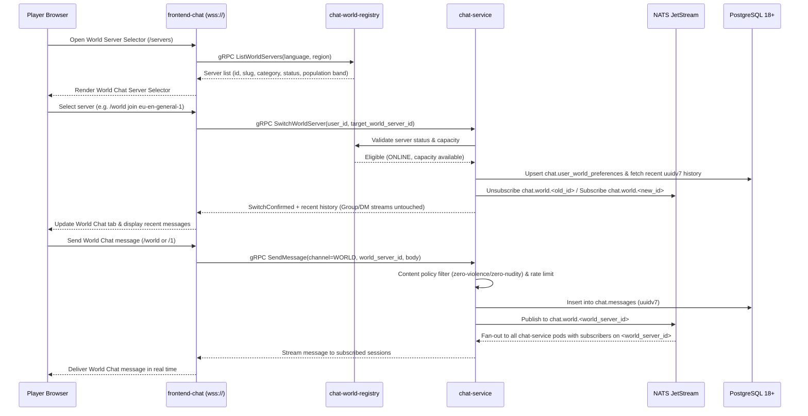

# ADR-0002: World Chat in a Microservice Environment & Player World Chat Server Selection

- **Status:** Accepted
- **Date:** 2026-11-21
- **Deciders:** PrincessPink Architecture
- **Related Documents:** [`docs/Concept.md`](../Concept.md), [`README.md`](../../README.md), [`ADR-0001`](ADR-0001-minimum-postgresql-version.md)

---

## Context

PrincessPink provides a real-time RPG chat system (`frontend-chat` + `chat-service`) featuring three channel types: **Global / World Chat** (modeled on classic World of Warcraft), **Group Chat** (private to a Game Master and their Group), and **1-to-1 Direct Messages** between Players.

In World of Warcraft, "World Chat" (such as `/1` General or `/world`) is not a single unpartitioned global stream for every player on Earth. Instead, players connect to a chosen **Realm / World Server**—organized by language, region, community style (e.g., General, Roleplay, Scientific Discussion), and population load—so the chat feels lively, socially cohesive, and readable without turning into an unusable firehose.

In PrincessPink's cloud-native microservice architecture on **Microsoft Azure Kubernetes Service (AKS)** (`Go 1.27+`, Gin WebSocket edge, gRPC/Protobuf, NATS JetStream, and PostgreSQL 18+ per [ADR-0001](ADR-0001-minimum-postgresql-version.md)), realizing this concept introduces two concrete architectural questions:

1. **How is a World of Warcraft-style World Chat realized across stateless, independently versioned microservices** without introducing fragile stateful per-world server monoliths?
2. **How do Players discover, choose, persist, and switch their World Chat Server** seamlessly—without dropping their WebSocket session or interrupting their **Group Chat** and **1-to-1 Direct Messages**?

---

## Decision

PrincessPink realizes World of Warcraft-style World Chat using **logical World Chat Servers** backed by a dedicated **`chat-world-registry`** microservice, subject-partitioned **NATS JetStream** fan-out, horizontally scalable **`chat-service`** pods, and a stateless **`frontend-chat`** WebSocket edge.

### 1. Realizing World Chat in a Microservice Environment

Instead of binding each browser directly to a dedicated stateful server process per world, connection handling, server directory management, and message routing are decoupled across three focused microservices in the `frontend` and `chat` namespaces:

| Microservice | Namespace | Responsibilities |
| :--- | :--- | :--- |
| **`frontend-chat`** | `frontend` | Stateless Go + Gin edge service terminating authenticated WebSocket (`wss://`) connections (validated via `frontend-gateway` / `user-admin`). Renders the chat UI, World Chat Server selector, and slash commands (`/world`, `/1`, `/servers`, `/group`, `/whisper`), multiplexing World, Group, and Direct Message streams over a **single** client WebSocket. |
| **`chat-world-registry`** | `chat` | Authoritative directory and lifecycle manager for **World Chat Servers**. Stores server metadata in PostgreSQL 18+ (`chat.world_servers`), tracks live occupancy via periodic pod heartbeats over NATS, computes population bands (`LOW`, `MEDIUM`, `HIGH`, `FULL`), exposes gRPC `ListWorldServers` / `GetWorldServer` / `RecommendWorldServer`, and manages server statuses (`ONLINE`, `HIGH_LOAD`, `FULL`, `MAINTENANCE`, `DRAINING`). |
| **`chat-service`** | `chat` | Horizontally scalable messaging engine handling message ingestion, authorization via `user-admin`, zero-violence/zero-nudity content filtering, per-user rate limiting, mute/block/report enforcement, PostgreSQL 18+ persistence (`chat.*` schema using native `uuidv7()` primary keys), and real-time fan-out over NATS JetStream. |

#### Partitioned Fan-Out & Persistence
- **NATS JetStream Subject Sharding:** Each World Chat Server maps to its own isolated NATS JetStream subject:
  - World Chat: `chat.world.<world_server_id>` (replacing a single unpartitioned `chat.global` firehose)
  - Group Chat: `chat.group.<group_id>`
  - Direct Messages: `chat.dm.<pair_id>`
- **PostgreSQL 18+ Schema (`chat.*`):**
  - `chat.world_servers`: `id` (`uuidv7()` PK), `slug` (unique, e.g., `eu-en-general-1`, `de-rp-1`, `global-science-1`), `display_name`, `region`, `language`, `category` (`GENERAL` | `ROLEPLAY` | `SCIENCE` | `NEWCOMER`), `status` (`ONLINE` | `HIGH_LOAD` | `FULL` | `MAINTENANCE` | `DRAINING`), `max_capacity`, `created_at`.
  - `chat.channels`: `id` (`uuidv7()` PK), `channel_type` (`GLOBAL` | `GROUP` | `DIRECT`), `world_server_id` (nullable FK to `chat.world_servers`, required when `channel_type = 'GLOBAL'`), `group_id` (nullable FK, required when `channel_type = 'GROUP'`), `name`, `created_at`.
  - `chat.user_world_preferences`: `user_id` (PK), `world_server_id` (FK), `switched_at`, `updated_at` — persists each Player's and Game Master's chosen World Chat Server across logins and devices.
  - `chat.messages`: `id` (`uuidv7()` PK), `channel_id` (FK), `sender_user_id`, `recipient_user_id`, `body`, `sent_at`, indexed by `(channel_id, id)` for fast cursor-paginated history retrieval on join/switch.
- **Orthogonal Group & Direct Message Channels:** Unlike traditional MMORPGs where a character is locked to a single realm for all social features, a Player's **Group Chat** (`group_id`) and **1-to-1 Direct Messages** are independent of their active World Chat Server. Switching World Chat Servers never interrupts Group or DM conversations.

### 2. How Players Choose & Switch Their World Chat Server

Players (and Game Masters) control their World Chat Server through an explicit, World of Warcraft-inspired **World Chat Server Selector** integrated into `frontend-chat`:

1. **Server Discovery (`ListWorldServers`):**
   - On first chat login (when no server is saved in `chat.user_world_preferences`) or whenever a player opens the **World Server Selector** in the chat header (or enters `/servers` / `/world servers`), `frontend-chat` queries `chat-world-registry`.
   - The UI displays available servers with **name**, **region**, **language**, **category** (`General`, `Roleplay`, `Science`, `Newcomer`), **status** (`Online`, `Maintenance`), and **population indicator** (`Low`, `Medium`, `High`, `Full` — intentionally banded rather than exposing raw internal metrics). Players can filter and sort by language, region, category, and population.
2. **Initial Selection & Smart Default:**
   - The player selects a server from the browser UI or via slash command (e.g., `/world join eu-en-general-1`).
   - If a player skips manual selection—or if their previously saved server is `MAINTENANCE`, `DRAINING`, or `FULL`—`chat-world-registry` provides a recommended eligible server (`RecommendWorldServer`) matching the player's locale/language with healthy headroom, while clearly notifying the player and letting them pick another server at any time.
3. **Validation & Persistent Preference:**
   - `frontend-chat` sends a `SwitchWorldServer(user_id, target_world_server_id)` gRPC call to `chat-service`.
   - `chat-service` validates the authenticated user (`user-admin`), checks with `chat-world-registry` that the target server is `ONLINE` and below `max_capacity`, enforces a per-user switch cooldown (anti-hopping rate limit), and upserts `chat.user_world_preferences` in PostgreSQL 18+.
4. **Live Zero-Disconnect Switching:**
   - Without closing the browser's `wss://` connection, `chat-service` atomically unsubscribes the player's stream from `chat.world.<old_world_server_id>` and subscribes it to `chat.world.<new_world_server_id>`.
   - `chat-service` updates occupancy delta heartbeats for `chat-world-registry`, emits a system notice in the UI (`Connected to World Chat Server: EU-EN-General-1`), and streams the recent cursor-paginated message history (`uuidv7()`) for the new server.
   - Active Group Chat and 1-to-1 Direct Message subscriptions continue uninterrupted on the same WebSocket connection.

### 3. End-to-End Selection & Broadcast Flow

### 4. Safety, Content Policy & Cross-Server Consistency

- **Zero-Violence / Zero-Nudity Enforcement:** Every message on every World Chat Server passes through the same automated content-policy filter and per-user rate limiter in `chat-service`.
- **Global Mute & Block Lists:** Player block/mute lists are scoped to `user_id` across all World Chat Servers—blocking a user prevents seeing their messages regardless of which World Chat Server either player joins.
- **Graceful Draining & Maintenance:** Operators can transition a World Chat Server to `DRAINING` in `chat-world-registry` to stop new joins, notify connected players, and guide them to select another online server before maintenance.
- **Auditability & Observability:** Server joins, switches, and moderation actions are logged with structured JSON (`log/slog` with non-PII `user_uuid`, `world_server_id`, `service_version`, `trace_id`) and OpenTelemetry traces, with Prometheus metrics tracking per-server active sessions, message throughput, and switch rate.

---

## Options Considered

| Option | Description | Evaluation |
| :--- | :--- | :--- |
| **1. Single Unpartitioned Global Chat (`chat.global`)** | All authenticated players share one global broadcast channel with no server selection. | **Rejected.** Does not scale socially or technically: mixes languages, time zones, and RPG playstyles into an unreadable firehose; creates a single hot NATS subject and DB partition; provides no player agency. |
| **2. Dedicated Stateful Chat Server Pod per World (Direct Client-to-Pod Binding)** | Mirror legacy MMORPG realms 1:1 by deploying a separate stateful server instance and endpoint per World Chat Server that clients connect to directly. | **Rejected.** Breaks AKS stateless horizontal autoscaling; complicates TLS/Ingress routing and zero-trust `NetworkPolicy`; causes mass disconnects on rolling updates or pod evictions; couples Group Chat and Direct Messages to world server availability. |
| **3. Logical World Chat Servers (`chat-world-registry` + Partitioned `chat-service` + Subject-Sharded NATS JetStream + Stateless `frontend-chat`)** | Decouple WebSocket edge termination (`frontend-chat`) from server discovery/capacity (`chat-world-registry`) and partitioned messaging (`chat-service` + `chat.world.<world_server_id>`). | **Selected.** Preserves the authentic WoW World Chat experience and player server choice while remaining 100% cloud-native, horizontally scalable on AKS, resilient to pod restarts, and non-disruptive to Group Chat and Direct Messages. |

---

## Rationale & Alignment with PrincessPink Requirements

1. **Cloud-Native Microservice Fit (Concept §3.1 & §6.1):**
   Keeps `frontend-chat` and `chat-service` stateless and HPA-scalable on AKS, while isolating server catalog/occupancy state into a small, independently versioned `chat-world-registry` microservice in the `chat` namespace.
2. **Authentic WoW Experience with Player Agency:**
   Players can browse servers by language, region, category, and live population band, join a community that fits their tabletop style, and switch servers live via UI or slash commands (`/servers`, `/world join <slug>`).
3. **PostgreSQL 18+ Synergy ([ADR-0001](ADR-0001-minimum-postgresql-version.md)):**
   Time-ordered `uuidv7()` primary keys and PostgreSQL 18 B-tree skip scans on `(channel_id, id)` make per-server cursor pagination and append-heavy multi-world message storage efficient without extra extensions.
4. **Resilience & Zero-Downtime Operations:**
   Pod restarts in `frontend-chat` or `chat-service` automatically reconnect and restore the player's saved `world_server_id` from `chat.user_world_preferences`. If a single World Chat Server grows disproportionately large, its NATS subject (`chat.world.<world_server_id>`) can be assigned dedicated consumer/pod pools without changing any client or API contract.

---

## Consequences

### Positive
- Delivers a genuine World of Warcraft-style World Chat experience with player-chosen servers while staying fully idiomatic to Kubernetes and Go microservices.
- Prevents global chat overload by partitioning both social traffic and NATS JetStream / PostgreSQL workloads by `world_server_id`.
- Allows instant, zero-disconnect World Chat Server switching without affecting Group Chat or 1-to-1 Direct Messages.
- Enables operators to add, categorize, drain, or retire World Chat Servers dynamically via `chat-world-registry` without redeploying `frontend-chat` or `chat-service`.

### Trade-offs & Operational Notes
- **Additional Microservice (`chat-world-registry`):** Adds one lightweight independently versioned Go microservice in the `chat` namespace, with corresponding gRPC contract in `pkg/proto/chat/v1`, Kubernetes `NetworkPolicy` rules (`frontend-chat` → `chat-world-registry`, `chat-service` → `chat-world-registry`, `chat-world-registry` → PostgreSQL & NATS), and CI/CD pipeline entries.
- **Eventually Consistent Occupancy Counts:** Live player counts per World Chat Server are aggregated from periodic pod heartbeats and presented as population bands (`LOW`, `MEDIUM`, `HIGH`, `FULL`), which is intentionally approximate (a few seconds of lag) and sufficient for server selection.
- **Anti-Hopping & Capacity Edge Cases:** `chat-service` must enforce a configurable switch cooldown to prevent abuse, and must handle race conditions near `max_capacity` gracefully by allowing slight soft-cap burst or prompting the player to choose another server.
