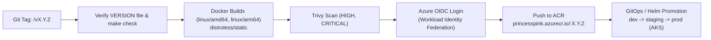

# ADR-0009: GitHub Actions CI/CD Architecture (`.github/workflows/`)

- **Status:** Accepted
- **Date:** 2026-11-22
- **Deciders:** PrincessPink Architecture
- **Related Documents:** [`docs/Concept.md`](../Concept.md), [`README.md`](../../README.md), [`Makefile`](../../Makefile), [`ADR-0001`](ADR-0001-minimum-postgresql-version.md), [`ADR-0005`](ADR-0005-shared-grpc-protobuf-contracts.md), [`ADR-0008`](ADR-0008-multi-module-makefile-build-automation.md)

---

## Context

PrincessPink is hosted on GitHub (`ladrost/princesspink`), structured as a Go 1.27+ multi-module workspace (`go.work`, `toolchain go1.27.4`) with shared `pkg/` libraries and 25+ independently versioned microservices under `services/`, targeting **Azure Container Registry (ACR)** and **Azure Kubernetes Service (AKS)** (Concept §3.5, §6.2 & §7.3).

A naive monorepo CI pipeline that rebuilds, retests, and redeploys every microservice on every commit does not scale to 25+ services and contradicts PrincessPink's independent per-service semantic versioning (`<service>/v<MAJOR.MINOR.PATCH>`). Conversely, overly fragmented pipelines risk skipping cross-cutting checks when shared `pkg/` libraries or Protobuf contracts change.

We need a clear, secure, and maintainable **GitHub Actions CI/CD architecture** under `.github/workflows/` that:

1. Enforces PrincessPink's full quality and security gates (`fmt-check`, `vet`, `golangci-lint`, `-race` tests, fixed-seed simulation tests, `buf` contract checks, `govulncheck`, PostgreSQL 18+ integration tests, and Trivy image scans).
2. Runs fast, change-aware pipelines on pull requests while validating the entire workspace whenever shared `pkg/` contracts or workspace tooling change.
3. Publishes independently versioned multi-arch (`linux/amd64,linux/arm64`) `distroless/static` container images to ACR using keyless OIDC authentication and drives GitOps/Helm promotion to AKS (`dev` → `staging` → `prod`).

---

## Decision

PrincessPink implements a modular **GitHub Actions** pipeline suite under `.github/workflows/` built on **`Makefile` target parity** ([ADR-0008](ADR-0008-multi-module-makefile-build-automation.md)), **change-aware module matrix execution**, **scoped Git-tag per-service releases**, and **keyless Azure OIDC authentication**.

### 1. Workflow Suite Overview

| Workflow File | Trigger | Responsibilities |
| :--- | :--- | :--- |
| **`ci.yml`** | `pull_request`, `push` to `main` | Change detection (`pkg/` vs. affected `services/`), Go quality gate (`fmt-check`, `vet`, `lint`, `test-race`, `vuln`), deterministic simulation tests (`test-sim`), Protobuf `buf lint` + `buf breaking` + clean-diff verification, and Testcontainers integration tests (`test-integration` with **PostgreSQL 18+** & NATS). |
| **`release-service.yml`** | Scoped Git tags `<service>/v*.*.*` | Validates that the tag matches `services/<service>/VERSION`, runs full `make check SERVICE=<service>`, builds and pushes a multi-arch (`linux/amd64,linux/arm64`) hardened `distroless/static` image to ACR (`princesspink.azurecr.io/<service>:<version>`), scans with **Trivy** (`--severity HIGH,CRITICAL --exit-code 1`), generates an SBOM/attestation, and triggers GitOps/Helm deployment (`dev` → `staging` → `prod`). |
| **`security.yml`** | Weekly schedule (`cron`) + `workflow_dispatch` | Full-workspace `govulncheck` across all `pkg/` and `services/` modules, CodeQL static analysis for Go, and container vulnerability re-scans of active ACR images so newly disclosed CVEs are caught even between code changes. |

### 2. Change-Aware Matrix Execution in `ci.yml`

To keep pull-request feedback fast as the service catalog grows:

- **Targeted Runs:** When a PR modifies only `services/<svc>/**`, `ci.yml` runs the Go test/lint/vuln matrix strictly for the affected service(s) via `make ... SERVICE=<svc>`.
- **Full-Workspace Fan-Out:** When a PR modifies `pkg/**`, `go.work`, `Makefile`, `.golangci.yml`, or `.github/workflows/**`, `ci.yml` automatically expands the matrix to validate all `pkg/` and `services/` modules in parallel.
- **Protobuf Contract Gate:** Whenever `pkg/proto/**` changes (or on every PR once `pkg/proto` exists), CI runs `make proto-lint`, `make proto-breaking` (against `main`), and verifies that `make proto-gen` produces no uncommitted diff.
- **PostgreSQL 18+ Integration Parity ([ADR-0001](ADR-0001-minimum-postgresql-version.md)):** Integration test jobs run against **PostgreSQL 18** (`postgres:18-alpine` via Testcontainers or GitHub Actions service containers) and NATS JetStream, validating RBAC boundaries, `uuidv7()` schemas, and outbox/event flows.

### 3. Per-Service Release Flow & Cloud Security

- **Keyless Azure Authentication (OIDC):** Release and deployment workflows authenticate to Microsoft Azure (ACR & AKS) exclusively via **GitHub OIDC + Azure Workload Identity Federation**—zero long-lived Azure service principal secrets stored in GitHub Secrets.
- **Least-Privilege Permissions & Supply-Chain Hardening:**
  - Every workflow declares explicit top-level `permissions: contents: read` and elevates permissions (`id-token: write`, `security-events: write`, `packages: write`) only on the specific job that needs them.
  - Third-party GitHub Actions are pinned to immutable full commit SHAs (with version comments) and kept current via Dependabot / Renovate alongside Go module dependencies.
  - Concurrency groups (`concurrency: { group: ${{ github.workflow }}-${{ github.ref }}, cancel-in-progress: true }`) prevent redundant PR runs while never canceling in-flight `main` or release-tag pipelines.
- **Environment Protection Rules:** AKS promotions to `staging` and `prod` use GitHub Environments with required approvals and branch/tag protection policies.

---

## Options Considered

| Option | Description | Evaluation |
| :--- | :--- | :--- |
| **1. GitHub Actions with Change-Aware Matrix, `Makefile` Parity & Azure OIDC** | Native `.github/workflows/` pipelines invoking `Makefile` targets, scoped `<service>/v*` release tags, and keyless OIDC to ACR/AKS. | **Selected.** Zero external CI server maintenance, native PR checks and GitHub Security/SARIF integration, clean fit for independent per-service tags, and directly aligned with Concept §7.3. |
| **2. Azure Pipelines (Azure DevOps)** | Host CI/CD outside GitHub in Azure DevOps. | **Rejected.** Splits repository governance, PR checks, and security advisories across two platforms when GitHub Actions already supports native Azure OIDC to ACR and AKS. |
| **3. Self-Hosted Jenkins / Custom Runner Fleet** | Operate dedicated CI servers inside AKS or VMs. | **Rejected.** High operational and security patching overhead for an open-source project; GitHub-hosted runners provide clean, ephemeral build environments out of the box. |
| **4. Single Monolithic Pipeline Rebuilding All Services on Every Commit** | Run full build, test, and Docker push for every service on every merge to `main`. | **Rejected.** Violates independent per-service versioning (Concept §3.5), wastes CI minutes, and creates noisy unnecessary container releases for untouched services. |

---

## Rationale & Alignment with PrincessPink Requirements

1. **Independent Microservice Versioning (Concept §3.5):**
   Triggering `release-service.yml` on scoped Git tags (`<service>/v<MAJOR.MINOR.PATCH>` created via `make tag SERVICE=<svc>`) ensures every microservice releases on its own cadence with traceable binary, Git, and ACR image versions.
2. **Defense-in-Depth Quality & Security Gates (Concept §7.2 & §7.3):**
   Combining `golangci-lint`, `-race` tests, deterministic fixed-seed simulation tests (`test-sim`), `buf breaking`, `govulncheck`, CodeQL, and Trivy container scans catches bugs, race conditions, contract regressions, and CVEs before any image reaches AKS.
3. **Local-to-CI Consistency ([ADR-0008](ADR-0008-multi-module-makefile-build-automation.md)):**
   Delegating build/test commands to `Makefile` targets prevents CI drift and lets contributors reproduce failures locally with a single command.

---

## Consequences

### Positive
- Fast, parallelized PR feedback that scales cleanly from Phase 1 (`pkg/` + `user-admin`) to 25+ microservices in Phase 4–5.
- Zero long-lived cloud credentials in GitHub Secrets thanks to Azure OIDC Workload Identity Federation.
- Automated weekly vulnerability monitoring (`govulncheck` + Trivy + CodeQL) protects both Go dependencies and `distroless/static` container images.

### Trade-offs & Operational Notes
- **Scoped Tag Discipline:** Releasing a microservice requires updating `services/<service>/VERSION` and pushing the matching `<service>/v<VERSION>` tag (`make tag SERVICE=<svc>`); CI fails fast if the tag and `VERSION` file diverge.
- **GitHub Actions Minute & Cache Management:** Caching the Go build/module cache (`actions/setup-go` using `go-version-file: go.work`) and `golangci-lint` cache per module is essential to keep full-workspace runs triggered by `pkg/` edits fast.
- **Phased Activation:** During Phase 0 (before `pkg/` and `services/` modules exist), `Makefile` targets exit cleanly when no Go modules are present, allowing `ci.yml` to be enabled incrementally in Phase 1 as the first `pkg/` modules and `user-admin` are committed.
