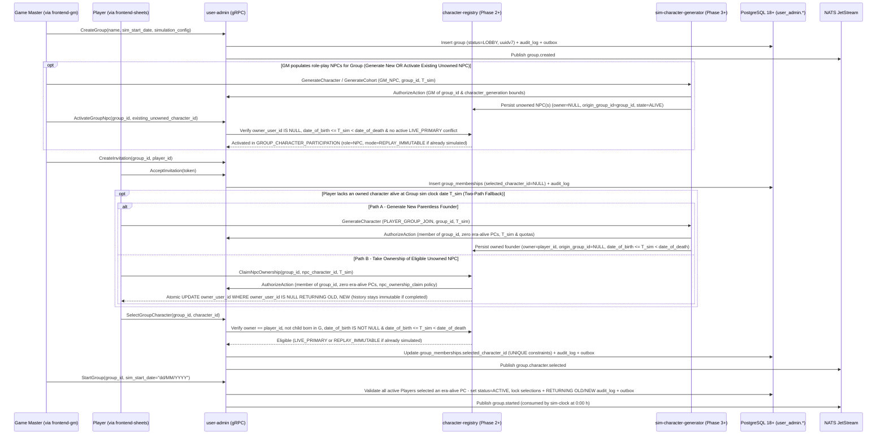

# ADR-0010: User Administration Service (`user-admin`) — PostgreSQL 18+, Argon2id Auth, Player/GM RBAC & Group Management

- **Status:** Accepted
- **Date:** 2026-11-22
- **Deciders:** PrincessPink Architecture
- **Related Documents:** [`docs/Concept.md`](../Concept.md), [`README.md`](../../README.md), [`ADR-0001`](ADR-0001-minimum-postgresql-version.md), [`ADR-0003`](ADR-0003-shared-logging-library.md), [`ADR-0004`](ADR-0004-shared-opentelemetry-observability.md), [`ADR-0005`](ADR-0005-shared-grpc-protobuf-contracts.md), [`ADR-0006`](ADR-0006-shared-configuration-library.md), [`ADR-0007`](ADR-0007-shared-uuid-utilities.md), [`ADR-0008`](ADR-0008-multi-module-makefile-build-automation.md), [`ADR-0009`](ADR-0009-github-actions-ci-cd.md), [`ADR-0012`](ADR-0012-private-subnet-isolation-and-encrypted-cloud-communication.md), [`ADR-0013`](ADR-0013-static-website-service-and-public-results-presentation.md)

---

## Context

Phase 1 of PrincessPink (**Platform Foundation**, Concept §9) establishes the shared `libs/` libraries ([ADR-0003](ADR-0003-shared-logging-library.md)–[ADR-0007](ADR-0007-shared-uuid-utilities.md)), build/CI automation ([ADR-0008](ADR-0008-multi-module-makefile-build-automation.md)–[ADR-0009](ADR-0009-github-actions-ci-cd.md)), and the first stateful domain microservice: **`user-admin`** (`services/user-admin/`).

`user-admin` is the authoritative source of identity, authentication, authorization, and Group (campaign) management across the entire PrincessPink platform (Concept §2.2, §4.2, §5.1). Every downstream subsystem introduced in Phases 2–4 depends on it:

- **`frontend-gateway`, `frontend-website`, `frontend-sheets`, `frontend-gm`, `frontend-chat`:** User registration, login, MFA verification, session refresh/logout, coarse-grained route protection, and mandatory MFA-verified `SYSTEM_ADMIN` gating for `/admin/website/*`.
- **`website-service` ([ADR-0013](ADR-0013-static-website-service-and-public-results-presentation.md)):** Synchronous verification of `SYSTEM_ADMIN` role + verified MFA on every static website draft, preview, edit, publish, rollback, and public-showcase configuration request, alongside immutable audit logging.
- **`character-registry`, `sheet-aggregator`, `sim-character-generator`, `sim-roleplay` & `gamification-service`:** Fine-grained verification of Player ownership, single-character-per-group selection (including strict point-in-time era liveness `date_of_birth IS NOT NULL AND date_of_birth <= T_sim AND (date_of_death IS NULL OR T_sim < date_of_death)` covering both live-simulating and already-simulated `REPLAY_IMMUTABLE` owned characters), child `origin_group_id` restrictions, owning-Player exclusive activation authority vs. GM unowned-NPC activation (`owner_user_id IS NULL`), GM-exclusive initiation of GM Role-Play Elements (`ACCIDENTAL_PREMATURE_EJACULATION`, `BROKEN_CONDOM`, `FORGOTTEN_CONTRACEPTION_PILL`, GM-only `FEMALE_ORGASM` with mandatory `CLITORAL` vs. `VAGINAL` choice, and extended events in Concept §2.9), `REPLAY_IMMUTABLE` attribute-mutation denial, parentless character generation permissions/quotas (`PLAYER_NEW_FAMILY`, `PLAYER_GROUP_JOIN`, `GM_NPC`, and internal-only `SYSTEM_SEED`), Player NPC ownership takeover (`NPC_OWNERSHIP_CLAIM`) when lacking an era-alive character, and Game Master supervision/adjustment authority.
- **`chat-service` & `chat-world-registry`:** Validating authenticated WebSocket sessions, enforcing Group Chat membership, and scoping Game Master moderation strictly to their own Group(s).
- **`sim-clock`:** Receiving authoritative Group creation, mandatory start date (`dd/MM/YYYY` at `0:00 h`), and `GROUP.simulation_config` updates authorized by the Group's Game Master.

To build `user-admin` securely and cleanly in Phase 1—before `character-registry`, `frontend-gateway`, or `sim-clock` exist in Phases 2–3—we must establish concrete architectural decisions for its PostgreSQL 18+ schema, `Argon2id` password hashing, token/session security, MFA, Player/GM RBAC, Group lifecycle invariants, immutable audit logging, and cross-service contracts.

---

## Decision

PrincessPink implements **`user-admin`** as an independently versioned **Go 1.27+ microservice** (`services/user-admin/`) backed by a dedicated **`user_admin.*` schema in PostgreSQL 18+** ([ADR-0001](ADR-0001-minimum-postgresql-version.md)), exposing an internal **gRPC/Protobuf API** (`libs/proto/useradmin/v1`, [ADR-0005](ADR-0005-shared-grpc-protobuf-contracts.md)), publishing domain events via a **transactional outbox** to NATS JetStream, and enforcing **`Argon2id` authentication**, **Ed25519 JWTs + rotating refresh tokens**, **TOTP/WebAuthn MFA**, **Player/GM/`SYSTEM_ADMIN` RBAC**, and **Group participation invariants**.

### 1. Service Architecture & Internal Interfaces

`user-admin` is deployed in the dedicated **`user-admin` AKS namespace** inside its own **private / non-public Azure VNet subnet (`snet-user-admin`)**—strictly isolated from other namespaces' subnets per [ADR-0012](ADR-0012-private-subnet-isolation-and-encrypted-cloud-communication.md)—as a stateless, horizontally scalable `Deployment` (`distroless/static` non-root container, read-only root filesystem, `CGO_ENABLED=0`) with zero direct public internet exposure. All browser traffic enters via Azure Front Door / `snet-ingress` → `frontend-gateway` (`snet-frontend`, TLS 1.3 / mTLS) and reaches `user-admin` over mandatory mTLS (TLS 1.3) gRPC; all outbound calls from `user-admin` to PostgreSQL 18+ (`snet-postgresql`, `sslmode=verify-full`), NATS JetStream (`snet-messaging`, TLS 1.3 / mTLS), `character-registry` (`snet-character-sheet`, mTLS gRPC), observability (`snet-observability`, TLS 1.3 / mTLS), and Key Vault (`snet-private-endpoints`, TLS 1.3) are strictly encrypted.

- **Shared Platform Modules:** Bootstraps structured non-PII JSON logging (`libs/logging`, [ADR-0003](ADR-0003-shared-logging-library.md)), OpenTelemetry tracing, Prometheus metrics, and `/healthz` + `/readyz` probes (`libs/telemetry`, [ADR-0004](ADR-0004-shared-opentelemetry-observability.md)), 12-Factor env + `*_FILE` Azure Key Vault CSI secrets (`libs/config`, [ADR-0006](ADR-0006-shared-configuration-library.md)), and RFC 9562 UUIDv7 entity IDs (`libs/uuid`, [ADR-0007](ADR-0007-shared-uuid-utilities.md)).
- **Internal gRPC Surface (`libs/proto/useradmin/v1`):**
  - **`AuthService`:** `Register`, `Login`, `VerifyMFA`, `RefreshSession`, `Logout`, `RevokeAllSessions`, `ChangePassword`, `RequestPasswordReset`, `CompletePasswordReset`, and `GetJWKS` (publishes Ed25519 public keys for fast local JWT verification at `frontend-gateway`).
  - **`UserService`:** `GetUser`, `UpdateProfile`, `UpdateUserRole`, `EnrollTOTP`, `ConfirmTOTP`, `RegisterWebAuthnCredential`, `DisableMFA`, and `RegenerateRecoveryCodes`.
  - **`GroupService`:** `CreateGroup`, `GetGroup`, `ListUserGroups`, `UpdateGroupConfig` (including `sim_start_date` preview in `LOBBY` and `character_generation`, `npc_ownership_claim`, `reappearance`, `roleplay_events`, `discovery_mode`, `campaign_challenges`, opt-in `public_visibility`, and `prenatal_loss` policies), `StartGroup` (validates mandatory `sim_start_date` and locks character selections), `ArchiveGroup`, `CreateInvitation`, `AcceptInvitation`, `RemoveMember`, `SelectGroupCharacter`, `ActivateGroupNpc` (GM activates an unowned NPC alive at `T_sim`), `ApproveNpcOwnershipClaim` (when GM approval is configured), and `ListGroupMembers`.
  - **`AuthorizationService`:** `AuthorizeAction` answering fine-grained policy checks (e.g., *"Can User `U` view/act on Character `C`?"*, *"Can User `U` select Character `C` for Group `G` at sim clock date `T_sim`?"*, *"Can User `U` mutate attributes of Character `C` at `T_sim` (denied if `REPLAY_IMMUTABLE` / already simulated)?"*, *"Can User `U` initiate GM-only Role-Play Event `E`—including `FEMALE_ORGASM` [`CLITORAL` | `VAGINAL`], `ACCIDENTAL_PREMATURE_EJACULATION`, `BROKEN_CONDOM`, `FORGOTTEN_CONTRACEPTION_PILL`, or extended GM events—in Group `G` (strictly allowed only for Group `G`'s managing `GAME_MASTER`, denied for Players, other GMs, and non-managing System Admins)?"*, *"Can GM `M` activate unowned NPC `C` in Group `G` (strictly denied if `owner_user_id IS NOT NULL`)?"*, *"Can User `U` generate a parentless character (`PLAYER_NEW_FAMILY`, `PLAYER_GROUP_JOIN` for Group `G`, or `GM_NPC` in Group `G`) or claim ownership of an unowned NPC (`NPC_OWNERSHIP_CLAIM`) for Group `G`?"*, *"Is User `U` the Game Master of Group `G`?"*, *"Can User `U` access Group Chat `G`?"*, *"Can User `U` control `sim-clock` for Group `G`?"*, *"Is User `U` an MFA-verified `SYSTEM_ADMIN` authorized to view drafts, edit, preview, publish, or roll back pages and public showcase widgets in `website-service`?"*).
- **Transactional Outbox Events (NATS JetStream):** Mutations to users, roles, groups, memberships, NPC activations, and group configuration atomically insert Protobuf event envelopes into `user_admin.outbox_events` and relay them to NATS JetStream (`user.registered`, `user.role.updated`, `group.created`, `group.started`, `group.archived`, `group.config.updated`, `group.member.joined`, `group.member.removed`, `group.character.selected`, `group.npc.activated`).

### 2. PostgreSQL 18+ Persistence Schema (`user_admin.*`)

`user-admin` owns the isolated PostgreSQL 18+ schema `user_admin.*` using `pgx/v5`, least-privilege database credentials (`user_admin_app`), `sslmode=verify-full` / Microsoft Entra ID authentication, and versioned SQL migrations. Every entity primary key uses native **RFC 9562 `uuidv7()`** ([ADR-0001](ADR-0001-minimum-postgresql-version.md), [ADR-0007](ADR-0007-shared-uuid-utilities.md)):

| Table | Key Columns & Constraints | Purpose |
| :--- | :--- | :--- |
| **`user_admin.users`** | `id` (`uuidv7()` PK), `email` (unique case-insensitive index on `LOWER(email)`), `display_name`, `role` (`PLAYER` \| `GAME_MASTER` \| `SYSTEM_ADMIN`), `status` (`ACTIVE` \| `SUSPENDED` \| `LOCKED` \| `DELETED`), `password_hash` (PHC Argon2id), `mfa_enabled`, `failed_login_attempts`, `locked_until`, `created_at`, `updated_at` | Canonical user identity, credentials, role, and account lockout state. Public `Register` always assigns `PLAYER`. |
| **`user_admin.mfa_credentials`** | `id` (`uuidv7()` PK), `user_id` (FK), `method` (`TOTP` \| `WEBAUTHN`), `encrypted_secret` (AES-256-GCM envelope-encrypted via Key Vault KEK), `credential_id`, `public_key`, `sign_count`, `last_used_timestep`, `verified_at`, `created_at` | TOTP secrets (with replay protection) and WebAuthn/Passkey public-key credentials. |
| **`user_admin.mfa_recovery_codes`** | `id` (`uuidv7()` PK), `user_id` (FK), `code_hash` (Argon2id/keyed hash), `used_at` (nullable) | Single-use backup recovery codes issued upon MFA enrollment. |
| **`user_admin.sessions`** | `id` (`uuidv7()` PK), `user_id` (FK), `token_family_id` (`UUID`), `refresh_token_hash` (SHA-256 of 256-bit `crypto/rand` token), `user_agent_hash`, `ip_prefix`, `expires_at`, `revoked_at`, `revoked_reason`, `created_at` | Active refresh-token sessions supporting rotation and reuse detection. |
| **`user_admin.password_reset_tokens`** | `id` (`uuidv7()` PK), `user_id` (FK), `token_hash` (SHA-256 of 256-bit `crypto/rand` token), `expires_at`, `used_at`, `created_at` | Short-lived, single-use password recovery tokens (never stored in plaintext). |
| **`user_admin.groups`** | `id` (`uuidv7()` PK), `name`, `game_master_id` (FK → `users.id`), `status` (`LOBBY` \| `ACTIVE` \| `ARCHIVED`), `sim_start_date` (`DATE`, optional/previewable in `LOBBY`, mandatory on `ACTIVE`), `simulation_config` (`JSONB`), `created_at`, `updated_at` | Authoritative Group (campaign) metadata, GM ownership, mandatory start date (`dd/MM/YYYY`, `0:00 h`), and versioned `simulation_config` (per-group tick rate defaulting to 1 sim year = 24h real time, weight/health bounds, `character_generation`, `npc_ownership_claim`, `reappearance`, `roleplay_events`, `discovery_mode`, `campaign_challenges`, opt-in `public_visibility`, and default-on GM-configurable prenatal-loss settings & prenatal-care tier). |
| **`user_admin.group_memberships`** | `id` (`uuidv7()` PK), `group_id` (FK), `user_id` (FK), `member_role` (`PLAYER` \| `GAME_MASTER`), `selected_character_id` (`UUID`, nullable until selected), `selection_locked_at` (nullable), `joined_at`, `removed_at` (nullable); `UNIQUE (group_id, user_id) WHERE removed_at IS NULL`; `UNIQUE (group_id, selected_character_id) WHERE selected_character_id IS NOT NULL AND removed_at IS NULL` | Enforces Group membership and the **one active owned Character per Player per Group** invariant at the database constraint level. |
| **`user_admin.group_invitations`** | `id` (`uuidv7()` PK), `group_id` (FK), `invited_by_user_id` (FK), `invitee_user_id` (nullable FK), `invite_token_hash` (SHA-256 of 256-bit `crypto/rand` token), `status` (`PENDING` \| `ACCEPTED` \| `DECLINED` \| `EXPIRED` \| `REVOKED`), `expires_at`, `created_at` | Controlled Group onboarding initiated by the Group's Game Master. |
| **`user_admin.audit_logs`** | `id` (`uuidv7()` PK), `occurred_at`, `actor_user_id`, `actor_role`, `action`, `target_type`, `target_id`, `group_id`, `correlation_id`, `service_version`, `old_state` (`JSONB`), `new_state` (`JSONB`), `metadata` (`JSONB`) | Append-only immutable security & governance trail (`REVOKE UPDATE, DELETE` from `user_admin_app`), populated atomically using PostgreSQL 18 `RETURNING OLD, NEW`. |
| **`user_admin.outbox_events`** | `id` (`uuidv7()` PK), `subject`, `payload` (`BYTEA`), `headers` (`JSONB`), `created_at`, `published_at` (nullable) | Transactional outbox guaranteeing atomic DB commit + NATS JetStream event publication. |

### 3. Authentication, `Argon2id` Password Hashing, MFA & Session Security

1. **`Argon2id` Password Hashing (`golang.org/x/crypto/argon2`):**
   - **Parameters:** Configurable via `libs/config` with enforced secure minimums aligned with OWASP guidelines: `memory >= 64 MiB` (`65536 KiB`), `time >= 3` iterations, `parallelism = 2` (or `4` sized to pod CPU limits), `salt = 16 bytes` from `crypto/rand`, `keyLength = 32 bytes`.
   - **PHC String Encoding & Transparent Upgrades:** Hashes are stored in standard PHC format (`$argon2id$v=19$m=65536,t=3,p=2$<b64-salt>$<b64-hash>`). On successful login, if a stored hash uses older/weaker parameters than the active configuration, `user-admin` transparently rehashes and updates `password_hash`.
   - **Timing & DoS Hardening:** Verification uses `crypto/subtle.ConstantTimeCompare`. Unknown-email logins execute a dummy `Argon2id` computation to equalize response latency and prevent account enumeration. A bounded concurrency semaphore limits simultaneous `Argon2id` derivations per pod so credential-stuffing bursts cannot OOM-kill `user-admin` containers.
2. **Short-Lived Ed25519 JWTs & Rotating Refresh Tokens:**
   - **Access Tokens:** Signed with **Ed25519 (`EdDSA`)** private keys mounted from Azure Key Vault via the Secrets Store CSI Driver ([ADR-0006](ADR-0006-shared-configuration-library.md)), short-lived (`10–15 minutes`), containing `sub` (`user_uuid`), `role` (`PLAYER` | `GAME_MASTER` | `SYSTEM_ADMIN`), `sid` (`session_id`), `mfa` (boolean), `kid`, `jti`, `iss`, `aud`, `iat`, and `exp`. No PII (no email or display name) is embedded in JWT claims.
   - **Refresh Tokens:** Generated from `crypto/rand` (≥ 256 bits, never UUIDv7 per [ADR-0007](ADR-0007-shared-uuid-utilities.md)), stored strictly as SHA-256 hashes in `user_admin.sessions`, and delivered to browsers by `frontend-gateway` exclusively in `HttpOnly`, `Secure`, `SameSite=Strict` cookies.
   - **Rotation & Reuse Detection:** Every `RefreshSession` call issues a new refresh token in the same `token_family_id` and marks the prior row rotated. Re-presenting a rotated or revoked refresh token triggers immediate revocation of the entire `token_family_id` and logs a high-severity `AUTH_TOKEN_REUSE_DETECTED` audit record.
3. **Multi-Factor Authentication (MFA) & Account Lockout:**
   - Supports **TOTP (RFC 6238)** (6-digit, 30s period, ±1 step window, `last_used_timestep` replay prevention) and **WebAuthn / Passkeys**.
   - Strongly recommended for `GAME_MASTER` accounts (`REQUIRE_GM_MFA`, default `false` in `local`/`dev`, `true` in `staging`/`prod`), and **strictly mandatory for `SYSTEM_ADMIN` accounts across all cloud environments** (`REQUIRE_ADMIN_MFA`, strictly enforced `true` in `dev`/`staging`/`prod`).
   - Progressive lockout on repeated failed logins (`failed_login_attempts`, `locked_until`) complements edge rate limiting at `frontend-gateway`.

### 4. Player / Game Master / System Admin RBAC & Group Management Invariants

`user-admin` enforces three platform roles—**`PLAYER`**, **`GAME_MASTER`**, and **`SYSTEM_ADMIN`**—combined with strict resource- and group-scoped ownership checks and **separation of duties**. A user with the `GAME_MASTER` role may create and manage their own Groups (`groups.game_master_id == user.id`) and may also join another GM's Group as a `PLAYER` (`group_memberships.member_role = 'PLAYER'`). A **`SYSTEM_ADMIN`** holds exclusive administrative access to the **Static Website Service** ([ADR-0013](ADR-0013-static-website-service-and-public-results-presentation.md)) but gains **zero implicit Game Master or private-campaign privileges** in any Group (`SYSTEM_ADMIN` accounts should remain separate from gameplay accounts in production; initial `SYSTEM_ADMIN` provisioning occurs strictly via internal mTLS operator tooling, never via public `Register`).

| Capability / Action | `PLAYER` (Member of Group `G`) | `GAME_MASTER` (Manages Group `G`) | `GAME_MASTER` (Other Group `G'`) | `SYSTEM_ADMIN` (Platform Admin) |
| :--- | :--- | :--- | :--- | :--- |
| View published public static pages (`/`, `/imprint`, `/privacy`, `/pages/:slug`, `/public/*`) | Allowed (public) | Allowed (public) | Allowed (public) | Allowed (public) |
| **Access Static Website Admin Portal (`/admin/website/*`) & edit, preview, publish, roll back Landing Page, Imprint, Privacy Policy, custom static pages & Public Service Results widgets (`website-service`)** | **Strictly Denied** (`PermissionDenied`) | **Strictly Denied** (`PermissionDenied`) | **Strictly Denied** (`PermissionDenied`) | **Allowed** (mandatory MFA, synchronous `AuthorizationService` check, immutable audit log) |
| View/manage own personal Character roster (`owner_user_id == user.id`) | Allowed | Allowed | Allowed (own roster only) | Own roster only *(separate account recommended)* |
| Decide whether an owned Character (`owner_user_id == user.id`) becomes active again in Group `G` | Allowed (owning Player only) | Denied for other Players' Characters (own roster only if joining as `PLAYER`) | Denied | Denied for other Players' Characters |
| Generate parentless founder character for own roster (`PLAYER_NEW_FAMILY`) or to join Group `G` when lacking an era-alive character (`PLAYER_GROUP_JOIN`) | Allowed (within quotas/cooldowns & `simulation_config`, audit-logged) | Allowed (own roster / if joining as `PLAYER`) | Allowed (own roster only) | Denied unless explicit `PLAYER` member of `G` |
| Take permanent ownership of an eligible unowned NPC (`NPC_OWNERSHIP_CLAIM`) when lacking an era-alive owned Character for Group `G` | Allowed (strictly when Player has zero era-alive owned PCs for `G`, atomic transfer, audit-logged) | Allowed only if joining as `PLAYER` with zero era-alive PCs (may also approve claims if required by `simulation_config`) | Denied | Denied unless explicit `PLAYER` member of `G` |
| Select **1 owned Character** for Group `G` (alive at Group `G`'s sim clock date `T_sim`: `date_of_birth IS NOT NULL AND date_of_birth <= T_sim AND (date_of_death IS NULL OR T_sim < date_of_death)`; non-child-in-origin-group; includes already-simulated owned PCs in `REPLAY_IMMUTABLE` mode) | Allowed (before `ACTIVE`, or upon invited active join) | Allowed only if also a `PLAYER` member | Denied | Denied unless explicit `PLAYER` member of `G` |
| Toggle gender-eligible Medical Drugs & update RP Lifestyle/Training Profile | Allowed (own active `LIVE_PRIMARY` PC only; **strictly denied** for `REPLAY_IMMUTABLE` already-simulated characters) | Denied (unless own `LIVE_PRIMARY` PC) | Denied | Denied |
| Declare encounter barrier protection (`CONDOM`), propose `PARTNER_BOND`, roll allowed tabletop checks, request care-tier `EMERGENCY_CONTRACEPTION` (`LIVE_PRIMARY`), view own Lineage Chronicle / Genetic Discovery Codex / Milestones | Allowed (own active PC; history-mutating actions denied in `REPLAY_IMMUTABLE`) | Allowed (own roster / supervisory read for Group `G`) | Denied | Denied *(public opt-in showcases only)* |
| Initiate GM-only Role-Play Elements (`ACCIDENTAL_PREMATURE_EJACULATION`, `BROKEN_CONDOM`, `FORGOTTEN_CONTRACEPTION_PILL` [`LIVE_PRIMARY` + active pill only], **GM-only `FEMALE_ORGASM`** with mandatory `CLITORAL` \| `VAGINAL` choice, `OVULATION_SHIFT`, `HYPEROVULATION_EVENT`, `POST_COITAL_REST_MODIFIER`, `ACUTE_LIFE_EVENT`, `CLINICAL_SUPPORT_EVENT`, `ENVIRONMENTAL_SEASON_EVENT`) in Group `G` | **Strictly Denied** (`PermissionDenied`) | **Allowed** (within `simulation_config.roleplay_events` bounds & biological/`REPLAY_IMMUTABLE` guardrails, audit-logged) | Denied | **Strictly Denied** *(separation of duties)* |
| Initiate/confirm Child `OWNERSHIP_AGREEMENT` | Allowed (biological parent's Player while `owner_user_id == null`) | Denied (unless parent's Player, or GM policy approval for PC+NPC parent) | Denied | Denied |
| Create Group, invite/remove Players, update `GROUP.simulation_config` | Denied | Allowed | Denied | Denied *(separation of duties)* |
| Generate parentless role-play NPCs (`GM_NPC`, `owner_user_id = null`, `origin_group_id = G`) in Group `G` | Denied | Allowed (within `simulation_config.character_generation` bounds, audit-logged) | Denied | Denied |
| Activate an existing unowned Character (`owner_user_id == null`, alive at `T_sim`, not `LIVE_PRIMARY` in another active Group) as an NPC in Group `G` | Denied | Allowed (audit-logged; `REPLAY_IMMUTABLE` if already simulated; **strictly denied** if `owner_user_id IS NOT NULL`) | Denied | Denied |
| Start Group (`sim_start_date` `dd/MM/YYYY` at `0:00 h`), adjust/stop/resume `sim-clock` | Denied | Allowed | Denied | Denied |
| Inspect all active PCs and NPCs (born children, GM/seed NPCs & reappearing NPCs) in Group `G` | Denied (own PC + shared group summary only) | Allowed (audit-logged) | Denied | Denied *(separation of duties)* |
| Apply bounded RP `weight_kg` & health-indicator adjustments in Group `G` | Denied | Allowed strictly for `LIVE_PRIMARY` characters within `simulation_config` bounds (**strictly denied** for `REPLAY_IMMUTABLE` already-simulated characters; audit-logged) | Denied | Denied |
| Participate in & moderate Group Chat `G` | Participate only | Participate & Moderate | Denied | Denied *(zero private chat access)* |

*(Note: `SYSTEM_SEED` batch bootstrapping and initial `SYSTEM_ADMIN` provisioning are restricted strictly to internal operator/bootstrap mTLS identities and are never exposed on public registration or Player/GM routes.)*

#### Enforced Group Lifecycle & Character Selection Flow

- **Phase 1 → Phase 2 Boundary (`CharacterOwnershipVerifier`):** Because `user-admin` is implemented in **Phase 1** while `character-registry` is implemented in **Phase 2**, `user-admin` defines an internal `CharacterOwnershipVerifier` Go interface. In Phase 2+, it calls `character-registry` over gRPC to verify: (1) `owner_user_id == user_id` and non-child-in-origin-group (`NOT (creation_source == CONCEPTION AND origin_group_id == group_id)`), (2) strict **point-in-time era liveness** against Group `G`'s clock date `T_sim` (`date_of_birth IS NOT NULL AND date_of_birth <= T_sim AND (date_of_death IS NULL OR T_sim < date_of_death)`—covering both currently live-simulating characters AND already-simulated owned characters reappearing in `REPLAY_IMMUTABLE` mode, while rejecting prenatal losses, unborn characters, and characters deceased at or before `T_sim`), (3) `owner_user_id IS NULL` for GM `ActivateGroupNpc` calls (strictly blocking GM activation of Player-owned characters), (4) the zero-era-alive-owned-character precondition for `PLAYER_GROUP_JOIN` and `NPC_OWNERSHIP_CLAIM`, and (5) `simulation_mode == LIVE_PRIMARY` before authorizing any attribute, lifestyle, or medication mutation. In Phase 1 unit/integration tests and standalone bootstrap, an explicit test/stub verifier allows full end-to-end validation of Group creation, invitations, character selection locking, era-liveness rejection, owning-Player vs. GM activation rules, and RBAC without circular Phase 1 dependencies.
- **Defense in Depth:** `frontend-gateway` validates Ed25519 JWT signatures, MFA claims (mandatory for `SYSTEM_ADMIN`), and CSRF tokens at the edge, while `website-service`, `sheet-aggregator`, `character-registry`, `sim-character-generator`, `sim-roleplay`, `gamification-service`, `chat-service`, and `sim-clock` enforce fine-grained authorization synchronously via `user-admin`'s `AuthorizationService` (with `SYSTEM_ADMIN` + MFA static-website checks, `GROUP_MEMBERSHIP`, generation quotas, GM-only role-play event triggers such as `FEMALE_ORGASM`, and GM ownership verified on every sensitive mutation).

---

## Options Considered

| Option | Description | Evaluation |
| :--- | :--- | :--- |
| **1. Dedicated Go `user-admin` Microservice with PostgreSQL 18+, `Argon2id`, Ed25519 JWT + Rotating Refresh Tokens & Domain RBAC/Groups** | Purpose-built Go microservice in `services/user-admin/` owning `user_admin.*` schema, Argon2id auth, TOTP/WebAuthn MFA, Ed25519 JWTs, Group management, and immutable PostgreSQL 18 audit logs. | **Selected.** Zero external IdP bloat, native alignment with `go.work` and `libs/*`, enforces PrincessPink's unique Group/character-selection invariants transactionally, and uses PostgreSQL 18 `uuidv7()` and `RETURNING OLD/NEW`. |
| **2. External Identity Provider (Keycloak / Auth0 / Entra External ID)** | Delegate user registration, passwords, MFA, and tokens to a third-party IdP while keeping a separate Group service. | **Rejected.** Keycloak introduces heavy JVM memory overhead and complex realm/theme operations on AKS; SaaS IdPs add vendor lock-in and per-MAU costs for an open-source project—while still requiring a custom microservice for Group lifecycles, `simulation_config`, and character-selection rules. *(Microsoft Entra ID remains used for Azure infrastructure/DB workload identity, not end-user RPG accounts.)* |
| **3. `bcrypt` Password Hashing & Pure Server-Side Session Cookies (No JWTs)** | Hash passwords with `bcrypt` and require `frontend-gateway` to call `user-admin` synchronously on every HTTP/WebSocket request. | **Rejected.** `bcrypt` truncates passwords at 72 bytes and lacks configurable memory-hardness compared to `Argon2id`. Purely stateful session lookups on every request turn `user-admin` into a hot synchronous bottleneck for `frontend-sheets` and `frontend-chat`, whereas short-lived Ed25519 JWTs allow fast local edge verification while refresh-token rotation retains revocation control. |
| **4. External Policy Engine (OPA / SpiceDB) in Phase 1** | Offload authorization decisions to a separate ReBAC/OPA cluster from day one. | **Rejected for Phase 1.** Premature operational overhead for three well-defined roles (`PLAYER`, `GAME_MASTER`, `SYSTEM_ADMIN`) and straightforward relational group/ownership checks in PostgreSQL 18+. Encapsulating checks behind `AuthorizationService` gRPC preserves a clean migration path if policy complexity grows later. |

---

## Rationale & Alignment with PrincessPink Requirements

1. **State-of-the-Art Security Posture (Concept §4.2 & §6.2):**
   Combining memory-hard `Argon2id`, Ed25519 short-lived JWTs, rotating `crypto/rand` refresh tokens with reuse detection, TOTP/WebAuthn MFA, Azure Key Vault CSI secret mounting, and mTLS satisfies modern OWASP authentication and session-management standards.
2. **PostgreSQL 18+ Feature Synergy ([ADR-0001](ADR-0001-minimum-postgresql-version.md)):**
   `uuidv7()` primary keys eliminate index fragmentation on append-heavy `sessions`, `audit_logs`, and `outbox_events` tables; `RETURNING OLD, NEW` captures atomic before/after state for `user_admin.audit_logs` in a single round trip; and `JSONB` with SQL/JSON functions validates and queries `GROUP.simulation_config`.
3. **Domain Integrity at the Database Layer (Concept §2.2):**
   Encoding one-character-per-player-per-group (`UNIQUE (group_id, user_id)`) and unique-character-per-group (`UNIQUE (group_id, selected_character_id)`) directly in PostgreSQL constraints prevents race conditions under concurrent requests.
4. **Full Phase 1 Platform Alignment ([ADR-0003](ADR-0003-shared-logging-library.md)–[ADR-0009](ADR-0009-github-actions-ci-cd.md)):**
   `user-admin` serves as the reference Phase 1 microservice proving out `libs/logging`, `libs/telemetry`, `libs/proto`, `libs/config`, `libs/uuid`, `Makefile` (`SERVICE=user-admin`), and GitHub Actions Testcontainers integration testing with `postgres:18-alpine`.

---

## Consequences

### Positive
- Provides a complete, security-hardened, independently versioned identity, RBAC, and Group management foundation in Phase 1.
- Eliminates cross-player and cross-group authorization leaks through defense-in-depth enforcement (edge Ed25519 JWT validation + backend `AuthorizationService` gRPC checks + PostgreSQL constraints).
- Produces a tamper-evident, append-only PostgreSQL 18 audit trail (`RETURNING OLD, NEW`) covering authentication, role changes, Group configuration, and GM supervisory actions.
- Decouples Phase 1 delivery from Phase 2 `character-registry` via the `CharacterOwnershipVerifier` interface while keeping the final gRPC integration clean.

### Trade-offs & Operational Notes
- **Argon2id Resource Budgeting:** Memory-hard hashing (`≥ 64 MiB` per concurrent derivation) requires explicit Kubernetes pod memory limits and an in-process concurrency semaphore in `user-admin` to prevent OOM kills during login spikes or credential-stuffing attacks.
- **Short-Lived JWT Revocation Window:** Because `frontend-gateway` verifies Ed25519 access tokens locally, revoking a user or changing a role takes full effect at the edge within the access-token TTL (10–15 minutes) unless an immediate revocation event (`user.session.revoked`) is subscribed to by `frontend-gateway`; sensitive mutations in `user-admin`, `character-registry`, and `sim-clock` remain checked immediately via `AuthorizationService`.
- **Ed25519 Key Rotation Discipline:** Rotating JWT signing keys in Azure Key Vault requires overlapping `kid` publication via `GetJWKS` (at least 2× access-token TTL) so in-flight tokens verify cleanly without forcing user logouts.
- **Audit Log Retention & Partitioning:** As user activity and GM actions grow, `user_admin.audit_logs` should be range-partitioned by time (or archived to immutable Azure Blob Storage) in Phase 5 production hardening.
- **No Unmoderated PII in Logs or Metrics:** Consistent with [ADR-0003](ADR-0003-shared-logging-library.md) and [ADR-0004](ADR-0004-shared-opentelemetry-observability.md), `user-admin` must log only `user_uuid` (never emails, password hashes, MFA secrets, or tokens) and must never attach `user_uuid` or `group_id` as Prometheus metric labels.
