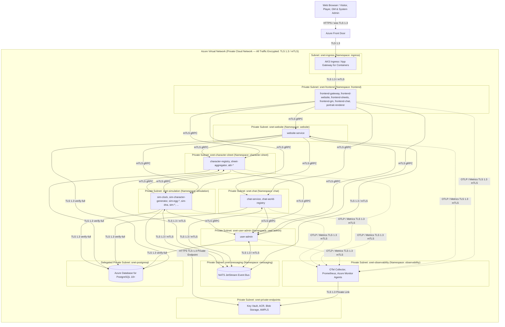

# ADR-0012: Private Subnet Isolation per Namespace & End-to-End Encrypted Cloud Communication

- **Status:** Accepted
- **Date:** 2026-11-27
- **Deciders:** PrincessPink Architecture
- **Related Documents:** [`docs/Concept.md`](../Concept.md), [`README.md`](../../README.md), [`AGENTS.md`](../../AGENTS.md), [`SECURITY.md`](../../SECURITY.md), [`CONTRIBUTING.md`](../../CONTRIBUTING.md), [`ADR-0001`](ADR-0001-minimum-postgresql-version.md), [`ADR-0002`](ADR-0002-world-chat-microservices-and-server-selection.md), [`ADR-0004`](ADR-0004-shared-opentelemetry-observability.md), [`ADR-0005`](ADR-0005-shared-grpc-protobuf-contracts.md), [`ADR-0006`](ADR-0006-shared-configuration-library.md), [`ADR-0009`](ADR-0009-github-actions-ci-cd.md), [`ADR-0010`](ADR-0010-user-admin-auth-rbac-and-group-management.md), [`ADR-0013`](ADR-0013-static-website-service-and-public-results-presentation.md)

---

## Context

PrincessPink runs 25+ independently versioned Go microservices on **Microsoft Azure Kubernetes Service (AKS)** alongside **Azure Database for PostgreSQL Flexible Server (18+)** ([ADR-0001](ADR-0001-minimum-postgresql-version.md)), an asynchronous event broker (**NATS JetStream** or **Azure Service Bus**), **Azure Key Vault**, **Azure Container Registry (ACR)**, **Azure Blob Storage** (for per-female Egg-Reserve and per-ejaculation SQLite artifacts), and **OpenTelemetry / Prometheus / Azure Monitor** ([ADR-0004](ADR-0004-shared-opentelemetry-observability.md)).

In the **High-Level Architecture Diagram** ([`docs/Concept.md`](../Concept.md#32-high-level-architecture-diagram)) and **Kubernetes Cluster Topology** ([`docs/Concept.md`](../Concept.md#61-kubernetes-cluster-topology)), workloads are organized into clear functional Kubernetes namespaces (`frontend`, `website`, `user-admin`, `chat`, `character-sheet`, `simulation`, plus supporting `ingress`, `messaging`, and `observability` namespaces). While earlier specifications already required private VNet integration for PostgreSQL, default-deny Kubernetes `NetworkPolicy`, and TLS 1.3 / mTLS at key boundaries, three foundational cloud network-security rules must be formalized and enforced uniformly across infrastructure, shared libraries (`libs/`), microservices, and deployment manifests:

1. **Private Network Placement for Backend Services:** Backend services handle sensitive identity credentials (`Argon2id` hashes, MFA secrets, Ed25519 JWT signing keys), private 1-to-1 Direct Messages, Group campaigns, and authoritative character/lineage records. Placing any backend service in a public subnet or assigning public IP addresses unnecessarily exposes internal RPC, broker, and management endpoints to the internet.
2. **Defense-in-Depth Network Segmentation Beyond Logical Namespaces:** Deploying all Kubernetes namespaces into a single flat AKS subnet relies solely on in-cluster `NetworkPolicy` to separate distinct security domains (such as `frontend`, `user-admin`, `chat`, `character-sheet`, and `simulation`). Separating namespaces into dedicated VNet subnets adds a cloud-layer L3/L4 isolation boundary (Azure Network Security Groups and route tables) aligned 1:1 with the High-Level Architecture Diagram.
3. **Zero Plaintext Traffic Inside the Cloud:** Terminating TLS only at the public edge ingress leaves internal east–west traffic (ingress-to-frontend, pod-to-pod gRPC, NATS JetStream links, PostgreSQL connections, OTLP telemetry export, Prometheus scrapes, and PaaS storage access) vulnerable to sniffing, misrouting, or lateral-movement spoofing within the cloud VNet.

---

## Decision

PrincessPink establishes three mandatory cloud networking and transport-security rules governing all **Azure AKS** and cloud infrastructure deployments (`dev`, `staging`, and `prod`):

1. **Private / Non-Public Subnets for All Backend Services (Matching PostgreSQL):** All backend services of PrincessPink—just like **Azure Database for PostgreSQL Flexible Server (18+)**—are located exclusively in **private / non-public Azure VNet subnets** with zero public IP addresses and no direct public internet exposure.
2. **1:1 Namespace-to-Subnet Isolation:** Services within the **same Kubernetes namespace** (per the [High-Level Architecture Diagram](../Concept.md#32-high-level-architecture-diagram) and [Cluster Topology](../Concept.md#61-kubernetes-cluster-topology)) are located in the **same private subnet**, whereas services within **different namespaces** are located in **different private subnets**.
3. **End-to-End Encrypted Cloud Communication:** **All communication—external and within the cloud—happens encrypted** (TLS 1.3 / mTLS across every intra-subnet, cross-subnet, event-bus, database, observability, and Azure PaaS hop, with zero plaintext cloud traffic).

### 1. Private / Non-Public Subnets for All Backend Services & Data Stores

- **Zero Public Exposure for Backend Workloads:** Every PrincessPink backend namespace (`website`, `user-admin`, `chat`, `character-sheet`, `simulation`, `messaging`, `observability`)—as well as the `frontend` workload pods behind the edge ingress—resides strictly in **private / non-public Azure VNet subnets** (`no public IP addresses` on AKS nodes or pods, no public `LoadBalancer` or `NodePort` services, and no direct inbound internet routes), mirroring Azure Database for PostgreSQL Flexible Server in its dedicated delegated private subnet (`snet-postgresql`).
- **Sole Public Entry Point:** External browser traffic (`HTTPS` and `wss://`) enters exclusively through the public edge layer (**Azure Front Door** and the dedicated edge `ingress` subnet `snet-ingress` running the AKS Ingress Controller / Azure Application Gateway for Containers), which bridges solely into `snet-frontend` over encrypted connections.
- **Private Azure PaaS & Control Plane:**
  - **Azure Database for PostgreSQL Flexible Server (18+):** Deployed with private VNet integration in its own delegated private subnet (`snet-postgresql`) with public network access disabled ([ADR-0001](ADR-0001-minimum-postgresql-version.md)).
  - **Azure Key Vault, Azure Container Registry (ACR), Azure Blob Storage (Egg-Reserve & Ejaculation SQLite artifacts), Azure Monitor Private Link Scope (AMPLS), and optional Azure Service Bus:** Accessed exclusively via **Azure Private Endpoints** in `snet-private-endpoints` with public network access disabled.
  - **Private AKS Cluster & Controlled Egress:** The AKS Kubernetes API server uses Private Cluster / Private Endpoint access; any strictly required outbound cloud egress traverses an Azure NAT Gateway or Azure Firewall rather than public node IPs.

### 2. 1:1 Namespace-to-Subnet Mapping & AKS Enforcement

Every Kubernetes namespace in the High-Level Architecture Diagram and Cluster Topology maps **1:1 to a dedicated, non-overlapping private Azure VNet subnet**. All services inside a given namespace share that namespace's private subnet; no two namespaces ever share a subnet:

| Kubernetes Namespace / Cloud Domain | Services / Components Located in Subnet | Dedicated VNet Subnet | Network Exposure |
| :--- | :--- | :--- | :--- |
| **`ingress`** | AKS Ingress Controller / Azure Application Gateway for Containers (behind Azure Front Door) | `snet-ingress` | Dedicated edge subnet (sole bridge from public edge to `snet-frontend`) |
| **`frontend`** | `frontend-gateway`, `frontend-website`, `frontend-sheets`, `frontend-gm`, `frontend-chat`, `portrait-renderer` | `snet-frontend` | **Private / Non-Public** |
| **`website`** | `website-service` ([ADR-0013](ADR-0013-static-website-service-and-public-results-presentation.md)) | `snet-website` | **Private / Non-Public** |
| **`user-admin`** | `user-admin` | `snet-user-admin` | **Private / Non-Public** |
| **`chat`** | `chat-service`, `chat-world-registry` | `snet-chat` | **Private / Non-Public** |
| **`character-sheet`** | `character-registry`, `sheet-aggregator`, `gamification-service`, all `attr-*` microservices | `snet-character-sheet` | **Private / Non-Public** |
| **`simulation`** | `sim-clock`, `sim-character-generator`, `sim-roleplay`, `sim-egg-reserve`, `sim-egg-selection`, `sim-menarche`, `sim-menstruation`, `sim-ejaculation`, `sim-sperm-race`, `sim-gamete-surface`, `sim-conception`, `sim-dna`, `sim-prenatal-loss`, `sim-birth-date`, `sim-gestation`, `sim-health`, `sim-mortality`, `sim-lifecycle` | `snet-simulation` | **Private / Non-Public** |
| **`messaging`** | Event Bus / NATS JetStream cluster (if run in-cluster) | `snet-messaging` | **Private / Non-Public** |
| **`observability`** | OpenTelemetry Collector, Prometheus, Grafana / Azure Monitor agents | `snet-observability` | **Private / Non-Public** |
| **`kube-system` (AKS System Pool)** | CoreDNS, Cilium / service-mesh control plane, `cert-manager`, Secrets Store CSI Driver | `snet-aks-system` | **Private / Non-Public** |
| **Central PostgreSQL 18+ (Azure PaaS)** | Azure Database for PostgreSQL Flexible Server (18+) | `snet-postgresql` | **Delegated Private / Non-Public** |
| **Azure PaaS Private Endpoints** | Azure Key Vault, ACR, Azure Blob Storage, AMPLS, optional Azure Service Bus | `snet-private-endpoints` | **Private / Non-Public** |

#### How AKS Realizes 1:1 Namespace-to-Subnet Isolation

1. **Azure CNI with Per-Namespace Private Subnets:** AKS runs **Azure CNI** (Azure CNI Powered by Cilium or Azure CNI Dynamic IP Allocation with pod subnets) with dedicated user node pools / pod subnets (`--vnet-subnet-id` / `--pod-subnet-id`) mapped 1:1 to each namespace's private subnet (`snet-frontend`, `snet-website`, `snet-user-admin`, `snet-chat`, `snet-character-sheet`, `snet-simulation`, `snet-messaging`, `snet-observability`, and `snet-ingress`).
2. **Mandatory Pod-to-Subnet Placement Enforcement:** Each namespace node pool carries a dedicated node label and taint (e.g., `princesspink.io/namespace=<ns>:NoSchedule`). Admission enforcement (Kyverno / OPA Gatekeeper / `PodNodeSelector`) guarantees that pods in namespace `<ns>` schedule **exclusively** onto the node pool backed by `snet-<ns>`, ensuring services in the same namespace always share a subnet and services in different namespaces can never co-locate in the same subnet.
3. **Dual-Layer Filtering (Azure NSGs + Kubernetes `NetworkPolicy`):**
   - **Cloud Layer (L3/L4):** Each private subnet attaches a dedicated **Azure Network Security Group (NSG)** with default-deny inter-subnet rules and explicit allow-lists strictly for required encrypted cross-subnet flows.
   - **Cluster Layer (L3/L4/L7):** Default-deny Kubernetes / Cilium `NetworkPolicy` per namespace enforces least-privilege pod-to-pod and pod-to-CIDR access within and across namespaces.

#### Permitted Cross-Subnet Encrypted Traffic Matrix

| Source Subnet (Namespace) | Permitted Destination Subnets | Protocol & Mandatory Encryption |
| :--- | :--- | :--- |
| `snet-ingress` (`ingress`) | `snet-frontend`, `snet-observability`, `snet-private-endpoints` | HTTPS / `wss://` (TLS 1.3 / mTLS re-encryption; zero plaintext HTTP), OTLP TLS 1.3/mTLS, Key Vault TLS 1.3 |
| `snet-frontend` (`frontend`) | `snet-website`, `snet-user-admin`, `snet-chat`, `snet-character-sheet`, `snet-simulation`, `snet-observability`, `snet-private-endpoints` | gRPC mTLS (TLS 1.3), OTLP/gRPC TLS 1.3/mTLS, HTTPS TLS 1.3 *(zero direct route to `snet-postgresql`)* |
| `snet-website` (`website`) | `snet-user-admin`, `snet-chat`, `snet-character-sheet`, `snet-simulation`, `snet-postgresql`, `snet-messaging`, `snet-observability`, `snet-private-endpoints` | gRPC mTLS (read-only public-summary & `SYSTEM_ADMIN` auth), PostgreSQL TLS 1.3 (`verify-full`), NATS TLS 1.3/mTLS, OTLP TLS 1.3/mTLS, HTTPS TLS 1.3 |
| `snet-user-admin` (`user-admin`) | `snet-character-sheet`, `snet-postgresql`, `snet-messaging`, `snet-observability`, `snet-private-endpoints` | gRPC mTLS, PostgreSQL TLS 1.3 (`verify-full`), NATS TLS 1.3/mTLS, OTLP TLS 1.3/mTLS, HTTPS TLS 1.3 |
| `snet-chat` (`chat`) | `snet-user-admin`, `snet-postgresql`, `snet-messaging`, `snet-observability`, `snet-private-endpoints` | gRPC mTLS, PostgreSQL TLS 1.3 (`verify-full`), NATS TLS 1.3/mTLS, OTLP TLS 1.3/mTLS, HTTPS TLS 1.3 |
| `snet-character-sheet` (`character-sheet`) | `snet-user-admin`, `snet-simulation`, `snet-postgresql`, `snet-messaging`, `snet-observability`, `snet-private-endpoints` | gRPC mTLS, PostgreSQL TLS 1.3 (`verify-full`), NATS TLS 1.3/mTLS, OTLP TLS 1.3/mTLS, HTTPS TLS 1.3 |
| `snet-simulation` (`simulation`) | `snet-user-admin`, `snet-character-sheet`, `snet-postgresql`, `snet-messaging`, `snet-observability`, `snet-private-endpoints` | gRPC mTLS, PostgreSQL TLS 1.3 (`verify-full`), NATS TLS 1.3/mTLS, OTLP TLS 1.3/mTLS, HTTPS TLS 1.3 |
| `snet-messaging` (`messaging`) | `snet-observability`, `snet-private-endpoints` (plus intra-subnet NATS cluster peers) | NATS TLS 1.3/mTLS (cluster/leaf/JetStream), OTLP TLS 1.3/mTLS, HTTPS TLS 1.3 |
| `snet-observability` (`observability`) | Scrape targets on internal admin mTLS ports across workload subnets, `snet-private-endpoints` (AMPLS) | HTTPS / mTLS (TLS 1.3) |

*(Note: All intra-subnet communication—such as `frontend-gateway` → `frontend-sheets`, `sheet-aggregator` → `attr-*`, `chat-service` → `chat-world-registry`, or `sim-*` → `sim-*`—also remains encrypted via mTLS/TLS 1.3 and governed by default-deny `NetworkPolicy`.)*

### 3. End-to-End Encrypted Communication Within the Cloud (Zero Plaintext Hops)

Every communication channel—both external and **every internal hop within the cloud** (intra-subnet and cross-subnet)—must be encrypted:

| Communication Path | Mandatory Transport Encryption | Enforcement Mechanism |
| :--- | :--- | :--- |
| **Browser ↔ Edge (`Azure Front Door` / `snet-ingress`)** | **HTTPS / `wss://` (TLS 1.3)**, HSTS | Azure Front Door / Ingress TLS policy; reject plaintext HTTP (redirect/block at edge). |
| **Edge Ingress (`snet-ingress`) ↔ `frontend` (`snet-frontend`)** | **HTTPS / `wss://` or mTLS (TLS 1.3)** | End-to-end backend TLS re-encryption configured on Ingress; plaintext HTTP to `frontend-*` is prohibited. |
| **Internal Synchronous RPC (gRPC — intra-subnet & cross-subnet)** | **mTLS (TLS 1.3)** | Service mesh (Cilium / Istio / Linkerd SPIFFE identity) and/or `libs/proto/grpcutil` TLS credentials ([ADR-0005](ADR-0005-shared-grpc-protobuf-contracts.md)). `insecure.NewCredentials()` is forbidden in cloud environments. |
| **Internal Event Bus (`snet-messaging` — NATS JetStream / Azure Service Bus)** | **TLS 1.3 / mTLS** | Mandatory TLS/mTLS for all NATS client connections (`tls://`), cluster routes, leaf nodes, and JetStream replication (or AMQPS / HTTPS TLS 1.3 over Private Endpoint for Azure Service Bus). |
| **Database (`snet-postgresql` — PostgreSQL 18+ Flexible Server)** | **TLS 1.3 (`sslmode=verify-full`)** | Server-side TLS enforcement on Azure PostgreSQL Flexible Server + `libs/config` `PostgresConfig` validation (`sslmode=verify-full`, `SCRAM-SHA-256` / Microsoft Entra ID; [ADR-0001](ADR-0001-minimum-postgresql-version.md), [ADR-0006](ADR-0006-shared-configuration-library.md)). |
| **Observability (`snet-observability` — OTLP/gRPC, Prometheus `/metrics`, Azure Monitor)** | **TLS 1.3 / mTLS** | Encrypted OTLP/gRPC trace/metric export (never `otlptracegrpc.WithInsecure()` in cloud), HTTPS/mTLS scraping on internal admin ports, and TLS 1.3 Private Link to Azure Monitor ([ADR-0004](ADR-0004-shared-opentelemetry-observability.md)). |
| **Azure PaaS & Artifact Storage (`snet-private-endpoints` — Key Vault, ACR, Blob Storage)** | **HTTPS (TLS 1.3)** | Private Endpoints + `secureTransferRequired` / minimum TLS policies across Azure Key Vault CSI, ACR pulls, and SQLite Egg-Reserve / Ejaculation artifact transfers. |
| **AKS Control Plane & Cluster Internals** | **TLS / mTLS** | Private AKS API server, TLS-secured `kubelet` and `etcd`, plus encryption at rest for Azure Managed Disks and Key Vault KMS. |

#### Fail-Fast Guardrails & Certificate Automation

- **Fail-Fast Startup Validation (`libs/config`, [ADR-0006](ADR-0006-shared-configuration-library.md)):** In all cloud environments (`ENVIRONMENT` in `dev`, `staging`, `prod`), `config.Load[T](ctx)` **must fail fast** if TLS/mTLS is disabled or insecure transport flags are set on HTTP, gRPC, PostgreSQL (`sslmode != verify-full`), NATS JetStream, or OTLP telemetry clients. Plaintext local shortcuts are strictly limited to explicit `ENVIRONMENT=local` developer workflows / unit tests, and local Docker Compose / `kind` stacks should support local dev CA parity.
- **Automated Certificate Rotation:** Workload identities and short-lived X.509 certificates are provisioned and rotated automatically via the cluster service mesh / `cert-manager` and Azure Key Vault Secrets Store CSI Driver without manual intervention or pod downtime.

---

## Options Considered

| Option | Description | Evaluation |
| :--- | :--- | :--- |
| **1. Private Per-Namespace Subnets (1:1 Mapping) + End-to-End Encrypted Cloud Communication** | Place every backend service namespace (and `frontend` pods behind edge ingress) in its own private / non-public Azure VNet subnet matching the High-Level Architecture Diagram and PostgreSQL's private subnet, backed by per-subnet NSGs, Kubernetes `NetworkPolicy`, and mandatory TLS 1.3 / mTLS on all external and cloud-internal traffic. | **Selected.** Delivers defense-in-depth at both Azure VNet (L3/L4 subnets + NSGs) and Kubernetes/service-mesh (L4/L7 `NetworkPolicy` + mTLS) layers, prevents accidental public exposure, strictly aligns cloud topology with the High-Level Architecture Diagram, and eliminates plaintext traffic anywhere in the cloud. |
| **2. Single Shared Private Subnet for All AKS Namespaces (K8s `NetworkPolicy` Only)** | Place PostgreSQL in a private subnet but run all AKS namespaces (`frontend`, `user-admin`, `chat`, `character-sheet`, `simulation`, `messaging`, `observability`) in one shared AKS subnet. | **Rejected.** Violates the namespace-to-subnet isolation rule; a misconfigured CNI or Kubernetes `NetworkPolicy` would immediately expose `user-admin`, `chat`, `character-sheet`, and `simulation` pods to `frontend` on the same L3 subnet without a cloud-layer NSG boundary. |
| **3. Public Subnets for Backend Services Protected Only by NSGs / Firewalls** | Deploy AKS backend node pools in public subnets and rely solely on firewall rules to drop unwanted internet traffic. | **Rejected.** Violates the private-subnet requirement and expands blast radius; a single misconfigured NSG rule or accidental `LoadBalancer` service would directly expose internal gRPC, NATS, or `/metrics` endpoints to the public internet. |
| **4. Perimeter-Only TLS Termination (Plaintext Internal Cloud Traffic)** | Terminate TLS 1.3 at Azure Front Door / AKS Ingress and run unencrypted HTTP, gRPC, NATS, and OTLP inside the Azure VNet. | **Rejected.** Violates the encrypted cloud communication rule and zero-trust security posture; leaves JWTs, session tokens, password-auth gRPC payloads, private 1-to-1 DMs, and database/telemetry streams unencrypted inside the cloud network. |

---

## Rationale & Alignment with PrincessPink Requirements

1. **Direct Alignment with the High-Level Architecture Diagram (Concept §3.2 & §6.1):**
   Mapping each namespace (`frontend`, `website`, `user-admin`, `chat`, `character-sheet`, `simulation`, plus `ingress`, `messaging`, `observability`) 1:1 to its own private subnet guarantees that cloud network boundaries mirror logical domain boundaries exactly—services in the same namespace co-locate in the same subnet, while services in different namespaces always reside in separate subnets.
2. **True Defense in Depth for Sensitive Identity, Chat & Simulation Data (Concept §4.2, §6.3 & [ADR-0010](ADR-0010-user-admin-auth-rbac-and-group-management.md)):**
   Combining private / non-public subnets, per-subnet Azure NSGs, default-deny Kubernetes `NetworkPolicy`, and mandatory TLS 1.3 / mTLS ensures that even if a single layer is misconfigured (e.g., an overly permissive `NetworkPolicy` or a compromised frontend pod), both cloud-level subnet rules and cryptographic mTLS identity verification still block unauthorized access and eavesdropping.
3. **Uniform Private Posture Across Compute and Data (Concept §5.1, §6.2 & [ADR-0001](ADR-0001-minimum-postgresql-version.md)):**
   Treating all backend microservices (`website`, `user-admin`, `chat`, `character-sheet`, `simulation`, `messaging`, `observability`) with the exact same private-subnet isolation discipline as Azure Database for PostgreSQL Flexible Server eliminates asymmetric attack surfaces between compute and storage tiers.
4. **Zero Plaintext Blind Spots Across Shared Platform Libraries ([ADR-0004](ADR-0004-shared-opentelemetry-observability.md)–[ADR-0006](ADR-0006-shared-configuration-library.md)):**
   Embedding encryption enforcement directly into `libs/proto/grpcutil`, `libs/telemetry`, and `libs/config` guarantees that every new `attr-*` or `sim-*` microservice inherits encrypted cloud communication automatically without per-service boilerplate.

---

## Consequences

### Positive
- **Zero Public Attack Surface on Backend Tiers:** No backend microservice, event broker, observability collector, or PostgreSQL instance is reachable from the public internet.
- **Strict Blast-Radius Containment per Domain:** Cloud-layer subnet + NSG boundaries isolate `frontend`, `website`, `user-admin`, `chat`, `character-sheet`, `simulation`, `messaging`, `observability`, and `postgresql` independently.
- **End-to-End Confidentiality & Authenticity in the Cloud:** Every network hop—ingress-to-frontend, gRPC fan-out, NATS JetStream pub/sub, PostgreSQL queries, OTLP traces, Prometheus scrapes, and Azure PaaS storage—is cryptographically protected with TLS 1.3 / mTLS.
- **Auditability & Infrastructure-as-Code Clarity:** Subnet CIDRs, NSG flow logs, and Terraform/Bicep modules map cleanly 1:1 onto the namespaces shown in the High-Level Architecture Diagram.

### Trade-offs & Operational Notes
- **VNet CIDR & Subnet Capacity Planning:** Each namespace requires a pre-allocated, non-overlapping private CIDR block sized for peak Horizontal Pod Autoscaler (HPA) replica counts and rolling-update surge IPs—in particular, `snet-character-sheet` (hosting `character-registry`, `sheet-aggregator`, and 15+ `attr-*` services) and `snet-simulation` (hosting 15+ `sim-*` services) must be sized generously to avoid Azure CNI IP exhaustion.
- **Per-Namespace Node Pool Sizing & Cost Management:** Binding each namespace to its own private subnet via dedicated AKS node pools introduces baseline node overhead compared to bin-packing all namespaces onto one shared node pool. Right-sizing VM SKUs per domain (e.g., smaller burstable/general-purpose nodes for `user-admin` and `chat`, memory/CPU-tuned pools for `character-sheet` and `simulation`, plus AKS Cluster Autoscaler) mitigates idle cost while preserving hard subnet isolation.
- **TLS / mTLS Handshake Latency & Certificate Lifecycle:** Encrypting every internal call—including high-fan-out `sheet-aggregator` → `attr-*` gRPC bursts—relies on HTTP/2 connection pooling (keep-alive multiplexed mTLS channels) and automated short-lived certificate rotation (`cert-manager` / service mesh SPIFFE) so steady-state latency overhead remains sub-millisecond and certificate expiry never causes outages.
- **Local Development Parity:** Local `docker-compose` / `kind` stacks (`ENVIRONMENT=local`) do not reproduce Azure VNet subnets natively; CI/CD and Phase 5 Infrastructure-as-Code pipelines (Terraform/Bicep + Helm/Kustomize policy checks) must validate private subnet placement, NSG allow-lists, pod affinity/taints, and mandatory TLS 1.3 / mTLS flags before deployment to AKS.
