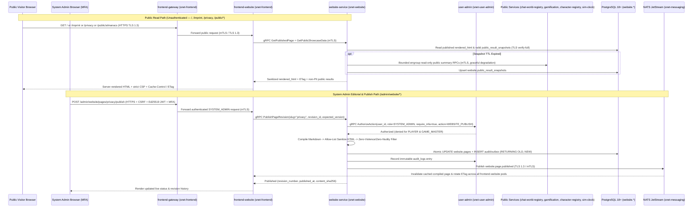

# ADR-0013: Built-In Static Website Service (`frontend-website` & `website-service`), System Admin Editorial Portal & Native Public Service Results Presentation

- **Status:** Accepted
- **Date:** 2026-11-27
- **Deciders:** PrincessPink Architecture
- **Related Documents:** [`docs/Concept.md`](../Concept.md), [`README.md`](../../README.md), [`AGENTS.md`](../../AGENTS.md), [`SECURITY.md`](../../SECURITY.md), [`CONTRIBUTING.md`](../../CONTRIBUTING.md), [`ADR-0001`](ADR-0001-minimum-postgresql-version.md), [`ADR-0002`](ADR-0002-world-chat-microservices-and-server-selection.md), [`ADR-0003`](ADR-0003-shared-logging-library.md), [`ADR-0004`](ADR-0004-shared-opentelemetry-observability.md), [`ADR-0005`](ADR-0005-shared-grpc-protobuf-contracts.md), [`ADR-0006`](ADR-0006-shared-configuration-library.md), [`ADR-0007`](ADR-0007-shared-uuid-utilities.md), [`ADR-0010`](ADR-0010-user-admin-auth-rbac-and-group-management.md), [`ADR-0011`](ADR-0011-go-as-sole-programming-language.md), [`ADR-0012`](ADR-0012-private-subnet-isolation-and-encrypted-cloud-communication.md)

---

## Context

Every publicly accessible PrincessPink deployment requires a reliable, legally compliant, and fast public web presence:

1. **Mandatory Public Legal & Entry Pages:** Visitors and registered users must be able to view the **Landing Page** (`/`), **Imprint** (`/imprint`, e.g., statutory operator identification / *Impressum*), and **Privacy Policy** (`/privacy`, GDPR/data-protection disclosures) without logging in—and a **System Admin (`SYSTEM_ADMIN`)** must be able to edit, preview, version, publish, and roll back these pages directly inside PrincessPink without redeploying containers or manually editing HTML files in Git.
2. **Native Presentation of Public Services' Results Without Third-Party CMS / Website Generators:** PrincessPink produces rich, publicly shareable scientific and community results across its microservices—such as live **World Chat Server** directory status and population bands (`chat-world-registry`), **anonymized population and Mendelian blood-type / longevity statistics** (`character-registry` & `sim-clock`), **publicly opted-in Dynasty Almanacs and Lineage Chronicles** (`gamification-service` & `portrait-renderer`), and global **Genetic Discovery Codex** unlock distributions. Relying on a third-party website generator or CMS such as **Ghost** (Node.js), **WordPress** (PHP/MySQL), **Drupal** (PHP), or an external static-site generator pipeline would violate PrincessPink's Go-only policy ([ADR-0011](ADR-0011-go-as-sole-programming-language.md)), introduce a high-CVE plugin ecosystem, duplicate authentication and theming, and require brittle synchronization scripts to render live public results from internal gRPC microservices.
3. **Strict RBAC & Network-Security Alignment:** Existing RBAC ([ADR-0010](ADR-0010-user-admin-auth-rbac-and-group-management.md)) defines only `PLAYER` and `GAME_MASTER`, neither of whom should edit platform-wide legal documents or the Landing Page. Meanwhile, [ADR-0012](ADR-0012-private-subnet-isolation-and-encrypted-cloud-communication.md) prohibits `frontend` pods (`snet-frontend`) from connecting directly to PostgreSQL (`snet-postgresql`) and requires strict 1:1 namespace-to-private-subnet isolation with mandatory TLS 1.3 / mTLS across all cloud communication.

We therefore need a first-class, pure-Go **Static Website Service** integrated seamlessly with `user-admin` (`SYSTEM_ADMIN` RBAC), PostgreSQL 18+, NATS JetStream, and PrincessPink's public-result-producing microservices.

---

## Decision

PrincessPink implements a **built-in, pure-Go Static Website Service** decomposed along the platform's established micro-frontend / backend security boundary—**`frontend-website`** (`frontend` namespace / `snet-frontend`) and **`website-service`** (`website` namespace / `snet-website`)—backed by a dedicated **`website.*` schema in PostgreSQL 18+** ([ADR-0001](ADR-0001-minimum-postgresql-version.md)), controlled exclusively by a new **`SYSTEM_ADMIN`** role in `user-admin` ([ADR-0010](ADR-0010-user-admin-auth-rbac-and-group-management.md)), and capable of natively rendering both editable static pages and live/cached **public services' results** with **zero dependency on Ghost, WordPress, Drupal, or any other third-party website generator**.

### 1. Service Decomposition & Private-Subnet Isolation ([ADR-0012](ADR-0012-private-subnet-isolation-and-encrypted-cloud-communication.md))

To keep `snet-frontend` completely isolated from `snet-postgresql` while mirroring the established `frontend-chat` + `chat-*` and `frontend-sheets` + `sheet-aggregator`/`character-registry` patterns, static website delivery and content management are split across two focused, independently versioned Go 1.27+ microservices:

| Microservice | AKS Namespace (Private Subnet) | Responsibilities |
| :--- | :--- | :--- |
| **`frontend-website`** (`services/frontend-website/`) | `frontend` (`snet-frontend`, private / non-public) | Stateless Go + **Gin** HTTP edge service behind `frontend-gateway` serving public unauthenticated routes (`/` Landing Page, `/imprint` Imprint, `/privacy` Privacy Policy, `/pages/:slug` optional custom static pages, `/public/*` public service result views, `/sitemap.xml`, `/robots.txt`) using server-rendered Go templates (`html/template` / `templ`), progressive HTMX fragments, deterministic SVG portraits (`portrait-renderer`), strong `ETag` / `Cache-Control`, and strict CSP headers—plus the authenticated **`SYSTEM_ADMIN`-only editorial UI** (`/admin/website/*`). Zero direct PostgreSQL access; communicates exclusively over mTLS gRPC with `website-service` and `user-admin` (via `frontend-gateway`). |
| **`website-service`** (`services/website-service/`) | `website` (`snet-website`, private / non-public) | Authoritative Go backend microservice owning the **`website.*`** PostgreSQL 18+ schema (`sslmode=verify-full`), exposing `libs/proto/website/v1` over mandatory mTLS gRPC. Manages protected system pages (`landing`, `imprint`, `privacy`) and optional custom static pages, performs server-side Markdown compilation, strict allow-list HTML sanitization, and zero-violence/zero-nudity content validation, maintains append-only immutable revision history (`website.page_revisions`), publishes cache-invalidation events via transactional outbox to NATS JetStream (`snet-messaging`), enforces **`SYSTEM_ADMIN`** RBAC + mandatory MFA synchronously via `user-admin`, and aggregates read-only, anonymized/opt-in **public service results** into cached `website.public_result_snapshots`. |

### 2. `SYSTEM_ADMIN` Role & Separation of Duties ([ADR-0010](ADR-0010-user-admin-auth-rbac-and-group-management.md))

`user-admin` extends `USER.role` to **`PLAYER | GAME_MASTER | SYSTEM_ADMIN`** with strict least-privilege and separation-of-duties guarantees:

- **Exclusive Static Website Management:** Only authenticated users with `role == SYSTEM_ADMIN` and verified **MFA (TOTP or WebAuthn/Passkeys)** may access `/admin/website/*` or invoke editorial/publish/rollback/showcase-configuration RPCs on `website-service`. Both `PLAYER` and `GAME_MASTER` receive `PermissionDenied` on all administrative website endpoints and can read only **published** public pages.
- **Mandatory Cloud MFA & Synchronous Verification:** `REQUIRE_ADMIN_MFA` is strictly enforced (`true`) in all cloud environments (`dev`, `staging`, `prod`). Every editorial write, draft read, preview, publish, rollback, and showcase configuration change in `website-service` performs a **synchronous `AuthorizationService.AuthorizeAction` check against `user-admin`** (never relying solely on a cached JWT) and records immutable before/after state in `user_admin.audit_logs` (`RETURNING OLD, NEW`).
- **Strict Separation from Campaign Gameplay:** Holding `SYSTEM_ADMIN` does **not** grant implicit Game Master powers inside any Group—a System Admin cannot read private character sheets, adjust `weight_kg`/health, trigger GM-only Role-Play Elements (`FEMALE_ORGASM`, `BROKEN_CONDOM`, etc.), read private Group Chats, or view 1-to-1 Direct Messages unless they hold explicit Player/GM membership in a specific Group (operational best practice recommends separate admin vs. gameplay accounts).
- **Safe Provisioning:** Public self-registration (`AuthService.Register`) always assigns `role = PLAYER` and never allows registering as `SYSTEM_ADMIN`. Initial `SYSTEM_ADMIN` bootstrapping is performed strictly via internal mTLS operator tooling / audited promotion in `user-admin`.

### 3. Managed Static Pages, Safe Authoring & Immutable Versioning

1. **Built-In Protected System Pages (`is_system_page = true`):**
   - **`landing` (`/` — Landing Page):** Editable editorial hero, project vision/safety overview, sign-in/registration entry points, announcements, and configurable **Public Service Results** showcase widgets.
   - **`imprint` (`/imprint` — Imprint / *Impressum*):** Editable statutory operator identification and legal disclosures; linked persistently in the global footer across all public and authenticated PrincessPink frontends (`frontend-website`, `frontend-sheets`, `frontend-gm`, `frontend-chat`).
   - **`privacy` (`/privacy` — Privacy Policy):** Editable GDPR/data-protection policy linked persistently in the global footer and on registration/login forms, displaying its published revision number and effective publication timestamp (`published_at`) for compliance traceability.
   - **Deletion & Unpublish Protection:** Protected system slugs (`landing`, `imprint`, `privacy`) are seeded with safe default placeholders on initial bootstrap and **can never be deleted or unpublished**, preventing accidental removal of legally mandatory pages.
2. **Optional Extensible Static Pages (`page_type = CUSTOM_STATIC`, `/pages/:slug`):**
   - System Admins may optionally author additional static informational pages (e.g., `/pages/about`, `/pages/rules`, `/pages/safety`, `/pages/faq`). Reserved route prefixes (`/`, `/imprint`, `/privacy`, `/public`, `/admin`, `/api`, `/auth`, `/sheets`, `/gm`, `/chat`, `/portraits`, `/static`, `/healthz`, `/readyz`, `/metrics`) are rejected by slug validation so admin pages can never hijack application endpoints.
3. **Pure-Go Markdown Compilation, Sanitization & Zero-Violence/Zero-Nudity Policy:**
   - System Admins edit structured fields (`title`, `meta_description`, `locale`, `content_markdown`, `showcase_config` JSONB, `change_summary`) in `/admin/website`.
   - `website-service` compiles Markdown in pure Go (e.g., `goldmark`) and filters the output through a strict allow-list HTML sanitizer (e.g., `bluemonday` stripping `<script>`, `<iframe>`, `<object>`, `<embed>`, inline `on*` event handlers, `javascript:`/`data:` script URIs, and third-party tracking beacons), then validates text against PrincessPink's **zero-violence, zero-nudity** content-policy filter before persisting `rendered_html`.
   - **No Arbitrary Image Uploads:** Public website visuals use bundled versioned theme SVG/CSS assets and deterministic head-and-shoulders comic portraits from `portrait-renderer`, upholding Concept §1.3 safe-by-design visuals.
4. **Draft → Preview → Publish → One-Click Rollback Workflow:**
   - Every saved draft appends an immutable row to `website.page_revisions` (`REVOKE UPDATE, DELETE` on published/archived revisions).
   - System Admins preview drafts (including live public-service result widgets) at `/admin/website/pages/:slug/preview` before promoting a revision atomically via `PublishPageRevision` (guarded by optimistic concurrency `version` checks).
   - Publishing updates `website.pages.current_published_revision_id` (`RETURNING OLD, NEW`), writes a `user_admin.audit_logs` entry, and emits `website.page.published` via `website.outbox_events` to NATS JetStream so all `frontend-website` pods invalidate in-memory compiled HTML caches immediately (and update `ETag` headers for Azure Front Door).
   - System Admins can roll back to any previous immutable revision in one click (`RollbackPageRevision`), audited identically.

### 4. Native Presentation of Public Services' Results (Zero Third-Party Website Generators)

To ensure PrincessPink **never requires Ghost, WordPress, Drupal, or any external CMS/static-site generator** to showcase results from its public services, `website-service` includes a native, privacy-preserving **Public Results Aggregator** rendered directly by `frontend-website`:

| Public Service Result Showcase | Upstream Public-Summary Source (mTLS gRPC) | Public Route & Landing Widget | Strict Privacy & Non-PII Boundary |
| :--- | :--- | :--- | :--- |
| **World Chat Server Directory** | `chat-world-registry` (`snet-chat`) → `ListWorldServers` | `/public/worlds` + Landing widget | Displays server display name, slug, region, language, category (`GENERAL`/`ROLEPLAY`/`SCIENCE`/`NEWCOMER`), status (`ONLINE`/`MAINTENANCE`), and banded occupancy (`LOW`/`MEDIUM`/`HIGH`/`FULL`). **Never** exposes chat message bodies, user lists, or `user_uuid`s. |
| **Population & Scientific Simulation Observatory** | `character-registry` (`snet-character-sheet`) & `sim-clock` (`snet-simulation`) → read-only aggregate summary RPCs | `/public/statistics` + Landing widget | Displays strictly anonymized, population-level scientific aggregates (active public eras, total simulated characters, generational depth distribution, observed ABO/RhD blood-type distribution vs. Hardy-Weinberg baseline, observed sex ratio, longevity/twin cohort statistics). **Zero** personal user data or unaggregated private group data. |
| **Public Dynasty Almanacs, Lineage Chronicles & Genetic Discovery Codex** | `gamification-service` (`snet-character-sheet`) + `portrait-renderer` (`snet-frontend`) → `ListPublicDynastyAlmanacs`, `GetPublicCodexStats` | `/public/almanacs`, `/public/codex` + Landing widget | Publishes **strictly opt-in** Groups where the managing GM explicitly enabled `GROUP.simulation_config.public_visibility` (default `false`), rendering non-PII Dynasty Almanacs, character-only Lineage Chronicles with deterministic comic face portraits, global Genetic Discovery Codex unlock rates, and completed public Group Challenges. **Never** exposes Player emails, private Group Chats, private `GM_SECRET` role-play events, or opted-out campaigns. |
| **Public Platform Status & Independent Service Catalog** | `website-service` aggregated public health/version registry | `/public/status` + optional footer link | Shows high-level public availability and released public semantic versions (`VERSION`) without leaking internal cluster topology, pod IPs, or internal `/metrics`. |

#### Public Traffic Protection, Caching & Graceful Degradation
- **Bounded Parallel Fan-Out (`errgroup`):** `website-service` refreshes public summaries concurrently with strict per-RPC deadlines (mirroring `sheet-aggregator` in Concept §4.3).
- **Read-Through Snapshot Cache (`website.public_result_snapshots`):** Aggregated public payloads are cached in PostgreSQL 18+ and pod memory with short configurable TTLs (e.g., `30s–300s`) and refreshed asynchronously on NATS JetStream summary events (`gamification.almanac.published`, `chat.world_server.status_changed`, `website.public_results.refreshed`). Public internet traffic spikes hitting `/` or `/public/*` are served strictly from `Azure Front Door` + `frontend-website` / `website-service` caches and **never amplify query load onto `character-registry`, `sim-*`, `chat-*`, or `user-admin`**.
- **Graceful Degradation:** If any upstream public service is temporarily unavailable, `frontend-website` serves the last cached snapshot (marked with a `"Last updated ..."` timestamp) or cleanly degrades that individual widget without ever breaking the Landing Page, Imprint, or Privacy Policy.
- **System Admin Showcase Composition:** Through `website.pages.showcase_config` JSONB in `/admin/website`, the `SYSTEM_ADMIN` controls which approved public-service result widgets appear on the Landing Page or `/public/*` pages, their ordering, display titles, and surrounding Markdown narrative—providing full editorial flexibility with zero external CMS!

### 5. PostgreSQL 18+ Persistence Schema (`website.*`)

`website-service` owns the isolated **`website.*`** schema in PostgreSQL 18+ (`pgx/v5`, least-privilege role `website_service_app`, `sslmode=verify-full` over `snet-postgresql`, native `uuidv7()` primary keys, and `RETURNING OLD, NEW` audit capture):

| Table | Key Columns & Constraints | Purpose |
| :--- | :--- | :--- |
| **`website.pages`** | `id` (`uuidv7()` PK), `slug` (`TEXT NOT NULL`), `page_type` (`LANDING_PAGE` \| `IMPRINT` \| `PRIVACY_POLICY` \| `CUSTOM_STATIC`), `locale` (default `'en'`), `is_system_page` (`BOOLEAN`), `current_published_revision_id` (nullable FK → `website.page_revisions`), `version` (`BIGINT` optimistic lock), `created_at`, `updated_at`; `UNIQUE (slug, locale)` | Canonical page registry protecting core legal/landing slugs (`landing`, `imprint`, `privacy`) against deletion or unpublishing. |
| **`website.page_revisions`** | `id` (`uuidv7()` PK), `page_id` (FK), `revision_number` (`INT`), `title`, `meta_description`, `content_markdown` (`TEXT`), `rendered_html` (`TEXT`), `content_sha256` (`TEXT`), `showcase_config` (`JSONB`), `status` (`DRAFT` \| `PUBLISHED` \| `ARCHIVED`), `change_summary`, `author_user_id` (`UUID`), `published_by_user_id` (nullable `UUID`), `published_at` (nullable), `service_version`, `created_at`; `UNIQUE (page_id, revision_number)` | Immutable version history of every draft and published page revision (`REVOKE UPDATE, DELETE` on published rows via DB policy/triggers) enabling instant auditability and one-click rollback. |
| **`website.public_result_snapshots`** | `id` (`uuidv7()` PK), `widget_key` (`UNIQUE`, e.g., `world_chat_directory`, `population_stats`, `public_almanacs`, `codex_stats`), `source_service`, `payload` (`JSONB`), `content_sha256`, `refreshed_at`, `expires_at`, `service_version` | Cached, non-PII public service result projections decoupling public visitor traffic from core backend databases and simulation services. |
| **`website.outbox_events`** | `id` (`uuidv7()` PK), `subject`, `payload` (`BYTEA`), `headers` (`JSONB`), `created_at`, `published_at` (nullable) | Transactional outbox relaying `website.page.published`, `website.page.rolled_back`, and `website.public_results.refreshed` reliably to NATS JetStream (`snet-messaging`). |

### 6. End-to-End Request & Publishing Flows

---

## Options Considered

| Option | Description | Evaluation |
| :--- | :--- | :--- |
| **1. Built-In Pure-Go Static Website Service (`frontend-website` in `snet-frontend` + `website-service` in `snet-website` backed by PostgreSQL 18+)** | Native Go 1.27+ Gin + `html/template` renderer and mTLS gRPC content/public-results service with `SYSTEM_ADMIN` RBAC, Markdown + strict HTML sanitization, immutable revisions, and cached public-service result widgets. | **Selected.** Zero third-party CMS dependencies (no Ghost/WordPress/Drupal), 100% aligned with Go-only ([ADR-0011](ADR-0011-go-as-sole-programming-language.md)), preserves zero `snet-frontend` → `snet-postgresql` exposure ([ADR-0012](ADR-0012-private-subnet-isolation-and-encrypted-cloud-communication.md)), natively renders live/cached public service results over mTLS gRPC, and enforces `SYSTEM_ADMIN` + MFA + audit logging via `user-admin`. |
| **2. Third-Party CMS (WordPress, Drupal, or Ghost)** | Deploy WordPress (PHP + MySQL/MariaDB), Drupal (PHP), or Ghost (Node.js + MySQL) alongside AKS for Landing Page, Imprint, Privacy Policy, and public showcases. | **Rejected.** Directly violates the requirement to operate without third-party website generators and breaks PrincessPink's sole-language Go policy ([ADR-0011](ADR-0011-go-as-sole-programming-language.md)). Introduces a second database engine (MySQL), large non-distroless runtimes, frequent plugin/theme CVEs, duplicated user management, and brittle webhook/sync scripts to pull live results from PrincessPink's gRPC microservices. |
| **3. External Static Site Generator (Hugo / Jekyll / Astro) Built in Git CI** | Store Imprint, Privacy Policy, and Landing Page in Git Markdown files and rebuild static bundles in CI whenever content or public results change. | **Rejected.** Forces System Admins to use Git commits and CI deployments for urgent legal updates (Imprint / Privacy Policy) rather than editing directly through the static website service, and cannot naturally display live/near-real-time results from public services (World Chat server directory, population observatory, opt-in Dynasty Almanacs) without periodic external rebuild pipelines. |
| **4. Single Service Inside `frontend` Namespace Talking Directly to PostgreSQL** | Collapse `website-service` into `frontend-website` inside `snet-frontend` and open an NSG/NetworkPolicy route from `snet-frontend` to `snet-postgresql`. | **Rejected.** Weakens [ADR-0012](ADR-0012-private-subnet-isolation-and-encrypted-cloud-communication.md) defense-in-depth by granting an internet-facing edge subnet (`snet-frontend`) direct L3/L4 access to the central PostgreSQL subnet (`snet-postgresql`), expanding blast radius if an edge HTTP handler is compromised. |

---

## Rationale & Alignment with PrincessPink Requirements

1. **Eliminates External Website Generators Completely (Issue Requirement & [ADR-0011](ADR-0011-go-as-sole-programming-language.md)):**
   PrincessPink renders its Landing Page, Imprint, Privacy Policy, custom static pages, and live/cached public service results purely in Go (`CGO_ENABLED=0`, `distroless/static`) using the exact same `go.work`, `libs/*`, `Makefile`, Qodana, `golangci-lint`, `govulncheck`, and Trivy security pipeline as every other microservice—with zero Ghost, WordPress, Drupal, PHP, or Node.js components.
2. **First-Class Legal & Operational Maintainability for `SYSTEM_ADMIN`:**
   System Admins can update the Imprint, Privacy Policy, and Landing Page immediately via `/admin/website` with Markdown preview, immutable version tracking, effective legal timestamps, and one-click rollback—while protected system slugs guarantee legal pages can never be accidentally deleted.
3. **Zero-Trust Security & Subnet Isolation ([ADR-0010](ADR-0010-user-admin-auth-rbac-and-group-management.md), [ADR-0012](ADR-0012-private-subnet-isolation-and-encrypted-cloud-communication.md)):**
   Separating `frontend-website` (`snet-frontend`) from `website-service` (`snet-website`) keeps `snet-frontend` completely cut off from `snet-postgresql`. Mandatory `SYSTEM_ADMIN` MFA, synchronous `user-admin` authorization checks, strict HTML allow-list sanitization, CSP without `unsafe-inline` scripts, and immutable PostgreSQL 18 audit logs harden the public edge against stored XSS, defacement, and privilege escalation.
4. **Safe Public Showcase of Scientific Simulation Results:**
   By consuming only dedicated read-only, non-PII public-summary gRPC endpoints (with strict opt-in `GROUP.simulation_config.public_visibility` default `false`) and buffering reads behind `website.public_result_snapshots`, PrincessPink showcases its World Chat servers, scientific population observatory, and public Dynasty Almanacs cleanly without risking private data leaks or database overload.

---

## Consequences

### Positive
- Self-contained public web presence (Landing Page, Imprint, Privacy Policy, and native public-service result pages) editable in-app by `SYSTEM_ADMIN` with zero third-party CMS operational or security overhead.
- Consistent Go 1.27+ design system, shared `libs/*` observability/logging/config/UUIDv7 guarantees, and unified `distroless/static` container security across both public web pages and in-game tabletop sheets.
- Preserves strict 1:1 namespace-to-private-subnet isolation (`snet-website`) and zero direct frontend-to-PostgreSQL access.
- Protects legal compliance through protected system pages, immutable revision history, publication timestamps, and full audit trails.

### Trade-offs & Operational Notes
- **Two Additional Independently Versioned Services & One Dedicated Private Subnet:** Adds `services/frontend-website/` (`snet-frontend`) and `services/website-service/` (`website` namespace → `snet-website`), requiring corresponding `libs/proto/website/v1` contracts, Azure VNet subnet CIDR allocation, NSG/NetworkPolicy allow-lists, and CI/CD entries.
- **Focused Scope (Not a Full General-Purpose Blog/Plugin CMS):** Intentionally omits third-party themes, arbitrary JavaScript embeds, custom PHP/Node plugins, and free-form image upload galleries; richer visual layouts remain version-controlled Go templates in `frontend-website` so security, CSP, and the zero-violence/zero-nudity policy remain strictly verifiable.
- **Public Result Snapshot Freshness:** Caching public service results in `website.public_result_snapshots` introduces bounded staleness (e.g., 30–300 seconds between refreshes unless invalidated via NATS events), which is an intentional trade-off to shield transactional and simulation microservices from unauthenticated internet traffic bursts.
- **Mandatory `SYSTEM_ADMIN` Bootstrap Discipline:** Operations runbooks (`docs/runbooks/`) must document secure initial `SYSTEM_ADMIN` account provisioning, MFA recovery procedures, and separation of admin vs. gameplay accounts.
